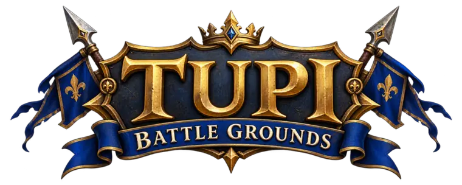
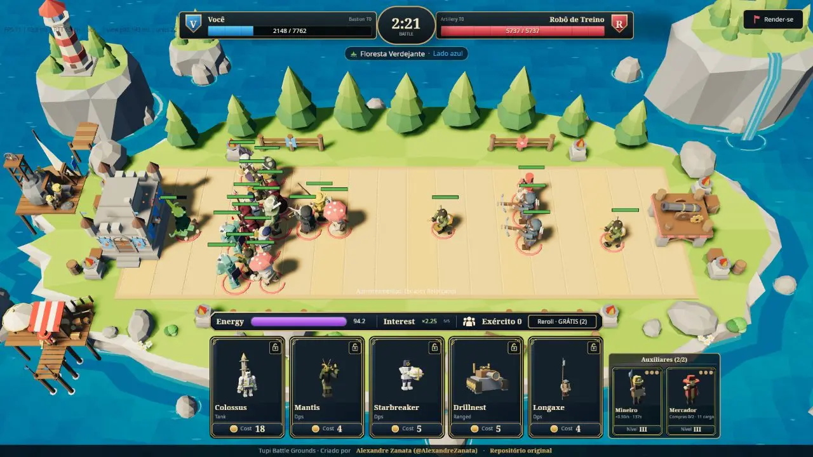
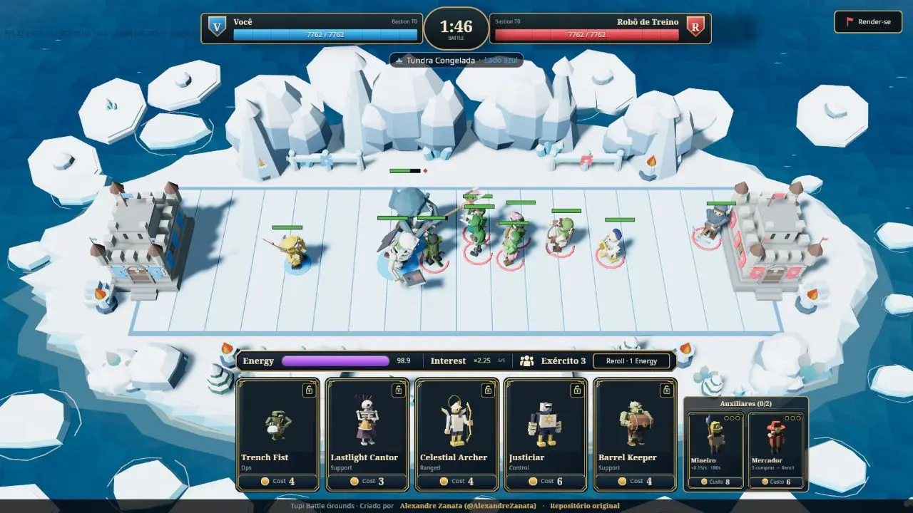
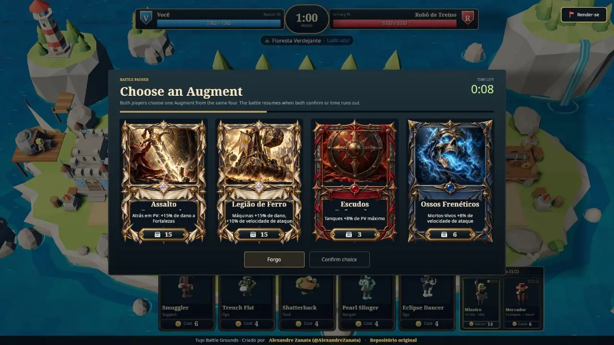
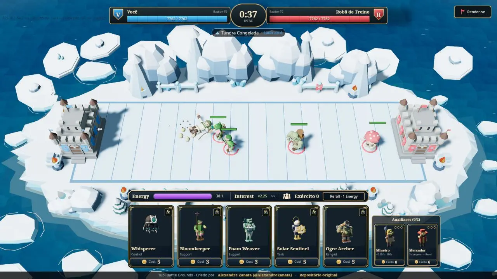
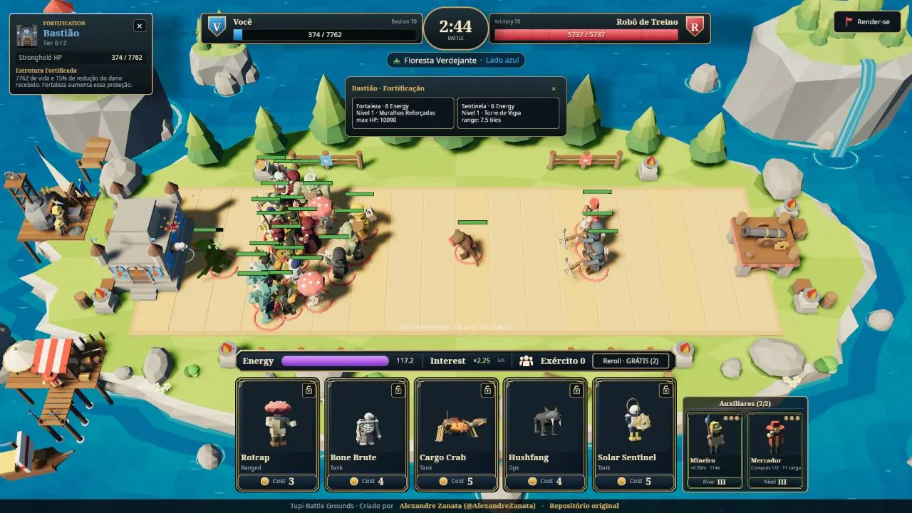
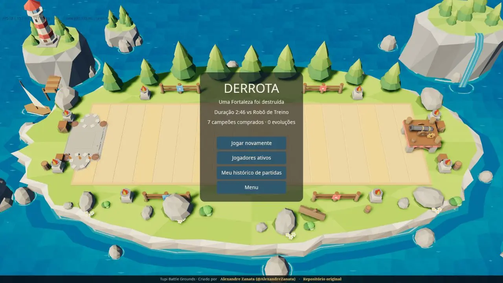
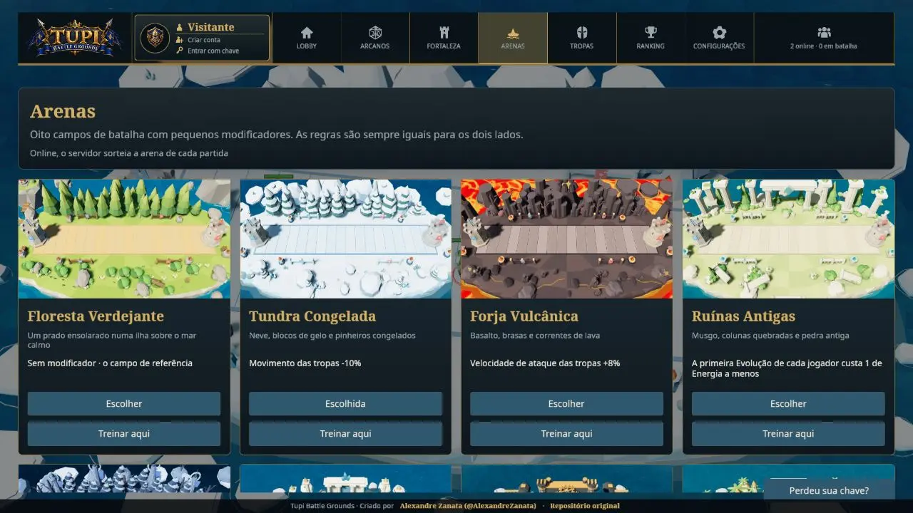
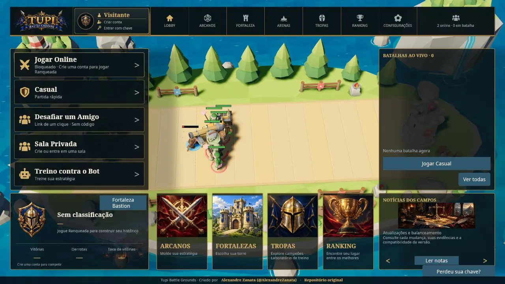

<p align="center">
  <a href="https://tupibg.com/">
    
  </a>
</p>

# Tupi Battle Grounds

**[▶ PLAY IN YOUR BROWSER — app.tupibg.com](https://app.tupibg.com/)**

**[Official website — tupibg.com](https://tupibg.com/)** ·
[How to play](https://tupibg.com/#how-to-play) ·
[Linux and Windows download options](https://tupibg.com/#play)

An open-source, real-time 1v1 strategy game for desktop browsers, Linux and
Windows. Build an army from a rotating five-offer `Shop`, combine `Faction`
`Synergy`, choose branching `Evolution`, and destroy the enemy `Stronghold`.
Combat runs automatically on one `BattleLine`; your purchases and timing decide
what reaches it. Online matches use an authoritative Rust server.



*Verdant Forest, the base Arena: a real Practice match with both War Auxiliaries
at tier III. All screenshots below come from the native Linux release build.*

## How to play

1. **Enter the game.** Open [app.tupibg.com](https://app.tupibg.com/) on a desktop
   browser, or visit [tupibg.com](https://tupibg.com/#play) for native download
   availability. Start with **Practice against the Bot**; choose an Arena and
   difficulty. Casual, friend challenges and private rooms are also available.
2. **Buy and send champions.** Click an affordable `Shop` offer. The champion
   enters the `BattleLine` and fights automatically. Manage `Energy` between
   purchases, `Evolution`, rerolls and saving for Interest.
3. **Inspect and evolve.** Click one of your champions to see its statistics
   and `Evolution` choices. Combine champions from a `Faction` to activate
   `Synergy`. Click your `Stronghold` to inspect its `Fortification` branches.
4. **Choose an Augment.** At each **War Council**, combat pauses and both players
   receive the same four `Augment` offers. Select one and confirm, or **Forgo**.
5. **Build your economy.** Hire **Mineiro** and **Mercador** in the auxiliary
   cards beside the `Shop`. Each has three tiers: Mineiro generates `Energy`;
   Mercador rewards champion purchases. Their construction and remaining
   benefits are visible during the match.
6. **Break the enemy Stronghold.** There is no match time limit. Destroying the
   opposing `Stronghold` ends the match; the result screen offers **Play again**.

Guests can learn and play Casual; an account is required for Ranked and saved
account progress. Keep your manual recovery key safe. Account recovery and
optional verified email are documented in the
[P75 account and social contracts](docs/planning/P75-CONTRACTS.md).

Full rules and the current balance proposals: [GAME-DESIGN](docs/GAME-DESIGN.md).

## Real gameplay gallery

These are actual frames from **0.1.4-colossus.5**, compiled with the **release**
profile for Linux. They show ordinary Practice gameplay, including a complete
Forest match through the result screen. No armies, `Energy` or auxiliary tiers
were injected. [Capture provenance and image details](docs/evidence/readme-linux-release.md).

### Frozen Tundra



### War Council and Augments



### Click a champion: statistics and Evolution



### Click the Stronghold: tower upgrades



### A complete match reaches its result



### Choose an Arena



*The Arena catalog shows additional fields; the gameplay photos above are from
actual Forest and Tundra matches.*

### The lobby



Explore more Arenas, champions and instructions on the
[official landing page](https://tupibg.com/#screenshots), or
**[play the web game](https://app.tupibg.com/)**.

**Development status: beta.** Competitive balance approval and remaining device
and visual acceptance are tracked separately. These Linux captures do not
certify Windows or browser pixel and motion parity. See
[RELEASES](docs/RELEASES.md), [ROADMAP](docs/ROADMAP.md) and the
[desktop UI contract](docs/ui/DESKTOP-UI-CONTRACT.md) for current limits.

### Android beta

Native Android runs the same game in landscape with compact touch controls.
The ARM64 beta requires Android 12/API31 or newer. Its automatic release uses
an inspected non-debuggable APK, a stable upgrade signature, SHA-256 checksums
and GitHub hosted-builder provenance. See [Android release notes](platform/android/RELEASE-NOTES.md)
and [official platform availability](https://tupibg.com/#play).
Online play requires the same live server contract; a public beta release is
not a claim of server activation, universal physical-device or16KB runtime
acceptance. Practice and Training remain available locally.

## Technology

Rust everywhere: a Bevy client compiled to WebAssembly (WebGL2), a shared
deterministic rules crate, and an Axum/Tokio authoritative server, deployed
as one binary plus static files on a single small VPS. Art is built in code
as stylized toy figurines — no rigging pipeline. Details:
[docs/ARCHITECTURE.md](docs/ARCHITECTURE.md) ·
[docs/DECISIONS.md](docs/DECISIONS.md).

```
crates/tbg-core    rules, content, bot, protocol (shared, deterministic)
crates/tbg-client  Bevy Linux/Windows and browser client
crates/tbg-server  authoritative game server
docs/              GAME-DESIGN, ARCHITECTURE, ROADMAP, DECISIONS, phases/
archive/           legacy Unity/Nakama/Python project (read-only)
```

## Build and check

Requires `rustup`; `rust-toolchain.toml` pins the compiler version and installs the
`wasm32-unknown-unknown` target.

Use [DEVELOPMENT](docs/DEVELOPMENT.md) and [VALIDATION](docs/VALIDATION.md) to choose
minimal checks per front and targeted tests at consolidation. Full suites are
explicitly requested, not the default. [RELEASES](docs/RELEASES.md) covers protected
automatic publication and [SCALING](docs/SCALING.md) covers measured capacity.

```bash
cargo fmt -p tbg-server -- --check
flock -n -E 75 "/tmp/tbg-validation-$(id -u).lock" \
  env CARGO_BUILD_JOBS=2 cargo check --locked -p tbg-server --bin tbg-server
```

## Run it locally

Follow [DEVELOPMENT](docs/DEVELOPMENT.md) for the native client and browser setup.
For a local browser build with Trunk already installed:

```bash
# Exit 75 means defer: another worktree owns the shared compilation slot.
flock -n -E 75 "/tmp/tbg-validation-$(id -u).lock" \
  env CARGO_BUILD_JOBS=2 bash -euc '(cd crates/tbg-client && trunk build); cargo build --locked -p tbg-server'
TBG_AUTH_ORIGINS=http://localhost:8080,http://127.0.0.1:8080 \
  TBG_DB=/tmp/tbg-development.sqlite3 TBG_STATIC_DIR=crates/tbg-client/dist target/debug/tbg-server
```

Open `http://localhost:8080/` in a desktop browser. Keep client and server on the
same match contract. Practice is local; online accounts and matches use the
configured server. Public ranking and patch notes are served at `/ranking/`
and `/api/patch-notes`. See [deploy/README.md](deploy/README.md) for deployment
operations and [RELEASES](docs/RELEASES.md) for publication and compatibility gates.

## Contributing

Humans and AI agents follow [AGENTS.md](AGENTS.md). Work is organized in
phases: [docs/ROADMAP.md](docs/ROADMAP.md) is the index, each phase has an
executable spec in [docs/phases/](docs/phases/).

## History

The previous Unity/Nakama/Python implementation is preserved under
[`archive/`](archive/ARCHIVE-MANIFEST.md) and in git tags
`pre-tbg20-20261027` and `pre-simplify-20261027`. Its game rules carry
over; its technology does not.

## License

[TBG Visible Attribution License 1.0](LICENSE), selected by the owner on
2026-10-31: use, modification and redistribution for any purpose, including
commercial use, require readable on-screen credit to Alexandre Zanata, with
links to [the creator](https://github.com/AlexandreZanata) and
[the original repository](https://github.com/AlexandreZanata/TBG-Tupi-Battle-Grounds).
The interface keeps those references visible during normal use. Third-party
materials retain their own licenses; see
[THIRD_PARTY_NOTICES.md](THIRD_PARTY_NOTICES.md).
