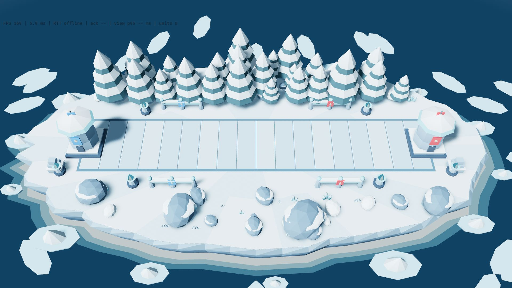
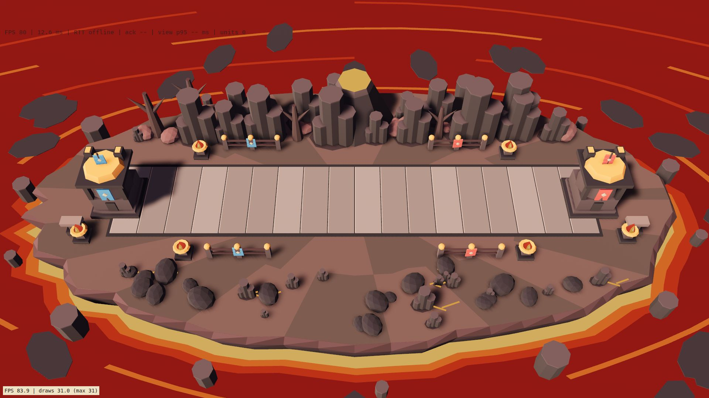
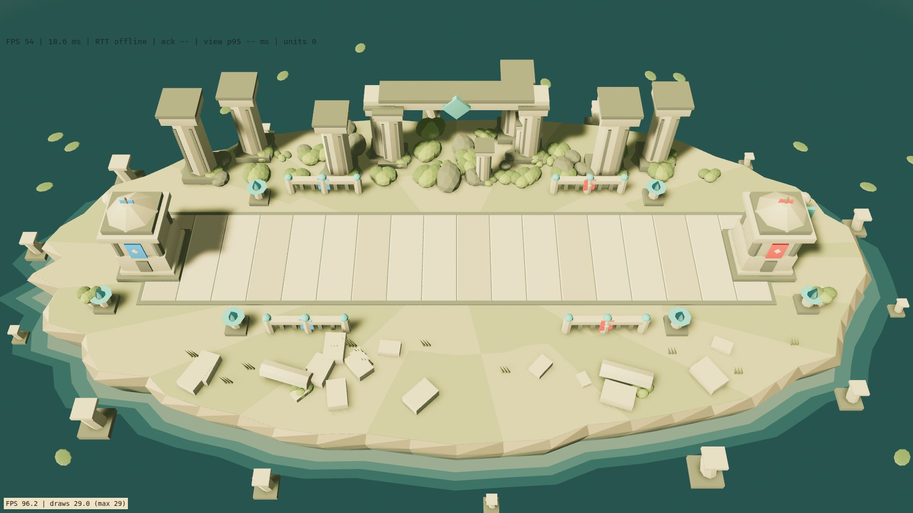
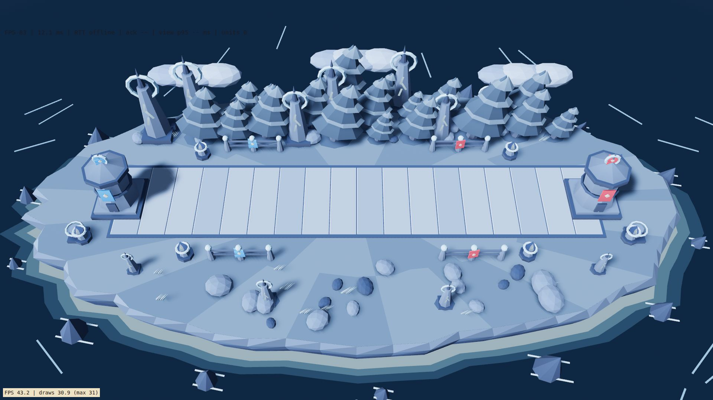

# Themed arenas — visual edition

The four environments below extend the P16-A arena with original procedural
assets. All five arenas use the same island outline, camera, Stronghold
positions and BattleLine dimensions. Verdant Forest is the unchanged default.
This is an art delivery: every arena has identical gameplay.

## Open the scenes

After `trunk serve` in `crates/tbg-client`, open:

- [Verdant Forest / arena 1](http://localhost:8000/?arena=forest).
- [Frozen Tundra / arena 2](http://localhost:8000/?arena=tundra).
- [Volcanic Forge / arena 3](http://localhost:8000/?arena=volcanic).
- [Ancient Ruins / arena 4](http://localhost:8000/?arena=ruins).
- [Storm Valley / arena 5](http://localhost:8000/?arena=storm).

`&stress=30&measure` adds the existing 30-unit visual workload and WebGL
diagnostics. It is a rendering scene, not a simulated match. For the live
lobby and Practice vs Bot, use `?theme=tundra` (or another theme identifier)
without `arena`. On native builds, use `TBG_THEME=tundra` and `TBG_ARENA=1`
for inspection. Unknown identifiers fall back to Verdant Forest. When both
parameters exist, `theme` wins. Selection is fixed when the page starts;
reload to inspect another environment.

These local preferences never select an authoritative match arena, are not
sent over the network, and need not match another client's preference.
Online arena assignment, selection menus and gameplay modifiers require a
separate rules/protocol phase.

## Frozen Tundra

Snow replaces the meadow; compact blue-gray paving keeps white troops
separate from the BattleLine. Ice-colored cliff strata meet a cold sea with
a frozen coastal shelf, polygonal ice floes and pointed icebergs. The shelf
is static rather than using the forest's foam animation.

Its kit contains snow-loaded firs with separate snow caps, capped boulders,
faceted crystal clusters, snowdrifts, frost grass, stacked cairns,
ice-and-snow railings and frost lanterns. The Strongholds have octagonal
stone drums and wide snow-covered conical roofs. Cool daylight, blue-white
fog and cyan lanterns complete the scene.

## Volcanic Forge

Ash and cooled rock replace grass; broad gray paving gives troops a calm
combat surface. Dark volcanic cliffs sit above a lava sea, orange shore
bands and floating crust plates. Offshore basalt stacks replace sea rocks.
Lava fissures remain outside the BattleLine.

Its kit contains clustered basalt organ pipes with exposed caps, a rear
volcanic crater with a bright inset, charred branch silhouettes, slag
boulders, low fissures, anvils, iron rails and forge bowls. Angular
Strongholds carry twin chimneys and a broad forge crown. Peach daylight
and a muted mauve atmosphere preserve legibility without a post-processing
pass, bloom, lava damage, smoke simulation or particle emitters.

## Ancient Ruins

Dry moss and muted earth replace the meadow; worn limestone tiles define
the BattleLine. Sedimentary walls meet a green still-water basin with
submerged column remnants and low aquatic growth.

Its kit contains octagonal columns with capitals and inset grooves, a rear
colonnade and crest-bearing lintel, fallen column drums, broken masonry,
small guardian statues, urn planters, moss shrubs, reeds, stone balustrades
and jade ritual bowls. The Strongholds become stepped temple watchposts
with corner columns. Warm ivory light and green-gray ambient tones keep
the scene in the same miniature family as arena 1.

## Storm Valley

Slate-colored heath and silver-blue paving replace the green island.
Blue-gray cliffs fall to dark open water, low linear whitecaps and jagged
offshore rocks. Flattened polygonal cloud banks sit beyond the island,
below the combat silhouettes.

Its kit contains wind-bent conifers with windward highlights, ring-crowned
conductor obelisks with static lightning inlays, silver grass swept in one
direction, slate boulders, coil fixtures, narrow metal railings and electric
lanterns. The Strongholds become banded storm watchtowers with ring finials.
Flags sway more strongly using the existing rigid-cloth animation. Cool
overcast light replaces the warm forest key. There are no lightning
flashes, screen shake, rain particles or dynamic weather simulation.

## Asset production and integration

The source assets are the Rust builders in
`crates/tbg-client/src/arena/themes/`. Each theme owns its own module;
`structures.rs` owns fittings and the three Stronghold damage pieces.
`theme.rs` contains only visual identities and palettes. These are generated
meshes, not image concepts, downloaded models or external asset placeholders.

1. Assemble the existing eight-sided cones/cylinders, ico-spheres, cuboids,
   frustums and rings through `art::mesh::Shape`.
2. Use the original `mesh::paint` for flat normals, vertex colors, height
   shading and the small baked rim. Add low contact discs where appropriate.
3. Place scenery from fixed PCG seeds inside the original dressing envelope.
   Rear props use the forest's original placement grid. Foreground objects
   are kept low and outside the width-3 BattleLine.
4. Merge opaque scenery into the terrain mesh. Lava fissures and electrical
   inlays share one extra unlit mesh where used; no per-prop draw entities.
   Surrounding surfaces and coastal bands reuse the two original unlit layers.
5. Reuse the eight shared lantern meshes and eighteen rigid cloth segments.
   Keep Stronghold damage thresholds and team banners intact.
6. Build only the chosen theme, log each layer's triangle count, then review
   desktop captures with the same camera and a 30-unit workload.

No new dependency, external service, texture atlas, shader, physics system
or asset download is introduced. Initialization may allocate geometry;
ambient animation continues to update bounded entities without per-frame
collections. Only one key light and the existing shadow cascade are used.

The implementation report, measured limits and review status are in
[the visual phase report](phases/ARENAS-visual-variants.md#phase-report).
Owner approval of the look remains a separate human checkpoint.
