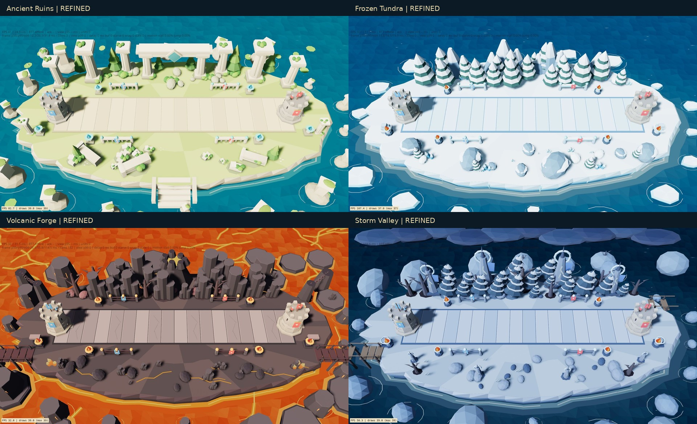
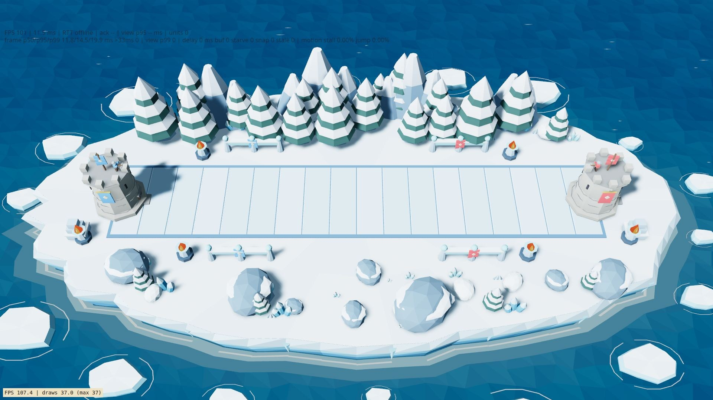
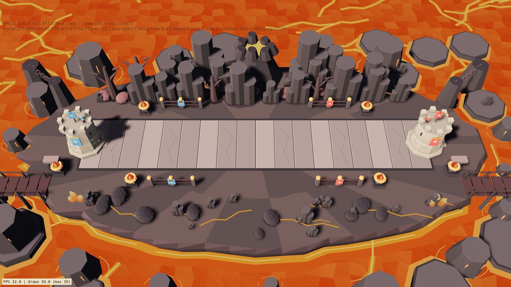
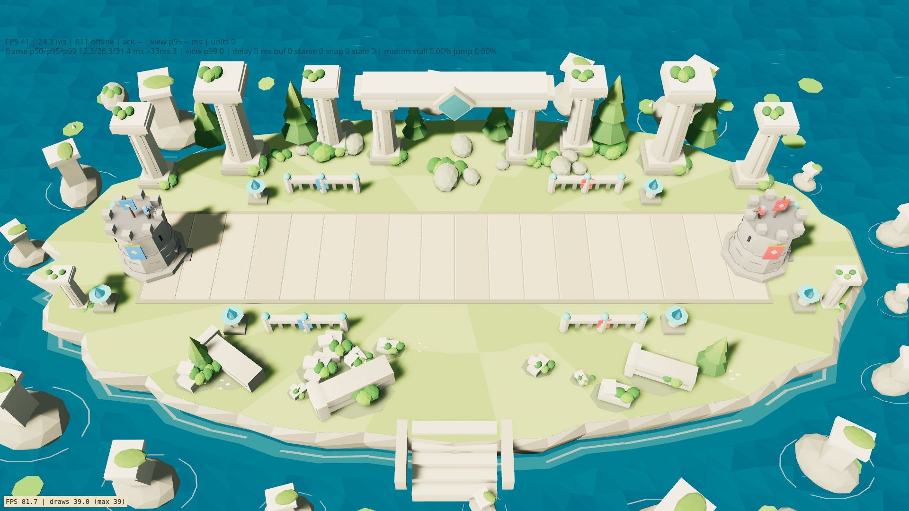
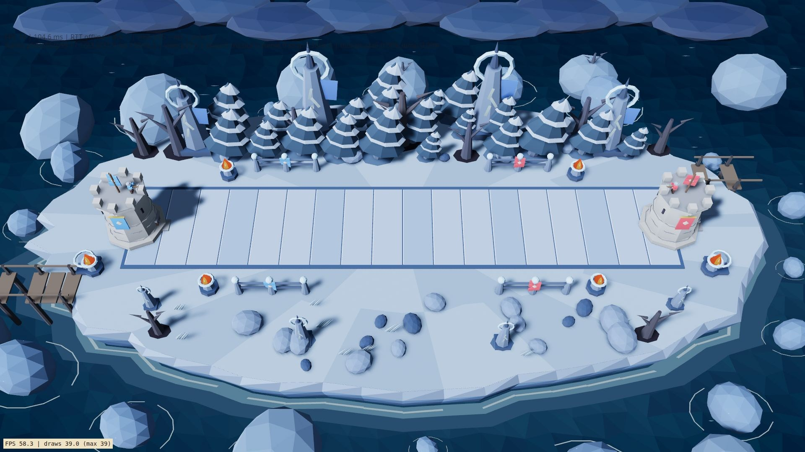

# Themed arenas — visual edition

The seven themed environments below extend the P16-A arena with original procedural
assets. All eight arenas use the same island outline, camera, Stronghold
positions and BattleLine dimensions. Verdant Forest is the unchanged default.
This catalog describes presentation. Current arena assignment and modifiers belong to [ARENAS-G](phases/ARENAS-gameplay.md); the visual refinement changes none of those rules.

The [2026-10-31 reference refinement report](art/ARENA-REFERENCE-REFINEMENT.md) contains the current before/after desktop captures, exact main base and scoped validation limits.

## Open the scenes

After `trunk serve` in `crates/tbg-client`, open:

- [Verdant Forest / arena 1](http://localhost:8000/?arena=forest).
- [Frozen Tundra / arena 2](http://localhost:8000/?arena=tundra).
- [Volcanic Forge / arena 3](http://localhost:8000/?arena=volcanic).
- [Ancient Ruins / arena 4](http://localhost:8000/?arena=ruins).
- [Storm Valley / arena 5](http://localhost:8000/?arena=storm).
- [Celestial Citadel / arena 6](http://localhost:8000/?arena=celestial).
- [Clockwork Bastion / arena 7](http://localhost:8000/?arena=clockwork).
- [Desert Relics / arena 8](http://localhost:8000/?arena=desert).

`&stress=30&measure` adds the existing 30-unit visual workload and WebGL
diagnostics. It is a rendering scene, not a simulated match. For the live
lobby and Practice vs Bot, use `?theme=tundra` (or another theme identifier)
without `arena`. On native builds, use `TBG_THEME=tundra` and `TBG_ARENA=1`
for inspection. Unknown identifiers fall back to Verdant Forest. When both
parameters exist, `theme` wins. Selection is fixed when the page starts;
reload to inspect another environment.

These local preferences never select an authoritative match arena, are not
sent over the network, and need not match another client's preference.
Online assignment and symmetric gameplay modifiers are active under
[GAME-DESIGN §12](GAME-DESIGN.md#12-arenas-active-values-proposed-arenas-g-d-55).

## Frozen Tundra

The editable Blender adaptation includes both animated auxiliary sites per seat. [Frozen Tundra Blender study](art/BLENDER-FROZEN-TUNDRA.md)

Snow replaces the meadow; compact blue-gray paving keeps white troops
separate from the BattleLine. Ice-colored cliff strata meet a cold sea with
a frozen coastal shelf, chipped ice slabs with irregular beveled edges and pointed icebergs. The shelf
is static rather than using the forest's foam animation.

Its kit contains snow-loaded firs with separate snow caps, capped boulders,
faceted crystal clusters, snowdrifts, frost grass, stacked cairns,
ice-and-snow railings, angular snowy ridges and cliff icicles. Cool daylight and blue-white fog contrast with warm orange braziers. Strongholds retain their selected kind, position and damage behavior in every arena.

## Volcanic Forge

The editable adaptation includes both animated mines and both merchant quays. [Volcanic Forge Blender study](art/BLENDER-VOLCANIC-FORGE.md)

Ash and cooled rock replace grass; broad gray paving gives troops a calm
combat surface. Dark volcanic cliffs sit above a lava sea, orange shore
bands and floating crust plates. Offshore basalt stacks replace sea rocks.
Lava fissures remain outside the BattleLine.

Its kit contains clustered basalt organ pipes with exposed caps, a rear
volcanic crater with a bright inset, charred branch silhouettes, slag
boulders, low fissures, anvils, iron rails and forge bowls. Chained outcrops and plank bridges dress the offshore rock. Selected kind-based Strongholds stay unchanged. Peach daylight
and a muted mauve atmosphere preserve legibility without a post-processing
pass, bloom, lava damage, smoke simulation or particle emitters.

## Ancient Ruins

[Editable Blender study and animated auxiliary previews](art/BLENDER-ANCIENT-RUINS.md)

Dry moss and muted earth replace the meadow; worn limestone tiles define
the BattleLine. Pale sedimentary walls meet a faceted turquoise basin with submerged column remnants, mossy islets and lily pads.

Its kit contains octagonal columns with capitals and inset grooves, a rear
colonnade and crest-bearing lintel, fallen column drums, broken masonry,
moss shrubs, conifers, flowers, a stepped water entrance, stone balustrades and turquoise ritual flames. The grouped temple arch carries a pale turquoise keystone. Selected kind-based Strongholds stay unchanged. Ivory sunlight and cooler fill keep stone distinct from vegetation.

## Storm Valley

Slate-colored heath and silver-blue paving replace the green island.
Blue-gray cliffs fall to dark open water, low linear whitecaps and jagged
offshore rocks. Overlapping dark polygonal cloud banks form the distant horizon beyond the island.

Its kit contains wind-bent conifers with windward highlights, ring-crowned
conductor obelisks with static lightning inlays, silver grass swept in one
direction, slate boulders, coil fixtures, narrow metal railings and electric
fixtures, broken docks and slate islets. Selected kind-based Strongholds stay unchanged; orange braziers provide warm accents.
Flags sway more strongly using the existing rigid-cloth animation. Cool
overcast light replaces the warm forest key. There are no lightning
flashes, screen shake, rain particles or dynamic weather simulation.

## Celestial Citadel

Ivory masonry, gold capitals and azure crystals frame a rear citadel with a
stepped entrance and two ceremonial guardians. Low crystal sanctuaries and
stone planters dress the foreground; waterfall islets extend the blue seascape.
The pale limestone lane keeps the existing dimensions and Stronghold positions.
**Proposed symmetric effect:** troop movement +8%.

## Clockwork Bastion

A dark iron foundry with brass battlements, furnace grilles and coastal cranes
stands behind a quiet slate BattleLine. Three slowly counter-rotating gears
reuse the existing mesh/material pipeline, carry ArenaScene ownership and do
not allocate per frame. Low boilers and riveted supply blocks stay off the lane.
**Proposed symmetric tradeoff:** troop attack speed +8%, movement −5%.

## Desert Relics

Warm sandstone columns and turquoise inlays form a stepped temple, flanked by
pointed obelisks and guardians. Coastal palms, pottery and sandstone outcrops
replace conifers and cold rock. The blue sea contrasts with the muted sand lane.
**Proposed symmetric effect:** base Energy regeneration −8%, added beside
Interest before fractional accumulation.

The three original owner reference PNGs are copied only to ignored local
`.local/arena-references/` with a SHA-256 manifest. They are not textures, scene
backgrounds, tracked assets or GitHub uploads. New catalog thumbnails are
exported from the real game renderer. See [the implementation report](phases/ARENAS-three-new.md).

## Asset production and integration

The source assets are the Rust builders in
`crates/tbg-client/src/arena/themes/`. Each theme owns its own module;
`structures.rs` owns fittings and the three Stronghold damage pieces.
`theme.rs` contains only visual identities and palettes. These are generated
meshes, not image concepts, downloaded models or external asset placeholders.

1. Assemble the existing eight-sided cones/cylinders, ico-spheres, cuboids,
   frustums and rings through `art::mesh::Shape`.
2. Use the original `mesh::paint` for flat normals, vertex colors, height
   shading and the small baked rim. Add low contact discs where appropriate.
3. Place scenery from fixed PCG seeds inside the original dressing envelope.
   Rear props use the forest's original placement grid. Foreground objects
   are kept low and outside the width-3 BattleLine.
4. Merge opaque scenery into the terrain mesh. Lava fissures and electrical
   inlays share one extra unlit mesh where used; no per-prop draw entities.
   Surrounding surfaces and coastal bands reuse the two original unlit layers.
5. Reuse the eight shared lantern meshes and eighteen rigid cloth segments.
   Keep Stronghold damage thresholds and team banners intact.
6. Build only the chosen theme, log each layer's triangle count, then review
   desktop captures with the same camera and a 30-unit workload.

No new dependency, external service, texture atlas, shader, physics system
or asset download is introduced. Initialization may allocate geometry;
ambient animation continues to update bounded entities without per-frame
collections. Only one key light and the existing shadow cascade are used.

The implementation report, measured limits and review status are in
[the visual phase report](phases/ARENAS-visual-variants.md#phase-report).
Owner approval of the look remains a separate human checkpoint.
