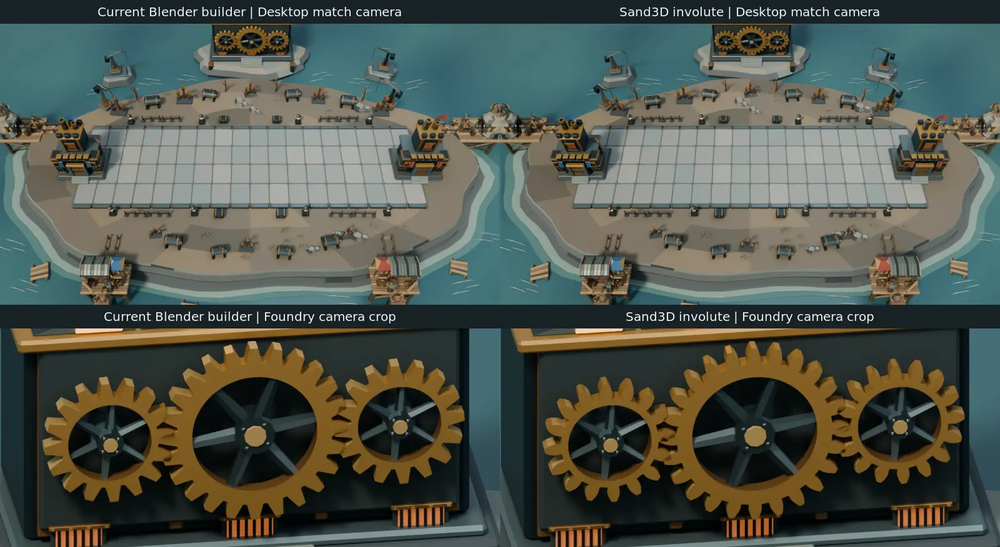

# AI-assisted Blender mesh workflow

Research reviewed on 2026-11-06. Sand3D and image-to-mesh tools are optional
authoring experiments for future assets and revisions. Blender 4.5 LTS is the
reference authoring environment. The [champion production guide](BLENDER-CHAMPIONS.md)
governs shipping geometry and the [desktop visual contract](../ui/DESKTOP-UI-CONTRACT.md)
governs in-game acceptance.

## Choose the tool by the work

- Pilot **Sand3D** for mechanical pieces and repeatable variants with holes,
  bevels, gears and named attachments. Compare against the TBG Blender
  helpers for the same brief.
- Explore organic character shapes with **TripoSR** and an original concept
  image to estimate mass and silhouette. Rebuild or retopologize the useful
  shapes in Blender and fit them to the existing TBG rig.
- For existing meshes and final optimization, use **Blender's built-in tools**
  first. Try **ReQuad** for a second automatic retopology result or
  **RetopoFlow** when an artist needs to place edge loops. These are geometry
  tools. The AI step is optional.

## Sand3D pilot for new parts and revisions

Sand3D is a Python library on Blender's `bpy`, with named solids, placement
frames and edits. A script can regenerate a part when dimensions change.
Sand3D 1.6.3 uses Apache-2.0 and supports Blender 4.5 with Python 3.11
or Blender 5.2 with Python 3.13. Use the Blender 4.5 line for the TBG
pilot. The package has no model weights. If an agent writes the script,
record the asset references and keep the reviewed script as editable source.
[Library license](https://github.com/Sandflow-ai/sand3d/blob/main/LICENSE) ·
[Release and requirements](https://pypi.org/project/sand3d/1.6.3/) ·
[API and examples](https://sand3d.sandflow.ai/api.html)

### Smoke test in a scratch directory

Set `blender_bin` and `blender_python` to the Blender 4.5 executable and its
bundled Python 3.11 executable. Run this on the authoring machine. The
wheel goes into the scratch directory and Blender supplies `bpy`.

```sh
blender_bin=/path/to/blender-4.5/blender
blender_python=/path/to/blender-4.5/4.5/python/bin/python3.11
pilot_dir=$(mktemp -d)

"$blender_python" -m pip install --only-binary=:all: --no-deps \
  --target "$pilot_dir/python" 'sand3d==1.6.3'

cat > "$pilot_dir/gear.py" <<'PY'
from pathlib import Path
import sys

pilot_dir = Path(__file__).resolve().parent
sys.path.insert(0, str(pilot_dir / "python"))

import sand3d as s3d

s3d.empty_scene()
s3d.units("mm")
gear = s3d.gear("Pilot gear", teeth=24, module=8, width=18, bore=10)
s3d.export(gear, str(pilot_dir / "pilot-gear.glb"))
PY

"$blender_bin" -b -t 2 --factory-startup --python-exit-code 1 \
  --python "$pilot_dir/gear.py"
```

Import `pilot-gear.glb` in a separate Blender scene and inspect its bounds
and normals. The example dimensions exercise the API. Derive production
dimensions from the existing asset before comparing. Sand3D defaults to
millimeters and exports in meters. Check the imported part against a known
dimension before placing it. A GLB carries the current pose and joint
metadata in node extras. Use Blender and the TBG kit for animation.
[Sand3D quickstart and export units](https://sand3d.sandflow.ai/quickstart.html) ·
[Export format details](https://github.com/Sandflow-ai/sand3d#export-glb-urdf-usd-stl)

### First comparison in Clockwork Bastion

1. Use the
   [existing gear builder](../../scripts/blender_clockwork_arena/clockwork_mechanics.py)
   and [Clockwork study](BLENDER-CLOCKWORK-BASTION.md) as the baseline. Work
   in a copy of the editable scene. Generate a 24-tooth rim and a 16-tooth
   variant from the same script.
2. Fit each rim to the existing axle and material palette. Reuse the spokes,
   hub, bolts, collections and animation drivers. Check the tooth silhouette
   and gaps between the wheels, including rotation, at the desktop match
   camera. An involute gear profile can read differently from the existing
   stylized teeth.
3. Run the existing `verify_clockwork.py` command from the
   [study's validation section](BLENDER-CLOCKWORK-BASTION.md#reproduce-and-validate)
   against the scratch scene. Compare the time to build, revise and fit both
   variants, including cleanup. Record setup time separately and compare
   evaluated triangle counts. Adopt Sand3D for a class of parts when the
   reviewed result saves time and meets the same visual and motion checks.

### Clockwork Bastion pilot results

On 2026-11-06, the pilot used Linux, Blender 4.5.15 LTS, Sand3D 1.6.3
and the checked-in Clockwork scene at `b480721d`. The baseline rebuilt
the existing stylized rims with `clockwork_mechanics.gear`. The candidate
used Sand3D's 20° involute `gear` with an 80 mm module, 186 mm thickness
and 1,382.4 mm and 921.6 mm bores for the 24- and 16-tooth rims. The fit
converted the millimeter geometry to scene units, rotated the extrusion
onto Y, centered the thickness, aligned the tooth phase and assigned the
existing brass colors. Both versions used the same wheel instances,
spokes, hubs, bolts and animation drivers.

**Evaluated geometry**

- The **24-tooth rim** went from 384 vertices and 768 triangles to
  944 vertices and 1,888 triangles, or 2.46× the triangles.
- The **16-tooth rim** went from 256 vertices and 512 triangles to
  672 vertices and 1,344 triangles, or 2.63× the triangles.
- The **three installed rims** went from 1,792 to 4,576 triangles.
  This count includes both 16-tooth followers.

**Work and processing time**

- The current script already handles both tooth counts. The Sand3D
  trial added a fit and material pass. The agent's elapsed time from
  the initial geometry probe to the saved fitted scene was 2 min 9 s,
  including writing and debugging the comparison harness. Installing the
  downloaded Python wheel in the scratch directory took 3.08 s. These are
  one-time trial observations. Artist time for a new design remains
  unmeasured.
- Median Blender processing for **both rims together**, over 11 warm
  trials on the same i7-13620H with two Blender threads, was **122.9 ms**
  for the current builder and **270.9 ms** for Sand3D including fitting
  and scene update. The generation portion was 3.4 ms and 136.3 ms
  respectively. The timed interval ended after the scene update. Blender
  startup, temporary object cleanup and rendering were outside it.

**Camera comparison**

Both variants used the saved scene's lighting, frame 391 (24.375 s) and
the same 12-sample Cycles settings. The desktop match camera rendered
at 1600 × 900. The Foundry camera provided a close-up of the same frame.
The involute teeth look narrower and rounder in the close-up. The current
rims have wider, squared-off tips and larger facets. All three wheels
remain readable above the BattleLine in the match frame. The two profiles
read similarly at that distance.



**Fit and motion**

The fitted bores, outer radii and axial bounds matched the baseline
within 0.000001 scene units. The existing `verify_clockwork.py` passed on
the scratch scene with 18 driver-angle checks, the 1.60-unit axle spacing
and the existing scenic and auxiliary checks. A separate planar profile
check sampled both drive/follower pairs at 16 steps per second over
29 seconds. Both meshes overlapped at all 930 samples with the current
driver phase. Peak overlap was 0.0211 square scene units for the baseline
and 0.0171 for Sand3D. This measures projected rim overlap, while the
existing verifier checks animation timing and placement.

**Decision for Clockwork Bastion.** Keep the current rims. The Sand3D
candidate added fitting work and 2,784 triangles across the installed
assembly for a profile change mainly visible in the close-up. The
comparison covers the Blender study on Linux at one rendered frame.

### Reuse on a champion

For a future rigid component or adjustment, a launcher guide such as the
[Abyss Harpooner's](BLENDER-CHAMPIONS.md#abyss-harpooner-undertow-herald-trench-lamplighter-and-foam-weaver)
is a suitable follow-up. Match the grip, bore and release point to the
existing `WeaponR` socket. Feed the resulting vertices and faces into the
existing [`Model.mesh`](../../scripts/blender_champions/geometry.py) path or
rebuild the reviewed shape with the current helpers. Bake the required
transforms into the mesh in the destination node's local coordinates.
The [exporter's mesh collector](../../scripts/blender_champions/export_study.py)
reads mesh-local vertex positions. Use the TBG palette
and lit/glow layers, then run the scoped `export_game.py -- <champion-id>`
command from the [production guide](BLENDER-CHAMPIONS.md#editable-source-and-export).

## TripoSR for character blockouts

Stability AI and Tripo AI publish the source and official pretrained
weights under MIT. The upstream example reports around 6 GB of VRAM with
default settings. The CLI also supports CPU inference. The upstream
`torchmcubes` dependency uses MPL-2.0. Install in a separate environment
using the upstream instructions, and record the source revision, weight
revision, PyTorch build and dependency versions before comparing.
[Publisher announcement](https://stability.ai/news-updates/triposr-3d-generation) ·
[Source and setup](https://github.com/VAST-AI-Research/TripoSR) ·
[Official weights](https://huggingface.co/stabilityai/TripoSR) ·
[Dependency license](https://github.com/tatsy/torchmcubes/blob/master/LICENSE)

1. Prepare an original TBG concept image with the whole silhouette visible,
   a correctly framed subject and a plain gray background. Keep the
   turnaround or design notes nearby to check occluded sides.
2. Run from the TripoSR checkout after setup. Point the CLI at a local
   snapshot of the official model to make the input revision explicit.
   The documented `--no-remove-bg` flag skips the default background
   removal step. Review all settings in the [upstream CLI](https://github.com/VAST-AI-Research/TripoSR/blob/main/run.py).

   ```sh
   python run.py /path/to/tbg-concept.png \
     --pretrained-model-name-or-path /path/to/pinned-triposr-weights \
     --no-remove-bg --model-save-format glb --output-dir /tmp/tbg-triposr
   ```

3. Import `0/mesh.glb` as a reference. Review the side, back and underside
   for guessed or fused shapes. Use it to compare the Base silhouette
   against the existing authoring method. Keep the raw output separately
   and reconstruct useful components on the named rig nodes. Fit the
   accessories and plan the four Evolution silhouettes in Blender.
   Apply the TBG palette to the finished components.
4. Compare with a Blender-only blockout for the same brief. Include the
   time spent correcting hidden geometry and preparing usable components.
   Keep the AI step for briefs where the reviewed result saves time.

## Retopology and optimization in Blender

The existing [Archer and Bone Brute comparison](BLENDER-CHAMPIONS.md#comparison-experiment)
is the TBG baseline. The joined and voxel-remeshed bodies had more
triangles than the modular versions. The Archer's sleeve and tunic also
stretched during the draw pose. Evaluate remeshing on individual pieces
and check the moving result before adopting it.

1. **Start with built-in cleanup.** Duplicate the source component. Remove
   stray geometry, dissolve degenerate edges, merge unintended duplicate
   vertices with a small threshold and inspect normals and non-manifold
   edges. Inspect intentional openings such as a muzzle before closing
   holes. Keep the rig attachment points and the original for comparison.
   [Blender mesh cleanup](https://docs.blender.org/manual/en/4.5/modeling/meshes/editing/mesh/cleanup.html) ·
   [Blender license and output FAQ](https://www.blender.org/support/faq/)
2. **Retopologize only where it helps.** For a dense organic reference,
   test Voxel Remesh on a copy if overlapping surfaces need a clean
   volume. Use QuadriFlow as a starting point for a quad layout. Retopology
   can change fine forms, attributes and boundaries. Inspect openings and
   material divisions after remeshing. For an area that needs controlled
   edge flow, create loops by hand over the source, with Shrinkwrap if
   useful. TBG's rigid parts move on existing nodes. Keep independent
   components, sockets and material boundaries when processing them.
   [Blender remeshing](https://docs.blender.org/manual/en/4.4/modeling/meshes/retopology.html) ·
   [Shrinkwrap API](https://docs.blender.org/api/4.5/bpy.types.ShrinkwrapModifier.html)
3. **Compare ReQuad with QuadriFlow on an isolated piece.** ReQuad runs the
   QuadWild bi-MDF solver inside a Blender extension. Its manifest lists
   Blender 4.2 or later, Linux x64 and Windows x64. The extension and
   bundled engine are GPL-3.0-or-later. Install an official release ZIP
   in a test profile and run both tools on the same triangulated copy.
   Compare edge flow, silhouette, material boundaries and hand cleanup.
   [Releases](https://github.com/mlstr0m/requad/releases) ·
   [Extension manifest](https://github.com/mlstr0m/requad/blob/main/blender_manifest.toml) ·
   [Bundled component licenses](https://github.com/mlstr0m/requad/blob/main/THIRD_PARTY_LICENSES.md)
4. **Use RetopoFlow for artist-directed topology.** The GitHub 3.x release
   line offers free downloads and the add-on code uses GPL-3.0-or-later.
   Try it when Blender's basic tools make loop placement slow, such as
   around eyes, mouths or armor rims. Use the GitHub build in a test
   profile and verify it with Blender 4.5 before standardizing on it.
   [Releases](https://github.com/CGCookie/retopoflow/releases) ·
   [Add-on license](https://github.com/CGCookie/retopoflow/blob/master/RetopoFlow.LICENSE)
5. **Use Instant Meshes when a standalone retopology tool helps.** The
   tool is BSD-3-Clause. Export an isolated piece as OBJ, set an approximate
   target density, guide the flow where needed and bring the result back
   into Blender for fitting and material assignment. Compare with QuadriFlow.
   [Tool and downloads](https://github.com/wjakob/instant-meshes) ·
   [License](https://github.com/wjakob/instant-meshes/blob/master/LICENSE.txt)
6. **Reduce geometry component by component.** Try Decimate Planar for broad
   flat areas and Collapse for dense curved pieces. Protect silhouette
   edges, joint clearances, material boundaries and small features that
   read at match distance. Compare evaluated triangle and vertex counts,
   exported `.tbgmesh` bytes and the result under the same camera and
   lighting. If the goal is better frame time, also measure the affected
   in-game case at consolidation and use measured frame time to establish
   the gain. [Blender Decimate modifier](https://docs.blender.org/manual/en/4.5/modeling/modifiers/generate/decimate.html)

## Commercial-use screening

The selection is for local authoring without a required paid service,
commercial-use fee or revenue cap for the listed workflow. Open licenses
still have terms. When redistributing tool code or weights, retain the
required notices and follow the applicable redistribution terms. Blender's
FAQ treats original meshes and scenes as the author's output. Track the
license of any content included in that output. GPU time and hardware
are separate from license fees. [Blender FAQ](https://www.blender.org/support/faq/)

Record the license and origin of the input concept, reference meshes and
textures separately from the code, weights and any auxiliary model.
Prefer original TBG references for both pilots. Sand3D example datasets
are separate from its Apache-2.0 library and some records carry their
own upstream attribution terms. Check those terms before reusing any
dataset asset. [Sand3D dataset license and attribution](https://huggingface.co/datasets/Sandflow/sand3d-objaverse#licence)

- Microsoft publishes the main **TRELLIS.2** code and weights under MIT.
  The default checkpoint configuration also names DINOv3 and BRIA
  RMBG-2.0. The loader initializes the configured background model.
  BRIA's free weights are non-commercial, so keep the default workflow
  out of this shortlist. A separate configuration would need its own
  dependency and weight review.
  [Model card](https://huggingface.co/microsoft/TRELLIS.2-4B) ·
  [Default configuration](https://huggingface.co/microsoft/TRELLIS.2-4B/raw/main/pipeline.json) ·
  [Loader](https://github.com/microsoft/TRELLIS.2/blob/main/trellis2/pipelines/trellis2_image_to_3d.py) ·
  [BRIA terms](https://huggingface.co/briaai/RMBG-2.0)
- The main **TripoSG** code and weights use MIT. The reference inference
  script loads BRIA RMBG-1.4, whose free weights are non-commercial.
  Reconsider only after reviewing a workflow that omits that dependency.
  [Weights](https://huggingface.co/VAST-AI/TripoSG) ·
  [Reference script](https://github.com/VAST-AI-Research/TripoSG/blob/main/scripts/inference_triposg.py) ·
  [BRIA terms](https://huggingface.co/briaai/RMBG-1.4)
- **Stable Fast 3D** uses Stability AI's Community License with a
  commercial revenue threshold. **Hunyuan3D 2.1** uses Tencent's
  Community License with territory restrictions. Both
  fall outside the requested licensing criteria.
  [Stability AI terms](https://github.com/Stability-AI/stable-fast-3d/blob/main/LICENSE.md) ·
  [Tencent terms](https://huggingface.co/tencent/Hunyuan3D-2.1/blob/main/LICENSE)
- Automatic part segmentation with **PartField** could help separate a
  reference mesh. The published NVIDIA license limits use to
  non-commercial purposes. Use Blender's component editing for this workflow.
  [PartField license, section 3.3](https://github.com/nv-tlabs/PartField/blob/main/LICENSE)

## Record a pilot result

Record the asset and version, input provenance, tool and weight versions,
baseline and candidate hands-on time, evaluated mesh counts, exported
bytes when applicable, camera views, and failed cases. For a champion,
check Base, A1, A2, B1 and B2 and the affected grips, sockets, motion and
release or strike timing. Review the same asset on both seats and keep
the feet circle as the allegiance marker.

If a change ships in the game, update the
[desktop visual contract](../ui/DESKTOP-UI-CONTRACT.md) in the same change
and queue the affected comparisons for Linux, Windows and desktop web
under [local validation](../VALIDATION.md). Use the existing champion
loader test for exported mesh changes at consolidation. Record pending
targets separately from observed results. The Clockwork result above
covers two fitted rims in one Blender study. The character and retopology
workflows still need their own trials.
