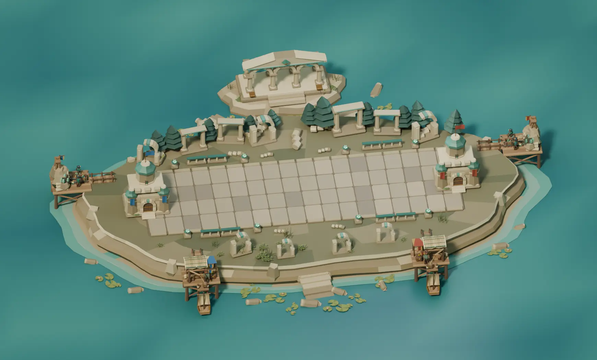
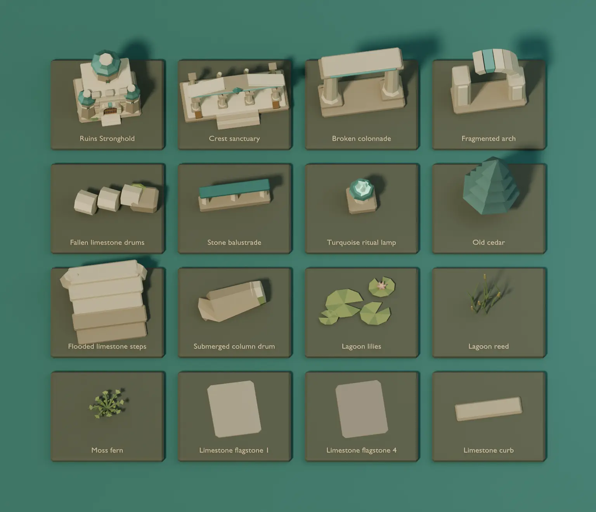
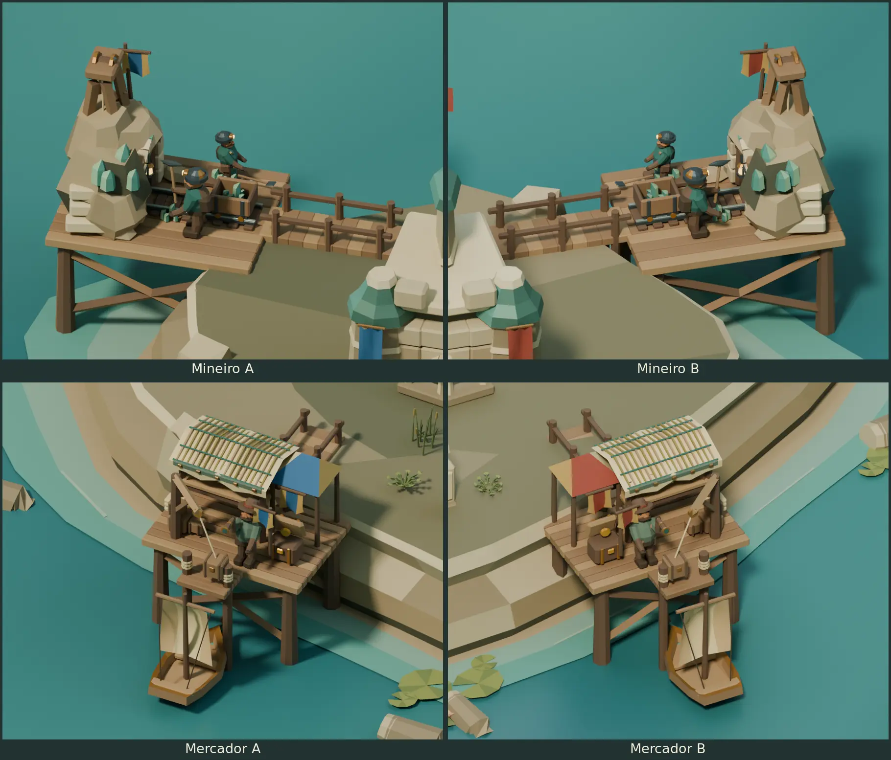
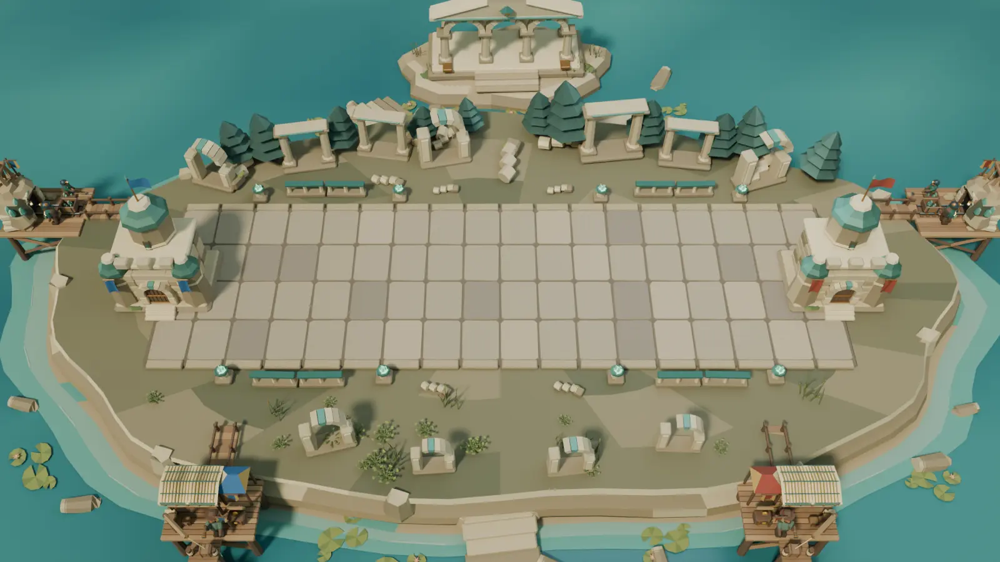

# Ancient Ruins Blender study

Ancient Ruins is the fourth arena in the catalog. The editable scene
uses the [Verdant Forest](BLENDER-FOREST-ARENA.md) layout, the
[Frozen Tundra](BLENDER-FROZEN-TUNDRA.md) offshore mounts and the
[Volcanic Forge](BLENDER-VOLCANIC-FORGE.md) component workflow.
The BattleLine is 16 × 5 units at floor height zero. The Strongholds
sit at X −0.9 and 16.9. The desktop match camera uses a 35° vertical
field of view.



[Editable Blender project](../media/blender-ruins-arena/ancient-ruins.blend)

## Model and assemble the arena

1. Shape the moss plateau, banded limestone cliff, shallows and lagoon
   as separate collections. Color the lagoon by vertex so the broad
   depth changes read without texture maps.
2. Bevel four reusable flagstone variants and place them over the
   road bed in 72 instances. Use muted tones and fine wear marks in
   the playable strip.
3. Assemble each Stronghold from ashlar blocks, a segmented stone
   arch, a recessed oak gate and octagonal towers with patinated
   crowns. Place the architecture pennants on separate mounts.
4. Build the crest sanctuary on a separate rock islet from a
   stepped podium, fluted shafts, individual arch stones and a
   jade-inlaid lintel. Frame the rear plateau with broken colonnades
   and cedars. Use fallen column drums, balustrades, ritual lamps,
   flooded steps, reeds and notched lily pads along the coast.
5. Place four mirrored auxiliary precincts. Parent the carved adit
   masonry to the rising mine outcrop, the split-reed canopy to
   the awning and the carved bronze-and-jade prow to the boat.
   The shared auxiliary rig moves each new detail with its parent.

The project has 26 reusable asset collections. Sixteen appear in
the component board. The workers use the same palette on both
sides, with seat colors on the architectural pennants.



## Mineiro and Mercador on both sides

Mineiro A and B work the outside quarry platforms. Mercador A and B
use the two front quays. Each site has a bridge to the plateau and
uses the shared 29-second construction, upgrade and work sequence.
The mine views show tier three and the quays show the crane lifting
a parcel from the moored boat.



## Reproduce and validate

Run from the repository root with Blender 4.5 LTS.

```sh
blender -b -t 4 --python-exit-code 1 --python scripts/blender_ruins_arena/ruins_study.py -- /tmp/tbg-ancient-ruins
blender -b /tmp/tbg-ancient-ruins/ancient-ruins.blend -t 2 --python-exit-code 1 \
  --python scripts/blender_ruins_arena/verify_ruins.py -- /tmp/tbg-ancient-ruins/validation.json
```

The generator writes the editable project, seven PNGs and
`metrics.json`. Open `01  Ancient Ruins` for the six cameras and
scrub the timeline to see construction and deliveries. Open
`02  Ruins component board` for the individual assets.

Blender 4.5.15 on Linux reopened the saved scene and checked the
camera, Stronghold anchors, 72 flagstones and four shore approaches.
The verifier tested 1,732 scenic bounds and 10,584 auxiliary bounds
across 18 timestamps for BattleLine clearance. It checked mine
construction, both pick contacts, market upgrades, berth, parcel
hoist, chest and departure. It compared 112 sampled hull and prow
bounds against lagoon obstructions. The assembled study contains
74,510 evaluated triangles, including the four auxiliary precincts.
The saved Volcanic Forge scene also passed the shared verifier.



The reference match camera crops part of the offshore sites and
the top of the sanctuary. The overview and close-ups show the
complete models. Runtime integration, authoritative work and
delivery events, payouts and desktop platform comparisons are pending.
