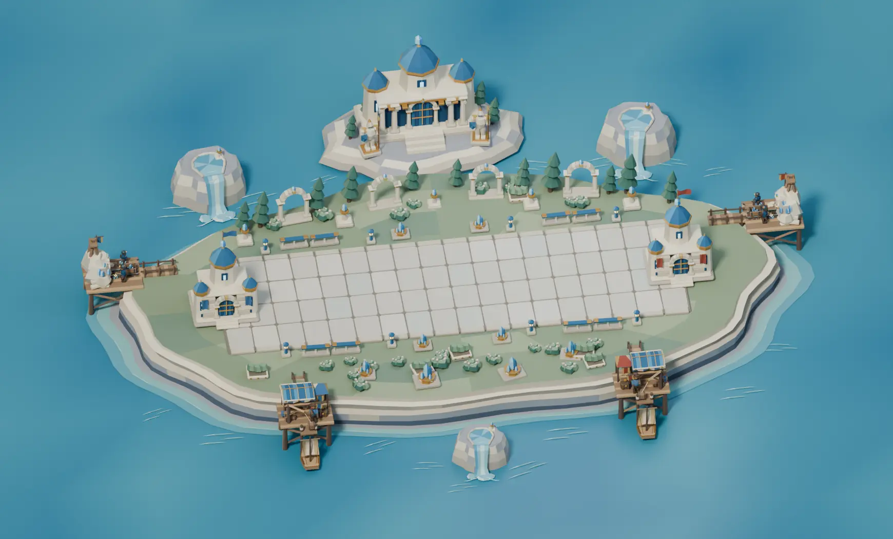
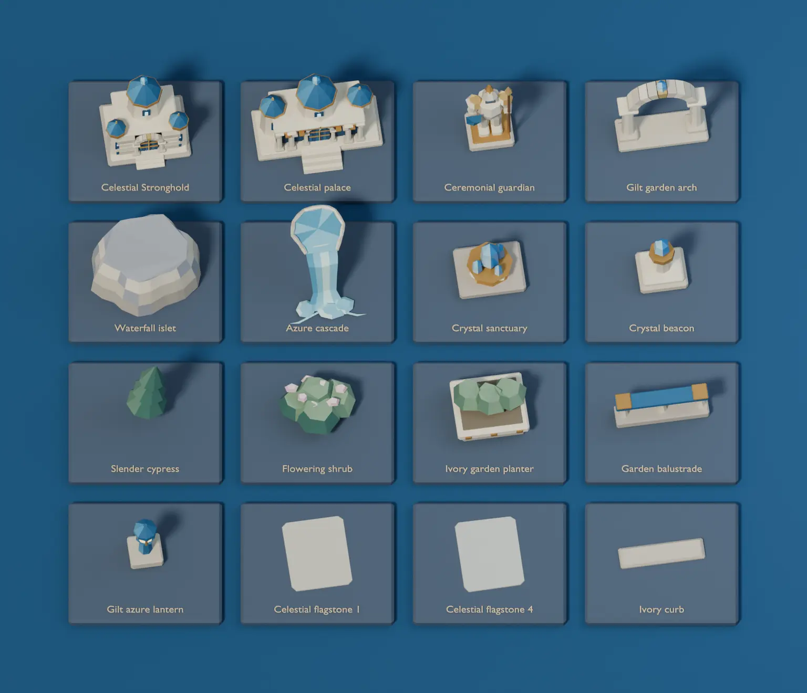
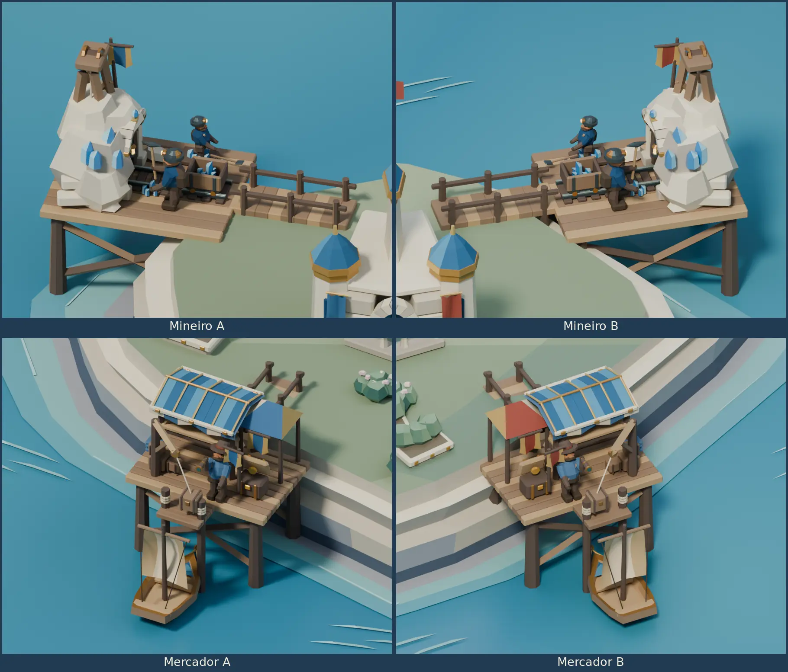
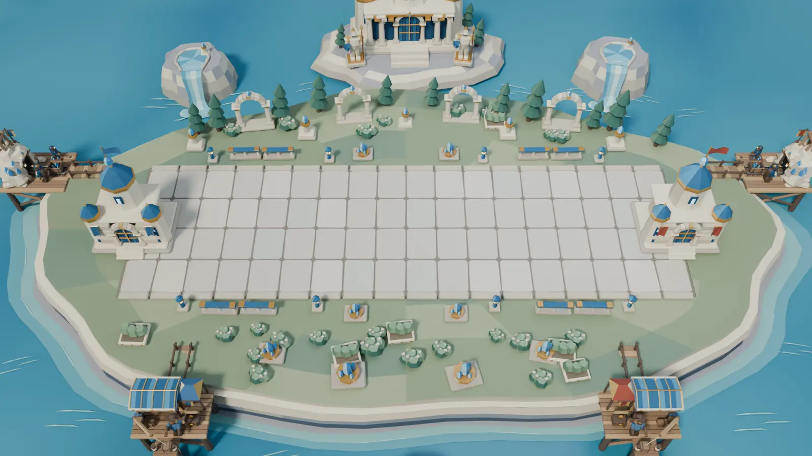

# Celestial Citadel Blender study

Celestial Citadel is the sixth arena in the catalog. It uses the
[Verdant Forest](BLENDER-FOREST-ARENA.md) layout, the
[Frozen Tundra](BLENDER-FROZEN-TUNDRA.md) offshore mounts and the
[Storm Valley](BLENDER-STORM-VALLEY.md) component workflow.
The BattleLine is 16 × 5 units at floor height zero. The Strongholds
sit at X −0.9 and 16.9. The desktop match camera uses a 35° vertical
field of view.



[Editable Blender project](../media/blender-celestial-arena/celestial-citadel.blend)

## Model and assemble the arena

1. Build the high garden plateau, terraced ivory cliffs, sunlit shore
   shelf and clear blue sea as separate collections. Give the sea a
   vertex-color depth gradient and separate thin ripple meshes.
2. Dress four pale limestone flagstone variants and place 72 instances
   above the BattleLine foundation. Fit the separate curbs, blue
   balustrades, lanterns and low crystal sanctuaries around the lane.
3. Build the Strongholds from ivory blocks, cut arches, recessed blue
   doors and octagonal turrets. Fit blue roof sections, gilt capitals,
   crystal finials and separately mounted architectural pennants.
4. Assemble the offshore citadel from a stepped island, palace hall,
   three roofed towers and individual gate stones. Place two ceremonial
   stone guardians beside its stairs. Build each guardian from boots,
   legs, breastplate, arms, helmet, shield and spear.
5. Fit three separate waterfall sheets to three matching terraced
   islets. Add a spring pool and a stone lip at the top of each sheet,
   foam at the foot and thin sea ripples. Dress the plateau with
   cypresses, flowering shrubs and ivory planters.
6. Fit new quarry portals, gilt azure market roofs and ceremonial
   prows to the existing auxiliary rigs. Parent each portal to the
   rising quarry, each roof to the awning and each prow to its boat.

The project contains 27 reusable collections. Sixteen appear on the
component board. The two seats share worker materials. Architectural
pennants carry the seat colors. The waterfalls are static sculpted meshes.



## Mineiro and Mercador on both sides

Mineiro A and B work the outside quarry platforms. Mercador A and B
use the front quays. The four bridges land on the plateau. Both sides
reuse the 29-second Forest construction, upgrade and work timeline.
The mine views show tier three. The quay views show the crane
lifting a parcel from the moored boat.



## Reproduce and validate

Run from the repository root with Blender 4.5 LTS.

```sh
blender -b -t 4 --python-exit-code 1 --python scripts/blender_celestial_arena/celestial_study.py -- /tmp/tbg-celestial-citadel
blender -b /tmp/tbg-celestial-citadel/celestial-citadel.blend -t 2 --python-exit-code 1 \
  --python scripts/blender_celestial_arena/verify_celestial.py -- /tmp/tbg-celestial-citadel/validation.json
```

The generator writes an editable project, seven PNGs and
`metrics.json`. Open `01  Celestial Citadel` for the six cameras
and scrub the timeline for construction, upgrades and work. Open
`02  Celestial Citadel component board` for the separate samples.

Blender 4.5.15 on Linux reopened the final project and checked the
72 flagstones, camera, Stronghold anchors and four bridge approaches.
The verifier tested 939 scenic bounds and 10,350 auxiliary bounds
over 18 timestamps for BattleLine clearance. It checked construction,
both pick contacts, market upgrades, both berths, parcel hoists,
chest motion and departure. The 112 sampled hull and prow bounds
cleared the waterfall and citadel islands. All three waterfall sheets
match their island placements and scales. The study contains 73,940
evaluated triangles, including all four auxiliary precincts.



The reference match camera crops parts of the outside posts and the
rear palace. The overview and close-ups show the complete auxiliary
sites. Runtime integration, authoritative work and delivery events,
payouts and desktop platform comparisons are pending.

The next arena is the [Clockwork Bastion Blender study](BLENDER-CLOCKWORK-BASTION.md).
