# Blender champion production

**Required for new champions.** Read [Art Direction](../ART-DIRECTION.md)
and the [desktop visual contract](../ui/DESKTOP-UI-CONTRACT.md) before
authoring. The feet circle is the champion's sole allegiance marker. The model,
weapon, fletching, clothes, glow and every Evolution use the same geometry
and intrinsic colors for both seats. Remove ownership geometry from the
source, such as chest badges, arm pennants and team tabards. Preserve
intrinsic material colors and the independent status outline.

## Required Evolution branch identity

Before modeling a new champion, choose a distinct intrinsic accent
palette and a visual equipment or anatomy motif for each Evolution
branch. A1 and B1 must each add or replace a readable modeled piece.
A2 and B2 must visibly develop their branch with another modeled
addition or a recognizable silhouette change. Size or color changes
alone do not satisfy this rule. Choose pieces that express the kit,
such as Old Finn's catch and net or the Antidote Brewer's still and
bandolier.

Check the five forms side by side and at the desktop match scale.
Preserve the champion's recognizable Base identity, existing rig and
combat anchors. All branch colors and geometry match across seats.
The feet circle carries allegiance.

## Editable source and export

The initial roster and the first expanded-roster figures use component modeling.
Each Blender object is named for its physical piece and has a material and
a named rig node. The source is in
[scripts/blender_champions](../../scripts/blender_champions).
Blender 4.5.15 LTS was used for these exports.

1. Build the base in joint-local, Y-up game coordinates in a champion
   model module. Use supported bevels for metal, profile lofts for
   cloth and faces, and tapered tubes for curved bones and bow limbs.
   Keep the skeleton, sockets and grip points from `art/rig.rs` and the
   champion kit. `rig.py` maps game +Y up and +Z forward to Blender +Z
   up and -Y forward.
2. Place separate components on the named v2 bones, springs and sockets.
   Archer has a tailored doublet, piped hood, laminated bow and neutral
   fletching. Bone Brute has a sculpted skull, tapered ribs and a beveled
   cleaver. In the base, chest-local clavicles end at the shoulder pivots,
   and the burial sash shares Hips with the belt.
3. Author Base, A1, A2, B1 and B2 in that order. Keep branch identity in
   quivers, cloaks, bows, shields and blades. Archer's bow uses the kit's
   per-form half lengths and -0.10 depth at each tip. The game still
   animates StringTop, StringBottom and Nock. Reaper uses the current
   longer arm rest offsets and scythe tip.
4. Export from the repository root. The Blender exporter applies the
   evaluated bevels, triangulates surfaces, keeps corner normals, and
   merges geometry by joint and lit/glow layer. TBG4 stores a five-form
   length table, quantized rest offsets, 16-bit positions, normals and
   indices, and RGB vertex colors. TBG5 uses the same layout and records
   all 26 nodes for kits that model geometry on the last three sockets.
   The first 23 nodes retain the same order and encoding. Blender and
   the runtime both check the reserved allegiance colors. The runtime also checks the joint
   offsets against the current kit before loading a form.

```sh
blender -b -t 2 --python-exit-code 1 --python scripts/blender_champions/export_game.py
```

Pass champion IDs after `--` to export only those champions.

5. Use the same FigureLibrary entry for the Laboratory, BattleLine,
   Evolution swap and inspection. Confirm stance, movement, weapon
   attachment, release/strike, hit and death at match distance and in
   the Laboratory. Use both seats and confirm that the feet circle
   carries allegiance independently of status. Record scoped desktop
   checks in the visual contract.

## Comparison experiment

For editable .blend files and base GLBs, run:

```sh
blender -b -t 2 --python-exit-code 1 --python scripts/blender_champions/export_study.py
blender -b -t 2 --python-exit-code 1 --python scripts/blender_champions/render_study.py
```

The study writes `scripts/exports/` and the render step writes the two
comparison PNGs in `scripts/exports/renders/`. The study builds the earlier
prototype rig and saves separate collections for each form and method. The generated
comparison joins designated body volumes, applies 0.0165 voxel remesh,
two relaxation passes and decimation, then transfers material colors and
up to two weights from nearby source joints. Gear stays rigid. The
generated Archer stretched between its sleeve and tunic in a draw pose,
and both generated bodies had higher triangle counts. The game uses the
modular Blender pieces. This also keeps the existing kit pose and
authoritative battle event path.

`export_game.py` produces the game assets. The editable
scenes and intermediate build outputs are generated locally.
The Archer export has 5,058–5,464 triangles per form and occupies 436,544
bytes. The Bone Brute export has 6,384–6,998 triangles per form and occupies
571,208 bytes. These counts exclude runtime bow string and projectile meshes.

## Authoring renders

The Blender Cycles renders show the source design in the rest pose. Each
image has the modular model on the left and the voxel comparison on the
right. The game uses the left-hand method with its shared materials and
animated weapon sockets.

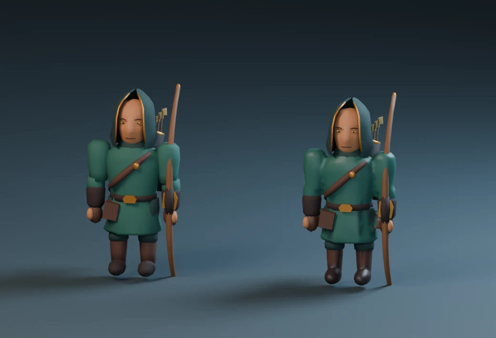

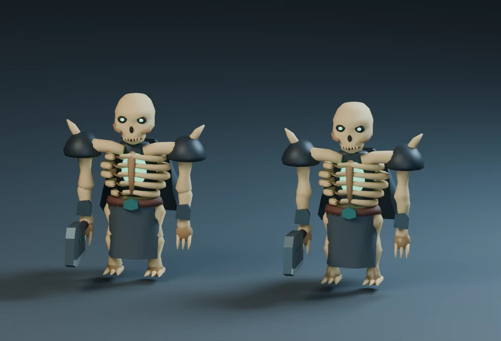

## Shieldbearer and Hexer

The Shieldbearer uses a quilted gambeson, curved armor, a forged kite
shield and a diamond-section sword. The A branch moves from a kettle
helm and wider shield to a great helm and crenellated tower shield.
The B branch adds a cavalry mantle, plume, wing crest and longer sword.
Keep the shield face along the offhand's +X axis. The blade point stays
at weapon-local Z 0.62, 0.72 or 0.82 according to the kit.

The Hexer uses a tattered robe, crooked hat and skull lantern in a
forked blackthorn staff. Withering and Doom add a broken halo and
gold thorns. Plague and Pestilence add a green censer and a stitched
plague beak. The staff mouth stays at the kit's cast muzzle
`(0.0, 0.88, 0.09)`. The runtime renders ritual violet and soul green
in its separate glow layer.

The exports contain 3,418–4,110 triangles per Shieldbearer form and
4,160–4,568 per Hexer form. The files are 360,732 and 313,317 bytes,
respectively. Render the ten forms with the same Blender studio setup.

```sh
blender -b -t 2 --python-exit-code 1 --python scripts/blender_champions/export_game.py -- shieldbearer hexer
blender -b -t 2 --python-exit-code 1 --python scripts/blender_champions/render_lineup.py -- shieldbearer hexer
```

The renders are in Base, A1, A2, B1, B2 order, from left to right.

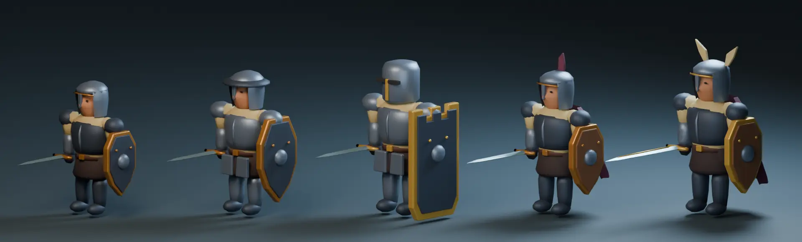

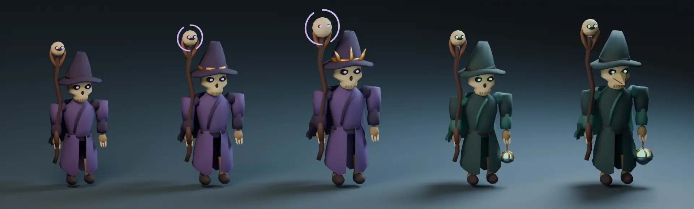

## Sawbot and Bloomkeeper

The Sawbot has a riveted boiler, piston limbs, a furnace eye and a
directional toothed disk. Overclock adds copper, hot vents and, at A2,
a second saw with paired exhausts. Plating adds steel guards and, at
B2, horns and a larger disk. The disks are centered at hand-local
Y −0.13 and rotate around the existing hand axes. The right-hand
tooth radius follows the strike profile at 0.16 or 0.22. The studio
lineup tilts the arms to show the face of each saw.

The Bloomkeeper has a carved lightwood face, folded leaves and a petal
skirt. The A branch adds shoulder blossoms and a flowering bough on
the back spring. The B branch adds bark guards, thorns and, at B2, a
thorn crown and amber seed. The flower and seed share the cast muzzle
at weapon-local `(0.0, 0.90, 0.03)`.

The exports contain 3,828–4,536 triangles per Sawbot form and
3,094–3,924 per Bloomkeeper form. The files are 424,161 and 248,184
bytes, respectively.

```sh
blender -b -t 2 --python-exit-code 1 --python scripts/blender_champions/export_game.py -- sawbot bloomkeeper
blender -b -t 2 --python-exit-code 1 --python scripts/blender_champions/render_lineup.py -- sawbot bloomkeeper
```

The renders are in Base, A1, A2, B1, B2 order, from left to right.

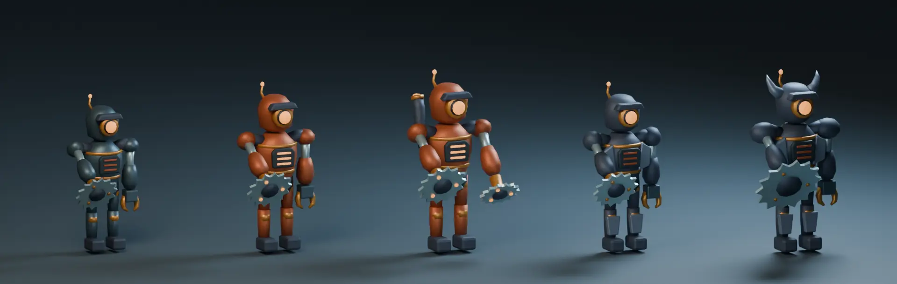

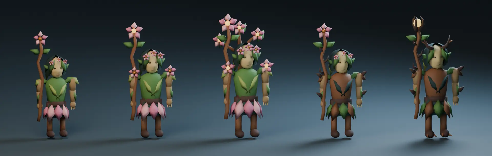

## Siege Walker and Rootcaller

The Siege Walker's face is sculpted as one shell with defined cheeks,
recessed eyes and fitted tusks. The helmet visor clears the eye line.
The shoulder bombard has a tapered steel barrel, a separate dark bore
liner, a carved stock and a braced support grip. Longshot adds a
centered telescope. Artillery gets twin bores, Shrapnel a flared bell,
and Concussion a shell drum. The bore axis stays at weapon-local Y 0.26.
Keep the five muzzle planes, the support grip at `(0.28, 0.10, 0.36)`
and the native animated reload lever on its own socket. The lineup shows
the shoulder carry.

The Rootcaller has a fluted trunk, jointed root claws, an amber eye glow
and moss beard. The A branch adds vines and a crown of roots. The B
branch adds a broad cap, glowing spores and a fungal cluster on the
back spring. The middle claw on the right-hand socket ends at
`(0, -0.06 - length, 0.04)`, with the kit's per-form claw length.

The refined Siege Walker export has 5,234–6,348 triangles per form and
uses 534,937 bytes. This excludes the native reload lever. The Rootcaller
has 2,386–5,692 triangles per form and uses 253,790 bytes.

```sh
blender -b -t 2 --python-exit-code 1 --python scripts/blender_champions/export_game.py -- siegewalker rootcaller
blender -b -t 2 --python-exit-code 1 --python scripts/blender_champions/render_lineup.py -- siegewalker rootcaller
```

The renders are in Base, A1, A2, B1, B2 order, from left to right.

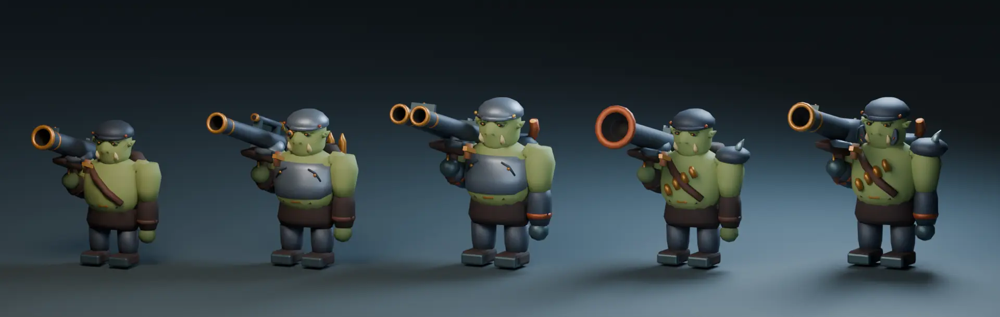

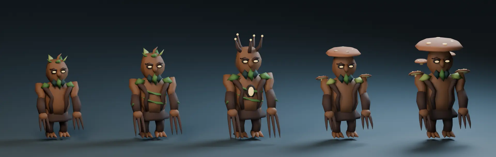

## Nester and Rampart

The Nester wears a broadleaf hood and carries a split-willow basket.
Brood grows the clutch and A2 builds a woven straw skep with amber
brood pods. The B branch changes the clutch from green venom eggs to
thorned violet eggs. Keep the basket on BackSpring and the seed
centered at the existing cast point, weapon-local `(0, 0.03, 0.06)`.

The Rampart carries an oak wall with riveted crossbeams over layered
armor. Bastion adds reinforced edges and A2 adds stone crenellations.
The B branch adds wall spikes and a heated forearm ram at B2. Keep
the wall chest-local with its rail at the existing left-hand grip.
The right-hand contact plate remains at hand-local Y −0.15.

The Nester export has 3,720–4,568 triangles per form and uses 276,915
bytes. The Rampart has 4,790–5,546 triangles per form and uses 496,172
bytes.

```sh
blender -b -t 2 --python-exit-code 1 --python scripts/blender_champions/export_game.py -- nester rampart
blender -b -t 2 --python-exit-code 1 --python scripts/blender_champions/render_lineup.py -- nester rampart
```

The renders are in Base, A1, A2, B1, B2 order, from left to right.

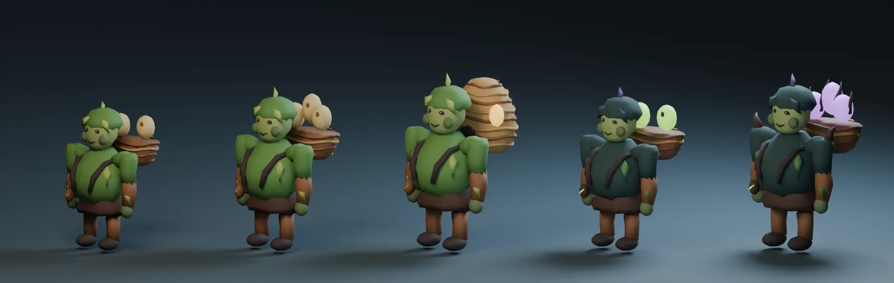

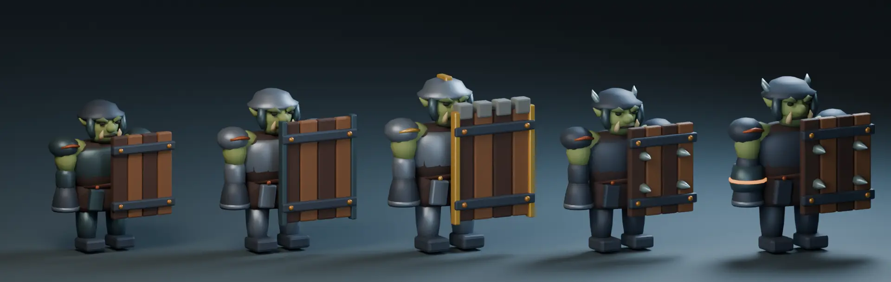

## Longaxe and Farwatch

Longaxe has a stitched ochre gambeson, a fitted kettle helmet and a
forged ash poleaxe. The A branch adds plate, a broader edge and a gilded
crescent. The B branch adds a twin blade, then a hook and horned helmet.
Keep the working edge at weapon-local `(0, 1.728, 0.22)` and the existing
two-hand grip. The lineup tilts the polearm to show the whole haft.

Farwatch has a slate field coat, fitted gloves and a cranked arbalest
with laminated steel limbs. The A branch adds a centered scope and
a wide feathered hat. The B branch adds a scarf and heated bolt point.
The bolt ends at weapon-local `(0, 0.05, 0.58)`. The fore-stock
encloses the existing support-hand point `(0.02, 0, 0.14)`.

Longaxe uses 2,938–3,334 triangles per form and 255,053 bytes. Farwatch
uses 3,674–4,098 triangles per form and 353,534 bytes.

```sh
blender -b -t 2 --python-exit-code 1 --python scripts/blender_champions/export_game.py -- longaxe farwatch
blender -b -t 2 --python-exit-code 1 --python scripts/blender_champions/render_lineup.py -- longaxe farwatch
```

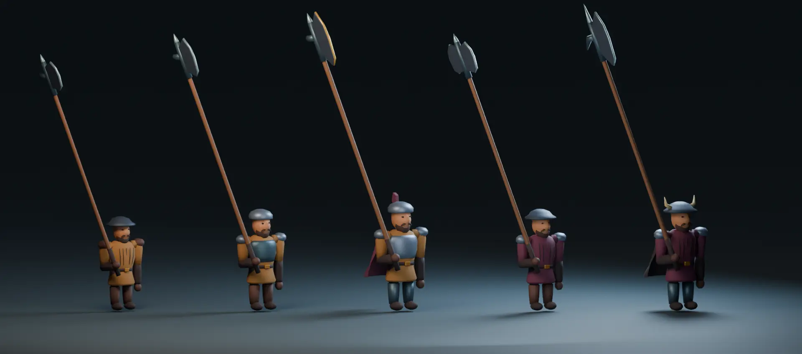

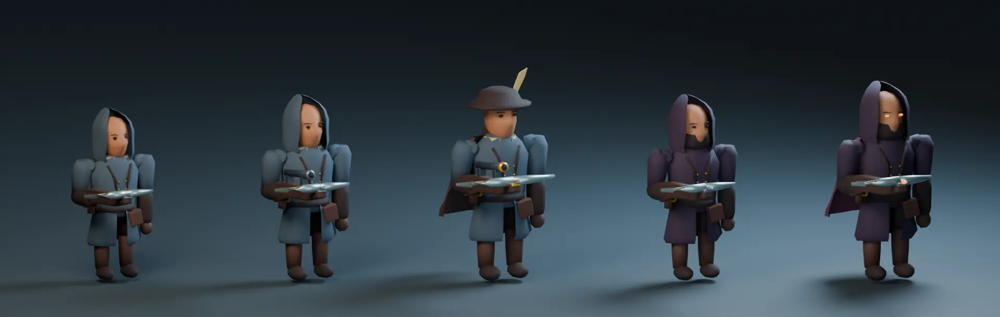

## Bombard and Rotcap

Bombard's leather coat, riveted cuirass, helmet and smoked goggles are
separate components on the existing rig. The right hand carries the
mortar at the hip and the support grip encloses weapon-local
`(0, -0.03, 0.24)`. The open muzzle planes sit at weapon-local Y 0.10
and Z 0.43, 0.45, 0.51, 0.43 and 0.47 in Base, A1, A2, B1 and B2 order.
A1 adds a flared mortar and bomb rack, and A2 adds a hot collar and a
furnace pack. B1 adds a hull shield, and B2 adds paired bores on either
side of the shared launch axis and a rear ammunition drum.

Rotcap's stem, collar, limbs, cap skin, membrane and radial gills are
individually modeled. The spitting rim is centered at head-local
`(0, -0.05187, 0.13923)`, with the throat recessed behind it and the
gills above it. A1 adds toxin freckles and vials, and A2 adds a broader
violet cap with venom drops. B1 grows shoulder caps, and B2 grows a
cluster of caps and pods on BackSpring. The palette stays the same
across seats. The game uses the existing recoil, reload and spit clips.

Bombard uses 5,266–6,526 triangles per form and 513,618 bytes. Rotcap
uses 4,686–7,998 triangles per form and 408,832 bytes.

```sh
blender -b -t 2 --python-exit-code 1 --python scripts/blender_champions/export_game.py -- bombard rotcap
blender -b -t 2 --python-exit-code 1 --python scripts/blender_champions/render_lineup.py -- bombard rotcap
```

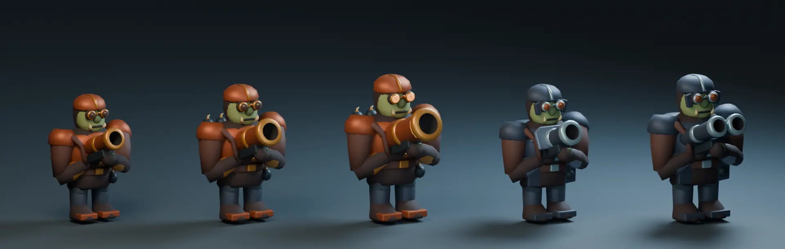

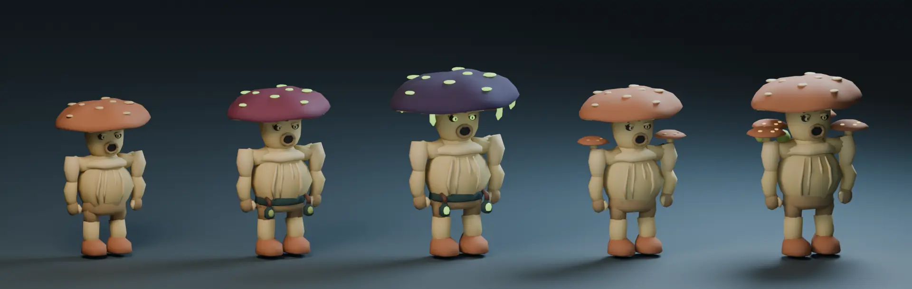

## Old Finn and Antidote Brewer

Old Finn wears a waxed ochre coat, a sou'wester and a forked white
beard. The rod, wrapped grip, working reel silhouette and line are
separate pieces on WeaponR. The rod and line end at the existing
fish-release point `(0, 0.902, 0)`. The ochre branch adds a larger catch
and a hauling float in A1, then an offset silver-bellied catfish with
long barbels in A2. The maritime-blue branch adds a two-tone storm
bib and hip rope coil in B1, then lighter blue oilskin, net floats,
extra catches and a brass hat clasp in B2. The basket and catches
move with BackSpring.

Antidote Brewer wears a linen apron and a two-leaf hood. The rim of
the remedy flask sits at WeaponR-local `(0, 0.07, 0.03)`. The amber
branch adds a gilt collar, braided herb crown and pouch in A1, then a
copper still with a curved condenser and glowing port in A2. The violet
branch adds a four-vial bandolier in B1, then a silver-collared second
flask on OffhandL, a mixing towel and cast back cauldron in B2.
The lower apron follows Hips and the workshop gear follows BackSpring.
Both champions keep their 0.22 s cast releases.

The branch palettes are intrinsic and match across seats. Old Finn
uses 4,016–5,618 triangles per form and 360,707 bytes. Antidote Brewer
uses 2,992–4,150 triangles per form and 299,567 bytes.

```sh
blender -b -t 2 --python-exit-code 1 --python scripts/blender_champions/export_game.py -- oldfinn antidotebrewer
blender -b -t 2 --python-exit-code 1 --python scripts/blender_champions/render_lineup.py -- oldfinn antidotebrewer
```

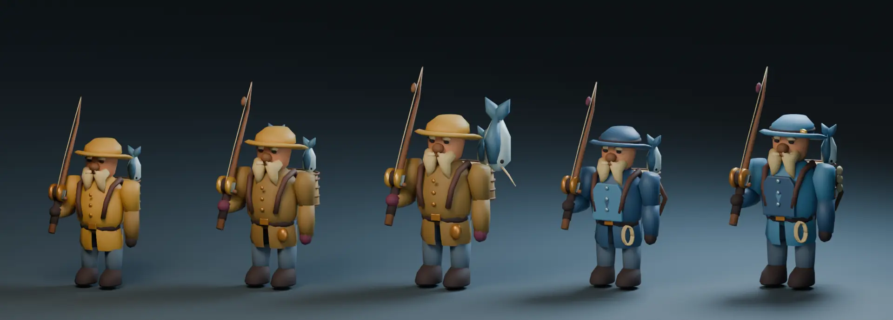

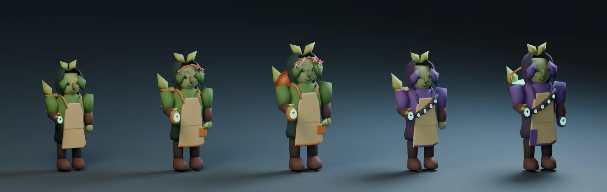

## Shatterback and Blood Furnace

Shatterback has a low terrapin body, hooked beak, planted paws and
four beveled slate plates. The pale ochre branch grows ivory shards
from the plates in A1, then lengthens them and adds a brass brow
shield in A2. The obsidian and ember branch adds heated veins
and fractured plates in B1, then adds raised ridges and an iron
brow shield in B2. The custom neck pivot is chest-local
`(0, 0.20, 0.33)`. The central right claw reaches HandR-local
`(0, 0, 0.24)`.

The body and four numbered plates export as separate TBG4 files.
Each plate is built in Chest coordinates so the existing live shell
controller can replace, hide and drop it independently. The lineup
and event-free previews assemble all four plates.

Blood Furnace has an ash-stained skull, connected clavicles, charred
ribs and an open iron grate. The hammer head is centered at
WeaponR-local `(0, 0, 0.51)` and uses the existing two-hand hold.
The copper and gold branch grows the fire behind a copper collar
and adds a pointed hammer poll in A1. A2 exposes the radiant core and
adds a gilt flame crown. The verdigris and jade branch adds a vented
door, draft dial, bellows and a caged hammer head in B1. B2 hangs
caged ember lanterns from the shoulders and reinforces the hammer
with extra cage ribs.

Shatterback uses 3,274–4,022 triangles with all four plates and
269,800 bytes across the body and plate files. Blood Furnace uses
4,788–6,752 triangles per form and 608,107 bytes.

```sh
blender -b -t 2 --python-exit-code 1 --python scripts/blender_champions/export_game.py -- shatterback bloodfurnace
blender -b -t 2 --python-exit-code 1 --python scripts/blender_champions/render_lineup.py -- shatterback bloodfurnace
```

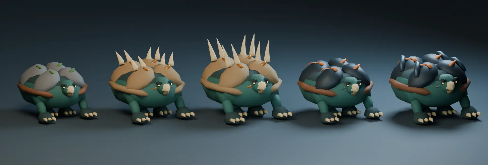

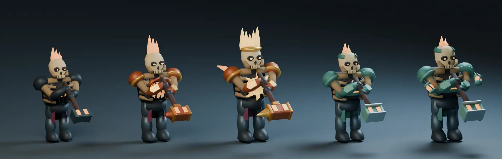

The local Linux preview build returned 75 from the shared validation
lock. At consolidation, run the loader check under the same lock,
install the preview, and observe a Shatterback plate loss and a Blood
Furnace strike in Training.

```sh
flock -n -E 75 "/tmp/tbg-validation-$(id -u).lock" \
  env CARGO_BUILD_JOBS=2 cargo +1.99.0 test -p tbg-client --lib \
  blender_assets_cover_all_forms_and_keep_animated_weapon_sockets -- --test-threads=1
```

## Bloodweaver and Oilpress

Bloodweaver's base has a wine-colored hood, a pleated hip-bound robe
and a spindle with blood thread. Deep Transfer adds an ivory stole
and gold chalice. Last Offering adds a heart reliquary and hood
finial. Rapid Circulation switches to indigo and violet, with wound
cuffs and thread across the chest. Shared Blood adds the shorter offhand
spindle and suspended drops. The WeaponR spindle releases at
`(0, 0.84, 0.03)`.

Oilpress has a riveted copper boiler, pressure gauge, stacked
pistons, exhaust pipes and two pressing fists. Reinforced Hull adds
brass and a steel breastplate. Immovable Mass adds a hip bulwark,
anchor spurs and a lit grille. Oil Leak uses verdigris and twin
tanks with dark oil trails. Black Mire swaps in a large tank and
tar-covered strike plates. Their striking surfaces end at
HandR/HandL-local `(0, -0.14, 0)`.

Bloodweaver uses 3,340–4,530 triangles per form and 335,736 bytes.
Oilpress uses 4,510–5,250 triangles per form and 504,025 bytes.

```sh
blender -b -t 2 --python-exit-code 1 --python scripts/blender_champions/export_game.py -- bloodweaver oilpress
blender -b -t 2 --python-exit-code 1 --python scripts/blender_champions/render_lineup.py -- bloodweaver oilpress
```

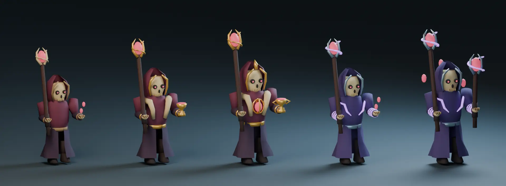

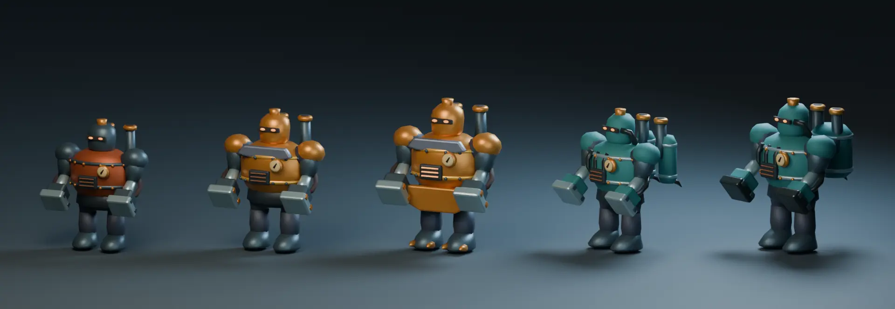

## Drumguard and Leechroot

Drumguard's base has a wine coat, shako and rope-tensioned snare.
War March adds carmine, gilt fittings, a plume and a larger copper
drum. Grand March adds a second plume and a gilded bass drum. Iron
Rhythm uses slate and steel, with a kettle helmet and breastplate.
Unbreakable Rhythm adds shoulder lamellae, a helmet comb and engraved
drum runes. The drum stays at Hips-local `(0.08, 0.02, 0.20)` and
both stick tips at their hand sockets' local Z 0.23.

Leechroot has a recessed ring maw, root fringe and two whip roots.
Faster Feeding adds a wider ivory-toothed maw and horns. Endless Growth
adds three amber sap sacs with supporting roots. Life Drain adds a
plum bark shell, violet veins and wrist nodes. Blood Hunger adds a
caged siphon bulb and two small maws on the whips. The native attack
tip remains at HandR-local `(0, -0.3094, 0.06)`.

Drumguard uses 2,934–3,254 triangles per form and 245,158 bytes.
Leechroot uses 2,774–4,670 triangles per form and 243,225 bytes.

```sh
blender -b -t 2 --python-exit-code 1 --python scripts/blender_champions/export_game.py -- drumguard leechroot
blender -b -t 2 --python-exit-code 1 --python scripts/blender_champions/render_lineup.py -- drumguard leechroot
```

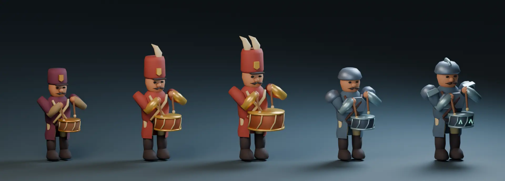

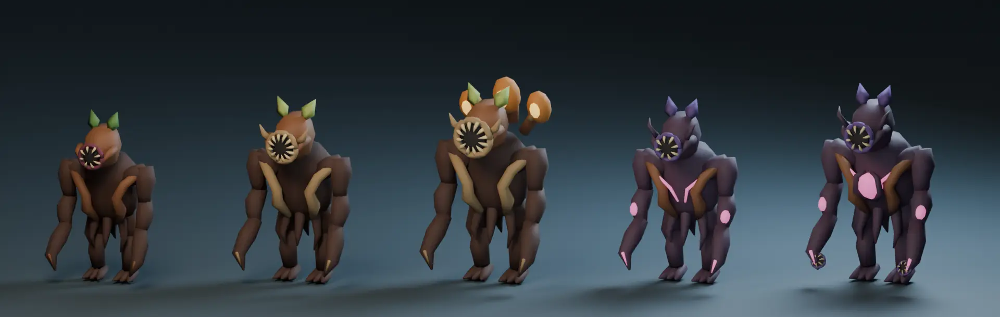

## Cargo Crab, Puppetmaster and Smuggler

**Cargo Crab** has an orange enamel shell, twin optics, three piston
legs per side and an open passenger saddle. Reinforced Shell adds
steel-blue plates and deflection spikes. Emergency Shield adds a raised
frame and two amber emitters outside the seating area. Faster Legs
adds jade servos and exposed copper pipes. Overdrive adds a raised
spoiler above the twin exhaust stacks. The cushion reaches Chest-local
Y 0.245, or 0.605 above the ground before form scaling. The closing
point stays between the two HandR jaws at `(0, -0.28, 0)`.
The five forms use 5,928–6,892 triangles and 640,859 bytes.

**Puppetmaster** has a violet split tailcoat, top hat and wooden
marionette. Painful Betrayal uses ruby and equips the puppet with a
dagger and hooks. Cruel Stumble adds a porcelain half-mask and a luminous
control cross. Faster Strings uses jade and adds a second cross and
puppet to the offhand. Double Puppet adds two miniature puppets to
the coat spring. The hand grip joins the
cross at the existing WeaponR release point `(0, -0.05, 0.12)`.
The five forms use 4,546–5,790 triangles and 496,047 bytes.

**Smuggler** has a rust jacket, eyepatch, tricorn, belt lantern and
revolver with a recessed bore. Better Connections adds a gold-edged
tricorn, coin purses and stacked crates. Black Market adds gilded locks, a
short cape and a tall plume. Faster Deliveries adds a maritime blue
bandanna and satchel. Double Shipment adds a hand-carried crate, another
crate on the frame and a route lantern on a pole. The WeaponR muzzle
stays at `(0, 0.04, 0.30)`. The five forms use 4,536–6,408 triangles
and 657,540 bytes.

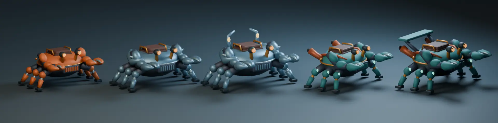

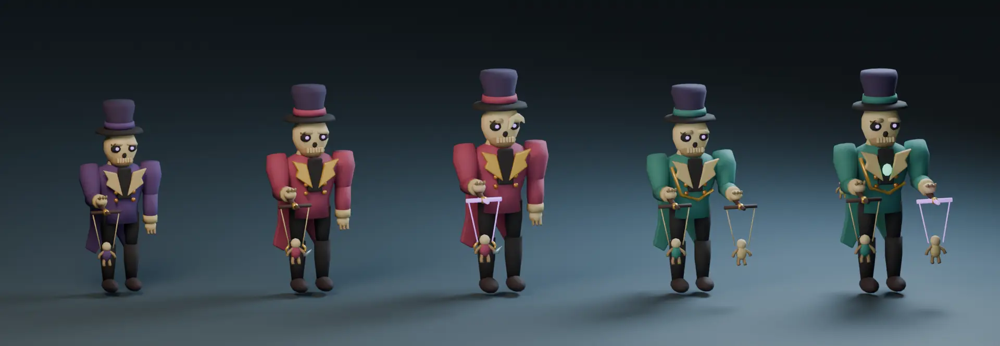

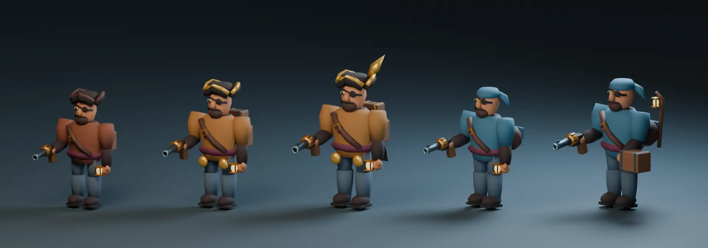

## Bonehorn, Ravager and Acidmaw

**Bonehorn** has four cloven feet, a low plated mantle and a long
boar skull. Ancestral Carapace adds ivory leg and cheek plates, then
raises the back crest and central horn. Stone Fangs uses rust-colored
stone, adds a shoulder collar and replaces the outer tusks, then forks their
tips into stone hooks. The custom quadruped keeps the center horn
strike at Head-local `(0, 0.10, 0.58)`. The five forms use 4,686–5,206
triangles and 440,522 bytes.

**Ravager** has six independently articulated supports and two front
scythes. Voracious Hunt adds ivory hunting blades around the cheeks
and broadens the scythes. Its second tier extends the stinger and
adds crest feelers. Deep Frenzy uses charcoal violet and rust, with
flared cheek fins and hot scythe edges. Its second tier adds dorsal
hooks and an outer hook to each scythe. The front attack tip stays
at ForearmR-local `(-0.07, -0.03, 0.43)`. Its hind feet use the
StringBottom and Nock sockets in the custom rig. The five forms use
3,784–4,060 triangles and 274,467 bytes.

**Acidmaw** has an elongated stalk, pulsing throat sac and four
jaw petals pivoting independently on Head. Abyssal Jaw adds ivory
braces and broader jaw petals, then adds swept crown horns.
Corrosive Volley adds lime veins against dark violet and a
larger reservoir. Its second tier adds three reservoir pods and an
extra prong to each petal. The Head-local muzzle stays at
`(0, 0, 0.36)`, in the open center of the petals. The five forms use
3,104–4,118 triangles and 238,404 bytes.

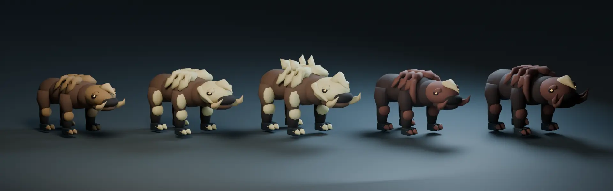

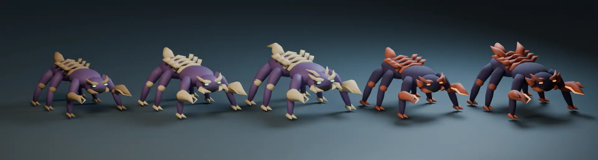

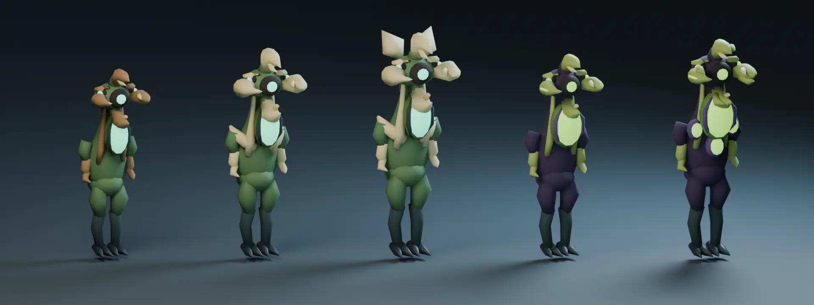

To reproduce these thirty forms and the six studio lineups, run from the
repository root. The lineup renders use the same authored parts with
studio poses. Cargo Crab and Smuggler turn their B forms farther to
show the rear equipment. All lineups read Base, A1, A2, B1, B2.

```sh
blender -b -t 2 --python-exit-code 1 --python scripts/blender_champions/export_game.py -- cargocrab puppetmaster smuggler bonehorn ravager acidmaw
blender -b -t 2 --python-exit-code 1 --python scripts/blender_champions/render_lineup.py -- cargocrab puppetmaster smuggler bonehorn ravager acidmaw
for unit in cargocrab puppetmaster smuggler bonehorn ravager acidmaw; do
  convert "scripts/exports/renders/$unit-lineup.png" -quality 88 "docs/media/blender-champions/$unit.webp"
done
```

## Whisperer, Bulwark and Demolisher

**Whisperer** has a hollow amethyst bell, a suspended clapper and
six articulated tendrils. Echo of Fear adds an ivory shell with
gilded hooks, then long cheek blades. Mental Pulse adds a rose-metal
resonator cage, then six luminous cores. The animated eye remains
on Back, with its release at `(0, 0, 0.15)`. The five forms use
3,622–4,414 triangles and 273,030 bytes.

**Bulwark** has staggered stone courses on a compact walking frame.
Mobile Fortress adds sandstone side walls, then crenellations
and a central keep. Earth Weight adds basalt counterweights, copper
cleats and a broader hammer, then a flanged earthbreaker face.
The hammer face crosses WeaponR-local Y -0.22 at Z 0.10 for
Base and A, and Z 0.13 for B. The second hand rests on the shaft
at `(0, 0.12, 0)`. The five forms use 4,736–6,248 triangles and
610,599 bytes.

**Demolisher** has exposed wrist pistons, separate knuckle pads
and a hydraulic pressure bottle. Reinforced Fists adds ochre cheek
armor and thick brass heels. Shock System adds indigo housings,
luminous forearm coils and a second pair of capacitors on the back.
The central right knuckle reaches HandR-local `(0, -0.05, 0.25)`.
The five forms use 4,088–5,992 triangles and 638,285 bytes.

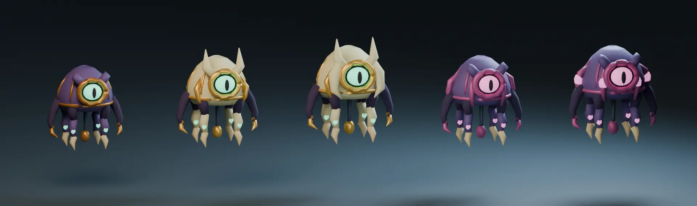

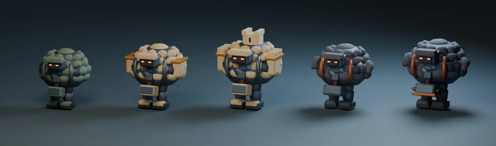

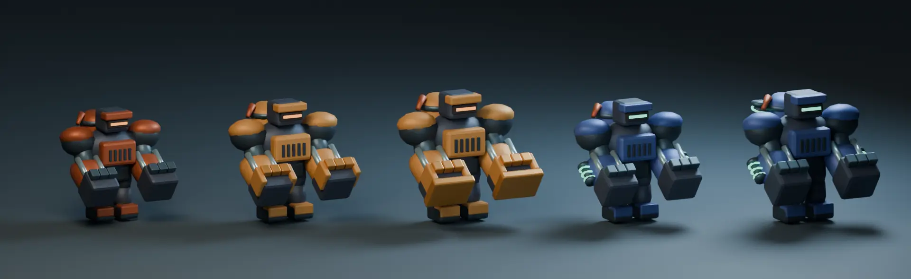

## Crowcaller, Trigger and Rattle & Tick

**Crowcaller** wears a fitted plague mask and carries a shoulder
raven and a crossbow. Plague Crow adds olive cloth and spore
ampoules, then respirator tubes and a raven spore carrier. Ruin
Bow adds claret cloth, layered iron feathers and broader limbs,
then a high arched sight. The raven body, head and wing use
BackSpring, HeadGear and Back. The bolt uses Nock so the kit can
hide it between release and reload. The WeaponR muzzle stays at
`(0, 0.035, 0.34)`. The five forms use 3,542–4,132 triangles
and 327,832 bytes.

**Trigger** has sculpted feline ears, cheek stripes, a western hat,
a jointed tail and two revolvers. Swift Gunman adds a jade scarf
and brass spurs, then flowing scarf and tail ribbons. Ricochet
Bullet adds indigo, bandoliers and faceted muzzle jackets, then
goggles and tall front sights. Both bores meet their socket's muzzle
at `(0, 0.055, 0.25)`. The five forms use 4,642–5,498 triangles
and 420,868 bytes.

**Rattle & Tick** share a shoulder harness. Big Brother's Fury
adds carmine armor and iron club teeth, then a brass breastplate
and broader teeth. Tico's Tricks adds a maritime blue tool roll
and Tick's workshop goggles, then spare charges and a blunderbuss
pressure valve. Rattle's club strikes from WeaponR-local
`(0, -0.40, 0)`. Tick uses BackSpring for his torso, HeadGear
for his head, Back and StringTop for his arms, and Nock for his
recoiling weapon. The five forms use 4,480–5,220 triangles and
481,218 bytes.

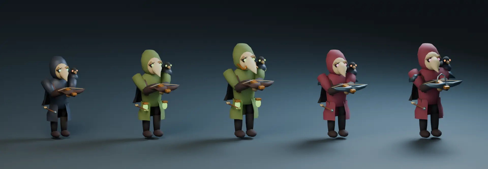

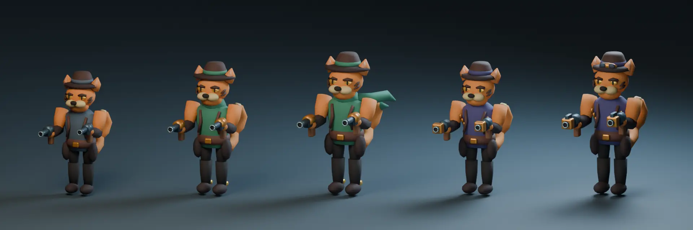

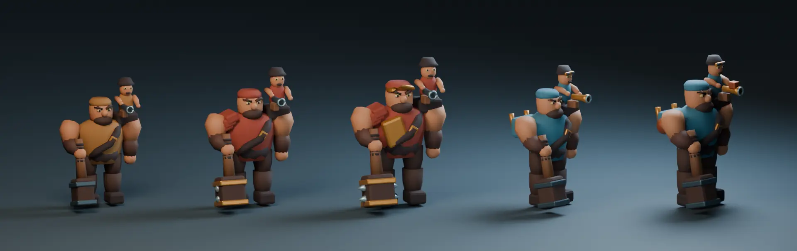

Crowcaller and Rattle & Tick use TBG5 to include their extended
socket positions. The other four use TBG4. Reproduce the five
forms and studio lineup per champion from the repository root.
The Rattle & Tick B forms turn farther to expose the rear tool roll
and spare charges.

```sh
blender -b -t 2 --python-exit-code 1 --python scripts/blender_champions/export_game.py -- whisperer bulwark demolisher crowcaller trigger rattletick
blender -b -t 2 --python-exit-code 1 --python scripts/blender_champions/render_lineup.py -- whisperer bulwark demolisher crowcaller trigger rattletick
for unit in whisperer bulwark demolisher crowcaller trigger rattletick; do
  convert "scripts/exports/renders/$unit-lineup.png" -quality 88 "docs/media/blender-champions/$unit.webp"
done
```

## Capybara and Trident

**Capybara** has a broad snout, rounded ears, exposed incisors and
a leaf collar. Stone Belly adds overlapping granite panels and
stone cuffs, then moss fronds and shoulder crests. Swamp Wave
adds teal willow weave and a reed basket, then wetland flowers
and a wrapped hip belt. The belly follows the Chest-mounted
Tabard, and the HandR paw reaches `(0, 0, 0.12)`. The five forms
use 3,504–4,788 triangles and 310,975 bytes.

**Trident** has a countershaded shark body, gill lines, separate
jaw and swept dorsal fin. Ocean Fury adds ivory shoulder plates,
then ivory shin guards, a higher fin and an amber coupling.
Bloody Tide adds a red reef harness and broader copper fork, then
copper shoulders and reverse hooks. The trident keeps its two
grips at WeaponR-local Z 0 and 0.18, and its central tine ends
at `(0, 0, 1.12)`. The five forms use 3,830–4,322 triangles and
301,376 bytes.

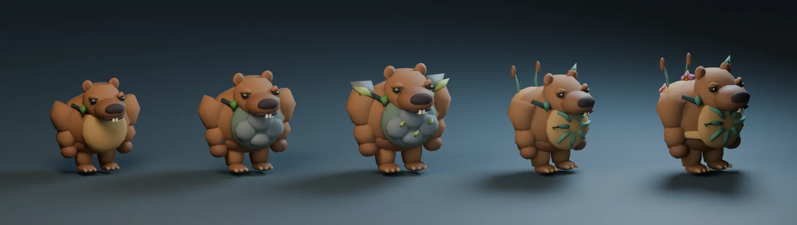

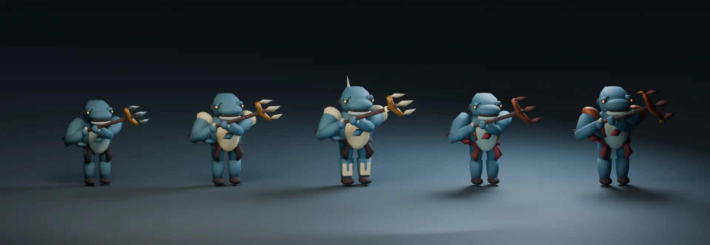

## Solar Sentinel and Luminous Oracle

**Solar Sentinel** carries a sun-disk shield and a long spear.
Light Fortress reinforces the shield with ivory spurs, then adds
a crest and overlapping shoulder lamellae. Group Protection
adds teal shield vanes, steel shoulder wings and, in B2, paired
halo winglets. The shield vanes keep their two OffhandL pivots
at X -0.15 and 0.15. The WeaponR spear ends at `(0, 0, 0.73)`.
The five forms use 3,516–3,628 triangles and 290,699 bytes.

**Luminous Oracle** wears a fitted empty hood and a layered robe.
Restoring Light adds saffron cloth and ivory rays around the staff
ring, then raises the ring and adds a golden finial. Sacred Aura
adds lagoon cloth and split shoulder shells, then paired ivory
staff prongs and a second shoulder layer. HeadGear follows
WeaponR at Y 0.55. The release stays at WeaponR-local
`(0, 0.55, 0.08)`, or `(0, 0.65, 0.08)` in A2. The five forms
use 2,938–3,030 triangles and 217,440 bytes.

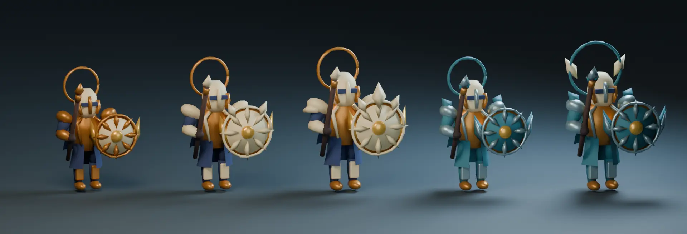

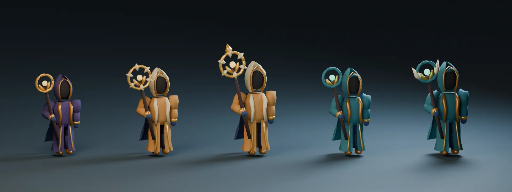

## Celestial Archer and Justiciar

**Celestial Archer** has rigid feather wings with shoulder hinges
set into the cuirass and a gilded angular bow. Divine Precision adds ivory wrist guards
and longer gold limbs, then a bow-hand ring and long flight feathers.
Celestial Mark adds amethyst wrist blades and forked bow blades,
then three raised prongs and longer plum wings. Both string halves
and the nocked arrow retain their native joints. The tip pivots
stay at Z -0.10, and the nocked arrow is 0.42 long. The five forms
use 3,088–3,382 triangles and 228,990 bytes.

**Justiciar** is a segmented stone construct with a moving chest
core and an aperture in each palm. Celestial Fury adds ember stone,
copper pauldron flanges and lit vents, then an open bronze crown.
Judgment adds obsidian gauntlet forks edged with violet crystal,
then shoulder obelisks. The HandR muzzle remains `(0, 0, 0.10)`.
The five forms use 5,026–5,420 triangles and 717,685 bytes.

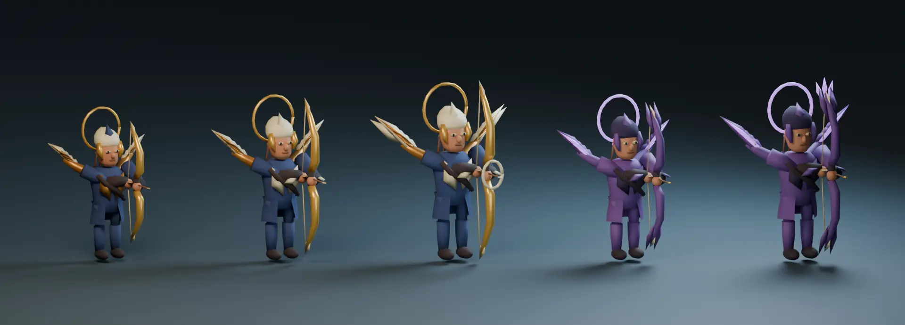

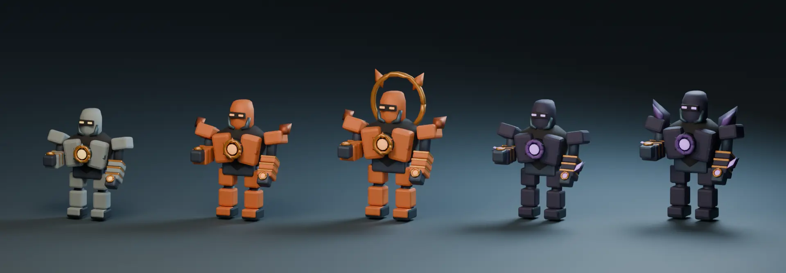

Solar Sentinel and Celestial Archer use TBG5 for their extended
socket positions. The other four use TBG4. The Trident studio pose
rolls the fork around the shaft so all three blades remain visible.
Both hands stay on the kit grips. Reproduce the lineups from the
repository root.

```sh
blender -b -t 2 --python-exit-code 1 --python scripts/blender_champions/export_game.py -- capybara trident solarsentinel luminousoracle celestialarcher justiciar
blender -b -t 2 --python-exit-code 1 --python scripts/blender_champions/render_lineup.py -- capybara trident solarsentinel luminousoracle celestialarcher justiciar
for unit in capybara trident solarsentinel luminousoracle celestialarcher justiciar; do
  convert "scripts/exports/renders/$unit-lineup.png" -quality 88 "docs/media/blender-champions/$unit.webp"
done
```

## Jawguard, Mantis, Hornet and Weaver

**Jawguard** carries a split beetle shell and two independently
hinged mandibles. Reinforced Carapace adds limestone plates and a
tall dorsal fin. Swarm Guard uses coral chitin with shoulder barbs,
larger hooks and brass secondary fangs. The Head-local bite
stays at `(0, -0.05, 0.31)`, between the jaws. The five forms
use 2,952–3,016 triangles and 208,461 bytes.

**Mantis** has a triangular face, a hip-mounted abdomen and two
hooked blades. Relentless Hunt adds ivory shin spurs, longer antennae
and brow crests. Precise Blade uses jade, a second cutting hook
and serrated elbow crystals. The strike stays at WeaponR-local
`(0, -0.04, 0.30)`. The five forms use 2,100–2,164 triangles
and 150,497 bytes.

**Hornet** has a banded abdomen, two wing pairs and a venom pistol.
Deep Venom adds ivory plating and chest ampoules, then extends
the nozzle to Z 0.53. The other forms release at Z 0.46. Swoop
adds aqua wing and hip shapes, then gold trailing spurs. The
unit-length hose meshes use four Root-parented sockets. Their
length and orientation follow the existing runtime hose transforms.
The five forms use 3,270–3,796 triangles and 265,237 bytes.

**Weaver** has eight independently posed leg groups and a head-mounted
spinner. Extended Web adds ivory silk saddle tines, then a dorsal
spool. Protective Web adds claret shell plates, gold knee caps and
paired nozzle wings. The spinner rim reaches WeaponR-local
`(0, 0, 0.14)`. The five forms use 3,494–3,666 triangles and
247,408 bytes.

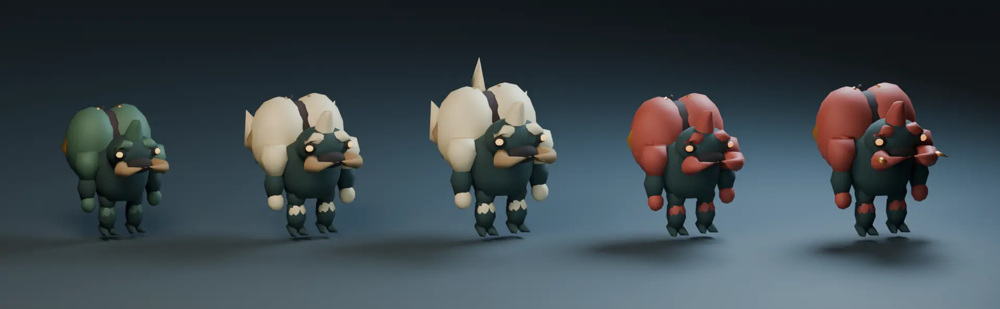

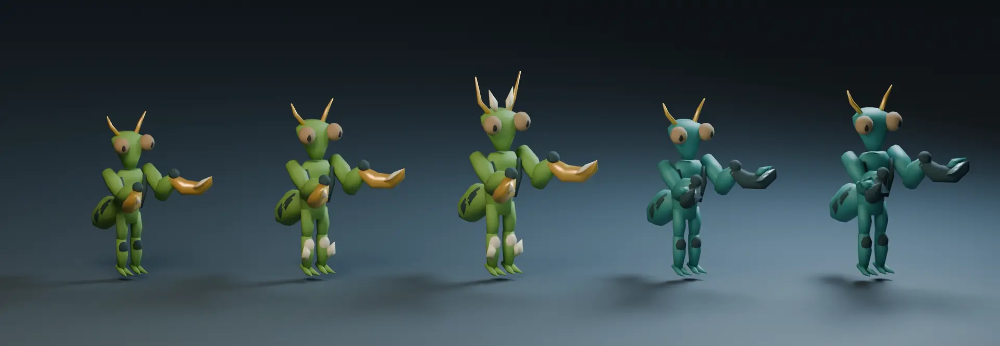

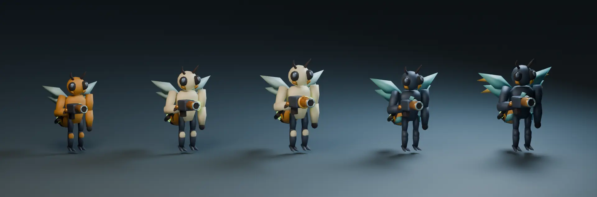

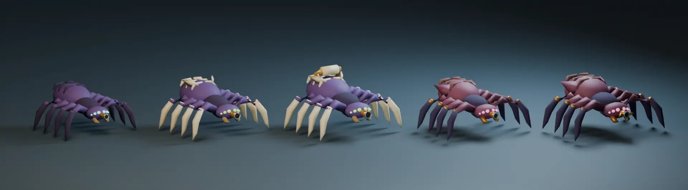

## Pyre Warden and Drillnest

**Pyre Warden** carries a coffin furnace on two shoulder stays
and holds a braced nozzle.
Funeral Furnace adds ivory lid reinforcement, a crown and an
extended nozzle. Pestilence Flame adds green ampoules and paired
side barrels. The support grip stays at WeaponR-local Z 0.20.
The flame event starts at Y 0.02 and Z 0.464, or Z 0.604 in A2.
The five forms use 4,732–5,456 triangles and 574,065 bytes.

**Drillnest** is a low tracked foundry with a honeycomb feed rack
and an independently recoiling barrel. Swarm Factory adds ivory
guide frames and raises the rack from five to seven cells. Siege
Drill adds copper recoil rails and, in B2, a double fork and two
chassis supports. HeadGear and Tabard carry the separate tread
links. The barrel keeps its Chest-local pivot at `(0, 0.05, 0.18)`.
The five forms use 4,462–5,322 triangles and 556,804 bytes.

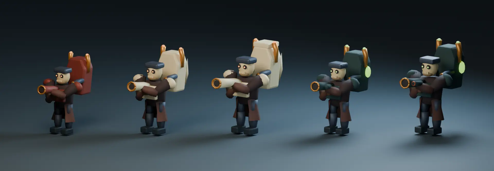

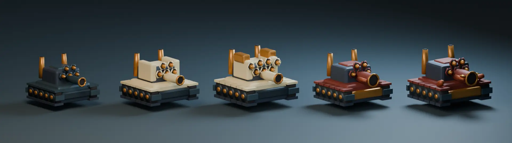

## Gravecutter, Lastlight Cantor, Cragclaw and Hushfang

The next four figures follow the order of the local completion pool.

**Gravecutter** has a fitted grave hood, interlocked forearm
chains and a curved sickle. Gravetaker adds an ochre coat and
coffin-shoulder plate. Final Harvester adds a spade crest and
second sickle tooth. Chain Dancer uses teal cloth and soul chains.
Soul Reaver adds a spectral collar and luminous tooth. The sickle
meets the WeaponR strike at `(0, 0, 0.30)`. The five forms use
3,422–3,810 triangles and 328,108 bytes.

**Lastlight Cantor** holds a hollow handbell and bone missal.
Vigil Bell adds gilded vestments and a wider bell. Sanctuary
Bell adds paired finials. Funeral Choir adds an amethyst collar.
Last Requiem adds a halo and secondary chimes. The echo outlet
meets WeaponR-local `(0, 0, 0.25)`. The five forms use 3,062–3,596
triangles and 268,437 bytes.

**Cragclaw** has asymmetric basalt arms and a wrist-driven claw.
Edgeclaw adds pale limestone armor and a broader blade. Obsidian
Chisel adds a gold wrist ridge. Splitclaw adds turquoise prongs
and shoulder forks. Shardsweeper adds bright crystal edges.
The central claw ends at WeaponR-local `(0, 0, 0.30)`. The five
forms use 1,828–2,052 triangles and 182,671 bytes.

**Hushfang** is a low quadruped with saber fangs and a curved
articulated tail that extends beyond the haunch.
Silent Prowler adds warm fur, long ivory fangs and foreleg guards.
Fang Warden adds tall collar shards. Flint Hunter adds midnight
blue fur and flint armor. Midnight Pounce adds luminous shoulder
shards and swept cheek blades. The bite stays at Head-local
`(0, 0, 0.30)`. The five forms use 3,046–3,126 triangles and
216,838 bytes.

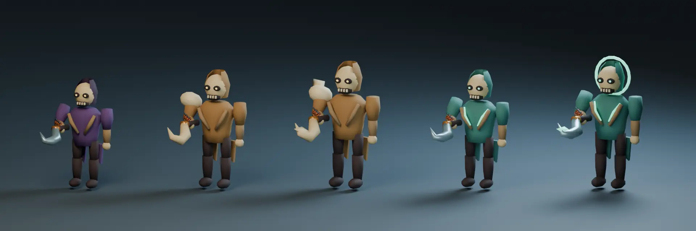

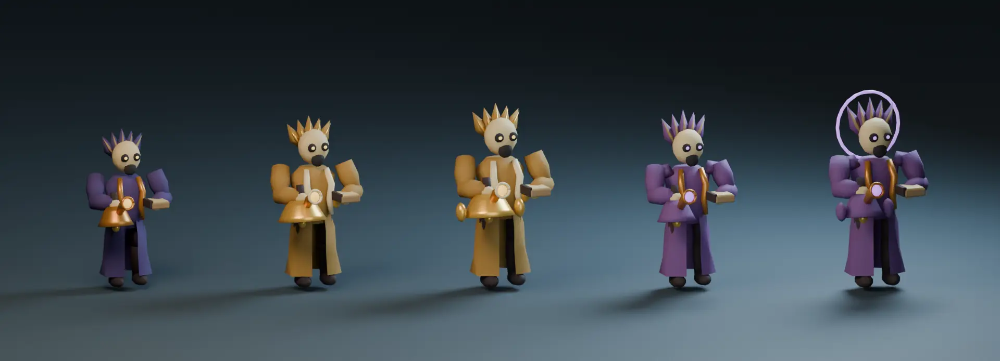

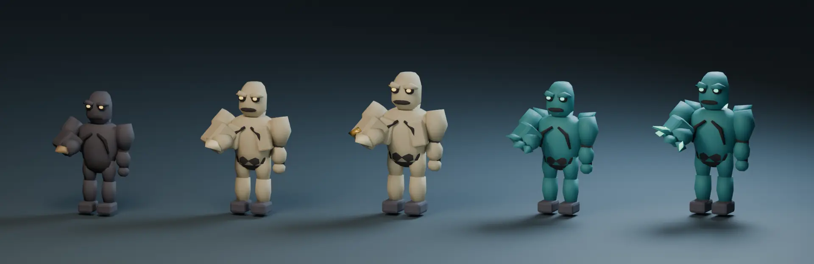

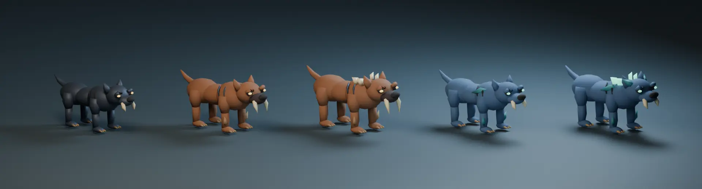

Hornet uses TBG5 to record all four hose sockets. The other nine
use TBG4. Run from the repository root to regenerate the fifty
forms and the studio lineups.

```sh
set -- jawguard mantis hornet weaver pyrewarden drillnest gravecutter lastlightcantor cragclaw hushfang
blender -b -t 2 --python-exit-code 1 --python scripts/blender_champions/export_game.py -- "$@"
blender -b -t 2 --python-exit-code 1 --python scripts/blender_champions/render_lineup.py -- "$@"
for unit do
  convert "scripts/exports/renders/$unit-lineup.png" -quality 88 "docs/media/blender-champions/$unit.webp"
done
```

## Spinehurler, Mire Tender and Gorgehowl

**Spinehurler** carries five dorsal quills and a loaded wrist needle.
Keen Needle adds ivory shoulder plates and a longer needle.
Spine Lancer adds a swept forehead quill. Barbed Fan adds a teal
quill rack with copper clips. Needle Phalanx adds rear rack vanes.
HeadGear follows WeaponR so the kit can hide the loaded needle at
release. The needle reaches WeaponR-local `(0, 0, 0.25)`. The five
forms use 2,116–2,328 triangles and 167,591 bytes.

**Mire Tender** has a woven hat, clay bowl and hand-carved ladle.
Brothkeeper adds ochre vestments and belt flasks. Deep Remedy
adds reinforced bowl handles and a drying leaf on the hat.
Reed Tender adds a green reed collar. Mire Sage adds marsh seed
heads and woven bowl loops. The bowl stays on OffhandL, and the
ladle reaches WeaponR-local `(0, 0, 0.25)`. The five forms use
2,786–3,314 triangles and 226,112 bytes.

**Gorgehowl** has a ribbed torso chamber and spiral shell horns.
Deep Resonator adds warm clay and ivory amplifiers. Quietbreaker
raises the rear amplifier spikes. Split Echo adds blue-green
glazed side pipes. Chasm Voice adds fins at the outlets. The
main outlet reaches the Chest-local strike at `(0, 0, 0.30)`.
The five forms use 2,514–2,630 triangles and 179,896 bytes.


## Sunlancer, Eclipse Dancer and Starbreaker

**Sunlancer** has an open cavalry helmet, swept plume and diamond
lance. Dawn Point adds saffron armor and a wider blade. Sun Pact
adds shoulder lamellae. Ember Lance adds indigo cloth and a charged
annulus around the shaft. Daybreak Oath adds flanking spark tips.
The shaft covers the WeaponR strike reference at Z 0.30, and its
wrapped support grip accommodates the idle Z 0.20 grip and the
forward thrust blend. The five forms use 2,178–2,556 triangles
and 166,980 bytes.

**Eclipse Dancer** wears a layered skirt and carries two separate
blades. Sun Step adds coral silk and a gold fork on the primary
sword. Zenith Blade widens the fork and raises the diadem.
Moon Step adds indigo silk and a violet crescent on the offhand.
Midnight Waltz widens the crescent and raises the diadem. Both
blades pass through local Z 0.30. The five forms use 2,486–2,518
triangles and 179,332 bytes.

**Starbreaker** wears fitted ceramic plates and a closed star
helm. Starmaul adds ivory shoulders and a wider maul.
Constellation Breaker adds raised edges and a crown crest.
Hammer Dance adds cobalt and a caged nova crystal. Nova Forge
adds a larger crystal and cage wings. The shaft keeps the kit's
WeaponR reference at Z 0.30 and the idle support grip at Z 0.13.
The five forms use 2,250–2,500 triangles and 249,958 bytes.


## Dawnmender and Prismancer

**Dawnmender** has a fitted hood and a lantern held between both
hands. Calm Lantern adds peach cloth and a larger solar frame.
Sanctuary Light adds a tall finial. Battle Beacon adds teal
shoulders and a second ring. Dawn Chorus adds luminous petals
and a halo. The left grip is 0.28 units from WeaponR in Base
and B, and 0.34 in A. The forward lens reaches `(0, 0, 0.25)`.
The five forms use 3,174–3,898 triangles and 247,232 bytes.

**Prismancer** carries a faceted crystal in an open cage. Keen
Focus adds a porcelain bracer and a larger lilac crystal.
Crystal Needle adds tapered focusing rails. Open Prism adds an
ice-blue shroud. Triune Prism adds two smaller crystals. The
central prism ends at WeaponR-local `(0, 0, 0.25)`. The five forms
use 2,132–2,518 triangles and 173,611 bytes.


## Leafcutter and Blastbeetle

**Leafcutter** has six articulated legs, curved mandibles and a
serrated wrist blade. Keen Mandible adds ivory cuticle armor.
Deep Serration adds a fifth tooth and central crest. Swift Saw
adds amber hip plates and teeth. Amber Reaper adds a reverse
hook. The blade passes through WeaponR-local Z 0.30. The five
forms use 2,238–2,278 triangles and 160,248 bytes.

**Blastbeetle** has an exposed abdomen pressure sac and twin
wrist spikes. Tight Carapace adds an ivory shell and thorax horn.
Amber Heart adds a heavy ring around the sac. Split Shell adds
coral vanes. Final Flash adds a luminous ring and side spark
prongs. Both spikes reach local Z 0.30. The five forms use
2,710–3,088 triangles and 201,334 bytes.


The ten figures follow the local completion pool. Leafcutter and
Blastbeetle use TBG5 for their auxiliary leg chains. The other
eight use TBG4. Reproduce all fifty forms and the studio lineups
from the repository root.

```sh
set -- spinehurler miretender gorgehowl sunlancer eclipsedancer starbreaker dawnmender prismancer leafcutter blastbeetle
blender -b -t 2 --python-exit-code 1 --python scripts/blender_champions/export_game.py -- "$@"
blender -b -t 2 --python-exit-code 1 --python scripts/blender_champions/render_lineup.py -- "$@"
for unit do
  convert "scripts/exports/renders/$unit-lineup.png" -quality 88 "docs/media/blender-champions/$unit.webp"
done
```

## Needlewing, Nectar Nurse and Stridulator

**Needlewing** has a narrow abdomen, compound eyes and four separately
modeled wing vanes on a chest-mounted pivot. Keen Sight adds long
ivory sight rails and extended vanes. Hunt Window adds a raised
ivory crest. Needle Volley adds ice-teal wing panels and amber
feed guides. Amber Guide adds forked vanes and spare needles. The
loaded needle sits on HeadGear, 0.13 forward of HandR, and reaches
the existing HandR-local shot origin at Z 0.25. All four wings stay
on WeaponR when the loaded needle disappears.
The five forms use 2,814–3,126 triangles and 216,818 bytes.


**Nectar Nurse** has a striped bee abdomen, a shallow nectar bowl and
a curved spoon. Honey Keeper adds golden thorax latticework and
bowl handles. Golden Remedy adds a hexagonal diadem and taller
handles. Silken Nectar adds an ivory apron, jade bowl and layered
silvery wings. Hive Lifeline extends the silk and the bowl handles.
The two tools move on independent hand sockets. The five forms
use 2,658–2,976 triangles and 199,275 bytes.


**Stridulator** has a short cicada abdomen, two hinged wing shells
and a recessed resonator. Echo Chamber adds ivory arches around
the acoustic ribs. Resonant Crown adds two ivory crown blades.
Cutting Rhythm adds amber side chambers. Amber Chorus adds
overlapping amber wings. The aperture is centered at Chest-local
`(0, 0, 0.30)`. The five forms use 2,852–3,224 triangles and
214,201 bytes.


## Basalt Bulwark, Cinder Maul, Hook Brawler and Flint Runner

**Basalt Bulwark** carries a braced stone shield and a quarry
maul. Cairn Guard adds pale masonry courses and a stone headband.
Stonewall adds a taller wall and a masonry crest. Cracked Guard
has a slate shield with a green fault line and split shoulders.
Quake Bastion adds a shield spur and taller shoulder ridges. The
shield grips OffhandL, and the maul encloses the WeaponR strike
point at Z 0.25. The five forms use 4,338–4,816 triangles and
413,614 bytes.


**Cinder Maul** carries a pair of wrapped hammers and a chimney
pack. Coalbreaker adds wide squared heads and forged shoulder
plates. Ember Anvil adds anvil horns and goggles. Twin Brands
adds cylindrical fists with orange forge bands. Furnace Fists
adds extended chimneys and vambrace fins. Both held heads cover
the Z 0.25 contact line. The five forms use 4,620–5,346 triangles
and 420,432 bytes.


**Hook Brawler** wears a split coat and knotted dock scarf.
Ironhook adds pale anchor flukes to the steel hook. Anchorbreaker
adds a longer hook and a shoulder guard. Barbed Loop adds an
offhand hook, indigo cloth and a shackle buckle. Chainmaster
adds three modeled links to each hook. The right shackle reaches
the WeaponR strike line at Z 0.25. The five forms use
4,812–5,712 triangles and 394,583 bytes.


**Flint Runner** has a narrow frame, a knapped crown ridge and
paired blades. Trailblade adds long ivory blades and layered
trail wraps. Flint Gale extends the blades and raises the ridge.
Sparksprinter has obsidian blades with glowing orange fractures.
Obsidian Rush adds shoulder spurs and another crown shard. Each
blade crosses its local Z 0.25 line. The five forms use
4,236–4,260 triangles and 308,945 bytes.


## Clay Binder, Barrel Keeper and Hide Mender

**Clay Binder** carries a split ceramic mask, a handled clay jar
and a hand-held seal. Clay Seal adds a limestone mask and a
waist tablet. Earthlock adds a double brow crest and taller
jar. Mire Mask introduces marsh-green cloth and a blue-green
glazed mask. Quagmire Sage adds reeds tied to a tall jar. The
seal lip centers on WeaponR-local Z 0.27. The five forms use
4,818–4,942 triangles and 418,666 bytes.


**Barrel Keeper** (GustDrummer) carries a horizontal stave cask
and fitted brewer's apron. Field Cask adds cream hoops and belt
vials. Balm Reserve adds cap braces and a raised golden vessel.
Rolling Remedy adds a green cask and brass tap. Harvest Cask
adds a longer spout and a raised green vessel. The chest-mounted
cask stays at `(0, 0.12, 0.29)` in rest, with palms at cask-local
X ±0.25 and the front bung at Z 0.218. The five forms use
5,170–5,696 triangles and 401,568 bytes.


**Hide Mender** wears open brass spectacles and carries a spool
and steel needle. Field Stitch adds a layered ivory apron and
spare tool pouch. Leather Surgeon adds a folded cap and a
longer needle. Spirit Spool adds plum lapels and mint thread.
Ancestral Seam adds raised collar tips and an exposed thread
loop on the spool. The needle reaches WeaponR-local Z 0.40 in
A and 0.33 in Base and B. The five forms use 5,178–5,610
triangles and 474,430 bytes.


This batch continues the local completion pool. The three insects
record the 26-node rig in TBG5, with each auxiliary leg authored as
coxa, shin and foot. Neck and shoulder collars join their heads and
upper arms to the thorax. The seven ogres use TBG4 and fitted anatomy
with per-kit facial proportions, clothing and equipment.
Both seats use the same materials. The feet circle shows allegiance.

Build all fifty forms and their Base, A1, A2, B1 and B2 studio
lineups from the repository root.

```sh
set -- needlewing nectarnurse stridulator basaltbulwark cindermaul hookbrawler flintrunner claybinder gustdrummer hidemender
blender -b -t 2 --python-exit-code 1 --python scripts/blender_champions/export_game.py -- "$@"
blender -b -t 2 --python-exit-code 1 --python scripts/blender_champions/render_lineup.py -- "$@"
for unit do
  convert "scripts/exports/renders/$unit-lineup.png" -quality 88 "docs/media/blender-champions/$unit.webp"
done
```
