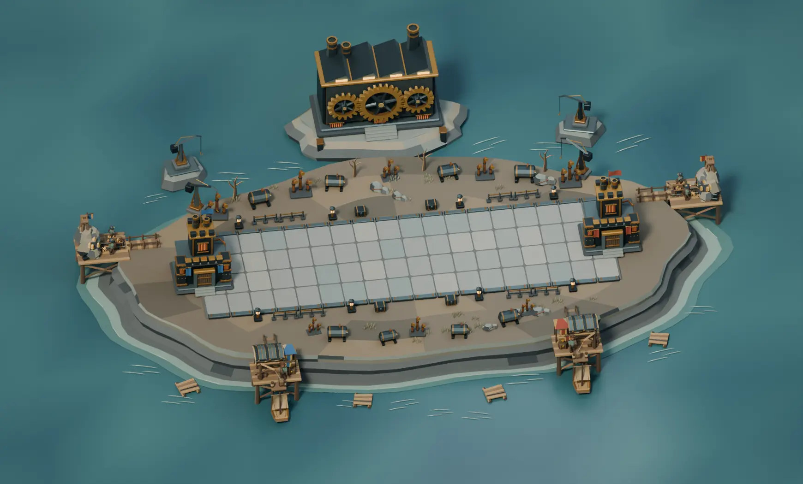
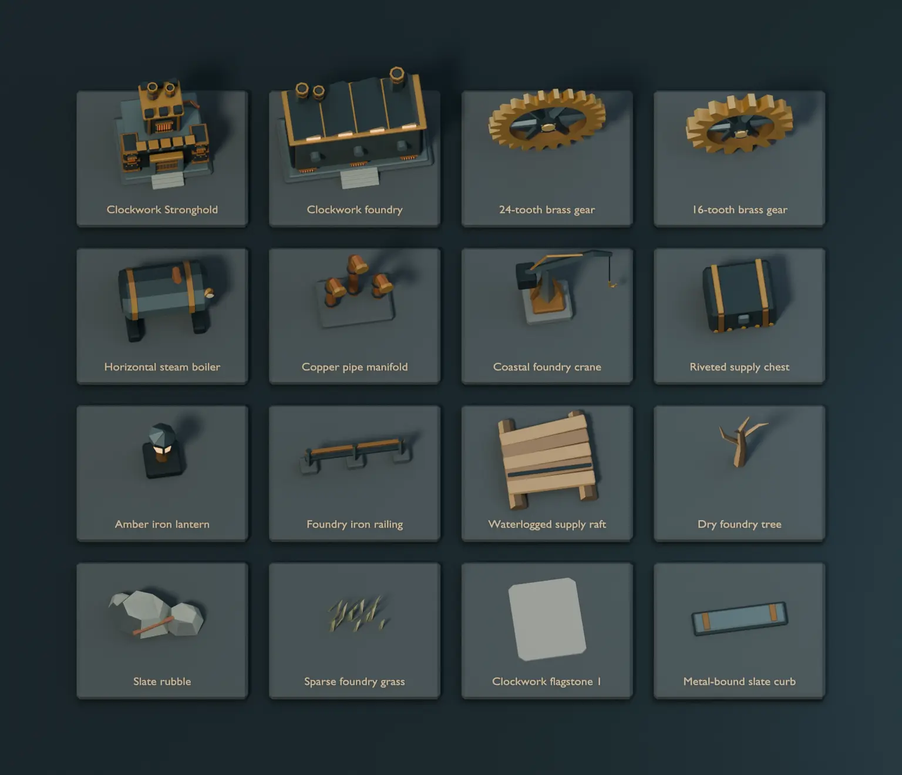
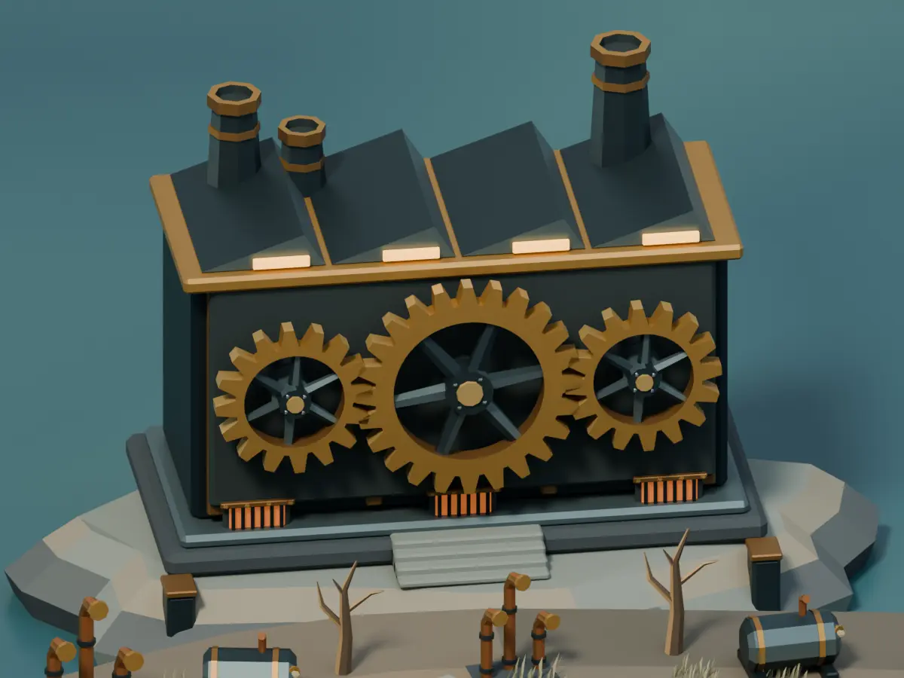
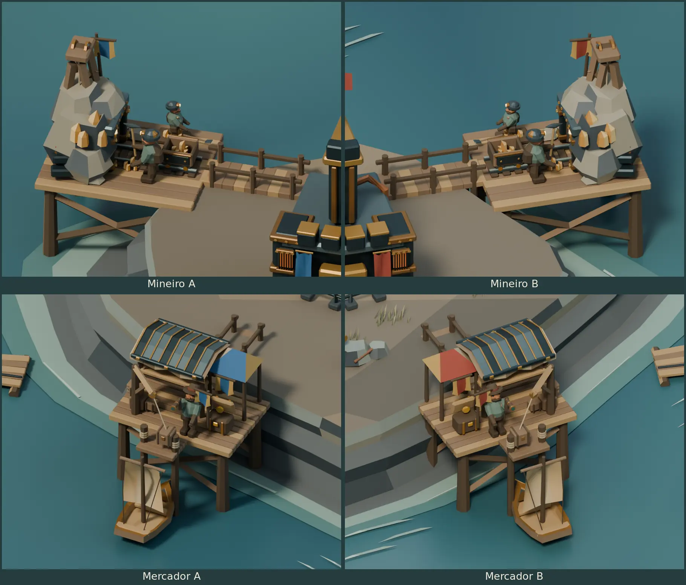
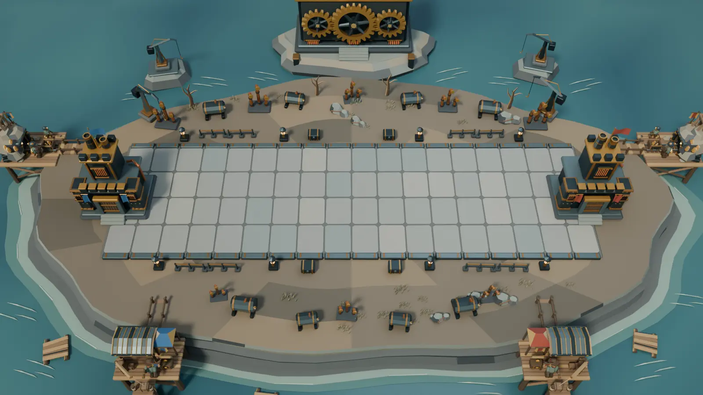

# Clockwork Bastion Blender study

Clockwork Bastion is the seventh arena in the catalog. It uses the
[Verdant Forest](BLENDER-FOREST-ARENA.md) layout, the
[Frozen Tundra](BLENDER-FROZEN-TUNDRA.md) offshore mounts and the
[Celestial Citadel](BLENDER-CELESTIAL-CITADEL.md) component workflow.
The BattleLine is 16 × 5 units at floor height zero. The Strongholds
sit at X −0.9 and 16.9. The desktop match camera uses a 35° vertical
field of view.



[Editable Blender project](../media/blender-clockwork-arena/clockwork-bastion.blend)

## Model and assemble the arena

1. Build the foundry plateau, banded slate cliffs, coastal shelf and
   cold sea as separate collections. Use vertex colors for the sea's
   depth gradient and separate meshes for its thin surface ripples.
2. Dress four slate flagstone variants and place 72 instances over the
   BattleLine bed. Fit metal-bound curbs and keep the lamps, thin rails
   and riveted supply chests outside the playable strip.
3. Assemble each Stronghold from iron gatehouse columns, brass bands,
   individual gate planks and crenellations. Add open chimney lips,
   amber furnace grilles and copper return pipes.
4. Assemble the rear foundry on its own terraced islet. Model separate
   sawtooth roof bays, clerestory lights, smokestacks, axle mounts and
   three drive wheels. Each wheel has an extruded toothed rim, six
   spokes, a hub, an axle cap and separate bolts.
5. Drive the central 24-tooth wheel at 7 degrees per second. Drive the
   two 16-tooth followers at −10.5 degrees per second. Native Blender
   frame expressions preserve continuous opposing rotation through
   the 29-second timeline. The wheel centers are 1.60 units apart.
6. Dress the coast with independent crane islets, horizontal boilers,
   copper manifolds, supply rafts, rubble and sparse grass. The coastal
   crane cables and hooks are static sculpted parts.
7. Fit cast-iron portals and cart armor to each mine, then parent the
   metal canopy and reinforced prow to each market rig. Reuse the
   existing workers, construction, upgrades and delivery motion.

The project contains 29 reusable collections. Sixteen appear in the
component board. The workers use the same materials on both sides.
Architectural pennants carry the seat colors. The wheels form an
animated visual assembly with sampled ratio and axle checks.





## Mineiro and Mercador on both sides

Mineiro A and B work the outer quarry platforms. Mercador A and B
use the front quays. All four bridges land on the plateau. Both seats
reuse the Forest auxiliary rig and its 29-second construction,
upgrade and work sequence. The mine views show tier three. The
quay views show the crane lifting a parcel from the moored boat.

The quarry portal follows the rising outcrop. The cart's new side
plates follow its moving frame. The market's raised roof seams and
the boat's armor follow the existing awning and vessel pivots.



## Reproduce and validate

Run from the repository root with Blender 4.5 LTS.

```sh
blender -b -t 4 --python-exit-code 1 --python scripts/blender_clockwork_arena/clockwork_study.py -- /tmp/tbg-clockwork-bastion
blender -b /tmp/tbg-clockwork-bastion/clockwork-bastion.blend -t 2 --python-exit-code 1 \
  --python scripts/blender_clockwork_arena/verify_clockwork.py -- /tmp/tbg-clockwork-bastion/validation.json
```

The generator writes an editable project, eight PNGs and
`metrics.json`. Open `01  Clockwork Bastion` for its seven cameras
and scrub the timeline for construction, upgrades, work and gear
motion. Open `02  Clockwork component board` for the separate samples.
The foundry camera frames the drive assembly.

Blender 4.5.15 on Linux reopened the final project and checked the
72 flagstones, camera, Stronghold anchors and four shore approaches.
The verifier tested 661 scenic bounds and 10,640 auxiliary bounds
over 18 timestamps for BattleLine clearance. It checked construction,
both picks, cart parenting, market upgrades, both berths, parcel
hoists, chest motion and departure. The 112 sampled hull and prow
bounds cleared the offshore scenery. The drive check sampled 18
angles, opposing directions, tooth-count ratios, valid drivers and
the 1.60-unit axle spacing. The study contains 75,931 evaluated
triangles, including all four auxiliary precincts.



The reference match camera crops parts of the outside posts and the
rear factory. The overview and close-ups show the complete auxiliary
sites. Runtime integration, authoritative work and delivery events,
payouts and desktop platform comparisons are pending.
