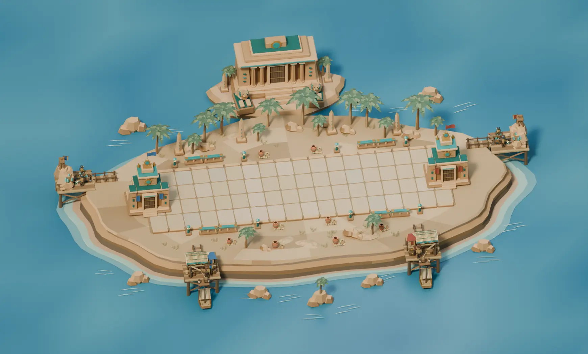
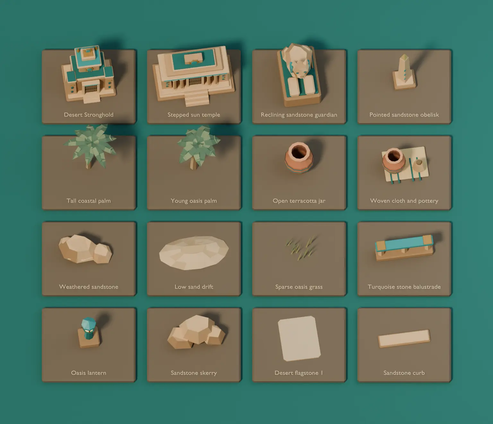
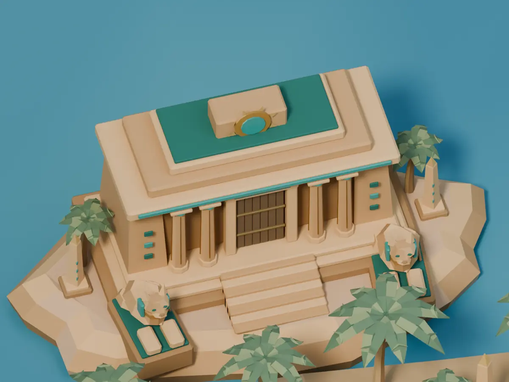
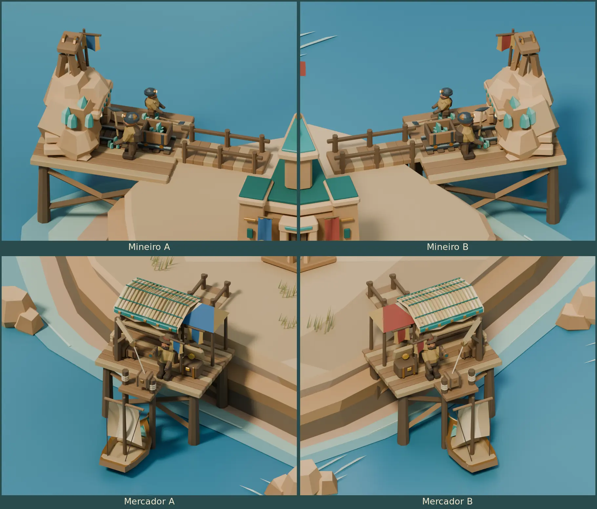
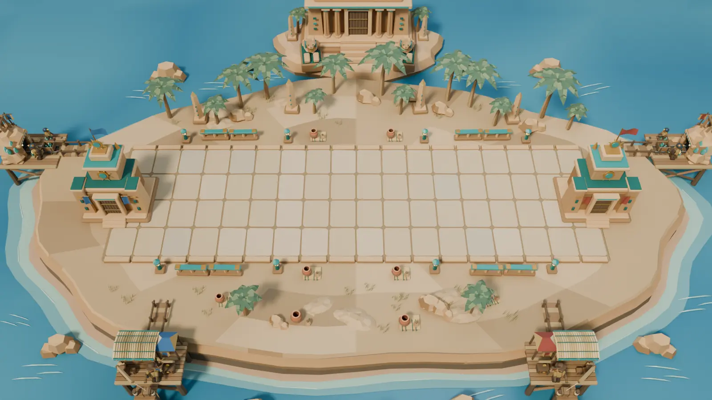

# Desert Relics Blender study

Desert Relics is the eighth arena in the current catalog. It follows
the [Verdant Forest](BLENDER-FOREST-ARENA.md) layout, the
[Frozen Tundra](BLENDER-FROZEN-TUNDRA.md) offshore mounts and the
[Clockwork Bastion](BLENDER-CLOCKWORK-BASTION.md) component workflow.
The BattleLine is 16 × 5 units at floor height zero. The Strongholds
sit at X −0.9 and 16.9. The desktop match camera uses a 35° vertical
field of view.



[Editable Blender project](../media/blender-desert-arena/desert-relics.blend)

## Model and assemble the arena

1. Build the sand plateau, banded sandstone cliffs, coastal shallows
   and blue sea as separate collections. Paint the sea with a
   vertex-color depth gradient and add separate ripple meshes.
2. Dress four muted sandstone flagstones and place 72 instances
   above the packed road bed. Fit individual curbs and place the
   turquoise rails, oasis lanterns and pottery outside the lane.
3. Build each Stronghold from tapered pylons, stepped crowns,
   carved door pieces, turquoise cornices and gold sun disks.
   Mount the architectural pennants on separate rods.
4. Assemble the offshore temple from three foundation steps, a
   recessed hall, papyrus columns, tapering wings and stepped roof
   blocks. Add a turquoise sun disk and individual gold rays.
   Place two reclining feline guardians beside the entry stair.
5. Sculpt the guardians from separate body, neck, head, ears,
   forepaws, hindquarters and tail meshes. Extend their plinths
   into the sandstone island for visible support.
6. Build palms from bent segmented trunks, individual folded
   fronds, midribs, leaflets and fruit clusters. Model terracotta
   jars with open mouths and inner walls. Add woven cloths,
   pottery groups, obelisks, sand drifts, grass and coastal skerries.
7. Parent each new sandstone mine portal to its rising quarry.
   Parent the woven reed market roof and curved turquoise-and-gold
   prow to their existing awning and vessel pivots.

The project contains 28 reusable collections. Sixteen appear on
the component board. Worker materials match across the two seats.
Architectural pennants carry the seat colors. The palms and
temple scenery are static sculpted meshes.





## Mineiro and Mercador on both sides

Mineiro A and B work the outside quarry platforms. Mercador A and B
use the front quays. All four bridges land on the plateau. Both sides
reuse the Forest auxiliary rig and its 29-second construction,
upgrade and work sequence. The mine views show tier three. The quay
views show the crane lifting a parcel from the moored boat.

The sandstone entry blocks follow the rising outcrop. The reed
roof, turquoise lashings and valance follow the awning. The curved
cutwater, side scrolls and eye insets follow the boat.



## Reproduce and validate

Run from the repository root with Blender 4.5 LTS.

```sh
blender -b -t 4 --python-exit-code 1 --python scripts/blender_desert_arena/desert_study.py -- /tmp/tbg-desert-relics
blender -b /tmp/tbg-desert-relics/desert-relics.blend -t 2 --python-exit-code 1 \
  --python scripts/blender_desert_arena/verify_desert.py -- /tmp/tbg-desert-relics/validation.json
```

The generator writes an editable project, eight PNGs and
`metrics.json`. Open `01  Desert Relics` for the seven cameras and
scrub the timeline for construction, upgrades and work. Open
`02  Desert Relics component board` for the separate samples.
The temple camera frames the entry, columns and guardians.

Blender 4.5.15 on Linux reopened the final project and checked the
72 flagstones, camera, Stronghold anchors and four shore approaches.
The verifier tested 1,852 scenic bounds and 10,762 auxiliary bounds
over 18 timestamps for BattleLine clearance. It checked construction,
both pick contacts, market upgrades, both berths, parcel hoists,
chest motion and departure. All 112 sampled hull and prow bounds
cleared the offshore scenery. It also checked the two guardians'
paired placement, scale and facing beside the temple. The study
contains 73,041 evaluated triangles, including all four precincts.



The reference match camera crops parts of the outside posts and
the rear temple. The overview and close-ups show the complete
auxiliary sites. Runtime integration, authoritative work and
delivery events, payouts and desktop platform comparisons are pending.
