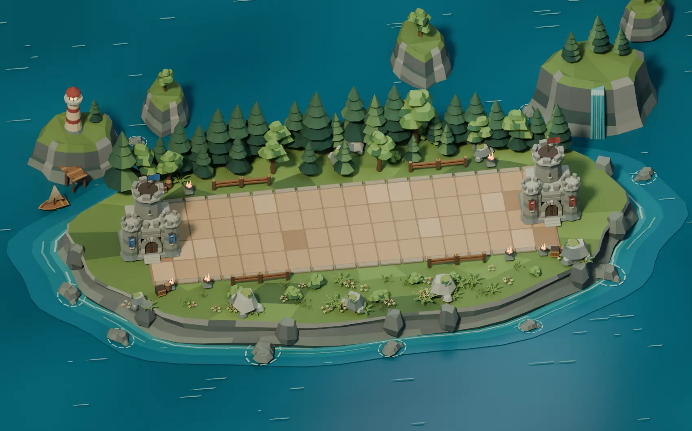
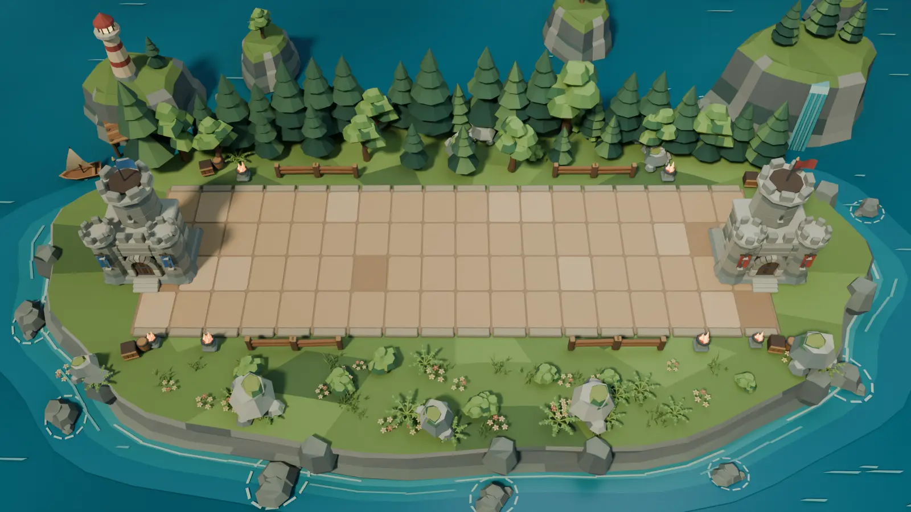
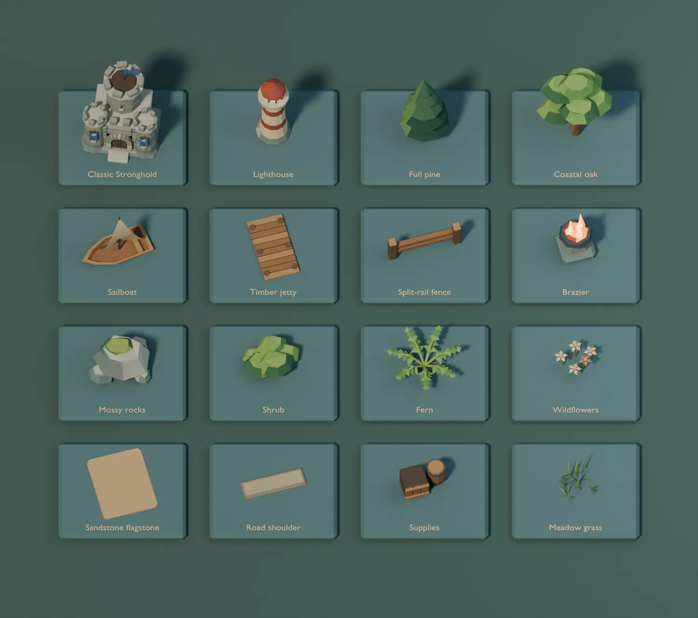

# Verdant Forest Blender study

This art study rebuilds the base Forest as an editable miniature. It uses
the [existing Forest](../media/arena-background-refinement-v2/forest-after-1920.jpg)
as a layout reference. The match camera follows the desktop 16:9 case in
`camera.rs`, the playable BattleLine is 16 × 5 units at floor height zero,
and the Stronghold origins are at X −0.9 and 16.9. The second camera is
an orthographic composition for reviewing the whole diorama.

## Assembly

Each prototype is a separate collection marked as a Blender asset.
Repeated parts are linked collection instances. The arena scene separates
terrain and coast, BattleLine, Strongholds, roadside props, forest,
understory and offshore scenery. The second scene lays out 16 samples.

- **Ground and sea.** Model the meadow surface and stratified cliffs
  independently. Paint smooth water tones on vertices and build the
  shallow shelf, tide lines, ripples and waterfall ribbons as geometry.
- **BattleLine.** Set the earth bed and stone shoulders, then place 72
  flagstones from four separately editable variants. Leave the combat
  corridor clear.
- **Strongholds.** Build the Classic model from separate plinths, courses,
  gate, arch stones, stairs, turrets and crenellations. Apply blue and red
  architectural banners as separate collections.
- **Vegetation and props.** Populate the back with pines and oaks. Place
  low ferns, shrubs, grasses, flowers and mossy rock clusters in the
  foreground. Build the fence, brazier, crate and barrel as separate
  props.
- **Offshore.** Assemble the lighthouse, timber jetty and sailboat with
  individual hull, sail and mast components. The islets, reef rocks and
  cascade are independent collections.

## Reproduce

Use Blender 4.5 LTS from the repository root. The command writes a
compressed `verdant-forest.blend`, three PNGs and `metrics.json` in the
chosen directory. It uses a fixed placement seed and no external images.

```sh
blender -b -t 4 --python-exit-code 1 --python scripts/blender_forest_arena/build.py -- /tmp/tbg-verdant-forest
```

Open `01  Verdant Forest` for the assembly or `02  Modular asset board`
for the samples. The Asset Browser's Current File library exposes all
30 collections. To edit a source collection directly, locate it in the
Outliner's Blender File view.







## Observations

Blender 4.5.15 reopened both scenes and all 30 collections. The 72
flagstone origins sit on the battle floor. Both Stronghold anchors and
the 35° vertical field of view match the reference. The evaluated
bounds of 1,118 scenic meshes outside the core ground and architecture
clear the playable rectangle in plan view.

The assembled scene has 60,586 evaluated triangles including placed
instances and bevels. This is an authoring count. The prototype shows
static scenery and the base Classic Stronghold. Runtime batching,
Stronghold damage and animation, draw calls, frame timings and visual
correspondence on Linux, Windows and desktop web are pending an
in-game integration.

The owner approved the visual direction. The [Stronghold companion
project](BLENDER-STRONGHOLDS.md) adds the four selectable kinds and
their Fortifications on this terrain.
