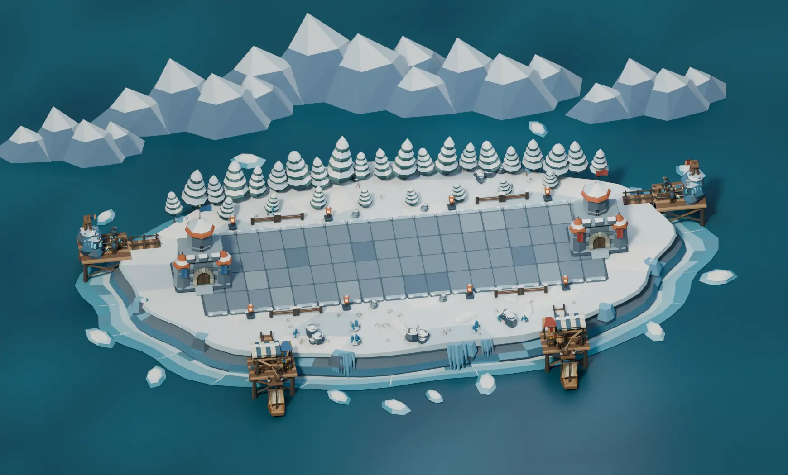
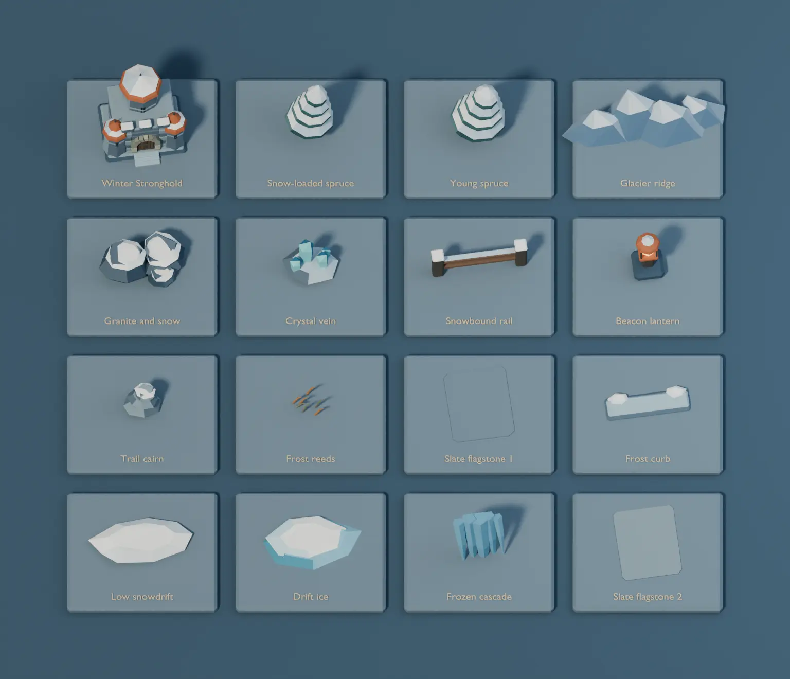
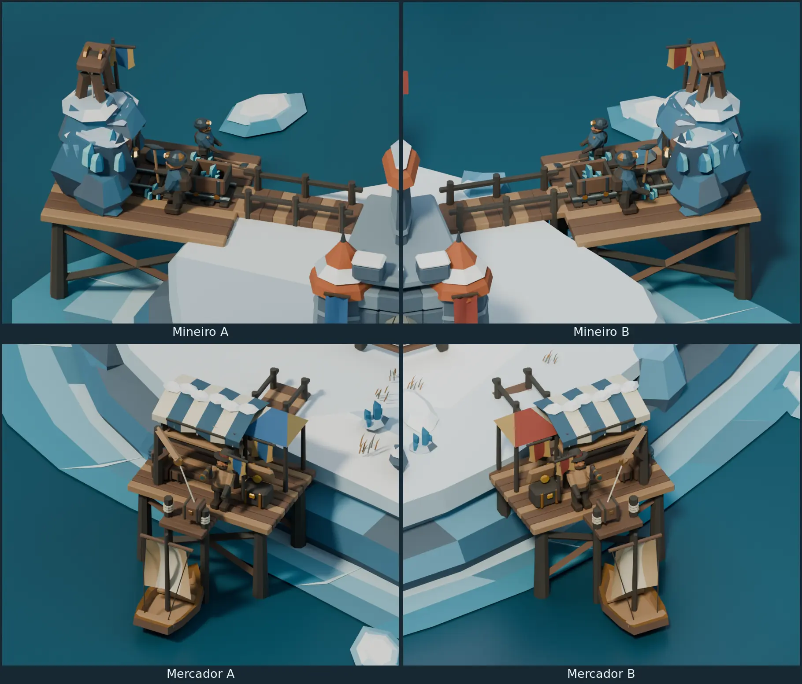
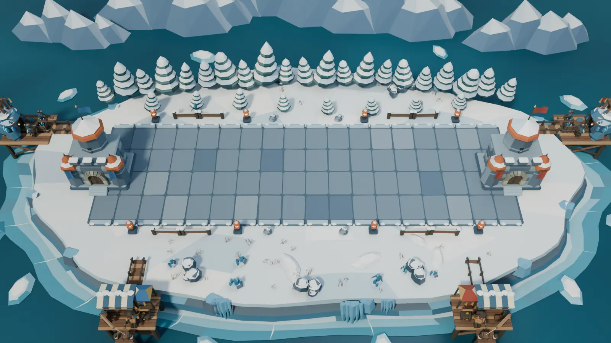

# Frozen Tundra Blender study

Frozen Tundra is the second arena in the existing catalog. This study
extends the modular [Verdant Forest](BLENDER-FOREST-ARENA.md) process.
It uses the same 16 × 5 BattleLine at floor height zero, Stronghold
anchors at X −0.9 and 16.9, and the 35° vertical desktop match camera.



[Editable Blender project](../media/blender-tundra-arena/frozen-tundra.blend)

## Winter components

The 25 asset collections can be inspected individually in the Blender
Asset Browser. Separate scene groups keep the land, road, Strongholds,
fixtures, trees, understory, coast and auxiliary precincts editable.

- A packed snow plateau sits above layered rock and a broken ice shelf.
  Cracks, low snowbanks, frost reeds and ice ribbons are modeled pieces.
- Four chamfered slate patterns create 72 flagstones. The stone lane
  separates pale figures from the snow and keeps the fight area legible.
- The Winter Stronghold uses octagonal granite towers, copper roofs,
  seated snow caps and recessed windows. The arch and architectural
  standards follow the base assembly.
- Snow layers sit on separate spruce boughs. Lanterns, railings, cairns,
  frosted boulders, crystal veins, glacial ridges and drift ice have their
  own reusable collections.



## Mineiro and Mercador

Seat A and seat B each have a mine and a market across the ice shelf.
The mine is toward the rear and the market is toward the camera.
Each bridge starts on the offshore pad and lands on the snowy
plateau. Positions mirror across the center of the BattleLine.

The Forest rigs and 29-second review timeline drive both winter sets.
The mine has snow caps, ice needles and a blue mineral vein. The new
pieces attach to the outcrop pivot and appear with its construction.
The market adds an insulated awning and a copper icebreaker shoe.
The snow follows the canvas motion and the shoe follows the moving
caravel. The worker materials match across seats. Flags identify the
architectural precincts.



## Build and inspect

From the repository root with Blender 4.5 LTS, build the scenes and
render the overview, desktop match camera, component board and four
auxiliary close-ups.

```sh
blender -b -t 4 --python-exit-code 1 --python scripts/blender_tundra_arena/tundra_study.py -- /tmp/tbg-frozen-tundra
blender -b /tmp/tbg-frozen-tundra/frozen-tundra.blend -t 2 --python-exit-code 1 \
  --python scripts/blender_tundra_arena/verify_tundra.py -- /tmp/tbg-frozen-tundra/validation.json
```

Open `01  Frozen Tundra` for the editable assembly, six cameras and
animation timeline. Open `02  Winter component board` to inspect
individual assets. The build also writes `metrics.json` and uses
deterministic placement and procedural geometry.



## Scoped validation

The saved project reopened in Blender 4.5.15 on Linux. The placement
check confirmed the four bridges, 72 flagstones, Stronghold anchors
and desktop camera. All 776 sampled scenic bounds and 9,582 animated
auxiliary bounds across 18 timestamps cleared the BattleLine. Both
miners reached the ore seam at pick contact. Both merchants berthed,
lifted a crate with the line attached, opened and closed the chest,
and sailed out. The scene contains 75,120 evaluated triangles,
including the four animated precincts and their construction pieces.

The desktop match composition crops some of the offshore sites.
The overview and close-ups cover both seats in full. Runtime asset
integration, authoritative auxiliary events, and visual comparisons
on Linux, Windows and desktop web remain pending.

The next arena adapts the same offshore placement to slag mines and armored barges. [Volcanic Forge Blender study](BLENDER-VOLCANIC-FORGE.md)
