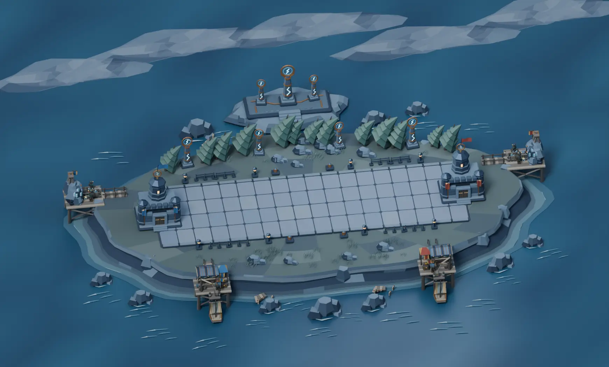
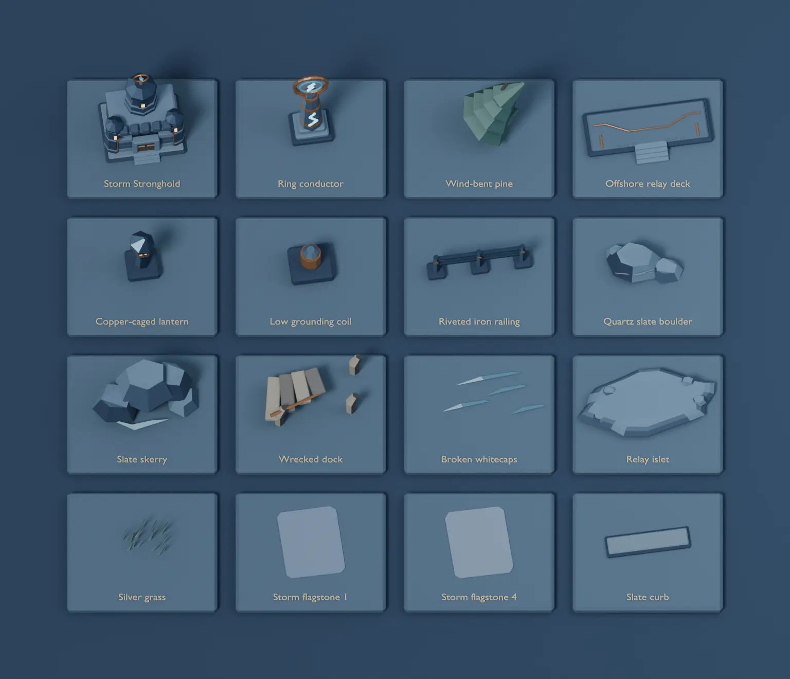
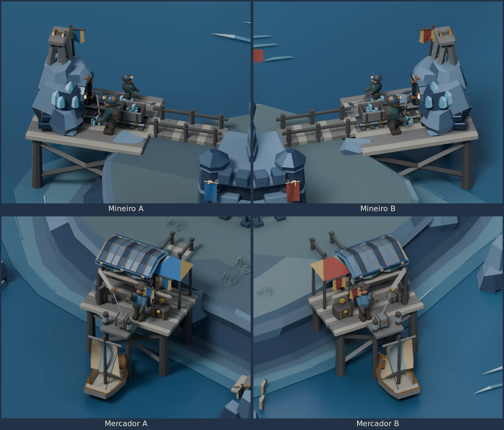
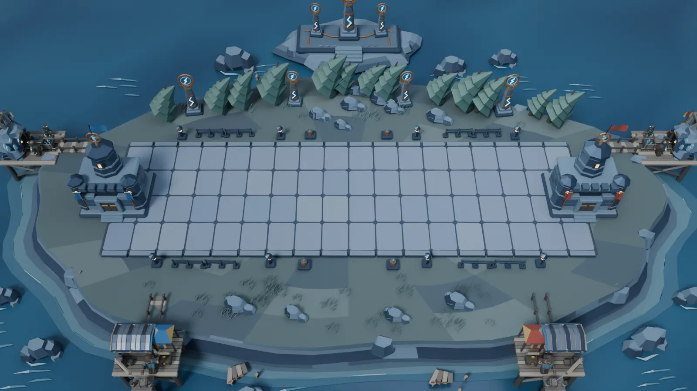

# Storm Valley Blender study

Storm Valley is the fifth arena in the catalog. It uses the
[Verdant Forest](BLENDER-FOREST-ARENA.md) layout, the
[Frozen Tundra](BLENDER-FROZEN-TUNDRA.md) offshore mounts and the
[Ancient Ruins](BLENDER-ANCIENT-RUINS.md) component workflow.
The BattleLine is 16 × 5 units at floor height zero. The Strongholds
sit at X −0.9 and 16.9. The desktop match camera uses a 35° vertical
field of view.



[Editable Blender project](../media/blender-storm-arena/storm-valley.blend)

## Model and assemble the arena

1. Build the wind-scoured plateau, layered slate cliffs, surf shelf
   and dark sea as four separate collections. Paint the sea with
   vertex colors and place small whitecap meshes around the coast.
2. Dress four slate flagstone variants and place 72 instances over
   the BattleLine foundation. Fit separate curbs and keep the copper
   lanterns, grounding coils and thin railings off the playable strip.
3. Build the banded Strongholds from slate blocks, separate turret
   courses, folded iron roof plates, oak gates and amber windows.
   Mount a copper ring finial above each watchtower.
4. Set three ring conductors on a stepped relay deck built on a
   separate offshore islet. Add wind-bent pines, silver grass,
   quartz-veined boulders, jagged skerries and wrecked dock pieces.
   Layer translucent polygonal cloud banks in the distance.
   The pale lightning shapes are fixed inlays on the conductors.
5. Fit storm-specific construction pieces to the shared auxiliary
   rigs. Attach the forged adit plates to the rising mine outcrop,
   the standing-seam roof to the market awning and the riveted
   copper-edged prow to the boat.

The project contains 26 reusable asset collections. Sixteen appear
on the component board. The two seats share worker materials and
use architectural pennants for seat colors.



## Mineiro and Mercador on both sides

Mineiro A and B work the outer slate quarry platforms. Mercador A
and B use the two front quays. All four sites have bridges to the
plateau and use the shared 29-second construction, upgrade and
work sequence. The mine views show tier three. The quay views show
the crane lifting a parcel from the moored boat.



## Reproduce and validate

Run from the repository root with Blender 4.5 LTS.

```sh
blender -b -t 4 --python-exit-code 1 --python scripts/blender_storm_arena/storm_study.py -- /tmp/tbg-storm-valley
blender -b /tmp/tbg-storm-valley/storm-valley.blend -t 2 --python-exit-code 1 \
  --python scripts/blender_storm_arena/verify_storm.py -- /tmp/tbg-storm-valley/validation.json
```

The generator writes the editable project, seven PNGs and
`metrics.json`. Open `01  Storm Valley` for the six cameras and
scrub the timeline to inspect construction, upgrades and work.
Open `02  Storm Valley component board` for the separated samples.

Blender 4.5.15 on Linux reopened the final project and checked the
72 flagstones, camera, Stronghold anchors and all four shore
approaches. The verifier tested 652 scenic bounds and 10,418
auxiliary bounds over 18 timestamps for BattleLine clearance.
It checked construction, both mine contacts, market upgrades,
both berths, parcel hoists, chest motion and departure. The 112
sampled hull and prow bounds cleared the skerries, wrecks and
relay islet. The study contains 69,425 evaluated triangles,
including all four auxiliary precincts.



The reference match camera crops parts of the offshore posts and
the rear relay. The overview and close-ups show the complete
auxiliary sites. Runtime integration, authoritative work and
delivery events, payouts and desktop platform comparisons are pending.
