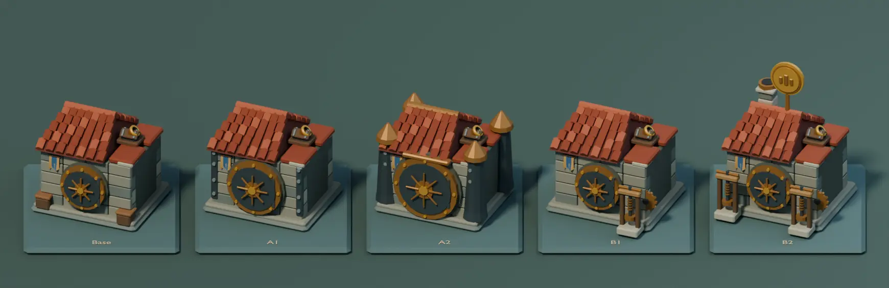
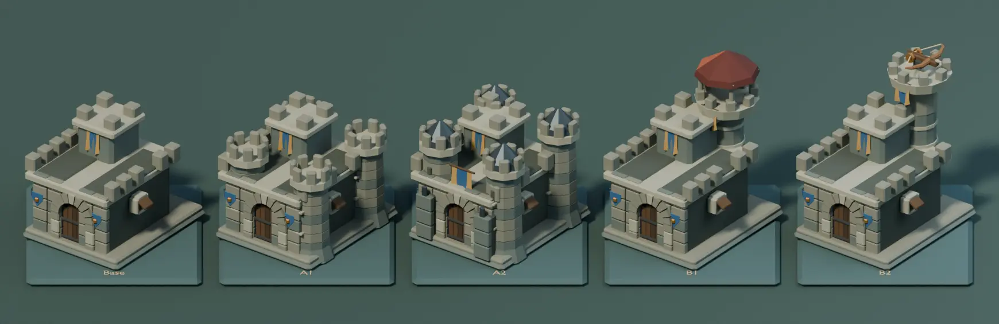
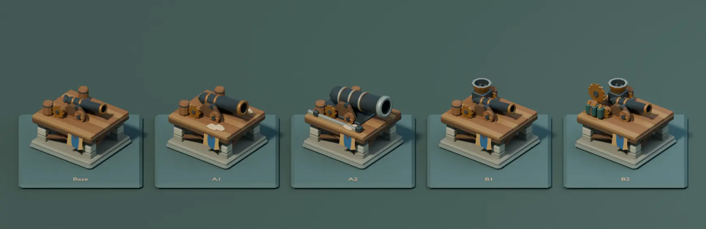
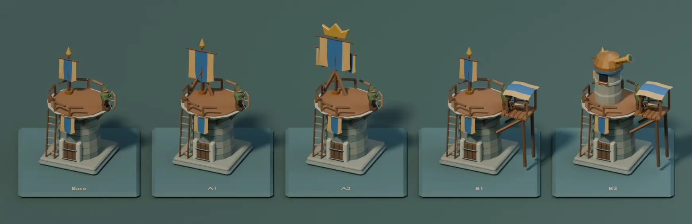
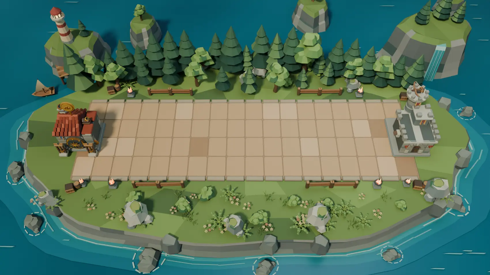
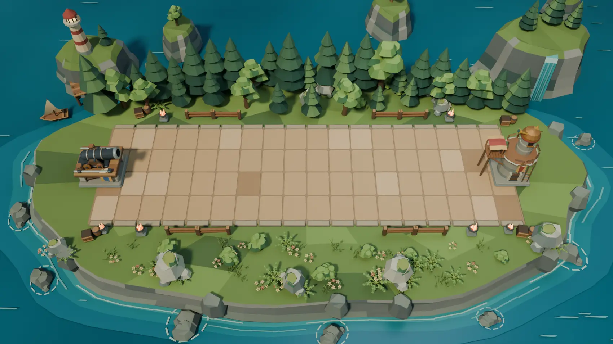

# Modular Blender Strongholds

The owner-approved [Verdant Forest study](BLENDER-FOREST-ARENA.md) now
has a companion authoring scene for all four selectable Strongholds.
The gallery follows the client order of Base, A1, A2, B1 and B2.
Fortifications retain the designs established by the Stronghold kits
and D-46.

## Gallery

**Treasury.** Base has a tiled trading house and a radial vault lock.
Reinforced Vault and Grand Vault enlarge the door and add iron bands,
then plated corner towers. Coinage adds a screw press and drive gear.
Royal Mint adds a second press, chimney and raised minted medallion.



**Bastion.** Base is a broad stone wall with a gate and falconet.
Reinforced Walls adds drum towers, and Imperial Fortress adds iron
crown caps and buttresses. Watchtower raises a covered observation
post. Royal Sentinel replaces that roof with a ballista fighting deck.



**Artillery.** Base has an open timber deck, a swivel carriage and a
recessed cannon bore. Heavy Shot and Great Cannon increase barrel
diameter and add sandbags, bracing and a recoil sled. Quick Reload adds
a hopper. Advanced Mechanism adds a shot rack and an indexed flywheel.



**Command.** Base has a round limestone tower, wood balcony, archer and
standard. War Cry raises the reinforced mast, and Supreme Command
adds a cast gold crown and side banners. Outpost adds the
map table and covered gangway. High Command adds a brass-domed
observatory with its own telescope.



## Editable project and assembly

The [Blender source project](../media/blender-strongholds/verdant-forest-strongholds.blend)
has four Fortification lineups and two Forest scenes. The 20 selectable
forms are asset collections. Their stone courses, beams, cloth and
mechanisms live in named subcollections. The Forest scenes place the
pairs on the existing X −0.9 and 16.9 origins, with the red example
reflected across its local X axis so the weapons face the BattleLine.

1. Build masonry, foundations and structural wood with the Forest
   palette. Add distinct Fortification geometry to the base profile.
2. Assemble ironwork and operating parts in their own subcollections.
   Attach shutters, levers, gears, weapons and telescope to named
   Blender pivot objects. Separate structural heraldry and keep the
   platform archer's colors independent of seat.
3. Convert Bevy coordinates to Blender as `(x, -z, y)`. Place the
   named muzzle marker on the visible bore or projectile tip in each
   weapon's local space. Use the existing native cannon and mortar
   rest pitch in the study. The shutters are displayed open for review.
4. Instance the finished collections in each board and use the approved
   Forest geometry for two 16:9 match-framed examples.

From the repository root with Blender 4.5 LTS:

```sh
blender -b -t 4 --python-exit-code 1 --python scripts/blender_forest_arena/stronghold_study.py -- /tmp/tbg-strongholds
```

The command writes the compressed Blender file, four lineups, two
Forest renders and a JSON triangle count per form. Add
`--project-only` after the output directory to generate the Blender
file and counts without rendering the PNGs.





## Verification and integration scope

Blender 4.5.15 reopened six scenes and 20 Stronghold collections,
including the two assembled Forest scenes. The check inspected 21
local muzzle markers across the forms. It checked the pivot offsets,
Artillery and Treasury rest pitch, open bore lips and bolt or arrow
tips, plus the paired Stronghold origins.

The evaluated counts span 5,018–6,686 triangles for Treasury,
3,472–7,416 for Bastion, 3,134–4,074 for Artillery and 2,158–3,258 for
Command. These are counts for the editable Blender meshes and bevels.
The runtime integration and its aim, recoil, reload, damage, collapse,
performance and platform comparisons are pending.
