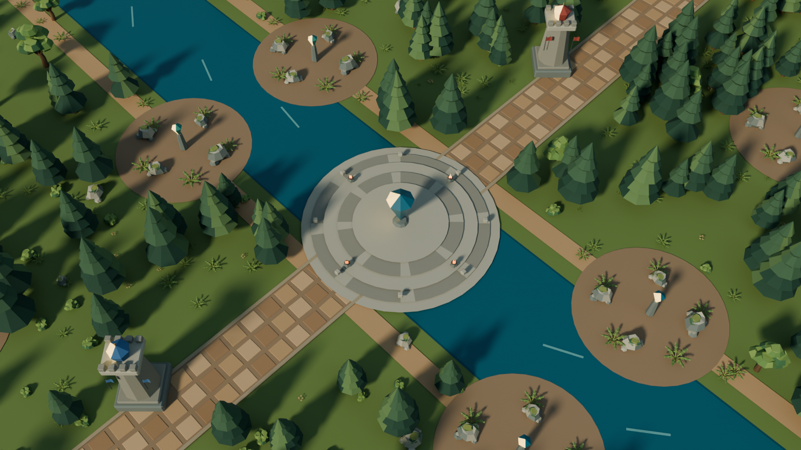
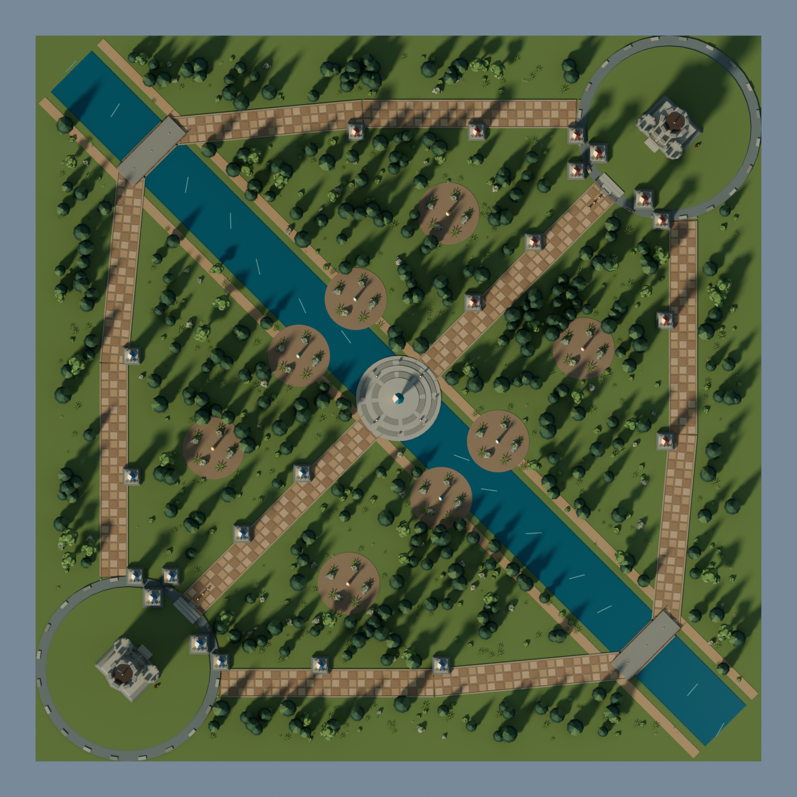
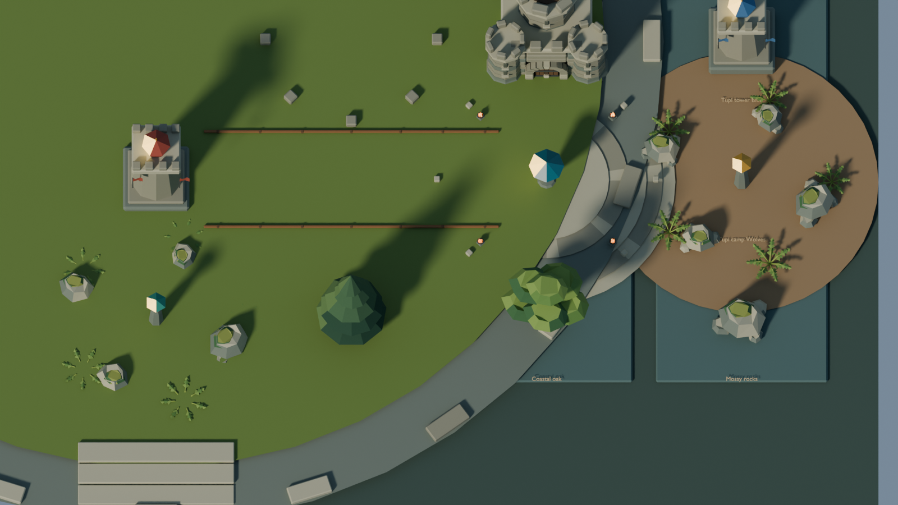

# Tupi Valley 5v5 Blender study

This study rebuilds the 5v5 MOBA map as an editable miniature. It follows
the same assembly rules as the [Verdant Forest study](BLENDER-FOREST-ARENA.md)
and the [modular Stronghold study](BLENDER-STRONGHOLDS.md), but the layout is
read from `moba/core-moba/src/map.rs`: a 200 × 200 valley, three lanes, the
diagonal river, two bridges, the central plaza, two base plateaus, 22 Towers
and eight jungle camps.

The shared 5v5 match camera is used for the review frame: 32° vertical
field of view, 56° pitch and 95 map units of distance. The second scene is a
component board for inspecting the new Tupi prototypes beside the reused
library pieces.



## Assembly

Every prototype is a separate collection marked as a Blender asset. Repeated
parts are collection instances; the scene keeps seven named layers:

- **Valley floor and river.** A 200 × 200 meadow, a diagonal water ribbon,
  sandy banks, ripples and the river bed.
- **Three lanes, bridges and plaza.** Lane beds, worn flagstones, kerbs,
  the two stone bridges with rails and lanterns, and the stepped plaza island
  with its crystal.
- **Base plateaus and Strongholds.** Grass courts, stone rims, stairs, Nexus
  plinths, the Classic Stronghold and its team banners.
- **Towers and team pennants.** Separate plinth, shaft, crown, crystal,
  finial and cloth collections instanced at the 11 Blue and 11 Red positions.
- **Jungle camps.** Clearing, outcrops, ferns and a kind-tinted camp crystal
  for Wolves, Golems, Jaguar and Frogs.
- **Forest edge.** Pines, oaks and understory placed outside lanes, water,
  bases, Towers and camps with a fixed seed.
- **Shoreline understory and props.** Braziers, fences, supplies and the
  component-board studio.

The reusable library comes from
`docs/media/blender-strongholds/verdant-forest-strongholds.blend`:
Classic Stronghold, Blue and Red banners, Full/Sparse pine, Coastal oak, Fern,
Shrub, Wildflowers, Meadow grass, Mossy rocks, Tide rocks, Brazier,
Split-rail fence and Supplies. The new Tupi prototypes are the lane
flagstones/kerbs, bridge deck, plaza island, base plateau, Nexus plinth,
Tower per team, camp per kind and the Stronghold crest.

## Reproduce

Use Blender 4.5 LTS from the repository root:

```sh
blender -b -t 4 --python-exit-code 1 \
  --python scripts/blender_tupi_valley_5v5/build.py -- /tmp/tbg-tupi-5v5
```

Add `--project-only` after the output directory to write the `.blend` and
`metrics.json` without rendering. The command writes:

- `tupi-valley-5v5.blend` with `01  Tupi Valley 5v5` and
  `02  Tupi Valley component board`.
- `tupi-valley-overview.png` (square 1600 px map overview).
- `tupi-valley-match.png` (1600 × 900 match-framed review).
- `tupi-valley-kit.png` (1600 × 900 component board).
- `metrics.json` with collection names, object counts, triangle counts and
  the match-camera values.

## Observations

Blender 4.5.15 reopened both scenes and all 40 collections. The main scene has
2,244 objects and 321,922 authored triangles including collection instances;
the component board has 40 objects and 12,058 triangles. The six base/Tower
groups, 22 Tower instances, eight camp clearings and all lane/bridge/plaza
prototypes evaluated complete. The layout was checked against the Rust map
constants for lane waypoints, river crossing, plaza radius, base radius,
Tower positions and camp positions.





## Runtime scope

The 5v5 **champion** figures now come from the shared 1v1 Blender
`FigureLibrary` and `tbgmesh` assets: the same meshes, rig, clips, weapon
sockets, glow layers and team-independent materials, with the existing 3×
map adapter. The map itself is still assembled by the runtime Rust scene.
Turning this Blender map study into batched runtime terrain, bridge and prop
meshes, preserving fog, water animation, Tower damage and platform
correspondence, remains a separate integration step. This study is an
authoring reference, not a runtime replacement and not a parity claim.
