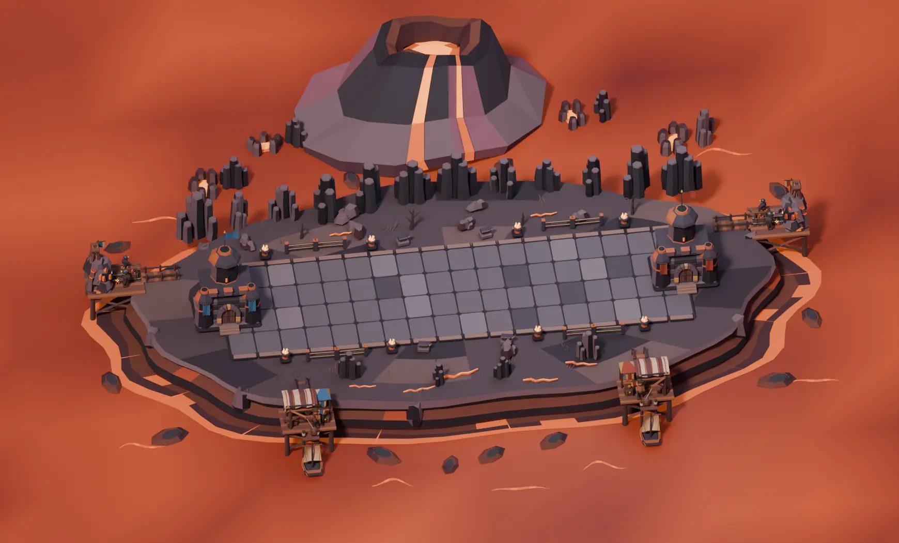
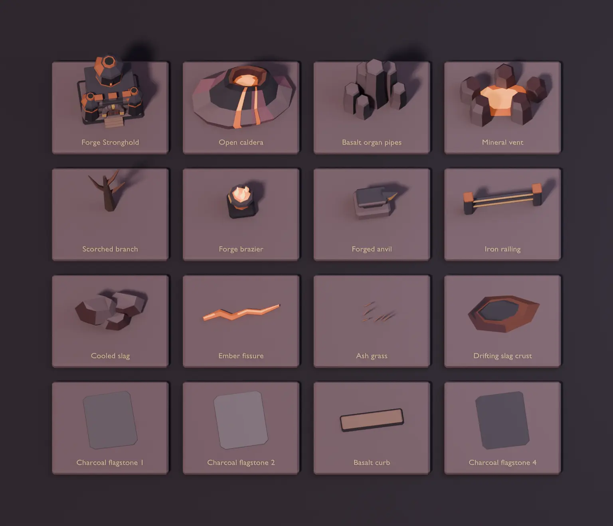
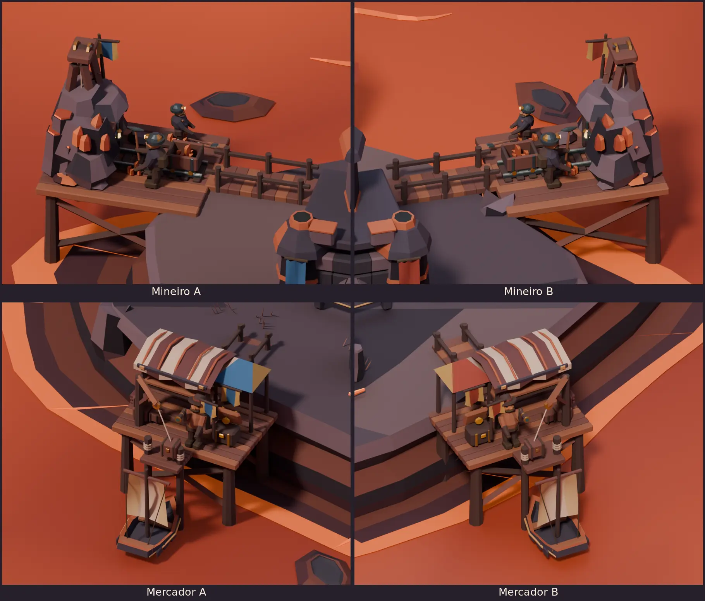
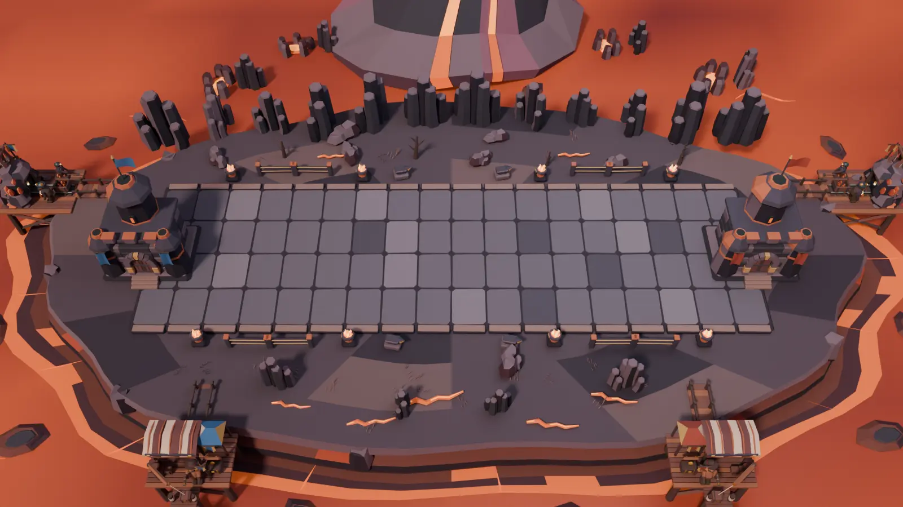

# Volcanic Forge Blender study

Volcanic Forge is the third arena in the existing catalog. The
editable diorama uses the [Verdant Forest](BLENDER-FOREST-ARENA.md)
layout and the [Frozen Tundra](BLENDER-FROZEN-TUNDRA.md) offshore
setup. The BattleLine is 16 × 5 units at floor height zero. The
Strongholds sit at X −0.9 and 16.9. The desktop match camera uses
a 35° vertical field of view.



[Editable Blender project](../media/blender-volcanic-arena/volcanic-forge.blend)

## Forge components

Twenty-four reusable collections hold the arena's editable parts.
Four cut-stone variants make 72 charcoal flagstones. The broader
platform, basalt strata, cooling crust and lava basin are separate
layers. The BattleLine's neutral gray keeps character silhouettes
distinct from the lava and coals.

- Forge Strongholds use octagonal basalt chimneys, copper bindings,
  recessed windows, heated slots and shaped gate masonry.
- Foundry props include brazier bowls, anvils, forged rails, dry
  branches, ore fissures and clusters of separate basalt pipes.
- The offshore scene uses an open caldera with fitted molten runnels,
  mineral vents, scattered slag crust and thin lava currents.



## Mineiro and Mercador on both sides

Each seat has one Mineiro on a rear platform and one Mercador on
a front quay. The four bridges land on the plateau. Both sides use
the Forest workers and their 29-second construction, work and
delivery timeline.

Separate basalt pipes, broken ore crowns and a hot mineral seam
attach to each mine's rising outcrop. The markets use copper
awning ribs and iron-edged roofs. Each animated barge carries a
fitted prow shroud and removable-looking heat plates on its hull.
The worker materials match across seats. The precinct pennants
identify the architecture.



## Reproduce and validate

From the repository root with Blender 4.5 LTS:

```sh
blender -b -t 4 --python-exit-code 1 --python scripts/blender_volcanic_arena/forge_study.py -- /tmp/tbg-volcanic-forge
blender -b /tmp/tbg-volcanic-forge/volcanic-forge.blend -t 2 --python-exit-code 1 \
  --python scripts/blender_volcanic_arena/verify_forge.py -- /tmp/tbg-volcanic-forge/validation.json
```

Open `01  Volcanic Forge` to use the six cameras and scrub through
construction, upgrades and deliveries. Open `02  Forge component board`
to inspect samples of the separate collections. The build writes
an editable project, seven PNGs and `metrics.json`.

Blender 4.5.15 on Linux reopened the final file and checked the
camera, Stronghold anchors, flagstones and bridge approaches.
The verifier checked 630 scenic bounds and 9,762 auxiliary bounds
over 18 timestamps for BattleLine clearance. It also checked both
pick contacts, both crane lines, and both barge arrivals and
departures. It compared 32 sampled hull and prow bounds against
the drifting slag. The assembled study contains 65,614 evaluated
triangles. The Tundra project also passed its saved-scene verifier
after the shared offshore helpers were extracted.



The reference match camera crops parts of the four offshore
precincts. The overview and close-ups show all four.
Runtime integration, authoritative events and desktop platform
comparisons remain pending.

The next arena is the [Ancient Ruins Blender study](BLENDER-ANCIENT-RUINS.md).
