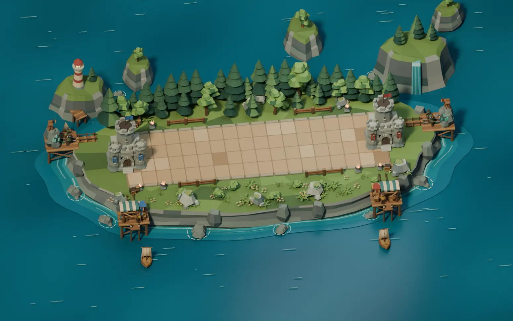
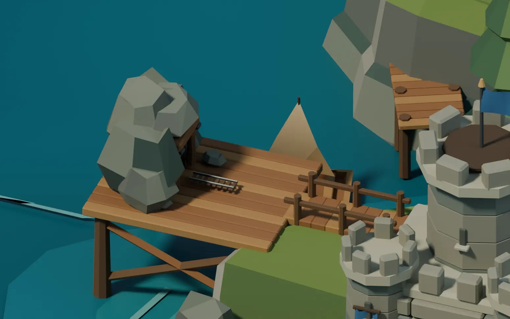
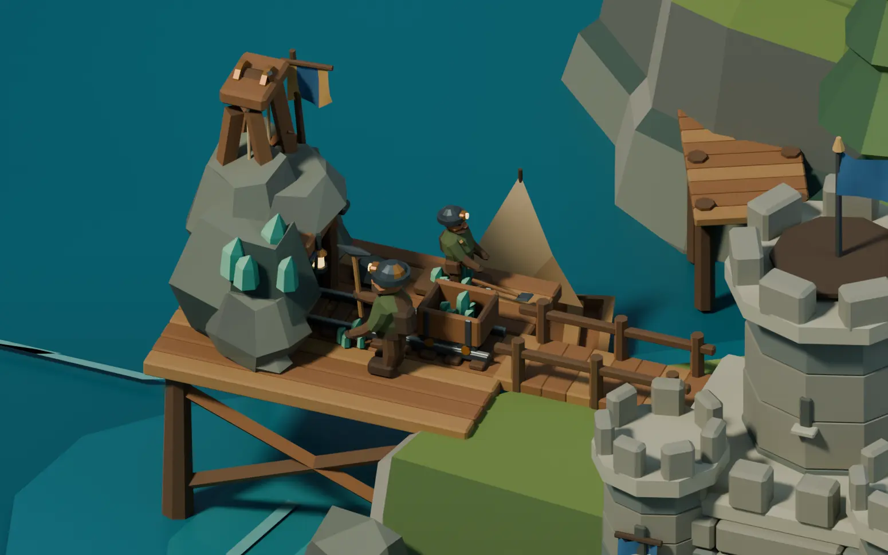
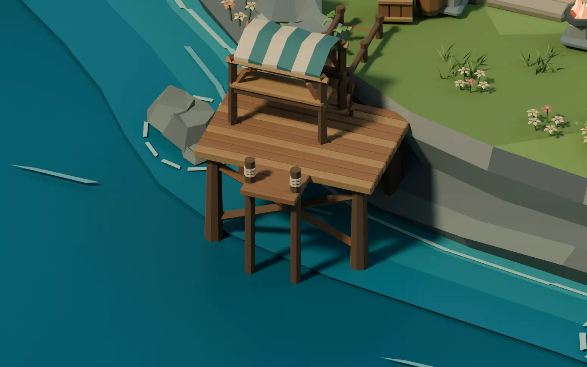
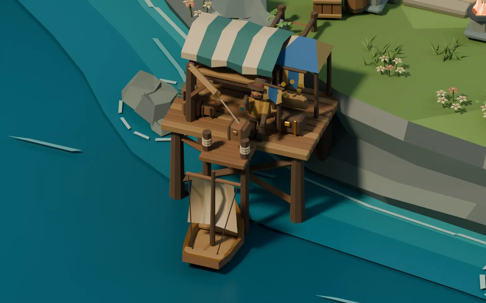

# Animated Blender War Auxiliaries

This companion study places Mineiro and Mercador on both seats of the
owner-approved [Verdant Forest](BLENDER-FOREST-ARENA.md). Four offshore
pads and their shore approaches use placements authored against this
Blender coastline. Keep the existing game layout in
`arena/auxiliaries/placement.rs` as the runtime reference. The worker
models share the same materials across seats. The attached market
cloth and precinct pennants carry the seat colors.

[Editable Blender project](../media/blender-auxiliaries/verdant-forest-auxiliaries.blend)
· [Mineiro clip](../media/blender-auxiliaries/mineiro.mp4)
· [Mercador clip](../media/blender-auxiliaries/mercador.mp4)



## Mineiro

1. Drive the shore posts and place the bridge treads in sequence. Assemble
   the braces and platform deck. Raise the slate outcrop and install the
   oak shoring, track, lantern and cart.
2. Walk the miner in with alternating leg and arm poses. Swing the
   shoulder, elbow, spine and head through anticipation, strike and
   recovery. Sample the forged pick tip at contact to place the spark
   burst and ore seam. Rock the lantern and move the loaded cart.
3. Reveal the winch, bucket and sorting tray at level 2. At level 3, add
   the headframe, moving sheave, crystal seam, banner and apprentice
   with a shovel loop. Settle the worker and hauling motions at the
   end of the review.





## Mercador

1. Lay the bridge and pilings, place the pier apron, raise the stall
   frame, then add the stitched canopy, cargo and unloading crane.
   Walk the worker to the counter and quay.
2. Raise the spyglass as the caravel approaches. Rock the ship, berth
   it, lift the crate with the crane line following its attachment, and
   turn the ship away from the pier. Return the spyglass to its carry
   pose.
3. Add the quay pennants and cargo stacks at level 2. Add the pavilion
   and hinged chest at level 3. On the third illustrated delivery, open
   the chest, throw a brief coin burst and close it again.





## Timeline and reproduction

The editable scene runs at 16 fps and has Overview, Mineiro and
Mercador cameras. The markers show construction, openings, upgrades,
deliveries and the completion pose. The Mineiro construction takes
12 s. The Mercador visual construction takes 3 s, and each illustrated
delivery takes 3.2 s. The Mineiro strike cycles are 1.35, 1.10 and 0.90 s
by level. Upgrade, delivery and completion triggers are staged for the
29 s review timeline. Game state and payout authority belong to the
existing rules.

The parts are modeled separately with the Forest mesh and material
helpers. Rigid rig joints and prop pivots are parented Blender objects
with local transform keyframes. Cycles renders the stills. The review
clips sample the same timeline at 8 frames per second with Workbench.
The project uses no external images.

From the repository root with Blender 4.5 LTS:

```sh
blender -b -t 4 --python-exit-code 1 --python scripts/blender_forest_arena/auxiliary_study.py -- /tmp/tbg-auxiliaries
blender -b /tmp/tbg-auxiliaries/verdant-forest-auxiliaries.blend -t 3 --python-exit-code 1 --python scripts/blender_forest_arena/render_auxiliary_clip.py -- Mineiro /tmp/tbg-auxiliaries/mineiro-frames
ffmpeg -framerate 8 -pattern_type glob -i '/tmp/tbg-auxiliaries/mineiro-frames/frame-*.png' -vf fps=16 -c:v libx264 -crf 24 -pix_fmt yuv420p -movflags +faststart /tmp/tbg-auxiliaries/mineiro.mp4
```

Use `Mercador` and a separate frame directory for the second clip.

## Verification and scope

Blender 4.5.15 reopened the project, inspected both seats, and checked
construction groups and level reveals, the mining strike, ship arrival
and departure, the line-to-crate attachment and chest closure. Across
13 timeline samples, 9,282 transformed mesh bounds from the four
precincts stayed outside the playable keep-out corridor.

This is the animated Blender authoring study. Native model replacement,
authoritative trigger wiring, reduced-motion behavior, runtime
performance and cross-platform comparison are pending integration.
