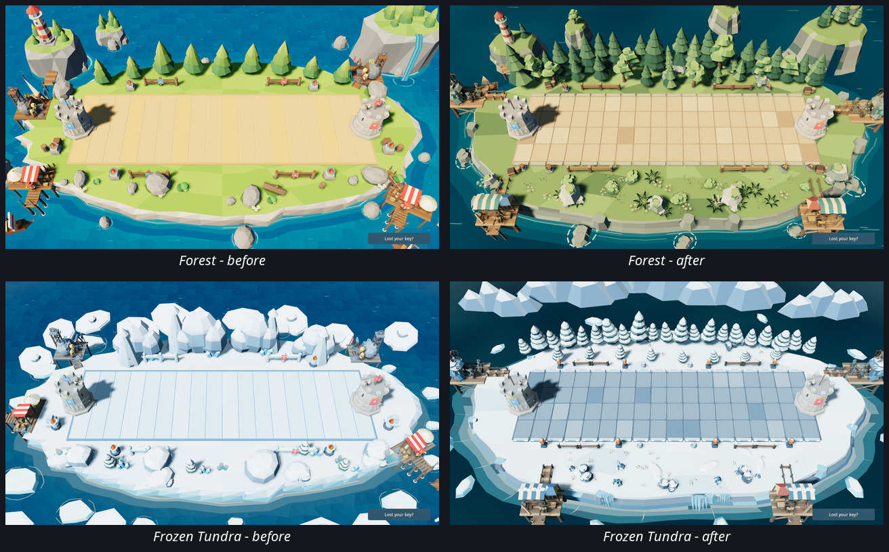
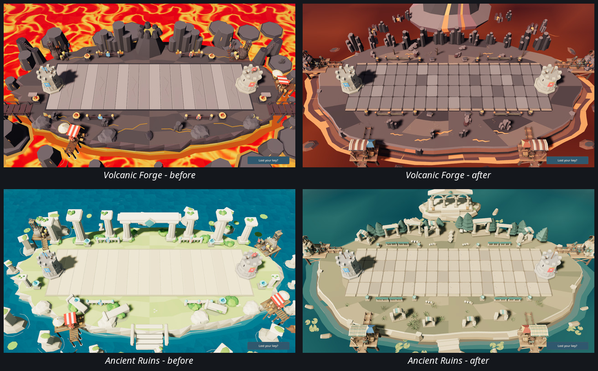
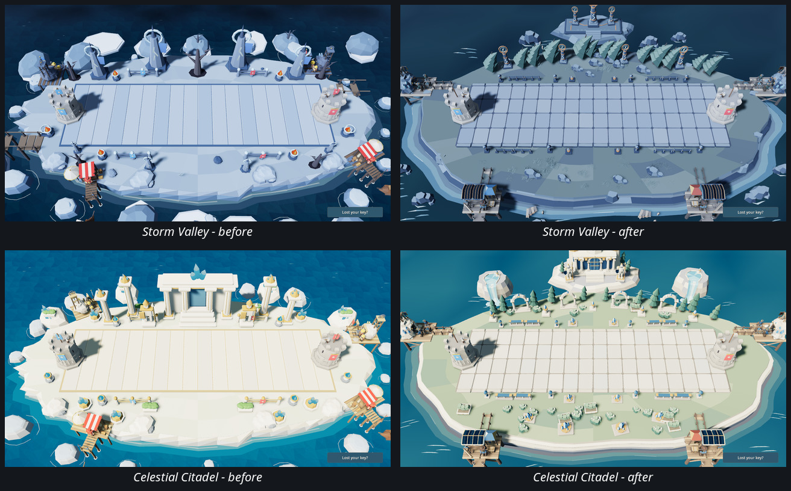
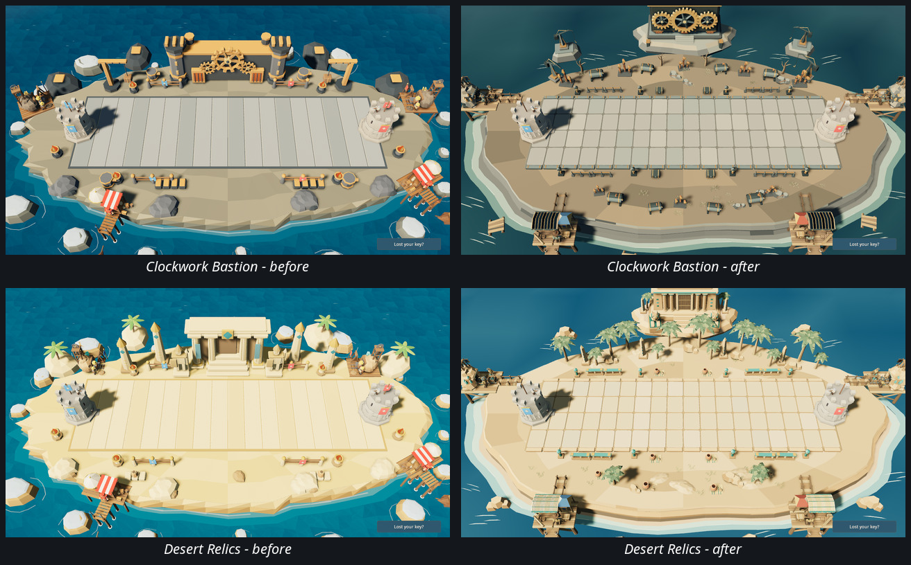
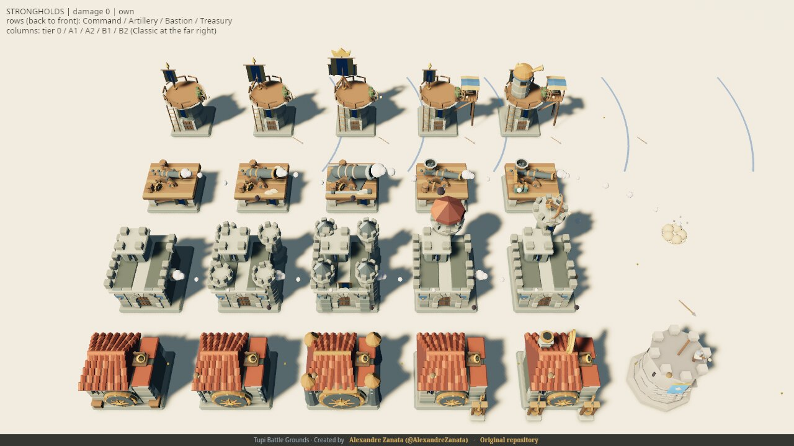
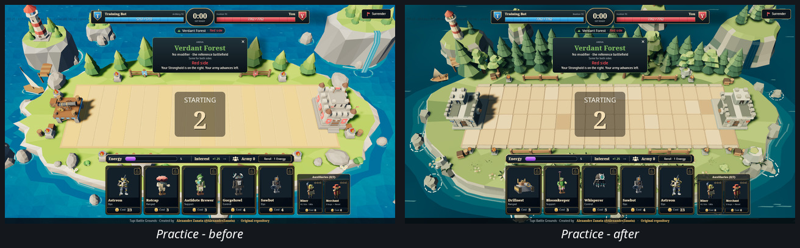
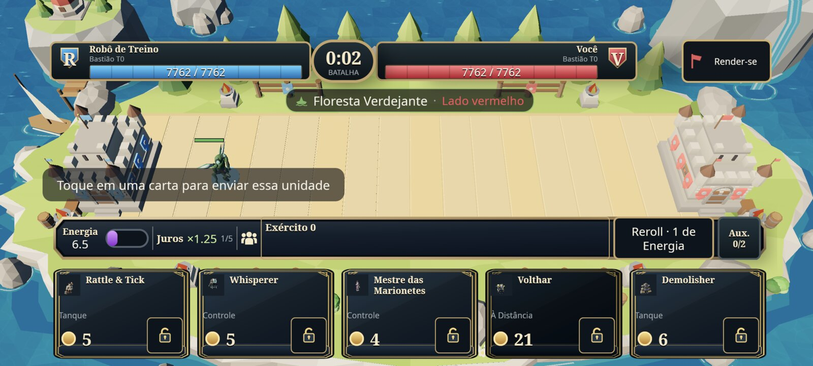
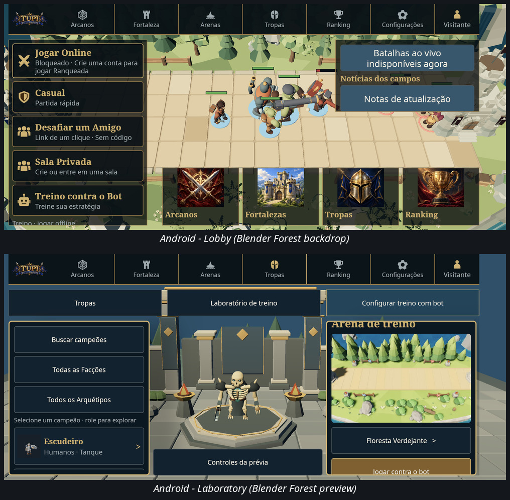
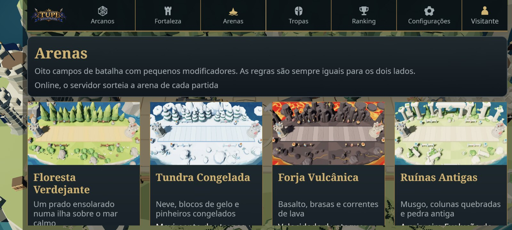

# Blender playable art gallery

Before/after captures for the playable Blender Arena delivery (PR #80).
Linux is the reference. The same shared client renders Windows, desktop web
and Android; only Linux and one physical Android device were captured.

Each set uses the same camera and framing for its pair. Motion frames are not
captured; the scenes were captured at rest.

## Capture provenance

| Set | Platform | Client | Commit | Scenario |
|-----|----------|--------|--------|----------|
| Desktop arenas | Linux, X11, NVIDIA RTX 4060, Vulkan | 0.1.4-colossus.7 | 83c10322 | Arena preview, identical camera per pair |
| Desktop strongholds | Linux, same build | 0.1.4-colossus.7 | 83c10322 | `?gallery=strongholds`, own seat, damage 0 |
| Desktop practice | Linux, same build | 0.1.4-colossus.7 | 83c10322 | offline Practice, both frames at `STARTING 2` |
| Android runtime | Xiaomi 2311DRK48G, Android 16 / SDK 36 | 0.1.4-colossus.8-android.57 | e2c94652 | lobby, Laboratory, Arena selection |
| Android before | same device, previous champion-only beta | revision 56 | - | offline Practice, old procedural Forest |

The desktop captures come from the render build at 83c10322. The branch head
e2c94652 differs only by the version bump and behavior-preserving clippy
fixes. The Android package and its captures are built from e2c94652.

## Arenas, before and after

## Strongholds and Practice

`Command`, `Artillery`, `Bastion` and `Treasury` across the five Fortification
forms, with the Classic skin at the far right.

## Android

Previous champion-only beta: old procedural Forest in a Practice match.

Blender Forest backdrop and Laboratory Arena preview on the physical device.

## Pending

These scenarios are not captured and are not verified:

- Android in-match with the new Arena, Strongholds and War Auxiliaries on the
  physical device.
- War Auxiliary construction, work, upgrade and delivery motion on either
  seat. The still frames show the precincts present, not the hired tracks.
- Tower muzzle, recoil, reload, damage and destruction frames in a live match.
- Windows desktop runtime capture.
- Desktop web runtime capture.
- Reduced-motion comparison.
