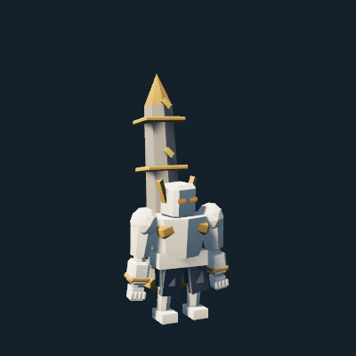
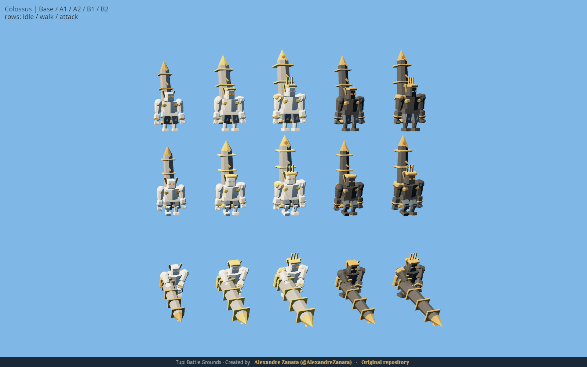

# Gods, Colossus and the wide BattleLine

Current owner correction: [RESTORE-01](../phases/LEGACY-CROWD-RESTORATION.md) restores immediate pieces and legacy cosmetic pushing in all normal modes. The physical-capacity proposal below is historical and disabled in Practice/Training.

Owner revision TW-01 / PK-01 / GD-01, 2026-11-02. All new numeric values are
Proposed in [GAME-DESIGN](../GAME-DESIGN.md#tw-01--pk-01--gd-01--proposed-owner-revision-2026-11-02).
Implementation and evidence: [phase report](../phases/COLOSSUS-FORTIFICATIONS-PACKING.md).

## Colossus / Colosso

Gods / Deuses begins with one grounded Tank, cost 18 Energy, 2400 base HP,
170 damage, 110-tick interval, 4500 range and 1800 frontal splash. Its reach
matches the corresponding Ogre Archer form and base damage is exactly double.
It carries one giant obelisk on the back and draws/slams that same mesh.
No projectile substitution, duplicate back weapon or floating team plaque.

Ivory stone, slate mantle, bronze glyph bands and amber eyes establish its
base identity. A forms develop a radiant gold/ivory crown and solar obelisk;
B forms use charcoal monumental armor and amber inlays. The giant hands are
sculpted, with individual fingers. Heavy footfalls, an overhead draw, grounded
impact, kneeling death and slow victory salute share the normal rig pipeline.

Forms: Base; A1 Sun Obelisk / Obelisco Solar; A2 Pillar of Dawn / Pilar da
Aurora; B1 Ancient Monolith / Monólito Ancestral; B2 Eternal Monument /
Monumento Eterno. A favors damage/reach/area and B endurance. Existing common
Evolution bonuses apply. Only foot rings identify teams.

Gods currently has no Synergy bonus and only this champion. The authored
private roster is 82 in 10 Factions; online FULL_POOL remains 46. New content
is available in Practice and Training. No public release is implied.

## Capacity

The candidate is active in private Practice, Training and explicit preview lab experiments.
Competitive canonical matches retain legacy movement pending D-33; repeated
preview bot probes exposed persistent long-run stalemates.

The server reserves integer lateral columns using real body/equipment mesh
measurements. [Raw native profiles](native-footprints.json) cover 87 kinds
and 435 forms including summons. The [core table](../../crates/tbg-core/src/content/occupancy.rs)
is the quantized normative profile. A full-width unit blocks passage; free
strips permit gradual bypasses. Stationary roots retain their slots. Paid
units without space wait rather than disappear. A rejected Evolution spends
no Energy. The local HUD exposes the waiting count.

An initial 3-tile corridor stranded attackers behind idle Supports; the
candidate uses 5 usable tiles with the common floor widened accordingly.
The Practice bot upgrades deployed power and seeks narrow attackers while its
entrance has a queue.
Long-run competitive balance is a separate D-33 acceptance requirement.

## Strongholds

All base damage is exactly tripled; HP is increased by 50% with integer
truncation. Fortification costs are 6 and 10 Energy. Treasury has stronger
spoils, Bastion real incoming armor, Artillery capped collateral splash and
Command a stronger, wider aura. Shared presentation JSON is pinned to core.

Linux is the visual reference. Native captures and install receipts are
recorded with their real source/binary provenance. Windows/game-web visual
comparison, full D-33 acceptance and owner look/fun sign-off remain pending.

The final bounded Energy-18 panel beats Archer/Longaxe and loses to Ogre Archer
and Trident on both seats. At Energy 24 the base Sawbot, Farwatch and Mantis
panels also counter it. Those results, including evolved references that still
lose, are recorded without claiming full competitive acceptance.

## Actual Linux model captures

[Renderer provenance](render-manifest.json) and [native witnesses](native-witnesses.json)
record the real source revisions and original image hashes. The portrait is
lossless engine output; the Evolution sheet is the original native PNG.
[Installed build verification](installed-validation.json) records all 380 asset
hashes and the exact debug binary. Local review: <http://localhost:8966/>;
updated 82-champion landing: <http://localhost:8604/#champions>.
