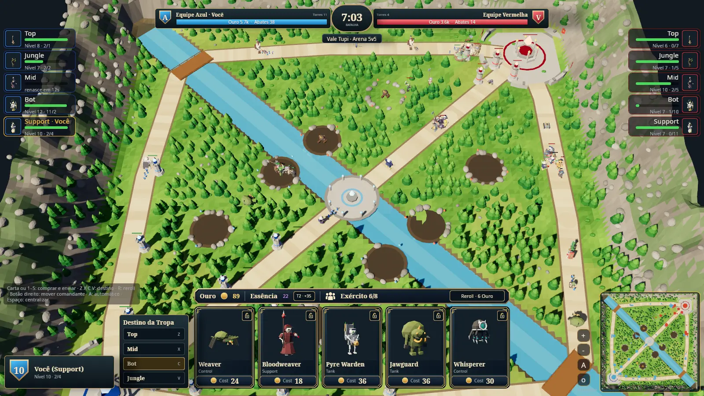

# Game design — TBG Arena 5v5 (MOBA mode)

> Canon of the 5v5 mode. **Every rule and number here is Proposed**
> (owner request, 2026-11-03) and **unbalanced**: balance work starts only
> after the mode is 100 % functional and the owner explicitly asks for it.
> The 1v1 canon ([GAME-DESIGN.md](../GAME-DESIGN.md)) is untouched; this mode
> shares its spirit (buy units, send them, never micro-manage combat) and
> its glossary style, not its rules. Rule IDs `M-xx` are cited by the
> contract tests in `moba/core-moba/tests/contract_moba.rs` and
> `moba/server-moba/tests/room.rs`.

Historical P76 capture; current P77 Seats have no avatars (M-65).

## 1. Pillars

1. **Ten strategists, one valley.** Two teams of five, one role each, on a
   three-lane map with a jungle and a river — readable at a glance.
2. **Strategy over twitch.** Players have no avatar and never steer a
   champion. Choose what to buy and its Lane/Jungle Destination; movement
   and combat are automatic (owner revision, 2026-11-03, M-65).
3. **One roster, two modes.** Troops *are* the 1v1 champions: same names,
   archetypes, base stats, prices (in Gold), Shop rules, portraits, 3D
   figures, animations, shots and impacts. What is new in 5v5 are the lane
   Minions, Towers, the jungle and the five strategic Roles.
4. **No delay for anyone.** The server ticks at 20 Hz, sends one shared
   world frame per Team per tick and never lets a slow player delay the other nine.
5. **Bots everywhere.** Every empty seat is a bot using the same intentions
   as a human, so a match always has ten sides and a human can drop in or out.

## 2. Glossary (use these words exactly)

| Term | Meaning |
|---|---|
| `Seat` | One of ten player slots: Blue `0..5`, Red `5..10`. Assigned by the host from the connection, never from a message. |
| `Team` | `Blue` (south-west base) or `Red` (north-east base). |
| `Role` | `Top`, `Jungle`, `Mid`, `Bot`, `Support` — seat index modulo 5. |
| `Lane` | `Top`, `Mid`, `Bot` road between the two Strongholds. |
| `Destination` | Where a purchased Troop goes: a `Lane` or the `Jungle` ("Destino da Tropa"). |
| `Commander` | Reserved P76 protocol term only. There is no player avatar or Commander in an active match (M-65). |
| `Troop` | A 1v1 champion (`tbg_core::UnitKind`) bought in the `Shop` and sent to a `Destination`. |
| `Shop` | Five offers per player: three role-filtered and two unrestricted drawn from the 1v1 online pool, with locks and a paid reroll, as in the 1v1 game. |
| `Minion` | Free lane unit spawned in `Wave`s by each Stronghold. |
| `Wave` | Three melee + two ranged Minions per lane, per team, every 30 s. |
| `Camp` | A jungle pit of Wolves, Golems, Jaguar or Frogs (M-60). |
| `Tower` | Defensive structure: Outer, Inner, Base per lane, plus two Nexus towers. |
| `Stronghold` | Each team's crystal; destroying the enemy's wins. |
| `Gold` | Currency for Troops (coins on the HUD). |
| `Essence` | Second currency (purple gem) spent on Troop `Upgrade`s. |
| `Upgrade` | Raises the player's Troop tier (+HP and damage for new Troops). |
| `MobaIntention` | The only way a player or bot acts: `BuyTroop`, `Reroll`, `ToggleLock`, `Upgrade`. Legacy movement intentions are rejected (M-65). |

## 3. Match structure

- **M-01** A match has 10 Seats in 2 Teams of 5 with roles Top, Jungle,
  Mid, Bot, Support. No Seat owns an avatar. The simulation ticks at 20 Hz.
- **M-02** One map, *Tupi Valley* (`moba/core-moba/src/map.rs`), 200 × 200
  units: three Lanes, a river from corner to corner (presentation only),
  a central plaza, 8 Camps (4 per jungle), 11 Towers and 1 Stronghold per Team.
  Red's layout is Blue's reflected across the anti-diagonal.
- **M-03** Same seed + same intentions ⇒ identical match (integer state,
  id-ordered units, no clocks, no unseeded randomness, no HashMap iteration).
- **M-04** Bots never act for human seats; humans and bots use the same
  `MobaIntention` validation.
- **M-05** The seat of an intention comes from the host (connection or bot
  slot), never from the message.

## 4. Units and combat

- **M-06** Every unit has HP, damage, range, attack interval, speed, armor
  (% damage ignored), sight and a body radius (table in §6).
- **M-07** Decisions use the start-of-tick state and all damage lands at
  once (simultaneous resolution). **Proposed owner revision:** commit to
  a valid target through pursuit, windup and cooldown. After the windup,
  release dead, protected, carried or otherwise invalid enemies and
  enemies beyond pursuit range. Mobile pursuit keeps the larger of
  weapon range and sight plus half the unit's sight, with the existing
  target-body allowance. Fixed attackers keep enemies within actual
  attack range. When acquiring, prioritize Guard, then candidates already
  in reach, then nearest distance and lowest id. A healer keeps an
  eligible wounded patient, and basic control casts keep eligible
  recipients. Neutral camp retaliation and leash still apply.
- **M-08** Tower order: an Inner Tower is invulnerable while its lane's
  Outer stands; a Base while its Inner stands; Nexus Towers while all three
  Base Towers stand; the Stronghold while either Nexus Tower stands.
- **M-09** Structures never move. Walking units reserve space and recover from
  spawn overlaps according to M-70/M-72.
- Lane walkers and structures ignore neutral monsters; jungle Troops
  hunt them. Monsters are passive until hit and leash 9 units
  from their camp, healing fully at home.

## 5. Economy, shop and progression

- **M-10** Clicking a Shop card (or pressing 1–5) buys that champion for its
  card price and sends it to the chosen Destination; insufficient Gold is
  rejected. Price = the champion's 1v1 Energy cost × 6 Gold.
- **M-18** A champion keeps its 1v1 HP, damage, attack interval and range
  proportions. **Proposed owner revision:** scale the authored basic and
  explicit champion cast reach by the existing 3× figure scale. Combat can
  acquire a target at the full weapon range, with Team sight still governed
  by M-50/M-55. Both modes tick at 20 Hz in millimetres. A champion walks 4× its 1v1 speed
  because MOBA lanes are ~12× longer than the BattleLine. Tank archetypes
  ignore 20 % of damage. Champions with a 1v1 `heal` mend the most injured
  ally in range instead of attacking; champions with a 1v1 `splash` also hit
  enemies around their target for 50 %. Automatic base champion abilities
  follow M-71; Evolution choices remain in P78.
- **M-19** Shop: five distinct offers from the 1v1 online pool, drawn from
  each seat's own seeded stream (1v1 BR-S01/S05); every purchase redraws all
  unlocked offers (BR-S04); locking a slot is free and keeps it through
  redraws (buying it unlocks it); a reroll redraws the unlocked offers for 6
  Gold (one 1v1 Energy).
- **M-11** At most 8 live Troops per player.
- **M-12** Passive income: +1 Gold per second, +1 Essence every 10 s.
- **M-13** Bounties go to the owner of the unit that landed the last hit:
  Minion 4, Troop cost/3, monsters by M-64.
- **M-14** Proposed owner revision: an owned Troop killed by an enemy Team
  increases that Team's score and its last-hitting player's kills by one;
  its buyer records one death. The card-price/3 Gold bounty (M-13) stays.
  Neutral kills record a loss without scoring for either Team. Avatar
  bounties, assists and XP no longer exist (M-65).
- **M-15** Tower destroyed: every player of the destroying Team +25 Gold
  +2 Essence.
- **M-16** Team Gold on the scoreboard is the sum of Gold earned.
- **M-17** Upgrade costs `15 + 10 × tier` Essence, up to tier 5; each tier
  gives +10 % HP and damage to Troops bought afterwards.
- **M-20** Proposed: the first three Shop slots derive their allowed
  Archetypes from the Role: Top Dps/Tank, Mid Control/Dps, Bot Ranged/Dps,
  Support Support/Control, Jungle Dps/Tank/Ranged. Unlocked slots draw in
  slot order, excluding locked champions and earlier draws. The wire sends
  a bitmask per slot (Tank=1, Dps=2, Support=4, Ranged=8, Control=16).
  The last two slots draw from all Archetypes in the full pool. Offers stay
  distinct across all five slots, including locks. Role never restricts a
  purchase's Destination. Category selection is reserved for a future intention. The former M-20
  avatar XP/level clause is retired by the owner's M-65 revision.
- **M-21/M-22** Retired by M-65: no avatar respawn or fountain healing.

## 6. Proposed values

| Unit | HP | Dmg | Range | Attack (s) | Speed (u/s) | Armor | Rule |
|---|---|---|---|---|---|---|---|
| Minion melee | 300 | 14 | 1.6 | 1.0 | 3.2 | 0 | — |
| Minion ranged | 200 | 18 | 6.0 | 1.2 | 3.2 | 0 | — |
| Any 1v1 champion — 1v1 Energy × 6 Gold | 1v1 HP | 1v1 | 1v1 × 3 | 1v1 | 1v1 × 4 | Tank 20 % | M-18 |
| Tower Outer / Inner / Base / Nexus | 2500 / 2800 / 3000 / 3500 | 120 | 9.0 | 1.0 | — | 0 | M-08 |
| Stronghold | 6000 | 150 | 10.0 | 1.0 | — | 0 | win condition |

Waves: first at 0:10, then every 30 s. Camps: first at 0:20, per-kind respawn after cleared (M-63). Start Gold 60.

## 7. Automatic champion strategy (owner revision, M-65/M-66)

- **M-65** Proposed, explicitly requested 2026-11-03: players have no avatar.
  Every champion is a purchased Troop. Choose a Destination before each
  purchase; any Role may send each champion to any Lane or Jungle. After
  spawning it walks, acquires targets, attacks/heals and advances by the
  server's rules without manual orders. No selection, steering, Hold,
  ability aiming or movement skill is required. There are no avatar
  levels, XP, assists, respawns or personal fountain. Essence still buys
  Troop Upgrade tiers. Legacy MoveCommander/CommanderAuto wire variants
  return ManualControlDisabled with no state mutation. Protocol v3 rejects
  old v1/v2 handshakes; old variant positions remain reserved.
- **M-66** Proposed: hold the left button on uncovered map ground and drag
  to pan the camera, keeping the grabbed ground point under the cursor.
  A drag starting on a HUD card/control/overlay cannot move the camera.
  A gesture starting in the minimap navigates the camera only. Release or
  focus loss ends a map drag; the camera stays within map bounds. Wheel,
  arrows, edge pan and middle drag remain; Space/H centres the Team base.
  Camera gestures never create MobaIntentions or change the simulation.

## 8. End of match

- **M-30** Destroying the enemy Stronghold wins at once. At 25:00 the
  Team with more Towers standing wins; then higher Stronghold HP; then
  more enemy Troop kills; else a draw. The room starts a new match 10 s later.

## 9. Bots (M-26)

Bots think twice per second. They upgrade when they can; otherwise they buy
the first affordable offer, preferring their Role's first allowed Archetype
(Top/Jungle Dps, Mid Control, Bot Ranged, Support Support). If nothing is
affordable and Gold ≥ 48, they reroll. Destinations and streams are unchanged.

## 9a. Minions (new in 5v5)

Every 30 s (first at 0:10) each Stronghold sends a Wave of three melee and
two ranged Minions down each lane. They walk towards the enemy Towers and
Stronghold and attack any enemy Troop, Minion or structure on the
way (structures in the M-08 order); they never enter the jungle.

## 10. Out of scope until later phases

1v1 champion abilities and Evolutions in 5v5, items, pings/chat, ranked/MMR,
matchmaking across rooms, spectators, reconnect-to-same-seat tokens,
mobile layout, sounds/music, balance.

## 11. Jungle camps (P77, Proposed M-60–M-64)

- **M-60** Camp ids 0–3 (Blue) and 4–7 (Red) repeat Wolves, Golems,
  Jaguar, Frogs. Wolves: one alpha and three pups; Golems: one big and two
  small; Jaguar: one elite; Frogs: one big and two small with ranged spit.
- **M-61** Monsters are passive until struck, then retaliate against that
  attacker; no lane unit or structure hunts neutral monsters.
- **M-62** Beyond the 9-unit home leash, or when the attacker leaves it,
  monsters drop the target, return home and heal fully within 4 units.
- **M-63** First spawn at 0:20. After the last monster dies, Wolves respawn
  after 45 s, Golems 75 s, Jaguar 90 s, Frogs 60 s. Partial clears do not
  start a timer. The timer is exposed only while the camp is in team vision.
- **M-64** The following are initial Proposed content values, not tuning.
  Bounties are last-hit Gold/Essence. XP was retired by M-65. All monsters
  have 8-unit sight. Radius: alpha/big frog 1, pup 0.5, golem/jaguar 1.2,
  small golem 0.7, small frog 0.6. No river objective is added.

| Monster | HP | Damage | Range | Interval (s) | Speed (u/s) | Armor | Gold/Essence |
|---|---|---|---|---|---|---|---|
| Wolf alpha | 600 | 30 | 1.8 | 0.8 | 4.2 | 0 | 18/1 |
| Wolf pup | 180 | 12 | 1.4 | 0.8 | 4.5 | 0 | 5/0 |
| Golem | 1200 | 32 | 2 | 1.5 | 2 | 25% | 20/2 |
| Small golem | 450 | 14 | 1.6 | 1.5 | 2.2 | 20% | 6/0 |
| Jaguar | 1000 | 70 | 2 | 1 | 4 | 5% | 32/3 |
| Big frog | 750 | 28 | 6 | 1.2 | 2.8 | 0 | 18/2 |
| Small frog | 240 | 12 | 5 | 1.2 | 3 | 0 | 6/0 |

P76 Small/Big protocol discriminants remain reserved for compatibility;
new camps never spawn them. Their legacy stats are unchanged.

## 12. Team vision (P77, Proposed M-50–M-55)

- **M-50** Proposed owner revision (2026-11-03): each Team sees all of its
  home half, the sight circles of allied Troops/Minions whose centres have
  crossed into the enemy half, and conquered enemy Tower circles (M-67–69).
  Allied units remain visible everywhere. Enemy/neutral centres outside
  these regions are omitted. Vision does not change combat decisions.
- **M-51** Structure locations are always map knowledge. Outside sight,
  their HP stays at its last observed value (initially full), with no
  attack or target updates. Structure destruction is public map knowledge.
- **M-52** The server encodes one World per Team per tick; sockets receive
  only their Team's World. Offline practice uses the human's Team.
- **M-53** Visibility uses integer squared distances and an id-ordered
  spatial grid. Same state and Team give identical frames.
- **M-54** Hidden units, target ids, CampCleared and enemy purchases/upgrades
  are omitted/redacted. Troop kill counts (without champion identity or
  location), K/D, destroyed Towers, team Gold, scores and outcome remain
  public. Retired avatar events are never emitted. Camp timers are sent only while
  cleared and the Camp centre is visible. First-spawn countdown follows
  the same visibility rule. Hidden figures disappear without a Death clip.
- **M-55** Sight: Troops/Minions 8 units, Towers 9, Strongholds
  10. The client and minimap use the same home-half boundary, invading
  scout predicate and conquered Tower circles as the server. A 256×256 mask
  shows visible/unseen ground; only sight circles have a soft inner edge.
  This cosmetic feather never increases the authoritative sight radius.
- **M-67** Proposed: the river centre line `x+y=200` divides the map. Blue's
  home half is `x+y <= 200`, Red's `x+y >= 200` (the line is visible to
  both Teams). Every point in the home half has full live vision, including
  enemy intruders, monsters and camp timers, without nearby allied units
  and even after all home Towers are destroyed.
- **M-68** Proposed: enemy-half scouting comes from living allied Troops
  and Minions already across the centre line, within their existing sight
  radius. A home-side unit does not reveal enemy ground across the river.
  When a scout dies, retreats or moves away, that scouting circle leaves
  unless another scout or conquered region still covers the point. No
  ordinary exploration memory or manual unit control is introduced.
- **M-69** Proposed: destroying an enemy Tower permanently reveals a circle
  centred on its original site, with that Tower's existing sight radius
  (9 units, inclusive), to the opposing Team. Damage alone does not grant
  this vision. It persists without nearby troops until the match ends and
  resets with the new map. All Tower tiers, including both Nexus Towers,
  use the rule; losing a home Tower never reduces the fully visible home
  half. Structure destruction is already public map knowledge, so both
  authority and presentation derive the same conquered sites from the
  fixed map and surviving Towers without adding wire fields.

- **M-70** Proposed: a champion's 2D solid body uses its PK-01 authored body
  radius at the existing 3× 5v5 figure scale. Swept steps block crossings;
  a walker tries a shorter step and then local sideways steps around the
  obstacle. Units already overlapping at spawn may separate; Towers and
  Strongholds stay fixed. Basic range is at least body contact plus the
  existing PK-01 gap. Formation anchors use the direction of their engaged
  target on the ground plane.
- **M-71** Proposed: deployed Troops use their shared 1v1 base ability and
  OnHit values automatically. Basic windups use the 1v1 `WINDUP`; timed
  specials keep an independent readiness and locked target. Root cancels
  actions; a Nectar channel also ends if its target leaves range. Area
  effects query 2D body intersections, line effects follow the aim vector,
  and drill fusion uses contact plus its existing 200 mm allowance. Direct
  and periodic damage keep last-hit seat credit, while summons never fill
  the bought Troop cap or grant a Troop kill bounty. Enemy and allied
  abilities obey the existing structure order and neutral targeting rules.
  Room snapshots reveal combat presentation facts only in Team vision.
  5v5 Essence upgrades still affect HP and damage; there is no Evolution
  branch choice in this phase. Cargo draws keep their shared weight bands
  and use base profiles until Evolution forms are enabled in 5v5.

- **M-72** Proposed owner revision: purchases and Minion waves deploy
  immediately from the Nexus. Lane deployments use the first road
  segment, from the Nexus plinth (5.5 units) to its edge plus the unit
  radius and PK-01 gap. They prefer a free cell clear of static structures.
  The Mid exit passes between the Nexus Towers at Blue (31,44)/(44,31)
  and beside the Mid Base Tower at (36,50), mirrored for Red. If the
  exit is crowded, they choose the least-overlapped position and resolve
  allied crowding as they advance. Mobile allies exert bounded pressure
  and never hard-block each other. The lateral component follows the
  road direction. The 2D adaptation reuses PK-01 body footprints, cell
  size and allied gap. Melee Minions use the Shieldbearer footprint and
  ranged Minions use the Archer footprint at the existing 95% mesh scale.
  Opposing bodies and immobile structures still block swept movement.
  A bypass keeps its passing side until the way ahead clears.
