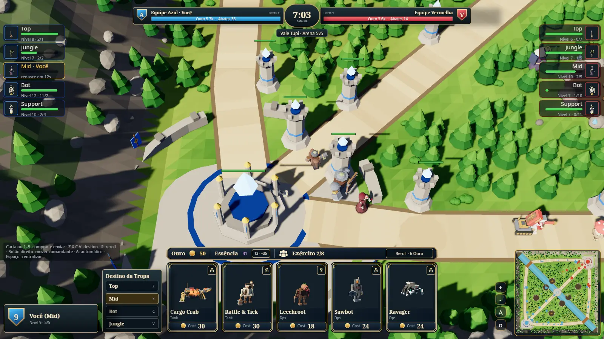

# TBG Arena 5v5 — MOBA mode

A separate 5v5 game mode of Tupi Battle Grounds: ten strategic Seats with no player avatars, three
lanes, a jungle, automatic Minion waves, the **same champions as the 1v1
game** bought in the same Shop and sent to a Destination, and bots on every
empty seat. Status: **P77 implemented locally, including the owner's strategy-only
revision and M-73–M-76 corrections. 42 focused tests passed; M-76 installed
Linux movement observation is being consolidated in the P77 report. Complete roster, performance
and cross-platform acceptance pending; unbalanced.**



Historical P76 image; P77 no-avatar HUD/map captures are pending.

| Read | For |
|---|---|
| [GAME-DESIGN-MOBA.md](GAME-DESIGN-MOBA.md) | Rules `M-xx`, glossary, Proposed numbers |
| [ARCHITECTURE-MOBA.md](ARCHITECTURE-MOBA.md) | Crates, simulation, network, client, running |
| [CONTRACTS.md](CONTRACTS.md) | What must never change silently |
| [P76 phase spec and report](../phases/P76-moba-5v5-foundation.md) | What was built and validated |
| [P77 spec and handoff](../phases/P77-moba-roles-vision-jungle-map.md) | Three role Shop slots, team vision, jungle monsters, map refinement, strategy-only combat and left-drag camera |
| [Reference map](media/reference-map.webp) · [1v1 battle HUD](media/reference-1v1-battle-hud.webp) | Owner visual targets |

## Play on Linux

```bash
moba/scripts/install-linux-moba.sh     # builds and installs; menu entry "TBG Arena 5v5"
tbg-moba                               # menu → choose a role → "Treinar contra 9 bots"
tbg-moba --play --role mid             # straight into a practice match
tbg-moba-server & tbg-moba --online    # local room; more clients take bot seats
```

Controls: choose a Destination (**Z X C V** = Top/Mid/Bot/Jungle), then
click a Shop card (or **1–5**) to buy and send that champion. Choose another
Destination before the next purchase to split champions across lanes.
Cards 1–3 draw from the Role categories; cards 4–5 draw from the entire
roster. All five are distinct. The Role never limits where a Troop can go. The card lock
keeps it through redraws; **R** rerolls and **U** upgrades future Troops.
Movement and combat are automatic; there is no player avatar or manual
unit order. **Left-drag empty map ground** pans the camera; left-click/drag
the minimap navigates it. Wheel zooms, arrows/middle-drag pan,
**Space** or **H** on the minimap centres the Team base, **Esc** returns
to the menu. Right click does not issue orders. A stationary pointer never pans at the window edge.
Troops keep their Lane/Jungle mission through combat and resume it afterward.
Engagements have explicit pursuit, windup, recovery and replanning phases;
support follows an eligible patient back into range.
Gold receipts distinguish personal bounties from Team Tower rewards.

Vision: the entire allied half is visible. Across the river, allied
Troops/Minions reveal only their sight circles after crossing. Destroying
an enemy Tower permanently reveals its former 9-unit sight circle until
the next match. Map and minimap share these authoritative rules.

## Develop

Use the work-front checks in [VALIDATION.md](../VALIDATION.md) and the
[P77 report](../phases/P77-moba-roles-vision-jungle-map.md#9-report).
Do not run a full workspace suite by default.

Local compilation follows [VALIDATION.md](../VALIDATION.md) (shared lock,
two build jobs). The workspace is separate from the 1v1 one on purpose; see
[ARCHITECTURE-MOBA §1](ARCHITECTURE-MOBA.md#1-isolation-from-the-1v1-game).
