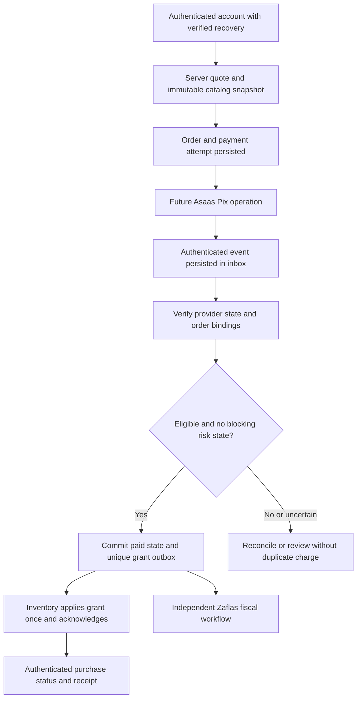

# Payment business flow, fulfillment and antifraud

> Proposed internal contract. Asaas is the only initial provider; Pix is the
> only initial method. No real payment adapter/route is enabled by this base.

## Quote → order → payment → entitlement

Server chooses SKU, allowed quantity, price, currency, discount and recipient
from its approved catalog. Client sends a selection/idempotency key, never
an authoritative price, owner or delivered flag. Start with fixed-price
nontransferable cosmetic items, no subscriptions, wallet, tradable currency,
random loot boxes, gifting or competitive benefits. Existing free cosmetics
remain free unless the owner explicitly approves a separate product change.

Show already-owned items and reject duplicate SKU selections/new purchase
of an owned nonconsumable at quote time. If another grant arrives after the
quote or concurrent orders both become paid, preserve payment evidence and
apply the approved excess/duplicate-purchase remedy; do not silently discard
money or grant a meaningless second copy.

Quote/order snapshot records catalog revision, line allocations, gross total,
BRL currency, legal/refund-policy versions, seller identity and verified
AccountId. Money is integer centavos with checked arithmetic. Convert external
decimal JSON amounts exactly; reject fractional cents or rounding ambiguity.
Gross amount is checked against the sale, not fee-deducted `netValue`.

Immutable order lines and provider attempt IDs map to the server-created
Asaas customer/payment. A billing customer is not an account credential.
Validate merchant/environment/customer, payment ID, reference, PIX method,
gross amount and corresponding account/order before granting anything.
`externalReference` aids correlation, not authentication or provider-enforced
uniqueness. Duplicate same-key/different-payload checkout is a conflict.

## Separate state machines

- Order: Draft → AwaitingPayment → PaymentVerified/ReviewRequired →
  FulfillmentPending → Fulfilled; Cancelled/Expired/Refunded are explicit
  business projections, not evidence a provider QR can no longer be paid.
- Payment attempt: Preparing → Pending/CreationUnknown → Received;
  RefundPending/PartiallyRefunded/Refunded/Disputed/Held are separate dimensions.
- Entitlement: grant requested → applied → compensated/revoked for a specific
  source, preserving any other valid grant of the same cosmetic.
- Fiscal: required/pending → submitted → authorized/error; cancellation and
  denied cancellation are their own transitions, not payment status.

For the initial PIX mapping only validated provider `RECEIVED` is the normal
payment gate, backed by current-state lookup for first grant/restoration.
Unavailable validation stays pending. Redirects, client screenshots, QR creation, `CREATED`, `PENDING`,
card `CONFIRMED`, viewed invoices or cash/manual-receipt events do not grant.
Provider refund/dispute/hold facts must not be cleared by a later-arriving
old Received notification. Store evidence/projections separately and reconcile
current provider state; arrival time alone is not event ordering.

Never hold a DB transaction open while calling a provider. Persist intent,
perform bounded external work later, then commit its result with expected
version. Timeout is CreationUnknown, not proof of failure: reconcile before
retry. Multiple matching provider records or inconsistent observations go
to review; never choose the first match and double-charge/grant silently.

One durable grant key per order line/source plus idempotent Inventory apply
gives an exactly-once **business effect** over at-least-once messaging. Use
inbox/outbox and unique constraints, not a claim of exactly-once network
delivery. Crash between paid commit and inventory delivery is recoverable.
If Inventory lives elsewhere, retry the same grant until durable ack; refund
compensation uses the same source ledger and cannot remove another purchase.

## Expiry, refunds and disputes

Provider QR expiry and internal checkout expiry are different. Late payments
on a closed/expired/changed-price order are recorded and reconciled under an
explicit fulfill-at-original-offer or refund/review policy. Do not lose the
money or force a second payment because the UI timer ended. A second paid
attempt is an excess-payment case, not another entitlement by default.

Refund requests have amount, reason, original payment and line allocation.
Atomically reserve refundable balance so pending plus confirmed refunds
cannot exceed the received gross amount. Never send money to an arbitrary
Pix key supplied in a ticket; refund the original provider transaction.
An uncertain/refund-in-progress response is not completion. Final refund facts
drive the appropriate source compensation and independent fiscal correction.
Partial bundle refunds use the original integer allocations, not current prices.

Provider fees/balance availability can affect refund execution; keep a seller
reserve and operational escalation. This does not authorize withholding a
consumer's legally required refund or charging them an undisclosed fee.
Do not automatically ban an account or change rating for requesting a refund.

Pix has dispute/fraud-return mechanisms. MED balance holds are not generic
card chargebacks, and an account-wide hold may have no payment ID. Quarantine
unattributable holds for financial review; do not revoke every player's items.
Release of a hold is not proof that all related disputes/refunds disappeared.

## Practical antifraud and permissions

Prevent tampered price/owner, fake/replayed webhook, credential theft, excessive
order attempts, duplicate payment/entitlement, multi-account abuse, refund
races and staff misuse. Use bounded rate/amount/velocity rules and explainable
review reasons. Shared IP, third-party payer name or billing email mismatch
alone is not proof of fraud. Email verification improves recovery, not payment
legitimacy. No device fingerprint farm or arbitrary protected-trait scoring.

Reviewer may pause new checkout or a specific disputed grant under approved
policy, with reason, expiry, audit and customer appeal. They cannot mark an
order paid manually without verified evidence, generate recoverable keys,
edit prices retroactively or mutate game outcomes. Finance/refund powers
need distinct permission/recent auth; P65 Moderator is insufficient.

Use safe authenticated status endpoints and bounded reconciliation jobs.
Public callbacks carry no session cookies/PII. Reject browser CSRF on user
commands; authenticate future provider callbacks with their own documented
credential, not a player CSRF token. Protect request bodies, credentials,
logs, metrics and backups. No billing work in match ticks or match-result
writer queues; bounded commerce failure must not slow online combat.

Initial tests use local synthetic fixtures only. Real Sandbox/Production
traffic, reconciliation polling and financial decisions require a separately
authorized integration phase and reviewed limits. See the provider dossier
for exact official behavior rather than invented generic payment assumptions.
