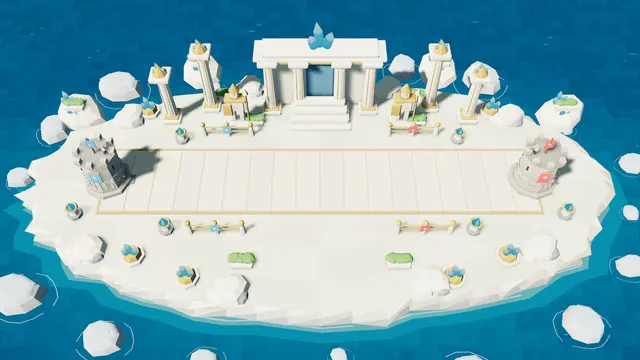
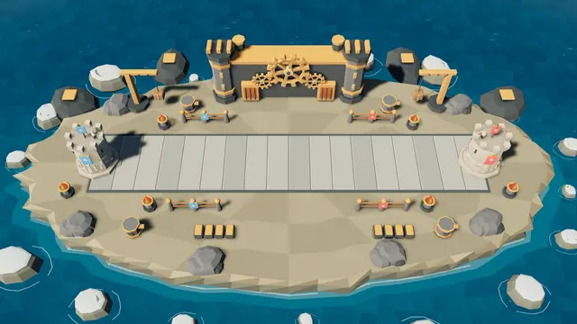
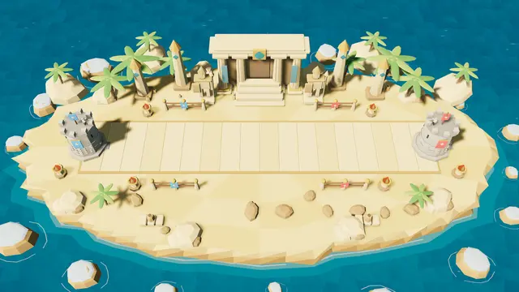

# Three new themed arenas — owner request, 2026-11-01

## Scope and read first

Read AGENTS.md, VALIDATION.md, GAME-DESIGN §12, ARENAS.md, ARENAS-gameplay.md,
ARENAS-visual-variants.md, the arena/art budget sections of ART-DIRECTION and
ARCHITECTURE, and the existing themed builders. The owner requests implementation,
local-only source references, three modeled environments, small symmetric effects,
GitHub delivery and a native Linux reinstall under the standing playtest workflow.

Append Celestial (id5), Clockwork (id6) and Desert (id7), preserving ids0–4,
Forest default, Practice persistence, uniform server assignment and reconnects.
Keep the existing camera, island outline, width-3 BattleLine, Stronghold kinds,
positions, collision rules, lifecycle, shared materials and deterministic placement.
Do not reproduce the reference images' UI or bake them into the game.

## Proposed modifiers (GAME-DESIGN §12, BR-AR06)

- Celestial Citadel: +800 troop movement bp (+8%).
- Clockwork Bastion: +800 troop attack-speed bp (+8%), −500 movement bp (−5%).
- Desert Relics: −800 base Energy regeneration bp (−8%).

Both seats use the same fields and existing formulas, caps and fractional
remainder. No Faction exception or existing arena number changes. These are
initial Proposed playtest values; D-33 acceptance and owner look/fun are pending.
Protocol30 rejects older peers before they receive unknown Arena identities.
Ruleset6 records the new gameplay source; no production deployment is included.

## Source and visual construction

Each new kit owns a procedural source module. Shared monument helpers build
columns, planted guardians, stepped entrances, planters and palms. The Celestial
kit uses ivory/gold towers, azure crystals and waterfall islets; Clockwork uses
iron/brass towers, cranes, furnace grilles, boilers and three cosmetic gears;
Desert uses sandstone, turquoise inlays, obelisks, guardians, palms and pottery.
All static parts merge into the existing lit terrain or unlit accent mesh.
Gears use three bounded scene-owned entities and absolute-time rotation.
Only the selected kit is built. Forest and the original four themed kits keep
their geometry. Native and web catalogs share identical canonical modifiers;
combined buffs/debuffs show every field in both languages.

Original PNGs and their hashes live only in ignored `.local/arena-references/`.
Commit only procedural source and thumbnails exported from actual game rendering.

## Validation plan and report

Validation level: targeted consolidation plus owner-authorized native playtest
installation. No workspace suite, release packaging, D-33 gate, mobile campaign
or public deployment. Run the union once under the shared nonblocking lock with
CARGO_BUILD_JOBS=2 and the existing target cache:

- Core arenas, contract_protocol, contract_ruleset_version, practice_bot tests.
- Server arena draw unit test and arenas integration target.
- Client arena_data_tests and repeated scene-switch lifecycle regression.
- Node arenas.test.js checks data, actual thumbnail files and bilingual effects.
- Native debug build for installation; three actual Practice captures and one
  catalog inspection. Export thumbnails from real renderer captures.
- Browser target compatibility only if existing cache makes a scoped check cheap;
  otherwise explicitly defer it. Native runtime is not browser evidence.

Implementation and validation results will be recorded below before delivery.

### Targeted consolidation, source implementation

Initial nonblocking lock attempt exited75 with no compilation. The owner then
explicitly authorized waiting for this delivery's lock on 2026-11-01. No process
was interrupted and no target cache was replaced. The sequential batch reused
ROOT/target with CARGO_BUILD_JOBS=2 and the documented native pkg-config path.

Commands (all `--offline --locked`, Rust tests with `--test-threads=1`):

- `cargo test -p tbg-core --test arenas --test contract_protocol --test contract_protocol_server --test contract_ruleset_version --test practice_bot`: 11+14+2+2+3 passed.
- `cargo test -p tbg-server --lib the_draw_is_uniform_over_all_arenas`: 1 passed; 32 filtered out.
- `cargo test -p tbg-server --test arenas`: 2 passed, including shared assignment and reconnect.
- `cargo test -p tbg-client --bin tbg-client arena`: 11 passed; 156 filtered out. Repeated switches include all eight themes with one sun and no entity leak.
- `cargo check -p tbg-client --bin tbg-client --target wasm32-unknown-unknown`: passed in4.49s with two pre-existing unused gallery-field/constant warnings.
- Client test compilation had one existing unused `visuals/layout::Layout::clear` method warning.
- `cargo fmt -p tbg-core -p tbg-client -p tbg-server` and `git diff --check`: passed.
- Node focused bilingual modifier descriptions: passed. Full thumbnail-existence check awaits actual renderer exports.

Total46 targeted Rust tests passed. The source log is kept locally at
`/tmp/tbg-three-arenas-consolidate.log`. Native rendering, thumbnail export and
installation are the next delivery steps; this entry does not claim their pass.
Browser rendering/performance, full suite and D-33 balance gate remain deferred.
The source PNG references were hash-checked and `git check-ignore` confirms all
three are excluded from git. Protocol30 requires a matching online server;
local Practice does not depend on a public deployment.

### Renderer exports and catalog assets

Native debug render build at source `fdd898fd227704a29ff79764abfd91df742e55e3`
passed (`cargo build --offline --locked -p tbg-client --bin tbg-client`,15.22s),
under the same shared lock, CARGO_BUILD_JOBS=2 and approved waiting exception.
Its frozen binary/receipt live in ignored `.local/three-arenas-evidence/candidate-fdd898f/`.

First diagnostic captures inherited Wayland and had inconsistent window sizes;
they were excluded from thumbnail exports. The corrected runner removes
WAYLAND_DISPLAY/WAYLAND_SOCKET, uses Xvfb1920x1080 and isolated TBG_DATA_DIR per
arena. All three corrected PNGs are1920x1080, boot_ready=true, scene_waiting=false,
pending_images=0, pending_texts=0, failed_images=0, with no panic. These are actual
renderer outputs, not reference-image backgrounds or mocked geometry.

Measured arena triangles (existing shared geometry included; no fixed D-30 cap):

- Celestial: props11,564; total24,834.
- Clockwork: props8,432; total21,924 including the three animated gears.
- Desert: props19,608; total30,856.

The new640x360 WebP catalog assets are exports of those corrected captures.
`node --test crates/tbg-client/tests/arenas.test.js` passed (exit0), covering
all eight identities, image existence, combined/signed effects and both locales.
Original owner PNGs remain ignored and are absent from the staged tree.
Capture manifests, full images and runtime logs stay local in
`.local/three-arenas-evidence/v2/`. No frame-rate, browser runtime or balance
acceptance is inferred from these stills. The native installation build follows
thumbnail generation so its boot-art manifest includes the three new paths.

Catalog previews exported from the game:

### Practice setup follow-through correction

The first final-candidate diagnostic reached the difficulty setup rather than a
Running match: P62 routes PracticeArena through PracticeSetup. The old opt-in
arena capture helper clicked only the first button. It was stopped without
claiming a Running-match pass; its setup log remains local under v2/celestial-practice.

Inspection also found that Catalog persists across screens: selecting an Arena
card updates saved storage after Catalog initialization, so opening Practice could
display the previous arena. Opening the Practice tab now reloads only its Arena
field from storage. The opt-in helper follows the real visible Practice Play
action, asserts setup Arena equals saved selection, then the existing capture
asserts MatchInfo equals the clicked Arena. This changes no combat rule or value.
The native candidate is rebuilt for these two client changes; all three final
Practice captures and their results follow below. Earlier core/protocol/server
results remain valid because those sources did not change.

### Final native Practice validation and installation — complete

Final runtime source: `d4436e07e883be275e79ba91810b6d8b94e9d392`.
Native debug build passed in18.00s after the Practice setup correction.
The affected WASM binary check passed in1.97s (the same two existing gallery
warnings). Both ran sequentially under the shared lock with two build jobs.
The owner-approved wait also preserved an unrelated Android build holding that
lock. No process from another work front was interrupted.

The exact frozen installation binary passed all three real bot Practice captures:
Celestial, Clockwork and Desert. In each case the helper observed eight distinct
Arena buttons, clicked the requested arena, verified that setup and saved choice
agreed, followed the actual Play action and captured `Phase::Running` with
MatchInfo.arena equal to the selected arena. All PNGs are1920x1080, boot-ready,
with zero pending/failed images or text and no panic. The eight-card catalog also
loaded without missing resources; its second row uses the existing scroll panel.
All three final Practice images and the catalog were visually inspected. The
BattleLine stays clear and the Strongholds/HUD keep the original placement.

Local evidence: `.local/three-arenas-evidence/v3/captures-practice.json`, the three
per-arena `runtime.log`/`scene.png` pairs and `v3/catalog/`. The earlier diagnostic
setup capture timed out after150s; it is not counted as a pass. The corrected
flow above resolves that diagnostic failure.

The source branch was pushed to `origin/phase/arenas-three-new` before native
installation, under the owner's standing workflow. Original reference PNGs and
all full-resolution capture folders remain ignored and were not pushed.

`python3 /tmp/tbg-install-three-arenas.py` completed successfully. Installed:
`/home/iiii/.local/opt/tupi-battle-grounds/0.1.0-native.2-arenas-d4436e0/tbg-client`.
The existing launcher and desktop entry now select it; all362 assets and the
binary hash were checked against the source/frozen candidate. Launcher
`--version` confirms protocol30 and source d4436e0. Previous installation and
user data remain intact. The installation receipt is local at
`.local/three-arenas-evidence/installed-three-arenas-linux.json`.

Binary SHA-256:
`0831eb72e7f880dad9dea7c4191d3c7e8ed774d77a65b15305eca401b1f52345`.

Remaining acceptance: owner look/fun and Proposed-value approval; D-33 balance
measurement; browser rendering/performance and full suite. None is claimed as
passed. Protocol30 online play requires a matching server; no public server was
deployed. Native Practice and the focused local server tests do not require it.
