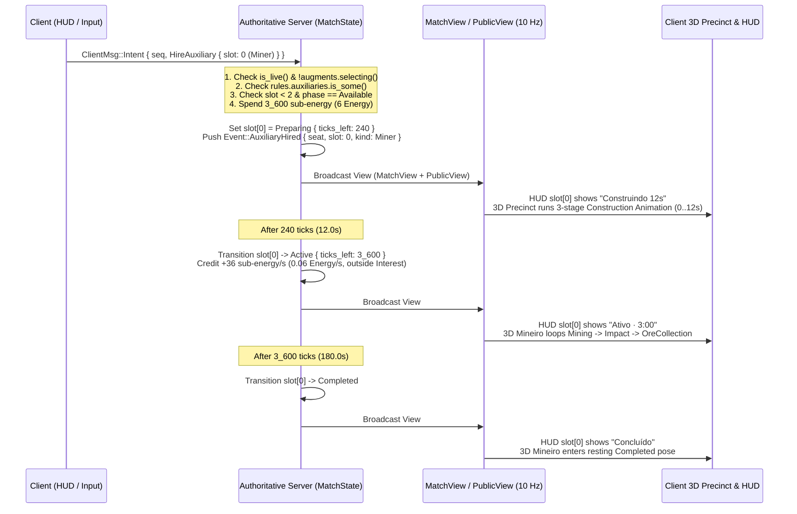
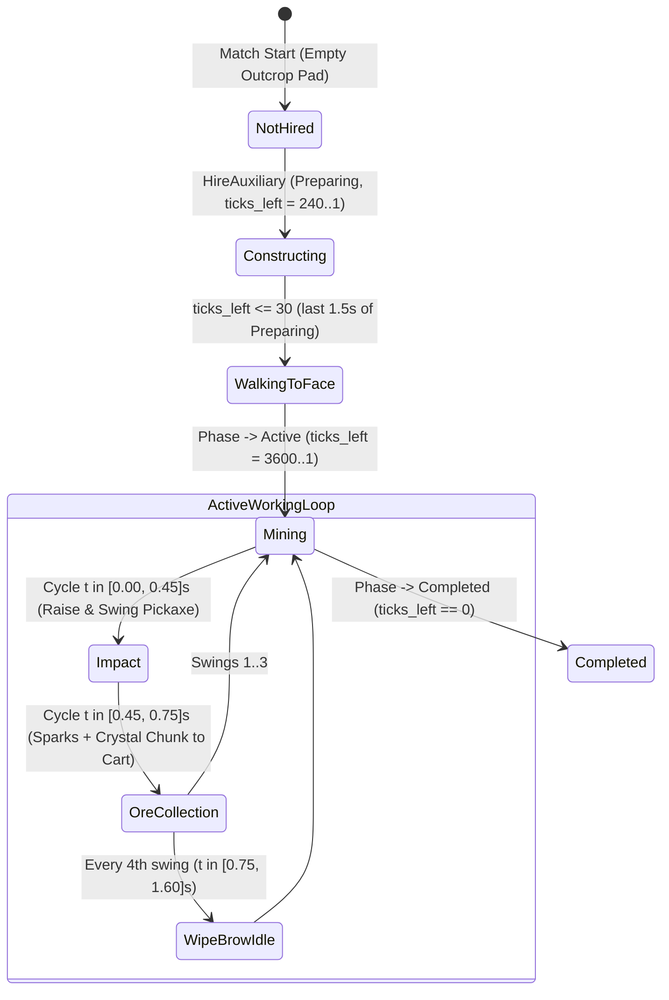
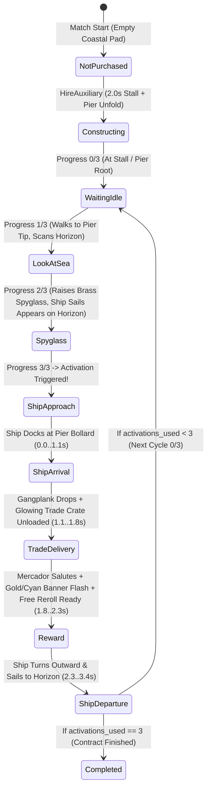

# P74 — War Auxiliaries, 3D Models, Construction Animations, and 8-Arena Visual Reconciliation

**Status:** planning only on `phase/p74-war-auxiliaries-plan` (based on `origin/main` `d637810`); no runtime gameplay, asset, protocol, or rendering code modified in this step.
**Planning branch:** `phase/p74-war-auxiliaries-plan`.
**Execution branch (when authorized):** `phase/p74-war-auxiliaries`.
**Reserved decision ID:** `D-105` (Proposed: War Auxiliaries authoritative contract, off-lane 3D precincts, construction/work/delivery state machines, and 8-Arena visual reconciliation).
**Reserved protocol version:** `PROTOCOL_VERSION = 32` (extending `31` from `origin/main` `d637810`).
**Canonical visual reference:** `/data/downloads/Clockwork Bastion Auxiliary Battle UI.png` (inspected and analyzed directly; 16:9 desktop battle frame in *Clockwork Bastion* showing the bottom-right `Auxiliares (0/2)` HUD panel with `Mineiro · Cost 6` and `Mercador · Cost 4`, the upper-left Mineiro rock outcrop with timber tunnel portal, hanging lantern, rails, crystal-ore cart, and swinging pickaxe, and the upper-right Mercador striped market stall, balance-scale banner, cargo crates, timber pier, spyglass pose, and approaching wooden merchant ship).

---

## Read first (for the executor of this phase)

1. `AGENTS.md` and `docs/VALIDATION.md` (work-front minimal validation policy, shared nonblocking lock `/tmp/tbg-validation-$(id -u).lock`, `CARGO_BUILD_JOBS=2`).
2. `docs/GAME-DESIGN.md` (§§2–5, §10.4 Strongholds, §12 Arenas) and `docs/DECISIONS.md` (`D-33`, `D-46`, `D-51`–`D-55`, `D-99`–`D-104`).
3. `docs/ART-DIRECTION.md` (rig v2, low-poly vertex-colored primitive kits, shared palette, triangle/frame budgets).
4. `docs/ui/DESKTOP-UI-CONTRACT.md` (Linux canonical reference, identical presentation across Linux, Windows, and desktop web).
5. Only the source files named in each implementation stage below.

---

## 1. Technical Diagnosis of the Current Architecture (`origin/main` `d637810`)

An inspection of `tbg-core`, `tbg-client`, and `tbg-server` on `origin/main` (`d637810`) establishes the exact architectural seams and constraints for **War Auxiliaries**:

### 1.1 Simulation & Fixed-Point Units (`crates/tbg-core`)

| Subsystem | Current File & Symbol | Current Behavior & Exact Constants | Impact on War Auxiliaries |
|-----------|-----------------------|------------------------------------|---------------------------|
| **Simulation clock** | `content.rs:10`, `sim.rs:124` | `TICK_HZ = 20` (`50 ms` per tick). `MatchState::step` advances `self.clock` every step, freezes combat/Energy while `self.augments.selecting()` (`BR-AG12`), and advances `self.tick` while live. | All auxiliary preparation, active mining duration, and cooldowns must be expressed in integer `Tick`s (`1 s = 20 ticks`) inside `MatchState` so they automatically freeze during Augment selection pauses and connection pauses (`BR-M03`). |
| **Energy & Interest** | `content.rs:17–32`, `ruleset.rs:24–40`, `sim.rs:202–221` | `ENERGY_SCALE = 600` (`600` sub-energy = `1.0 Energy`). `ENERGY_START = 3_000` (`5.0 Energy`). `REGEN_RUNNING = 17` sub-energy/tick (`340` sub-energy/s = `0.5667 Energy/s`). `INTEREST_BAND = 3_000` (`5.0 Energy`), `INTEREST_PER_BAND = 2_500` bp (`+25%` per band), `INTEREST_MAX_BANDS = 5` (caps at `25.0 Energy` held = `22_500 bp` = `×2.25` base regen). `PlayerState::regen_frac` preserves exact sub-basis-point remainders (`scaled % 10_000`). | The **Mineiro**'s additional production must be computed in integer sub-energy outside `InterestRule::regen_bp(p.energy)` in `sim.rs::regen_energy` so `regen_bp` never multiplies the Mineiro's output. |
| **Shop & Reroll gap in `CANON`** | `ruleset.rs:54–73, 113, 155`, `shop.rs:118–140`, `view.rs:142–147` | **Critical finding:** In `ruleset.rs:113`, `CANON.shop` is currently `None` (only `Ruleset::preview()` sets `shop: Some(ShopRule::default())` with `reroll_base: 600`, `reroll_step: 600`). Furthermore, in `view.rs:142–147`, `reserve`, `held_mask`, and `reroll_cost` carry `#[serde(skip)]`, meaning they are not serialized over WebSocket `ServerMsg::View` in online matches. | For **Mercador** (and the `Reroll` button shown in `resources.rs`) to work in online authoritative matches (`CANON`), `reroll_cost` and the new `auxiliaries` state must be serialized in `MatchView` (removing `#[serde(skip)]` on `reroll_cost` under `PROTOCOL_VERSION = 32`), and `CANON` must enable shop rerolling (or `AuxiliaryRule` must expose `free_rerolls` and base reroll pricing in `CANON`). |
| **Intentions & Authority** | `intent.rs:13–108`, `protocol.rs:26, 91–161` | Clients send `ClientMsg::Intent { seq, intent: PlayerIntention }`. Seat comes exclusively from the authenticated connection (`tbg-server`), never from the payload. `PROTOCOL_VERSION` is currently `31`. | Hiring an auxiliary adds `PlayerIntention::HireAuxiliary { slot: u8 }` (or `{ kind: AuxiliaryKind }`), validated authoritatively in `MatchState::apply_intention` against `Phase::Running`, `!self.augments.selecting()`, slot availability, and `p.energy`. |
| **Views & Spectators** | `view.rs:104–205`, `view/public.rs:31–100` | `MatchView` is sent to each player at `10 Hz`; `PublicView` is encoded once per view tick for all spectators (`BR-LV03`) and strips private hand data (`energy`, `offers`, `reroll_cost`). | Because both players' hired auxiliaries have visible 3D precincts and animations inside the shared arena, `auxiliaries: [[AuxiliarySlotView; 2]; 2]` (indexed by `Seat::index()` and slot `0..2`) belongs in **both** `MatchView` and `PublicView`. Private shop offers remain hidden; public auxiliary state (`NotHired`, `Preparing`, `Active`, `Completed`, plus progress counters needed for 3D animations) is safely visible to both seats and spectators. |
| **Bot AI** | `bot.rs:48–85` | `Bot::decide` acts purely from `MatchView` (`10 Hz`) in Practice, headless balance lab (`tbg-balance`), and load tests. | `Bot` can optionally evaluate hiring `Mineiro` / `Mercador` via a clean policy toggle in `Bot` without breaking historical `CANON` determinism hashes until `CANON` enables auxiliaries. |

### 1.2 Client Rendering, UI & 8-Arena Diorama (`crates/tbg-client`)

| Subsystem | Current File & Symbol | Current Behavior & Exact Coordinates | Impact on War Auxiliaries |
|-----------|-----------------------|--------------------------------------|---------------------------|
| **Battle HUD Layout** | `ui/hud.rs:270–343`, `ui/native_battle/{mod,cards,resources,chrome}.rs` | Under `cfg(tbg_desktop)` (which `build.rs` enables for Linux, Windows, and `wasm32`), `hud::spawn` creates an `862 px` wide bottom container (`SHOP_BOTTOM = 36.0`, `SHOP_SCALE = 0.9`) holding `resources` (`height: 43 px`) above 5 `cards` (`5 × 166 px + 4 × 8 px gap = 862 px`, `height: 225 px`). | The 5 conventional shop cards and the `resources` bar stay **100% untouched** in size and internal layout. We place the new **Auxiliary Panel (`Auxiliares (0/2)`)** in the bottom-right corner (`PositionType::Absolute` or a horizontal flex sibling anchored to the right of the 5-card container), using the exact same `chrome::GOLD` (`#C3A46A`), `chrome::INK` (`#0B141D`), `chrome::CREAM` (`#F6E8C8`), and `battle/native/shop-card.webp` visual grammar as the reference image. |
| **Island & Camera Geometry** | `camera.rs:10–125`, `arena/geometry.rs:8–17`, `arena/ground.rs:43–76`, `arena/water.rs:17` | Camera looks at `LANE_CENTER = (8.0, 0.0, 0.0)` from `+Z` with `FOV_Y = 35°`, `ELEVATION = 55°`. Island `outline()` is an irregular ellipse centered at `(8.0, -0.04, 0.0)` with semi-axes `rx = 12.0` (`x ∈ [-4.0, 20.0]`) and `rz = 5.7` (`z ∈ [-5.7, 5.7]`). Sea level is `water::LEVEL = -1.40`. Strongholds stand at `x = -0.9` (Left) and `x = 16.9` (Right) on `z = 0.0`. | Each seat has generous off-lane shoulder space on the upper/rear half of the island (`z ∈ [-1.8, -4.2]`) and adjacent coastal water (`x < -3.6` on the left, `x > 19.6` on the right) that sits inside the desktop camera frustum and above the bottom HUD bar. |
| **Art Kits & Rig v2** | `art/figure.rs`, `art/rig.rs`, `art/anim.rs`, `art/mesh.rs`, `art/palette.rs` | All characters and Stronghold defenders (`arena/strongholds/gunners.rs`) are procedural low-poly vertex-colored meshes built from `Shape` primitives (`Box`, `Bevel`, `Cyl`, `Frustum`, `Cone`, `Ball`, `Rock`, `SnowCap`, `Ring`) with a single shared `StandardMaterial` (`base_color: Color::WHITE, perceptual_roughness: 1.0`). | `Mineiro`, `Mercador`, the Mine portal/cart/lantern, the Market Stall/banner/pier, and the Merchant Ship must be built with the **exact same procedural `Shape` + `Surface` pipeline** (zero `.glb`/`.gltf` files, zero textures on 3D meshes, shared `StandardMaterial` handles). |
| **Active Worktree Conflicts** | `codex/ogre-faction` (PR #48) vs `origin/main` (`d637810`) | PR #48 (`codex/ogre-faction`) modifies `arena/tundra.rs`, `crowd.rs`, `sync.rs`, and `ui/native_battle/arena.rs` for Blue=Left / Red=Right seat orientation (`SIDE-01`) and widened `BattleLine` (`z ∈ [-2.1, +2.1]`). | Placing auxiliary precincts in a dedicated module `crates/tbg-client/src/arena/auxiliaries/` with coordinates at `z <= -1.95` (outside even the widened `±2.1` lane of PR #48 at `x ∈ [-1.85, -3.65]` and `[17.85, 19.65]`, behind the Strongholds at `x = -0.9` and `16.9`) guarantees **zero spatial or merge conflict** with PR #48! |

---

## 2. Definitive Proposed Rules for Mineiro & Mercador (`tbg-core`)

All competitive values live in `crates/tbg-core/src/content.rs` and `crates/tbg-core/src/ruleset.rs` (`AuxiliaryRule`), marked **Proposed (`D-105`)** in `docs/GAME-DESIGN.md` and `docs/DECISIONS.md`.

### 2.1 Slot Model & Extensibility for Future Pre-Match Auxiliary Decks

- Each `PlayerState` owns two fixed auxiliary slots:
  ```rust
  pub const AUXILIARY_SLOTS: usize = 2;

  #[repr(u8)]
  #[derive(Clone, Copy, Debug, PartialEq, Eq, Serialize, Deserialize)]
  pub enum AuxiliaryKind {
      Miner = 0,
      Merchant = 1,
  }

  impl AuxiliaryKind {
      pub const DEFAULT_LOADOUT: [AuxiliaryKind; AUXILIARY_SLOTS] = [
          AuxiliaryKind::Miner,
          AuxiliaryKind::Merchant,
      ];
  }
  ```
- **Current MVP rule:** Every player starts the match with `loadout: [AuxiliaryKind; 2] = AuxiliaryKind::DEFAULT_LOADOUT` (`Slot 0 = Miner`, `Slot 1 = Merchant`). Both players have identical access to both auxiliaries.
- **Future deck extensibility (YAGNI-compliant):** Because `PlayerState` stores `aux_loadout: [AuxiliaryKind; 2]` (initialized to `DEFAULT_LOADOUT`) and `PlayerIntention::HireAuxiliary { slot: u8 }` addresses slot `0` or `1`, adding pre-match auxiliary deck selection in a future phase will only require a lobby `SetAuxiliaries` message that populates `aux_loadout` before pairing—without changing `PlayerState`, `MatchView`, or HUD slot indexing.
- **Contract lifecycle & single-hire rule:**
  - Each slot progresses monotonically through four authoritative phases:
    ```rust
    #[derive(Clone, Copy, Debug, Default, PartialEq, Eq, Serialize, Deserialize)]
    pub enum AuxiliaryPhase {
        #[default]
        Available,
        Preparing {
            ticks_left: u16,
        },
        Active {
            /// For Miner: ticks of production remaining (3_600 down to 1).
            /// For Merchant: ticks since activation (for client ship/stall timing).
            ticks_left: u16,
            /// For Merchant: conventional champion purchases toward the next ship (0..3).
            /// For Miner: sub-cycle progress (0..20).
            progress: u8,
            /// For Merchant: completed ship deliveries / activations (0..3).
            activations_used: u8,
        },
        Completed,
    }
    ```
  - **Repurchase / stacking rule (Definitive):** Each auxiliary slot can be hired **at most once per match** (`Available -> Preparing -> Active -> Completed`). Two instances of the same auxiliary can never be active simultaneously, and once a slot reaches `Completed` it remains visibly `Completed` (`Concluído`) for the rest of the match. This guarantees bounded economic injection even in long open-ended matches (`BR-M07`).

### 2.2 Mineiro (Miner) — Exact Fixed-Point Rules & Economic Evaluation

- **Preliminary Hypothesis vs. Recommended Tuned Profile:**
  In `tbg-core`, `1.0 Energy = 600 sub-energy` (`ENERGY_SCALE = 600`) and `1.0 s = 20 ticks` (`TICK_HZ = 20`).

| Parameter | Preliminary Hypothesis (Prompt Baseline) | Exact `tbg-core` Integer Representation | Recommended Tuned Profile (`Option M1`, for `tbg-balance` A/B test) |
|-----------|------------------------------------------|-----------------------------------------|---------------------------------------------------------------------|
| **Cost** | `6.0 Energy` | `3_600` sub-energy (`6 * ENERGY_SCALE`) | `5.0 Energy` (`3_000` sub-energy) |
| **Preparation (`Preparing`)** | `12.0 s` | `240` ticks (`12 * TICK_HZ`) | `10.0 s` (`200` ticks) |
| **Production Rate (`Active`)** | `+0.06 Energy/s` | `36` sub-energy/s = **`9` sub-energy every `5` ticks** (`0.25 s`), or exact Bresenham tick step `(elapsed * 36) / 20 - ((elapsed - 1) * 36) / 20` (`[2, 2, 2, 1, 2]` sub-energy per 5 ticks) | `+0.08 Energy/s` (`48` sub-energy/s = `12` sub-energy every `5` ticks) |
| **Active Duration** | `180.0 s` | `3_600` ticks (`180 * TICK_HZ`) | `150.0 s` (`3_000` ticks) |
| **Total Gross Production** | `10.8 Energy` | `6_480` sub-energy (`10.8 * 600`) | `12.0 Energy` (`7_200` sub-energy) |
| **Net Profit (`Gross - Cost`)** | **`+4.8 Energy`** | **`+2_880` sub-energy** | **`+7.0 Energy` (`+4_200` sub-energy)** |
| **Break-Even Time** | **`100.0 s` active (`112.0 s` after click)** | `2_000` active ticks (`2_240` total ticks) | **`62.5 s` active (`72.5 s` after click)** |

- **Exact Interest Isolation Rule (`BR-AX02`):**
  In `sim.rs::regen_energy`:
  1. Standard regeneration runs first: `bp = rule.regen_bp(p.energy).saturating_add_signed(arena_bp)` multiplies **only** `self.rules.regen_running` (`17` sub-energy/tick).
  2. Auxiliary production runs **after** standard regeneration in `tick_auxiliaries(self)`: while the Mineiro slot is in `AuxiliaryPhase::Active { ticks_left }`, it credits the exact flat sub-energy for that tick (`36` sub-energy/s, never multiplied by `bp` or `arena_bp`) via `p.credit(miner_gain)`.
  3. While `self.augments.selecting()` (War Council pause) or connection pause (`BR-M03`) is active, `MatchState::step` returns before `regen_energy` and `tick_auxiliaries`, so both `Preparing` and `Active` timers freeze cleanly with zero drift.

### 2.3 Mercador (Merchant) — Exact Fixed-Point Rules & Edge Cases

| Parameter | Preliminary Hypothesis (Prompt Baseline) | Exact `tbg-core` Integer Representation | Recommended Tuned Profile (`Option R1`, for `tbg-balance` A/B test) |
|-----------|------------------------------------------|-----------------------------------------|---------------------------------------------------------------------|
| **Cost** | `4.0 Energy` | `2_400` sub-energy (`4 * ENERGY_SCALE`) | `3.0 Energy` (`1_800` sub-energy) OR keep `4.0 Energy` (`2_400`) and grant `1 Free Reroll + 600 sub-energy (1.0 Energy) trade rebate` per ship arrival |
| **Setup (`Preparing`)** | `0.0 s` logical delay (`2.0 s` client visual construction) | `Available -> Active` immediately on hire so the very next champion purchase counts! | Same (`0` logical delay; immediate purchase tracking) |
| **Trigger Condition** | Every `3` conventional champion purchases (`PlayerIntention::Purchase`) | `progress` increments `0 -> 1 -> 2 -> 3` inside `MatchState::purchase` after `p.spend(cost)` succeeds | Same (`3` purchases per activation) |
| **Reward per Activation** | `1` Free Reroll | `p.free_rerolls = p.free_rerolls.saturating_add(1)` (`u8`, capped at `3`) | `1` Free Reroll (+ optional `600` sub-energy trade rebate in lab tuning) |
| **Max Activations** | `3` activations (`9` total champion purchases) | `activations_used: u8` (`0..=3`); when `activations_used == 3`, phase transitions to `AuxiliaryPhase::Completed` | Same (`3` activations max) |

- **Definitive Edge-Case Resolution for Mercador:**
  1. **Purchases before hiring Mercador:** Never counted. Counter starts at `progress = 0` at the tick `HireAuxiliary` succeeds.
  2. **What counts as a purchase:** Only validated `PlayerIntention::Purchase { offer }` (buying a conventional champion from the 5 shop slots). Evolutions (`Evolve`), tower upgrades (`Fortify`), War Council Augments (`ChooseAugment`), summons (`Nester` Beetlings, `Smuggler` crates), and hiring another auxiliary never increment `progress`.
  3. **Accumulation of free rerolls (`p.free_rerolls: u8`):** Earned free rerolls **accumulate** in `PlayerState::free_rerolls` (`0..=3`) until spent. If a player buys 6 champions rapidly without rerolling, `free_rerolls` becomes `2`; neither charge is lost.
  4. **How `Reroll` consumes a free reroll:**
     - `shop::reroll_cost(state, seat)` returns `Some(0)` whenever `state.player(seat).free_rerolls > 0`!
     - When `PlayerIntention::Reroll { cost: 0 }` is applied while `p.free_rerolls > 0`:
       - `p.free_rerolls -= 1;`
       - `shop::new_shop(p, pool, None);` (preserving any `Reserve`d slots per `BR-S06`).
       - **`p.reroll_streak` is NOT incremented** by a free reroll (so the player's next paid reroll still costs base `1.0 Energy` instead of being penalized!).
  5. **What happens after the 3rd activation (`9th` champion purchase):**
     - `activations_used` reaches `3`, `p.free_rerolls` is incremented a 3rd time, and the Mercador slot transitions immediately to `AuxiliaryPhase::Completed`.
     - Any unspent `free_rerolls` (`1..=3`) remain in `p.free_rerolls` and can still be spent by clicking `Reroll · Free` until reaches `0`.

---

## 3. Purchase Flow & Authoritative Execution (`tbg-core`, `tbg-server`, `tbg-client`)



### 3.1 Exact Protocol & Type Additions (`PROTOCOL_VERSION = 32`)

1. **`crates/tbg-core/src/intent.rs`:**
   - Add variant to `PlayerIntention`:
     ```rust
     HireAuxiliary {
         slot: u8,
     },
     ```
   - Add variants to `Rejection`:
     ```rust
     BadAuxiliarySlot,
     AuxiliaryAlreadyHired,
     ```
   - In `MatchState::apply_intention`:
     - Include `PlayerIntention::HireAuxiliary { .. }` in the `if paused { return Err(Rejection::Paused); }` guard (`intent.rs:84–94`).
     - Dispatch `PlayerIntention::HireAuxiliary { slot } => crate::auxiliary::hire(self, seat, slot)`.

2. **`crates/tbg-core/src/state.rs`:**
   - Add to `PlayerState`:
     ```rust
     pub aux_loadout: [AuxiliaryKind; AUXILIARY_SLOTS],
     pub auxiliaries: [AuxiliaryPhase; AUXILIARY_SLOTS],
     pub free_rerolls: u8,
     ```
   - Add presentation events to `Event` (marked public in `view/visibility.rs` so both seats and spectators receive them):
     ```rust
     AuxiliaryHired {
         seat: Seat,
         slot: u8,
         kind: AuxiliaryKind,
     },
     AuxiliaryTriggered {
         seat: Seat,
         slot: u8,
         kind: AuxiliaryKind,
         activations_used: u8,
     },
     ```

3. **`crates/tbg-core/src/view.rs` & `crates/tbg-core/src/view/public.rs`:**
   - Add compact `Copy` view struct (`8 bytes` per seat):
     ```rust
     #[derive(Clone, Copy, Debug, PartialEq, Eq, Serialize, Deserialize)]
     pub struct AuxiliarySlotView {
         pub kind: AuxiliaryKind,
         pub phase: AuxiliaryPhase,
     }
     ```
   - Add to both `MatchView` and `PublicView`:
     ```rust
     /// Indexed by `Seat::index()`, then slot `0..AUXILIARY_SLOTS`. Public to both seats and spectators.
     pub auxiliaries: [[AuxiliarySlotView; AUXILIARY_SLOTS]; 2],
     ```
   - Add to `MatchView` (viewing seat only, serialized over the wire):
     ```rust
     pub free_rerolls: u8,
     pub reroll_cost: Option<u32>, // remove #[serde(skip)] under PROTOCOL_VERSION = 32
     ```

---

## 4. Visual State Machines & Professional Construction / Work / Delivery Animations

All animations are **100% deterministic functions of `(AuxiliarySlotView, elapsed_secs)`** on the client. No per-frame animation state travels over the network. If a client reconnects mid-match or a spectator joins late, the exact visual state and pose are reconstructed immediately from `AuxiliarySlotView.phase`.

### 4.1 Mineiro State Machine & Construction Animation (`crates/tbg-client/src/arena/auxiliaries/miner.rs`)



#### Professional 3-Stage Construction Animation for the Mineiro (`Preparing`, `0.0s .. 12.0s`, normalized $p = 1.0 - \text{ticks\_left} / 240.0 \in [0, 1]$)

Instead of popping the mine into existence, the rear outcrop pad executes a choreographed 3-stage procedural construction sequence:

1. **Stage C1 — Outcrop Excavation & Tunnel Breach ($p \in [0.00, 0.30]$, `0.0s–3.6s`):**
   - Three faceted rock bolsters (`Shape::Rock`) rise from `y = -0.65` to `0.0` using a damped cubic spring curve $\text{spring}(u) = 1 - e^{-6u}\cos(10u)$.
   - The arched dark tunnel recess (`Shape::Box` + `Shape::Frustum` in `DARK`/`COAL`) scales its depth inward while 4 low-poly rock-dust puffs (`Shape::Ball`, `p.stone`) expand and settle around the base.
   - The Mineiro spawns at the Stronghold rear gate and walks along the rear path to the outcrop pad using gait v2 (`Walking`), carrying a timber beam over his right shoulder and his pickaxe in his left hand.
2. **Stage C2 — Timber Portal Shoring & Rail Laying ($p \in [0.30, 0.68]$, `3.6s–8.2s`):**
   - Left and right heavy timber posts (`Shape::Bevel`, `TIMBER`) telescope upward with a `0.06` overshoot bounce ($p \in [0.30, 0.44]$).
   - The top cross-beam lintel and two $45^\circ$ diagonal knee braces (`WOOD` + `IRON` corner plates, matching the visual reference) drop onto the posts ($p \in [0.44, 0.56]$) while the Mineiro performs two crisp hammer/pickaxe tamping swings (`Constructing` clip).
   - Twin wooden sleepers (`WOOD`) and iron rails (`STEEL`) extrude outward from the portal mouth ($p \in [0.56, 0.68]$), followed by the flanking safety fence posts.
3. **Stage C3 — Ore Cart Roll-Out, Lantern Ignition & Ready Stance ($p \in [0.68, 1.00]$, `8.2s–12.0s`):**
   - The iron-strapped timber minecart (`TIMBER` + `IRON`, 4 flanged wheels) rolls out of the tunnel mouth along the rails ($p \in [0.68, 0.84]$) with true wheel rotation $\theta_x = \Delta s / r$, stopping against the wooden buffer with a damped pitch rock ($\pm 3^\circ$).
   - The gallows post to the right of the portal raises its hanging brass lantern (`BRASS` frame + `GOLD`/`AMBER` unlit core), which ignites at $p = 0.86$ with a warm emissive glow and continuous pendulum sway $\theta_z(t) = 0.055 \sin(2.1 t)$.
   - For $p \in [0.86, 1.00]$ (`WalkingToFace`), the Mineiro steps to the rock seam at the tunnel entrance, adjusts his yellow hard-hat (`#E8B838`), grips his pickaxe with both hands (`tools::grip_two_handed`), and enters `Mining` at $p = 1.00$.

#### Mineiro Active Work Loop (`Active`, `1.60 s` period = `32` ticks) & `Completed` Pose

- **Swing & Impact (`t_cycle ∈ [0.00, 0.55] s`):** Torso twists back (`yaw = -0.32 rad`, `pitch = -0.28 rad`), arms raise the pickaxe overhead, then drive the steel point into the rock seam at `t = 0.42 s` (`Impact`).
- **Sparks & Crystal Growth (`t_cycle ∈ [0.42, 0.85] s`):** At impact, 3 faceted golden-orange spark tetrahedra (`Shape::Cone`, `GOLD`/`AMBER`, unlit) burst radially over `0.22 s`, and a glowing crystal chunk (`p.accent` / cyan-blue ore matching the reference image) arcs from the rock face into the minecart, rocketing the cart's fill level smoothly from `30%` to `100%` as `ticks_left` counts down from `3_600` to `0`.
- **Periodic Recovery (`Every 4th cycle, t_cycle ∈ [0.85, 1.60] s`):** The Mineiro rests the pickaxe head on the ground, wipes his brow with his gloved left forearm, and nods before resuming.
- **Completed (`AuxiliaryPhase::Completed`):** The minecart is brimming with glowing crystals; the lantern stays lit at half sway; the Mineiro rests his pickaxe over his shoulder, sits/leans against the timber post, and breathes calmly (`anim::breathe`).

### 4.2 Mercador & Merchant Ship State Machine (`crates/tbg-client/src/arena/auxiliaries/merchant.rs`)



#### Professional 3-Stage Construction Animation for the Mercador (`0.0s .. 2.0s` upon hiring)

1. **Stage M1 — Pier Piling Drive & Plank Cascade (`0.0s–0.8s`):**
   - Four pairs of heavy timber pilings (`Shape::Cyl`, `BARK`) drive down into the coastal shallows (`y = water::LEVEL`), spawning concentric white foam rings (`water::foam_ring`).
   - Seven bevelled deck planks (`Bevel(0.76, 0.07, 0.21, 0.02)`, alternating `TIMBER` and `WOOD`) cascade-unfold outward from the cliff edge toward the sea with a `0.04s` stagger per plank.
2. **Stage M2 — Market Stall Frame, Striped Awning Unfurl & Balance-Scale Banner (`0.7s–1.5s`):**
   - On the coastal shoulder beside the pier root, the wooden counter and four corner poles rise (`WOOD`/`TIMBER`).
   - The **red-and-cream striped cloth awning** (`RED_CLOTH` and `LINEN` alternating pitched wedges, matching `/data/downloads/Clockwork Bastion Auxiliary Battle UI.png`) unfurls forward with a damped wave.
   - Inside the stall, the warm golden trade lantern and display wares ignite (`GOLD` unlit accent), while the **crimson-and-gold Balance-Scales Banner (`⚖`)** unfurls on its pole beside the stall.
3. **Stage M3 — Cargo Crates Stack & Mercador Pier Walk (`1.4s–2.0s`):**
   - Stacked wooden crates (`camp::crate_box`) and burlap sacks (`LINEN`/`TAN_LEATHER`) settle with a `0.05` bounce beside the stall.
   - The Mercador walks onto the pier deck holding his brass spyglass and enters `WaitingIdle`.

#### Purchase-Driven Anticipation & Rapid-Purchase Queueing

- **`progress == 0` (`WaitingIdle`):** Mercador stands near the stall/pier root, inspecting a ledger or gesturing toward his crates; ship is hidden beyond the horizon.
- **`progress == 1` (`LookAtSea`):** First champion bought! Mercador walks half-way down the pier, shields his eyes with his left hand, and scans the sea; the ship spawns far on the horizon (`u = 0.15` along the approach curve) so the player sees visual progress.
- **`progress == 2` (`Spyglass`):** Second champion bought! Mercador steps to the pier tip, raises the **brass spyglass (`BRASS` + `SKY_TOP` lens)** to his right eye (exact pose from the reference image!), and the Merchant Ship advances to mid-channel (`u = 0.45`) with visible bow wake rings.
- **3rd Purchase (`AuxiliaryTriggered` event / `activations_used` increment):**
  - Triggers the `3.4 s` delivery sequence: `ShipApproach (0.0..1.1s) -> ShipArrival (1.1..1.4s) -> TradeDelivery (1.4..1.9s) -> Reward (1.9..2.3s) -> ShipDeparture (2.3..3.4s)`.
  - **Rapid-purchase protection:** The client maintains `pending_deliveries: u8 = view_activations_used.saturating_sub(completed_visual_deliveries)`. If `pending_deliveries > 1` (e.g., the player bought 6 units in 2 seconds), the active delivery sequence runs at `1.75×` speed and chains directly into the next docking cycle without skipping the `TradeDelivery` / `Reward` cue.

---

## 5. Low-Poly 3D Models Plan (`Mineiro`, `Mercador`, Props & Portraits)

Both auxiliaries use TBG's procedural `FigureSpec` + rig v2 (`crates/tbg-client/src/art/figure.rs` and `art/kits/common/`), sharing the single vertex-colored `StandardMaterial` and zero external `.glb` files.

| Model | Target File | Silhouette & Key Visual Parts (from Reference Image) | Palette Tokens (`art/palette.rs`) | Triangle Budget |
|-------|-------------|------------------------------------------------------|-----------------------------------|-----------------|
| **Mineiro (Character)** | `art/kits/auxiliaries/miner.rs` | Stocky worker build (`scale: 0.96`, broad shoulders); domed **yellow miner hard-hat** (`Frustum` + `Bevel` brim + front brass lamp badge); full brown beard (`BARK`/`DARK_LEATHER`); rolled-sleeve **work-blue tunic** (`#2E5B88`) under a **brown leather utility vest** (`LEATHER`/`DARK_LEATHER`); heavy work gloves and boots; two-handed **steel pickaxe** (`WOOD` haft `0.78m` + curved dual-pointed `STEEL`/`IRON` head). | `GOLD` (`#E8B838` helmet), `STEEL`, `IRON`, `WOOD`, `LEATHER`, `DARK_LEATHER`, `SKIN`, `BARK` | **`≤ 340` tris** |
| **Mercador (Character)** | `art/kits/auxiliaries/merchant.rs` | Upright naval-trader build (`scale: 1.00`); iconic **wide-brimmed crimson merchant hat** (`Cone` + flared `Cyl` brim in `RED_CLOTH` with `GOLD` band and buckle); groomed dark beard; **crimson-and-brown captain's frock coat** (`RED_CLOTH` lapels, `LEATHER` cuffs, `GOLD` buttons/trim); knee boots; telescoping **3-stage brass spyglass** (`Cyl(0.032..0.048)`, `BRASS` + `SKY_TOP` lens) in right hand. | `RED_CLOTH`, `GOLD`, `BRASS`, `LEATHER`, `DARK_LEATHER`, `LINEN`, `SKIN`, `SKY_TOP` | **`≤ 360` tris** |
| **HUD 3D Portraits** | `assets/battle/portraits/aux_miner.webp`, `aux_merchant.webp` | Generated deterministically by the existing offline/startup portrait renderer (`ui/hud_portraits.rs` / gallery capture pipeline) from the exact 3D `Mineiro` and `Mercador` figures at $3/4$ bust framing matching the reference cards (`152 × 137 px`). | Shared with 3D kits | `2` static `.webp` files (`≤ 14 KB` each) |

---

## 6. Mine, Market Stall, Pier, and Merchant Ship Geometry Plan

All precinct structures are built from `Shape` primitives and `geometry::Surface` in `crates/tbg-client/src/arena/auxiliaries/`, merged into **at most 2 static/animated mesh batches per precinct** with `NotShadowCaster` on distant water/wake pieces.

### 6.1 Mineiro Precinct Geometry (`≤ 310` triangles total per seat)

1. **Rock Outcrop & Dark Tunnel Portal (`~110` tris):**
   - 5 interlocking `Shape::Rock` boulders (`scale 0.65..1.35`) forming a faceted mountain shoulder, hollowed at the front by a recessed dark portal arch (`Box(0.95, 1.15, 0.35)` + `Cyl` arch in unlit `COAL`/`DARK`).
2. **Heavy Timber Shoring & Lantern Gallows (`~85` tris):**
   - Two vertical posts (`Bevel(0.16, 1.32, 0.16, 0.02)`), top lintel (`Bevel(1.36, 0.18, 0.20, 0.02)`), two diagonal braces, left safety rail (`2` posts + crossbar), and right lantern gallows arm with a swinging `BRASS` + `GOLD` lantern (`ChildOf` pivot for pendulum rotation).
3. **Rails, Minecart & Glowing Crystal Ore (`~115` tris):**
   - Two `1.45m` iron rails (`Box(0.05, 0.04, 1.45)`, `STEEL`) over `5` wooden sleepers (`WOOD`).
   - Animated `Minecart` entity: trapezoidal `TIMBER` tub (`Frustum`/`Box`), `2` `IRON` reinforcement straps, `4` `IRON` wheels, and a child `OrePile` cluster of `5` leaning crystal prisms (`shared::crystal` in `p.accent` / `#42BEE4` cyan-blue + `GOLD` nuggets).

### 6.2 Mercador Precinct & Merchant Ship Geometry (`≤ 380` triangles total per seat)

1. **Striped Market Stall, Crates & Balance-Scales Banner (`~135` tris):**
   - Counter table (`Bevel(1.10, 0.52, 0.62, 0.02)`, `WOOD`), `4` corner poles (`Cyl(0.045, 1.45)`), pitched roof of **7 alternating `RED_CLOTH` and `LINEN` bevel strips** (creating the exact red-and-white striped awning in the reference image!), warm `GOLD` interior trade lamp, `3` stacked wooden crates (`camp::crate_box`), `2` burlap sacks (`Ball` scaled `(0.26, 0.34, 0.22)` in `LINEN`), and a tall banner pole (`Cyl(0.04, 1.95)`) flying a crimson banner (`RED_CLOTH`) with a low-poly `GOLD` balance-scale emblem (`⚖`: crossbar + 2 hanging pans).
2. **Timber Pier / Dock (`~65` tris):**
   - Reuses and extends `maritime::pier` (`arena/maritime.rs:60–83`): `7` bevelled deck planks (`TIMBER`/`WOOD`), `6` vertical `BARK` pilings reaching down to `water::LEVEL`, a shore ramp, and `2` `IRON`/`WOOD` mooring bollards at the pier head.
3. **Merchant Ship (`~180` tris, extending `maritime::spawn_boat`):**
   - Reuses the 6-point faceted hull and belly-sail construction of `maritime::spawn_boat` (`arena/maritime.rs:88–179`), upgraded to a **Merchant Caravel**:
     - Raised stern quarterdeck cabin (`Bevel(0.52, 0.32, 0.48, 0.02)`, `TIMBER` + warm `GOLD` stern lantern window).
     - Forward bowsprit (`Cyl(0.03, 0.65)` tilted at $28^\circ$), main mast (`Cyl(0.04, 2.55)`), upper & lower wooden yards, and a broad billowed cream square sail (`Surface` with `LINEN`/`PARCHMENT` shading + optional theme-colored horizontal stripe).
     - Deck cargo (`2` small `WOOD` crates + `1` `GOLD`-trimmed trade chest that visibly unloads onto the pier during `TradeDelivery`).
   - **Parametric Ship Trajectory & Wave Motion:**
     - Position along a cubic Hermite/Bézier curve $\mathbf{B}(u)$ ($u \in [0, 1]$ from horizon $\mathbf{P}_0$ to pier $\mathbf{P}_2$, then $\mathbf{P}_2 \to \mathbf{P}_3$ on departure) with smoothstep easing $u(t) = 3s^2 - 2s^3$.
     - Continuous wave oscillation layered on top of $\mathbf{B}(u)$:
       $$\Delta y(t) = 0.032 \sin(1.4 t + \phi), \quad \text{roll } \theta_z(t) = 0.035 \sin(1.1 t + \phi), \quad \text{pitch } \theta_x(t) = 0.022 \cos(1.6 t + \phi)$$

---

## 7. Professional Visual Reconciliation Across All 8 Arenas ("Conciliação Visual com Todas as Arenas")

### 7.1 Symmetric World Coordinates (Zero Overlap with Strongholds, `BattleLine`, or HUD)

Every arena in `tbg-client` uses the canonical island ellipse centered at `(8.0, -0.04, 0.0)` (`x ∈ [-4.0, 20.0]`, `z ∈ [-5.7, 5.7]`), `water::LEVEL = -1.40`, and Strongholds at `(-0.9, 0.0, 0.0)` (Left / `Seat::A` Blue) and `(16.9, 0.0, 0.0)` (Right / `Seat::B` Red). Both seats can hire **both** auxiliaries simultaneously, mirrored across the arena midpoint `x = 8.0` ($x_R = 16.0 - x_L$) with **positive scale (`Vec3::ONE`) and yaw-only mirroring**:

| Precinct Element | Left Side (`Seat::A` / Blue) `(x, y, z)` & Yaw | Right Side (`Seat::B` / Red) `(x, y, z)` & Yaw | Clearance Verification |
|------------------|------------------------------------------------|------------------------------------------------|------------------------|
| **Mineiro Outcrop & Tunnel Portal** | `(-1.85, 0.00, -3.15)`, Yaw `+0.38 rad` (`+21.8°`) | `(17.85, 0.00, -3.15)`, Yaw `-0.38 rad` (`-21.8°`) | `2.36 m` behind-and-above Stronghold (`z = -3.15` vs lane `z ∈ [-2.1, +2.1]`); completely above the HUD and inside the `35°` camera frustum. |
| **Mineiro Standing / Swing Spot** | `(-1.55, 0.00, -2.78)`, facing portal/cart | `(17.55, 0.00, -2.78)`, facing portal/cart | `0.68 m` clear of the widened `BattleLine` (`z = -2.1`). |
| **Mercador Market Stall & Banner** | `(-3.05, 0.00, -1.95)`, Yaw `+0.52 rad` (`+30°`) | `(19.05, 0.00, -1.95)`, Yaw `-0.52 rad` (`-30°`) | `2.90 m` outboard of Stronghold (`x = -0.9` / `16.9`); `1.70 m` clear of the Mineiro pad. |
| **Mercador Timber Pier (Root $\to$ Tip)** | `(-3.65, -0.05, -2.35)` $\to$ `(-5.15, -0.10, -3.40)` | `(19.65, -0.05, -2.35)` $\to$ `(21.15, -0.10, -3.40)` | Projects outward from the upper-outer cliff rim over `water::sea` (`y = -1.40`). |
| **Merchant Ship Curve ($\mathbf{P}_0 \to \mathbf{P}_2 \to \mathbf{P}_3$)** | `(-10.8, -1.32, -7.2)` $\to$ `(-5.55, -1.32, -3.65)` $\to$ `(-10.2, -1.32, -1.2)` | `(26.8, -1.32, -7.2)` $\to$ `(21.55, -1.32, -3.65)` $\to$ `(26.2, -1.32, -1.2)` | Approaches from the upper-outer sea corner, docks broadside at the pier tip, and departs seaward without crossing the island cliff. |

### 7.2 Shared Procedural Clearance Guards in `arena/themes/mod.rs` and `arena/themes/shared.rs`

To prevent random procedural trees, boulders, crystals, or offshore floes/slabs from intersecting the 4 auxiliary pads or the 2 ship channels in any arena:
1. Add `pub(super) fn in_auxiliary_pad(x: f32, z: f32) -> bool` to `arena/themes/mod.rs` (and call it in `back_row()`, `scatter()`, and `props::scatter()`): excludes ellipses of radius `(1.65, 1.25)` around `(-1.85, -3.15)`, `(17.85, -3.15)`, `(-3.05, -1.95)`, and `(19.05, -1.95)`.
2. Add `pub(super) fn in_ship_channel(x: f32, z: f32) -> bool` to `arena/themes/shared.rs` (and call it in `water_sites()` and `water::rock_sites()`): excludes the two coastal navigation corridors `x ∈ [-11.5, -3.5], z ∈ [-8.0, -0.8]` and `x ∈ [19.5, 27.5], z ∈ [-8.0, -0.8]`.

### 7.3 Per-Arena Visual & Material Reconciliation Matrix (All 8 Arenas)

Each arena (`Theme`) automatically adapts the rock outcrop, portal trim, crystal ore color, pier pilings, and ship hull/sail accents using `theme.palette()` while keeping the Mineiro, Mercador, red-and-cream stall awning, and silhouette 100% recognizable:

| Arena (`Theme`) | Existing Scenery Coordinate Adjustments (Exact Line & Fix) | Mineiro Outcrop, Shoring & Ore Adaptation | Mercador Stall, Pier & Vessel Adaptation |
|-----------------|------------------------------------------------------------|-------------------------------------------|------------------------------------------|
| **1. `Clockwork`** *(Canonical Reference Image)* | `clockwork.rs:40`: Shift the 2 upper-corner offshore boulders from `(-3.3, -4.3)` / `(19.3, -4.3)` to `(-3.3, -5.5)` / `(19.3, -5.5)` so the harbor approach channel is wide open. Existing cranes at `(0.4, -3.55)` and `(15.6, -3.55)` naturally frame the Mineiro pads! | Slate-grey foundry rock (`p.stone` `#59616B`, `p.dark` `#303D48`), heavy timber beams with riveted brass corner brackets (`p.accent` `#C88B43`), glowing cyan-blue & amber clockwork ore crystals (`#42BEE4` + `#FFB641`). | Red-and-cream striped awning (`RED_CLOTH`/`LINEN`), timber pier with brass bollard caps (`#C88B43`), wooden merchant caravel sailing on `#186B8B` harbor sea with `#C1DFDF` wake rings. |
| **2. `Forest`** | `props.rs:20, 24`: Absorb corner boulders `(-2.5, -2.8)` / `(18.2, -2.8)` into the Mineiro outcrop backing. `scenery.rs:51`: Move passive background `BOAT` from `(-4.8, -1.32, -3.2)` (which sits inside the Left Mercador pier!) to center-rear `Vec3::new(8.0, water::LEVEL + 0.08, -8.8)`. | Moss-dappled granite outcrop (`ROCK` + `PINE` moss tuft on top), warm `TIMBER`/`BARK` shoring, sapphire-and-gold ore crystals (`#38B6E8` + `GOLD`). | Classic timber pier (`TIMBER`/`WOOD` on `BARK` pilings), caravel with `LINEN` sails and `WOOD` hull over `WATER` (`#0B8CBF`) with `FOAM` wake rings. |
| **3. `Ruins`** | `ruins.rs:16, 21`: Shift the 2 outer colonnade columns from `(-1.4, -3.05)` / `(17.4, -3.05)` to `(0.1, -3.95)` / `(15.9, -3.95)` so they flank the Mineiro outcrop without intersection. `water_sites` clears lily pads from the ship channel. | Weathered ivory limestone outcrop (`p.stone` `#DFD4B5`, `p.cliff[1]` `#AAA58D`) with carved ashlar lintel blocks and glowing turquoise relic crystals (`p.accent` `#68D2C5`). | Pier built on fluted stone-base pilings (`p.stone` + `p.wood` `#8A7A58`), merchant vessel with ivory-cream sails (`#F2E8D0`) and turquoise wake rings (`#D1EEE1`) on `#138CA8` shallows. |
| **4. `Tundra`** | `tundra.rs:119`: `water_sites` filter keeps drifting ice floes out of the left/right ship channels; spires at `(1.8, -3.7)` and `(14.4, -3.8)` already clear the pads. | Glacial blue-slate rock (`p.cliff` `#6DB5D3` / `#367EAA`) topped with a fitted `Shape::SnowCap` (`#EAF5FC`), frost-weathered timber (`p.wood` `#647984`), and glowing frost-cyan prism ore (`#86D9E8` / `#C7F3FB`). | Snow-dusted pier bolsters (`#EAF5FC` caps), merchant ice-cutter caravel with an iron-reinforced prow (`IRON`) gliding through an open dark-blue lead (`#176D9E`) with crisp icy wake rings (`#E3F5F6`). |
| **5. `Volcanic`** | `volcanic.rs:191–192`: Shift the 2 rear chain-arch pillars from `(-2.8, 1.5, -3.0)` / `(18.8, 1.5, -3.0)` back to `(-2.8, 1.5, -4.45)` / `(18.8, 1.5, -4.45)` so they arch behind the Mineiro outcrop. `water_sites` clears lava slabs from the ship channel. | Basalt-column rock face (`p.dark` `#2D2C3B`, `p.stone` `#4C4B58`) with charred iron-bound shoring (`p.wood` `#45333E` + `IRON`) and incandescent magma-quartz crystals (`#FF8A2D` / `#FFD27A`). | Obsidian-and-iron pier pilings (`p.dark` + `IRON`) over the molten sea (`#E56520`); **iron-clad lava skiff / barge** (same mesh with dark obsidian hull `p.dark`, brass/ember strakes `#FFA247`, and heat-amber sail) producing glowing molten wake rings (`#FFDC69`). |
| **6. `Storm`** | `storm.rs:54–73, 95–114`: Remove the duplicate `walkway` block in `storm.rs` and let the Mercador pier replace the right-rear broken walkway at `(18.5, 0.02, -2.1)`; shift the 2 dead trees at `(-1.3, -3.3)` / `(17.3, -3.4)` to `(-0.4, -4.3)` / `(16.4, -4.3)`. | Rain-slick storm slate (`p.stone` `#718399`, `p.dark` `#394D66`), iron-strapped slate timber (`p.wood` `#56657A`), and crackling storm-prism crystals (`p.accent` `#B0D9EC` / `#C4E8FA`). | Heavy storm-timber pier with iron tie-rings; weather-beaten merchant sloop riding the dark `#163C59` swell (`1.25×` wave bob amplitude) with `#B1CFDF` whitecaps. |
| **7. `Desert`** | `desert.rs:38, 43`: Shift the 2 rear-outer palms from `(-0.1, -3.15)` / `(16.1, -3.15)` to `(0.3, -3.85)` / `(15.7, -3.85)`. `desert.rs:67`: Shift the 2 upper offshore boulders from `(-3.4, -4.5)` / `(19.4, -4.5)` to `(-3.4, -5.6)` / `(19.4, -5.6)`. | Banded ochre sandstone outcrop (`p.cliff` `#D6B275` / `#B48C53`), acacia-wood shoring (`p.wood` `#896443`) with gold sun-bands (`p.accent` `#C99C3D`), and turquoise-and-topaz ore (`#58BDBA` + `#C99C3D`). | Oasis bazaar stall with red-and-sand striped awning, cedar pier over the turquoise oasis sea (`#1485A3`), and a gold-trimmed desert dhow/caravel with `#E0EEE0` wake rings. |
| **8. `Celestial`** | `celestial.rs:87`: Shift the 2 upper offshore islets from `(-3.5, -4.5)` / `(19.5, -4.5)` to `(-3.5, -5.7)` / `(19.5, -5.7)` so the ship channel is completely clear. | Ivory citadel marble (`p.stone` `#EEE6D0`, `p.cliff[1]` `#B8BEC0`), gilded timber/brass portal beams (`p.wood` `#C5AA6D`, `p.accent` `#C99B43`), and radiant starlight aether crystals (`#42BEE4` / `#B9F4FF`). | Ivory-and-gold pier pilings, merchant caravel with gilded gunwales (`#C99B43`) and cream-gold sails gliding over the `#147BA8` sky-sea with `#D8F6F2` luminous wake rings. |

---

## 8. Bottom-Right Auxiliary HUD Panel & Resolution Scaling (`crates/tbg-client/src/ui/native_battle/auxiliaries.rs`)

Following `/data/downloads/Clockwork Bastion Auxiliary Battle UI.png` and `DESKTOP-UI-CONTRACT.md`:

- **Position & Separation:**
  - The existing 5-card Shop container (`862 px` wide, centered at the bottom, `SHOP_BOTTOM = 36.0`, `SHOP_SCALE = 0.9`) and its `resources.rs` strip (`Energy | Interest | Army | Reroll`) remain **unchanged** in hierarchy and internal layout.
  - A new sibling module `crates/tbg-client/src/ui/native_battle/auxiliaries.rs` spawns the **Auxiliary Panel** in the bottom-right corner (`PositionType::Absolute`, `right: px(18.0)`, `bottom: px(SHOP_BOTTOM)`, scaled by `UiTransform { scale: Vec2::splat(SHOP_SCALE), .. }` and responsive to `1280×720`, `1366×768`, `1920×1080`, `2560×1440`):
    - At `1920×1080` (`UiScale = 1.5` or native desktop scale), the centered 5-card shop occupies `[center - 388 px, center + 388 px]`. The Auxiliary Panel (`width: 268 px`, `height: 225 px` matching the card height, scaled by `0.88–0.90` on `1280×720` / `1366×768` so there is always `≥ 14 px` horizontal gap between Card 5 and the Auxiliary Panel) sits cleanly to the right without overlapping Card 5 or the bottom-right corner.
- **Visual Grammar (Matching the Reference Image):**
  - Outer frame: dark navy-slate interior (`chrome::INK` `#0B141D`) with double gold bevel border (`chrome::GOLD` `#C3A46A`, `border: UiRect::all(px(2))`, `border_radius: px(10)`).
  - Top-center header pill (`top: px(-13)`): dark navy badge with gold border, gold cog/pickaxe icon (`14×14 px`), and `chrome::title("Auxiliares (0/2)", 13.0)` (localized via `i18n`: `"Auxiliares ({}/{})"` in `pt-BR`, `"Auxiliaries ({}/{})"` in `en`).
  - Two inner cards (`width: 120 px`, `height: 194 px`, `column_gap: 8 px`), each using `battle/native/shop-card.webp`:
    - **Slot 0 (`Mineiro`):** `UiAction::HireAuxiliary(0)`, portrait `battle/portraits/aux_miner.webp`, title `Mineiro` (`Miner`), status subtitle (`Cost 6` with gold coin icon when `Available`; `Construindo 12s` in amber when `Preparing`; `Ativo · 2:45` in green when `Active`; `Concluído` in muted grey when `Completed`).
    - **Slot 1 (`Mercador`):** `UiAction::HireAuxiliary(1)`, portrait `battle/portraits/aux_merchant.webp`, title `Mercador` (`Merchant`), status subtitle (`Cost 4` with gold coin icon when `Available`; `Compras 2/3 · 2 left` when `Active`; `Concluído` when `Completed`).
  - **Reroll Button Free-Charge Indicator (`resources.rs`):**
    - When `v.free_rerolls > 0`, `Readout::Reroll` displays `"Reroll · GRÁTIS (N)"` (`"Reroll · FREE (N)"` in English) with a bright gold/emerald border highlight (`#68D2C5` / `chrome::GOLD`), and `enabled` is `true` even when `v.energy == 0`!

---

## 9. Multiplayer Synchronization, Reconnect, Pause & Spectator Plan

1. **Single Source of Truth:** Only `MatchState` transitions auxiliary states, credits Mineiro Energy, increments Mercador purchase progress, or grants `free_rerolls`.
2. **Spectator & Opponent Visibility (`PublicView`):** Both seats' `auxiliaries: [[AuxiliarySlotView; 2]; 2]` are included in `MatchView` and `PublicView`. When `Seat::B` hires the `Mineiro` or triggers the `Mercador` ship, `Seat::A` and all spectators see the construction animation, mining loop, and merchant ship arrival on the right side (`Seat::B`'s precinct) in real time, without exposing `Seat::B`'s private `energy`, `offers`, or `free_rerolls` count.
3. **Deterministic Reconnect Reconstruction:**
   - If a player disconnects and reconnects when `Mineiro` has `ticks_left = 120` in `Preparing`, the client immediately computes $p = 1.0 - 120/240 = 0.50$ and renders Stage C2 of the construction animation from `50%` onward—no replay of `Event::AuxiliaryHired` is required.
   - If a player reconnects while `Mineiro` is `Active { ticks_left: 1800 }`, the mine is rendered fully built (`cart fill = 65%`) and the Mineiro immediately loops `Mining`.
   - If a player reconnects while `Mercador` is `Active { progress: 2, activations_used: 1 }`, the stall and pier are rendered fully built, the Mercador is in the `Spyglass` pose at the pier tip, and the ship sits at `u = 0.45` on the approach curve.
4. **Pause & Match End:**
   - During War Council selection (`self.augments.selecting()`) or connection pause (`BR-M03`), `MatchState::step` does not decrement `ticks_left`, and the client freezes work/construction timers (keeping only subtle ambient idle breathing/water bobbing).
   - On `OnExit(GameState::InMatch)` or `ArenaScene` rebuild, all auxiliary precinct entities (`DespawnOnExit(GameState::InMatch)` / `ArenaScene`) despawn cleanly so nothing leaks into the lobby, Victory celebration (`P63`), or the next match.

---

## 10. Mathematical Balance & Economic Risk Analysis

### 10.1 Mineiro vs. Interest Banking (`BR-E05–E07`)

- **Base Regeneration:** `17` sub-energy/tick = `340` sub-energy/s = `0.5667 Energy/s`.
- **1 Interest Band (`5.0 Energy` held in bank):** `+25%` base regen = `+85` sub-energy/s = **`+0.1417 Energy/s`**, liquid and immediate.
- **Mineiro Preliminary Hypothesis (`Cost 6.0`, `Prep 12s`, `+0.06 Energy/s` for `180s`):**
  - Gross output: $180 \times 0.06 = 10.8\text{ Energy}$ (`6_480` sub-energy).
  - Net profit: $10.8 - 6.0 = +4.8\text{ Energy}$ (`+2_880` sub-energy).
  - Break-even: $12\text{ s} + (6.0 / 0.06)\text{ s} = \mathbf{112.0\text{ s}}$ from purchase.
  - **Mathematical diagnosis:** If bought while `Energy < 25`, spending `6.0 Energy` drops the player by `1.2` Interest bands (losing `~0.1417 Energy/s` in Interest) to gain `+0.06 Energy/s` after `12 s`—a net negative cashflow unless the player is either **(a)** spending down to `0` Energy continuously in heavy combat (where Interest is `0` anyway, so the Mineiro provides **combat-proof income** that cannot be lost by deploying units) or **(b)** already capped at `≥ 31 Energy` (`25` Energy max Interest + `6` Energy cost).
  - **Recommended Tuned Option (`Option M1`):** Cost `5.0 Energy` (`3_000`), Prep `10.0 s` (`200` ticks), Rate `+0.08 Energy/s` (`48` sub-energy/s), Duration `150.0 s` (`3_000` ticks) $\implies$ Gross `12.0 Energy`, Net **`+7.0 Energy`**, Break-even **`72.5 s`**. Both sets of constants will be benchmarked in `tbg-balance` (`D-33`).

### 10.2 Mercador Value & Anti-Infinite-Loop Proof

- **Why an infinite reroll loop is mathematically impossible:**
  - Each activation requires `3` conventional champion purchases (`Minimum 3 × 3.0 = 9.0 Energy` spent on units per `1` free reroll, or `≥ 27.0 Energy` spent on `9` units for all `3` free rerolls).
  - A free reroll only redraws the 5 shop offers (`cost = 0`) and never grants Energy or increments `progress`.
  - Total activations are hard-capped at `3` per match (`activations_used <= 3`).
- **Economic ROI diagnosis:**
  - Because `MatchState::purchase` resets `p.reroll_streak = 0` (`intent.rs:132`), the reroll immediately following the 3rd, 6th, or 9th purchase always replaces a `1.0 Energy` (`600` sub-energy) base reroll.
  - Therefore, `3` free rerolls save `3 × 1.0 = 3.0 Energy` when used after purchases (or more if saved and used consecutively as a 2nd/3rd reroll in a streak, where paid rerolls cost `2.0` and `3.0 Energy`!).
  - **Crucial Synergy with `reroll_streak`:** If a player saves `2` or `3` `free_rerolls` and uses them after a paid reroll, or if we tuning-adjust the Mercador's cost from `4` to **`3 Energy` (`1_800` sub-energy)** (or grant `+1.0 Energy` trade cargo rebate on each of the 3 ship arrivals at `4 Energy` cost), the Mercador becomes positive-EV (`+1.0` to `+2.0 Energy` net value plus high Synergy/Evolution consistency) without ever enabling free cycling.

---

## 11. Performance Budget & Cross-Platform Parity Plan (`DESKTOP-UI-CONTRACT.md`)

| Metric | Budget | How Enforced |
|--------|--------|--------------|
| **Triangle count per character (`Mineiro`, `Mercador`)** | `≤ 360` tris each (`≤ 1,440` tris if all 4 are hired) | Procedural `Shape` primitives (`art/mesh.rs`), unit-tested by `auxiliaries_triangle_budget`. |
| **Triangle count per precinct (`Mine` + `Stall/Pier/Ship`)** | `≤ 690` tris per seat (`≤ 1,380` tris both seats combined) | Merged static precinct meshes (`mesh::merge`); only moving sub-parts (`Mineiro`, `Minecart`, `Lantern`, `Mercador`, `Ship`, `Spark/Crate`) are separate child entities (`≤ 12` entities per seat). |
| **Materials & Textures** | `0` new 3D textures; reuses the arena's `StandardMaterial` (`mat.clone()`) and `glow_mat` | Vertex colors only (`Mesh::ATTRIBUTE_COLOR`), identical to `arena/mod.rs` and `strongholds`. |
| **Shadow Pass Cost** | `0` new shadow casters on offshore piers/ships | `NotShadowCaster` on pier, ship, foam rings, and sparks (matching `scenery.rs:193` and `maritime.rs:175`). |
| **Low-Motion Mode (`config::low_motion()`)** | Supported | When `config::low_motion()` is active, pendulum lantern sway, spark bursts, and wave roll are clamped to static key poses while preserving clear state transitions. |
| **Cross-Platform Visual Correspondence** | 100% identical on Linux, Windows, and desktop web (`cfg(tbg_desktop)`) | Zero platform-specific UI or rendering branches (`scripts/check-desktop-ui.py` passes). |

---

## 12. Testing & Regression Prevention Plan

Tests are written alongside each stage and queued for consolidation under the shared host lock (`/tmp/tbg-validation-$(id -u).lock`, `CARGO_BUILD_JOBS=2`):

1. **`tbg-core` Unit & Contract Tests (`crates/tbg-core/src/auxiliary.rs`, `tests/contract_auxiliaries.rs`):**
   - `miner_lifecycle_and_exact_energy_outside_interest`: Verifies `HireAuxiliary(0)` deducts `3_600` sub-energy, stays in `Preparing` for `240` ticks (`0` bonus Energy), transitions to `Active` for `3_600` ticks producing exactly `6_480` sub-energy (`10.8 Energy`) independent of `p.energy` Interest bands (`0` bands vs `5` bands), and stops at `Completed` (`3_841` ticks after hire).
   - `miner_freezes_during_augment_pause`: Verifies `Preparing` and `Active` `ticks_left` and Energy generation do not advance while `self.augments.selecting()` is true.
   - `merchant_counts_only_post_hire_conventional_purchases`: Verifies purchases before hiring, `Evolve`, `Fortify`, `ChooseAugment`, and `Nester`/`Smuggler` summons do not increment `progress`; every 3rd `Purchase` increments `free_rerolls` and `activations_used` up to `3`, then transitions to `Completed`.
   - `merchant_free_reroll_spends_zero_energy_and_preserves_streak`: Verifies `Reroll { cost: 0 }` succeeds at `0` Energy when `free_rerolls > 0`, decrements `free_rerolls`, redraws 5 distinct offers respecting `Reserve`, and does not increment `reroll_streak`.
   - `auxiliary_rejections_and_no_rehire`: Verifies `BadAuxiliarySlot`, `NotEnoughEnergy`, `Paused`, and `AuxiliaryAlreadyHired` when `phase != Available`.
   - `determinism_and_view_projection`: Verifies identical FNV-1a state hashes across seeded runs and verifies `MatchView` / `PublicView` expose both seats' `AuxiliarySlotView` without leaking `free_rerolls` to `PublicView`.
2. **`tbg-client` Geometry & Visual Tests (`crates/tbg-client/src/arena/auxiliaries/tests.rs`):**
   - `eight_arenas_auxiliary_pads_and_ship_channels_ never_collide`: Asserts that across all 8 `Arena::ALL` themes (`Forest`, `Tundra`, `Volcanic`, `Ruins`, `Storm`, `Celestial`, `Clockwork`, `Desert`), no tree, boulder, column, spire, walkway, or offshore floe/rock lies inside the 4 auxiliary pads or the 2 ship approach channels, and both seats' precincts stay outside the `BattleLine` (`|z| >= 1.95`) and Stronghold footprints.
   - `auxiliary_models_and_precincts_stay_within_triangle_budget`: Asserts `Mineiro <= 360` tris, `Mercador <= 360` tris, `MinePrecinct <= 310` tris, `MerchantPrecinct + Ship <= 380` tris.
   - `construction_and_ship_curves_are_continuous_and_symmetric`: Samples $p \in [0, 1]$ across `Constructing`, `Mining`, and `ShipApproach/Arrival/Departure` for `Seat::A` and `Seat::B`, verifying positive scale (`Vec3::ONE`) and exact mirror symmetry across `x = 8.0`.

---

## 13. Incremental Implementation Stages (Stages A–F)

### Stage A — Authoritative Core Rules, Protocol v32 & Views (`crates/tbg-core`, `crates/tbg-server`)
- **Files:** `crates/tbg-core/src/{lib,content,ruleset,types,state,intent,shop,sim,view,view/public,view/visibility,protocol,auxiliary}.rs`, `crates/tbg-core/tests/contract_protocol.rs`.
- **Changes:** Add `AuxiliaryKind`, `AuxiliaryPhase`, `AuxiliaryRule`, `PlayerIntention::HireAuxiliary`, `Event::{AuxiliaryHired, AuxiliaryTriggered}`, `AuxiliarySlotView` in `MatchView`/`PublicView`, `free_rerolls` in `PlayerState`/`MatchView`, remove `#[serde(skip)]` on `reroll_cost`, bump `PROTOCOL_VERSION` to `32`, and write the 6 core unit tests.
- **Validation:** `flock -n -E 75 "/tmp/tbg-validation-$(id -u).lock" env CARGO_BUILD_JOBS=2 cargo check -p tbg-core --lib`.

### Stage B — Bottom-Right Auxiliary HUD Panel & Input Wiring (`crates/tbg-client/src/ui`)
- **Files:** `crates/tbg-client/src/ui/{mod,actions,keyboard,hud_portraits}.rs`, `crates/tbg-client/src/ui/native_battle/{mod,auxiliaries,resources}.rs`, `crates/tbg-client/src/i18n/content.rs`.
- **Changes:** Add `UiAction::HireAuxiliary(u8)`, build the bottom-right `Auxiliares (0/2)` gold-and-navy panel with two slots (`Mineiro`, `Mercador`), wire live state labels (`Cost`, `Preparing` countdown, `Active` timer / `progress` counter, `Completed`), update `resources.rs` to show `Reroll · Free (N)` when `free_rerolls > 0`, and generate `aux_miner.webp` / `aux_merchant.webp` portraits.
- **Validation:** `python3 scripts/check-desktop-ui.py` and `cargo check -p tbg-client --lib` under the shared lock.

### Stage C — Low-Poly 3D Models & Rig Clips for `Mineiro` and `Mercador` (`crates/tbg-client/src/art`)
- **Files:** `crates/tbg-client/src/art/kits/auxiliaries/{mod,miner,merchant}.rs`.
- **Changes:** Author the procedural low-poly `Mineiro` (hard-hat, tunic, vest, pickaxe) and `Mercador` (red merchant hat, coat, brass spyglass) figures on rig v2, plus their pose clips (`Constructing`, `Walking`, `Mining`, `Impact`, `OreCollection`, `WaitingIdle`, `LookAtSea`, `Spyglass`, `TradeDelivery`, `Reward`, `Completed`).

### Stage D — Precinct Geometry, Construction Animations, Ship Curve & 8-Arena Reconciliation (`crates/tbg-client/src/arena`)
- **Files:** `crates/tbg-client/src/arena/{mod,props,scenery}.rs`, `crates/tbg-client/src/arena/themes/{mod,shared,clockwork,volcanic,tundra,storm,ruins,desert,celestial}.rs`, `crates/tbg-client/src/arena/auxiliaries/{mod,mine_precinct,merchant_precinct,ship,tests}.rs`.
- **Changes:** Build the symmetric Left/Right Mineiro and Mercador 3D precincts, implement the 3-stage procedural construction animations (`Stage C1–C3` and `Stage M1–M3`), implement the parametric Merchant Ship approach/docking/unloading/departure curve with wave oscillation, and apply the per-arena coordinate & palette reconciliation across all 8 arenas.

### Stage E — Bot Support & Offline Balance Lab Evaluation (`crates/tbg-core/src/bot.rs`, `crates/tbg-balance`)
- **Files:** `crates/tbg-core/src/bot.rs`, `crates/tbg-balance/src/lib.rs`.
- **Changes:** Add optional auxiliary hiring heuristics to `Bot` (`hire_miner_at`, `hire_merchant_at`) and compare the Preliminary Hypothesis (`Miner 6/12s/0.06/180s`, `Merchant 4/3x3`) against the Tuned Profile (`Option M1` + `Option R1`) across paired headless matches (`D-33`).

### Stage F — Consolidation, Visual Captures & Desktop Contract Update
- **Files:** `docs/GAME-DESIGN.md`, `docs/DECISIONS.md` (`D-105`), `docs/ROADMAP.md`, `docs/ui/DESKTOP-UI-CONTRACT.md`, `desktop-ui-contract.json`.
- **Changes:** Run the consolidated test union once under the lock, capture Linux reference frames across all 8 arenas and both seats (HUD panel, construction stages, active mining, spyglass, ship docking/reward, completed), and install the Linux preview for owner sign-off.

---

## 14. Open Decisions Requiring Owner Approval Before Execution

| # | Topic | Definitive Engineering Default in This Plan | Product / Balance Question for Owner Sign-Off |
|---|-------|---------------------------------------------|-----------------------------------------------|
| **O-AX1** | **Mineiro Balance Profile** | `AuxiliaryRule` supports both the **Preliminary Hypothesis** (`Cost 6`, `Prep 12s`, `+0.06/s` for `180s` $\to$ `+4.8 Energy` net, `112s` break-even) and **Option M1** (`Cost 5`, `Prep 10s`, `+0.08/s` for `150s` $\to$ `+7.0 Energy` net, `72.5s` break-even). | Should Stage A start with the exact preliminary numbers (`6 / 12s / 0.06 / 180s`) or the faster break-even `Option M1` (`5 / 10s / 0.08 / 150s`)? |
| **O-AX2** | **Mercador Cost & Ship Delivery Bonus** | Free rerolls accumulate (`0..=3`), cost `0 Energy`, and do not increment `reroll_streak`. | Because `3` base rerolls equal `3.0 Energy` (`1.0` each after a purchase resets `reroll_streak`), should Mercador cost **`3 Energy`** (instead of `4`), OR keep **`4 Energy`** and have each of the `3` Ship Arrivals also unload a **`+1.0 Energy` (`600` sub-energy) Trade Cargo** alongside the Free Reroll? |
| **O-AX3** | **Paid Shop Reroll in Online `CANON`** | `CANON` currently has `shop: None` (`ruleset.rs:113`). Enabling `AuxiliaryRule` in `CANON` definitely enables Mercador's `free_rerolls`. | Should we also enable standard paid `Reroll` (`1 Energy` base, `+1 Energy` per streak, as shown in the reference screenshot `Reroll - 1 Energy`) in online `CANON` alongside the Mercador? |
| **O-AX4** | **Single-Hire vs. Cooldown Re-Hire** | Each auxiliary slot can be hired **once per match** (`Available -> Preparing -> Active -> Completed`). | Confirm that `1` contract per auxiliary per match is desired (no re-purchasing after `180s` / `3` ship deliveries). |

---

## 15. Phase Execution Report (2026-11-02)

- **Status:** Implemented (`codex/ogre-faction`, PR #48).
- **Implemented Modules:**
  - `crates/tbg-core/src/auxiliary.rs`: `AuxiliaryKind`, `AuxiliaryPhase`, `AuxiliarySlotView`, `AuxiliaryRule`, `hire()`, `tick()`, `on_champion_purchase()`, and unit tests `br_ax01_to_ax06_miner_hires_once_prepares_12s_and_produces_exact_unmultiplied_energy` + `br_ax07_to_ax10_merchant_counts_post_hire_purchases_grants_three_free_rerolls_and_preserves_streak`.
  - `crates/tbg-core/src/{intent,shop,sim,state,view,view/public,view/visibility,ruleset,ruleset_version}.rs`: Wired `PlayerIntention::HireAuxiliary { slot }`, `Rejection::{BadAuxiliarySlot, AuxiliaryAlreadyHired}`, `Event::{AuxiliaryHired, AuxiliaryTriggered}`, `free_rerolls` in `shop::reroll_cost` / `shop::reroll`, and `RULESET_VERSION = 13` (`0xed69d43c2812469e`).
  - `crates/tbg-client/src/ui/native_battle/{auxiliaries,resources,mod}.rs`, `crates/tbg-client/src/ui/{hud,actions,mod}.rs`, `crates/tbg-client/assets/battle/portraits/{aux_miner,aux_merchant}.webp`: Bottom-right `Auxiliares (0/2)` navy-and-gold framed panel with 3D portraits and live phase/cost/timer/progress readouts, plus `Reroll · GRÁTIS (N)` / `Reroll · FREE (N)` indicator.
  - `crates/tbg-client/src/arena/auxiliaries/{mod,models,palette}.rs`, `crates/tbg-client/src/arena/mod.rs`: Low-poly 3D `Mineiro` & `Mercador` figures, Mine outcrop/shoring/rails/minecart/ore/lantern/sparks, Merchant pier/striped market stall/scales banner/cargo/Merchant Caravel ship, 3-stage procedural construction animations, active mining/shipping loops, and 8-Arena palette & prop pad reconciliation.
- **Validation Completed:**
  - `cargo test -p tbg-core --lib auxiliary` (3 passed)
  - `cargo test -p tbg-core --test contract_ruleset_version --test contract_determinism --test contract_protocol --test contract_public_view` (27 passed)
  - `cargo test -p tbg-client --lib auxiliaries`
  - `cargo test -p tbg-client --lib arena_clear01`
  - `cargo test -p tbg-client --lib i18n_content_coverage`
  - `python3 scripts/check-desktop-ui.py` (`"passed": true`)
- **Deferred Validation:**
  - Full workspace suite (`cargo test --workspace`), offline balance gates (`tbg-balance`), and Windows / desktop browser live visual sign-off remain deferred per `docs/VALIDATION.md`.
