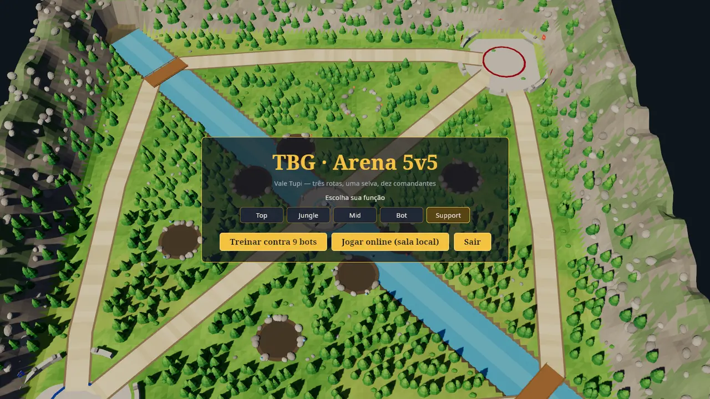
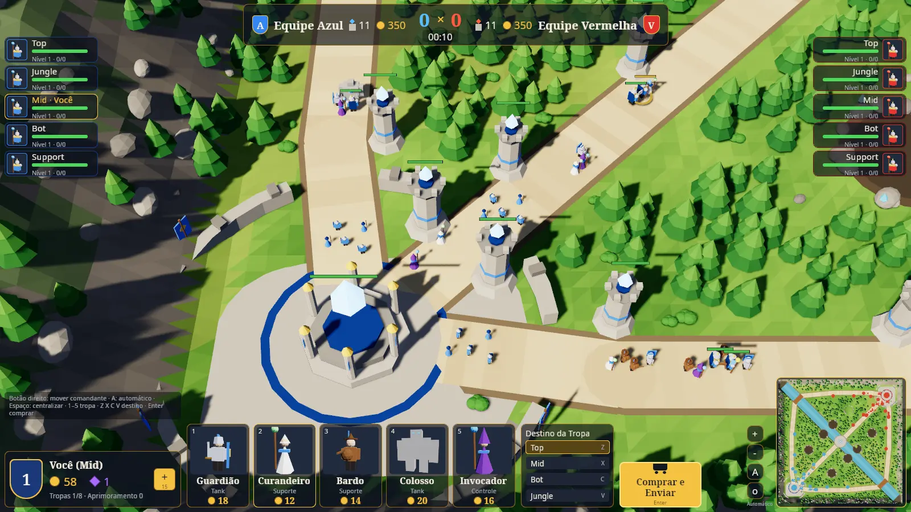
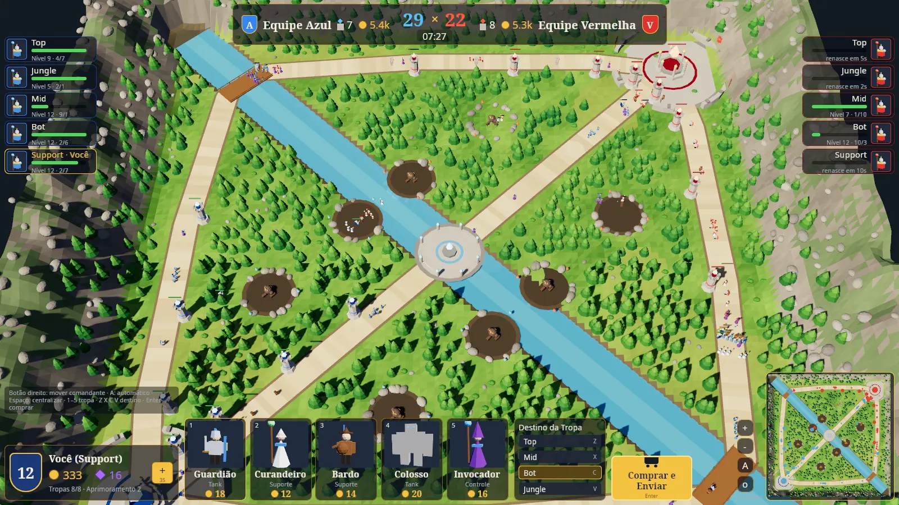

# P76 — TBG Arena 5v5 (MOBA) foundation

> Owner request (2026-11-03): a new, separate 5v5 MOBA mode with its own
> core, documentation, plan and complete execution; playable on the local
> Linux install against 9 bots; visual base taken from the owner's reference
> image; immutable contracts and a functional, professional skeleton that
> another agent can continue. **No balancing** until the mode is fully
> functional and the owner explicitly asks.

Branch `phase/p76-moba-core`, based on GitHub `main` `c3dbc999`.
Canon: [GAME-DESIGN-MOBA](../moba/GAME-DESIGN-MOBA.md) ·
[ARCHITECTURE-MOBA](../moba/ARCHITECTURE-MOBA.md) ·
[CONTRACTS](../moba/CONTRACTS.md) · Decision D-112.

## Read first (next executor)

1. [docs/moba/README.md](../moba/README.md), then the three canon files above.
2. `moba/core-moba/src/lib.rs` (module map) and `moba/core-moba/tests/contract_moba.rs`.
3. `moba/client-moba/src/link/mod.rs` (the one data seam of the client).
4. This file's *Backlog* — pick the next phase from there.

Do not read `crates/*` or `archive/` for MOBA work; nothing there is used.

## Steps (all done)

| # | Step | Result |
|---|---|---|
| S1 | Separate workspace `moba/` (core, server, client), root workspace untouched | done — D-112 |
| S2 | Deterministic core: map, units, combat, movement, economy, levels, waves, camps, outcome | done — M-01…M-30 |
| S3 | Seat bots through `MobaIntention`s; `host::tick` shared by every host | done — M-04, M-26 |
| S4 | Wire protocol v1 + views (one shared world frame per tick) | done — M-40 |
| S5 | Authoritative room server (seats from connections, drop-in/out bots, limits) | done — M-41, M-42 |
| S6 | Client: valley scene from the core map, units, effects, RTS + minimap cameras | done |
| S7 | Client HUD after the reference image; menu; offline and online links | done |
| S8 | Linux installer and local install; docs, contracts, CI workflow | done |

## Acceptance

| Item | Status |
|---|---|
| Separate folders/crates; no dependency on or change to the 1v1 crates, lock or release inputs | met (root `Cargo.toml`/`Cargo.lock` unchanged; native version policy passes) |
| Offline match: player + 9 bots, playable to the end | met (Linux, observed; bot-only matches end by Stronghold or the 25:00 limit) |
| Online match on the local room server; seat from connection; bots fill/resume seats | met (contract tests + observed client) |
| Visual base follows the reference: valley, 3 lanes, diagonal river with bridges, central plaza crystal, stone camps, towers with team crystals, base plateaus, top scoreboard, role columns, player card, Troop cards, Destination, "Comprar e Enviar", minimap | met on Linux (captures below) |
| Installed on the local Linux desktop | met — `~/.local/bin/tbg-moba`, menu entry "TBG Arena 5v5" |
| Balance | out of scope (explicit owner rule) |
| Windows and desktop web correspondence | **pending** (see deferred checks) |

## Validation (consolidation level, MOBA workspace only)

All compilation ran under the shared host lock with two build jobs and a
dedicated target directory.

```text
cd moba && cargo fmt --all -- --check                                  → ok
cargo clippy --locked --workspace --all-targets -- -D warnings         → ok, 0 warnings
cargo test --locked --workspace                                        → 12 passed (10 core, 2 server), 0 failed
cargo check --locked -p tbg-moba-core -p tbg-moba-client --target wasm32-unknown-unknown → ok, 0 warnings
scripts: ci-test-lanes, check-native-inputs, check-patch-notes,
         check-native-version --base origin/main, test-ci-required-checks → ok
shellcheck moba/scripts/install-linux-moba.sh                          → ok
git diff --check                                                       → ok
```

Runtime observations (Linux, Xvfb 1600×900/1920×1080, Mesa software
renderer — not a performance measurement):

- `--capture` offline start, `--warp 444 --overview` mid-game at 07:27,
  `--online` against `tbg-moba-server` (server log: seat 0 joined, bot
  resumed on leave).
- Real X input via XTest: menu role pick and "Treinar contra 9 bots",
  Troop card click, Destination click, "Comprar e Enviar" (gold debited,
  Troops 1/8), right-click move (Commander walked to the point), hotkeys
  `5 V Enter 2 X Enter` (two Troops bought, gold 42 as expected).
- Simulation probe (opt-level 1): ~28 µs per tick at 170–210 live units;
  peak world frame 3 090 bytes. Identical habits per role keep bot-only
  matches even (7 vs 7 towers at 25:00 with the seed shift disabled).





## Deviations

- The 1v1 non-negotiable glossary is not reused: the MOBA has its own
  glossary (Gold, Essence, Troop, Commander…) in its canon, all Proposed.
- `moba/` is its own Cargo workspace (not `crates/*` members) because a root
  manifest change is a 1v1 desktop release input (`scripts/native_release_policy.py`)
  and would force a 1v1 version bump and publication.
- The river is presentation only (no slow) to keep the first rules small.
- Role names stay in English in both languages (as in the reference image).

## Deferred checks (exact commands, with reasons)

| Check | Why deferred |
|---|---|
| Desktop web runtime and visual comparison against Linux (the WASM client compiles) | no web packaging/hosting for the MOBA yet (P80) |
| Windows build, package and visual comparison | no Windows packaging for the MOBA yet (P80) |
| Real-GPU frame-time measurement on the owner's desktop (NVIDIA) | only software-rendered Xvfb was used |
| Ten humans on a real network | needs the owner and devices (P78) |
| Owner look and fun sign-off | owner |

## Known limitations (honest list for the next agent)

- No Commander abilities, items, fog of war, pings, chat, sounds or music.
- One room per server process; no matchmaking, reconnect token, TLS or metrics.
- Commander Auto is simple (follows the lane front, retreats at 25 % HP).
- Lane units overlap loosely in big fights (soft separation only).
- No delta compression; ~60 KB/s per player at peak.
- Menu shows the valley without units (no match running behind it).
- Portraits are rendered once per frame by small cameras (cheap, but always on).

## Backlog — next phases (each its own spec before work starts)

1. **P77 — Commander kit and orders.** One active ability per role (Q),
   attack-move, stop, health/cooldown HUD, ability VFX; bots use them.
   Contracts: append `MobaIntention` variants (protocol v2 only if needed).
2. **P78 — Online rooms for real players.** Several rooms per process,
   lobby/matchmaking endpoint, reconnect tokens to the same seat, latency
   ping display, metrics, load test with 10 socket clients, TLS via Caddy.
   VPS work only on explicit owner request.
3. **P79 — Presentation polish.** Rigged walk/attack animations, sounds,
   music, kill-feed portraits, Tab scoreboard, settings (volume, edge pan),
   fog of war rendering after the rule exists.
4. **P80 — Windows and desktop web.** Packaging, WASM build/hosting,
   correspondence matrix and captures per the visual contract.
5. **P81 — Balance (only when the owner asks).** Offline lab for the MOBA
   core in the spirit of D-33; numbers change only with evidence.
6. **Integration** of the mode into the 1v1 launcher/lobby — owner decision.
