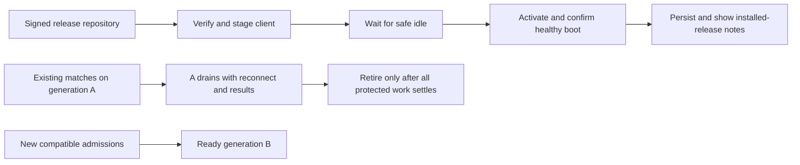

# P66 — Release contracts, alternatives and acceptance matrix

> Companion to [P66](../phases/P66-native-updates-and-release-safety.md).
> All types/examples are proposed contracts, not APIs already implemented.

## 1. Choosing the initial engineering approach

| Concern | Recommended now | Alternative / why deferred |
|---|---|---|
| Update integrity | Existing TUF library, bundled trusted root, signed immutable targets | Hash-only release downloads cannot authenticate a compromised feed; custom cryptography adds review burden |
| Linux installation | Per-user managed release directories, stable launcher/helper, journal | Treat AppImage/system-manager modes explicitly; replacing a mounted image or system-managed package blindly is unsafe |
| Windows installation | Same trust/transaction model with Windows-native helper and code-signing decision | MSIX/App Installer is a valid channel, but adds package identity/certificate/distribution policy; assess before adopting |
| Backend release | Safe drain fallback, then two pinned slots with shared durable admission/result ownership | Restart one process cuts live matches; two unrelated lobbies break single-account ownership |
| Proxy routing | Fixed slot routes installed before active migration; no routine proxy reload | Generic load balancing or socket retry cannot reconstruct in-memory matches; finite close delay cannot cover unlimited duration |
| Data compatibility | Expand/contract and verified old/new readers/writers | Reverting the production database loses results; destructive schema changes block safe coexistence |
| Thousands-player path | Measure overlap headroom, then scale match workers/admission/result boundaries | Kubernetes/multi-region/stream bus is not justified by a hypothetical player count |

The recommendation accepts two constraints: retaining old builds consumes
disk, and long-running old matches can defer the next incompatible release.
These are explicit costs of preserving match continuity without inventing
live simulation migration. An operator can choose a later recovery/fleet
project based on real evidence, not silently kill a draining match.



## 2. Identity and compatibility records

The signed descriptor is a TUF target; its signature/trust comes from the
repository roles. It is not itself an ad hoc `signature` field verified
with a public key fetched from the same untrusted response.

Illustrative descriptor, using test-only identities and digests:

```json
{
  "schema": 1,
  "build_id": "example-linux-00042",
  "release_sequence": 42,
  "display_version": "0.2.0",
  "channel": "stable",
  "platform": "linux",
  "architecture": "x86_64",
  "install_mode": "managed",
  "package_target": "packages/example-linux-00042.tar.gz",
  "notes_target": "notes/example-00042.json",
  "updater_abi": 1,
  "asset_manifest": "example-assets-a",
  "compatibility": {
    "wire_epoch": "example-wire-a",
    "ruleset_fingerprint": "example-rules-a",
    "content_manifest": "example-content-a",
    "presentation_compatibility": "example-presentation-a",
    "feature_set": "example-features-a"
  },
  "local_state_reader": [1],
  "local_state_writer": 1,
  "minimum_bootstrap": 1,
  "security_floor_sequence": 40
}
```

The actual schema adds supported OS/runtime minima, authoritative target
length/hash references and rollout policy from the selected metadata design;
the example is not a complete production manifest. Wire/content identities
above are deliberately not reserved protocol numbers. Document which asset
changes affect match compatibility versus purely cosmetic compatibility.
Reject malformed/unknown-critical-field descriptors before any disk mutation.

Server generation records include immutable server build, supported exact
contracts, DB readers/writers, fixed slot endpoint, state and capacity budget.
States: Staged → Warming → Ready/Canary → Active → Draining → Retired;
Failed is not Ready. Promotion is a versioned compare-and-swap action with
an audit record; concurrent promoters cannot assign the same slot twice.
Only authenticated local maintenance/release principals can change this
directory. Public discovery is read-only; P65 news Publisher grants cannot
promote builds, change signing roots or activate worker generations.

Private ownership records bind account/guest session, generation/epoch,
match key, seat and lifecycle. Credentials/leases are not public update-feed
fields. Directory/signing/admission authorities are separate: a signed
client release cannot authorize arbitrary server-side ownership claims.

## 3. Initial bounded settings, all Proposed

Finalize from actual artifacts/host at O04; exceeding an explicitly safe
bound fails with a user-visible retry/unsupported message, not a bypass.

- Signed metadata file at most 1 MiB; descriptor 64 KiB; localized notes
  512 KiB. Bound root-rotation chain work, metadata depth/count and JSON nesting
  with the chosen library. A real larger repository needs reviewed limits.
- Initial package cap 2 GiB compressed / 8 GiB extracted / 100,000 entries.
  Preflight additional free space for staging, candidate and retained fallback;
  do not assume twice the archive size equals required disk space.
- Up to 2 retry attempts after the initial attempt, exponential backoff
  with jitter and bounded total wait; manual Retry is separate. Honor rate
  limits/Retry-After without unbounded sleep. Range resume requires matching
  target identity; otherwise restart the staged download safely.
- Startup discovery deadline 5 seconds, background recheck no more than
  once per 6 hours while idle plus explicit manual checks. Downloads have
  progress/inactivity/cancel handling; timeout never kills the game process.
- Candidate readiness deadline 60 seconds of actual launch progress for
  a normal boot; slow/missing-ack policy is tested and diagnostic, not a
  reason to rollback an already-acknowledged process during a match.
- Current and previous verified build retained at minimum, plus any
  executing/resume-pinned builds. Notes acknowledgements are per installed
  build; automatic notes history highlights at most 10 releases.
- Proposed canary steps: internal-only → 5% → 25% → 100% **new eligible
  admissions**, with gates evaluated over meaningful samples. No automatic
  promotion from a tiny sample or a timer alone. Signed channels/builds
  cannot be cross-installed accidentally.
- Existing-game guardrail: no routine disconnect caused by deploy/update,
  no lost/duplicated result, no p99 tick-time or view-delay regression above
  5% versus paired baseline for the agreed same-load fixture. This is an
  initial stop criterion, not an already measured SLO or capacity claim.

Security failures and confirmed result loss stop rollout regardless of the
percentage metric. If normal measurement noise exceeds the proposed threshold,
report it as inconclusive; don't move the threshold to manufacture a pass.
Capacity/large load experiments are named owner-authorized work, not routine
per-front testing. Download bandwidth and max inactive-build disk quota are
set at Step 0 from platform measurements, with no destructive automatic cleanup.

## 4. Focused verification matrix

| ID | Fixture | Required evidence |
|---|---|---|
| U01 | Startup online/offline/current/new/unsupported channel | Nonblocking startup, safe idle modal, no render-loop network or lost input |
| U02 | Forged target, substituted package, expired/replayed metadata, old root or invalid rotation | Trust library rejects; installed app/data unchanged; no new trust from unsigned version API |
| U03 | Interrupted/range download, changed target, 429, disk full, cancellation | Bounded resource use/retry, safe resumability, no executable partial files |
| U04 | Traversal, links, duplicate/case-colliding names, reserved Windows paths, archive bomb | Rejection before escape/activation, bounded extraction, trusted roots intact |
| U05 | Inject termination/power-loss model at every journal/file/pointer boundary | Reopen resolves to full known-good old/new release; no mixed assets; durable ordering tested |
| U06 | Candidate crash/no health ack, revoked fallback, incompatible local data schema | Verified permitted recovery; security floor respected; no data/credential loss or false success |
| U07 | Linux legacy install, stable desktop/CLI launch, paths with spaces/accents, read-only and cross-filesystem staging | Managed update without uninstall/sudo; unknown files preserved; desktop entry follows new release |
| U08 | Real Windows running EXE/DLL, antivirus lock, multiple launches and shortcut | Helper waits, no forced kill/in-place replacement/admin prompt; rollback and launch work on target Windows |
| U09 | Update click versus queue/join, running match, council, spectator or reconnect | Safe transition wins atomically; no modal/restart/expensive update work during protected play |
| U10 | Update completes, app closes before/after notes modal/ack, skips releases or rolls back | Correct installed-build notes at least once until ack; offline/localized; no update-success claim after recovery |
| U11 | Native closes mid-match, staged new client, original server generation active | Protected resume credential/build reconnect to original match first; no new incompatible seat or leaked token |
| U12 | Client-only/backend-only/rules/wire/content/feature change across Linux/Windows/browser | Exact supported contracts accepted; unsupported new admission rejected; existing contract unchanged |
| U13 | A running match while B starts/canaries/promotes; network reconnect and second-device login through B | Existing A socket stays A; authenticated resume returns to A; no duplicate-account admission or stale-epoch writer |
| U14 | A matches zero but result persistence pending/failing; repeat/reorder finalization | Retirement blocked until durable result/outbox/delivery policy satisfied; one finalization per match key |
| U15 | Very long match, slow drain, two occupied slots, B canary fails | No timer kills old matches; promotion deferred/rolled back for new admissions; active B matches also preserved |
| U16 | Old/new DB writers, partial backfill, rollback, live browser tab and immutable old bundles | Expand/contract compatibility, preserved results/assets; no database restore to undo code; no forced tab reload |
| U17 | Proxy reload/worker SIGTERM/systemd stop path in isolation, coordinator loss or heartbeat uncertainty | Known disruptive operations gated; no routine proxy reload; safe admission refusal; no fake migration on dead worker |
| U18 | Constrained same-host old/new overlap with controlled sample | Measured headroom/tick/view/result-queue data and rollout guardrails; no claimed thousands-player capacity from unit tests |

Tests use synthetic repositories/keys, temporary install/data paths, local
listeners and process fixtures. Never update the owner's installation, sign
with production keys, publish real metadata or touch live accounts by test.
Fault injection uses controlled process killpoints in temporary fixtures,
not actual power cycling or attacks on production. Windows acceptance is a
real Windows work front; missing hardware is a recorded blocker, not a pass.

U13–U17 need focused integration scenarios once at consolidation. A broad
full multiplayer run is not implicit permission on every front. Keep planned
commands explicit and use the shared compile lock/two-job limit. Examples
cannot reference fake existing targets: implementation report supplies the
actual created test targets and commands.

## 5. Bootstrap and rollout runbooks

1. Adopt existing native installs through a trusted initial bootstrap,
   preserve user data and update every launch entry. No retrofit trust claim
   for previously unsigned installers. Unsupported modes remain explicit.
2. Prepare/sign metadata and notes with test keys first; publish targets
   before metadata promotion. Document offline root/key rotation/revocation
   and minimum-bootstrap repair using the selected TUF implementation.
3. Establish generation routing, ownership and durable result contracts
   before claiming safe multi-version rollout. Existing legacy `/ws` clients
   need a controlled compatibility/bootstrap transition, not a routing flip
   that destroys current matches. Proxy/bootstrap configuration is performed
   only in an owner-authorized quiet/drained window.
4. Stage B, verify readiness/schema/capacity, canary new admissions, promote,
   drain A and retire only after the complete application gate. An operator
   command timeout reports Pending rather than sending SIGKILL.
5. Roll back admission safely, retain running versions/results and pause
   unhealthy rollout. Reverting executables or schemas under live matches
   is forbidden. Write an explicit incident exception policy for urgent
   security action and explain player impact; don't call interruption zero.
6. Observe update failure/rollback/drain/result signals without personal
   metrics, then expand rollout from adequate evidence. Inspect both local
   updater recovery and backend result integrity before deleting old files.

## 6. Primary references checked during planning

- TUF metadata roles, root rotation and rollback/freeze defenses:
  [TUF specification](https://theupdateframework.github.io/specification/v1.0.36/).
- Candidate Rust client/tooling, not a new cryptographic implementation:
  [awslabs/tough](https://github.com/awslabs/tough).
- Caddy documents default WebSocket closure on config reload and finite
  stream close delay. Hence normal slot promotion must not reload the proxy:
  [Caddy reverse_proxy](https://caddyserver.com/docs/caddyfile/directives/reverse_proxy).
- Windows file-in-use/restart lifecycle needs actual native handling:
  [Microsoft Restart Manager](https://learn.microsoft.com/en-us/windows/desktop/rstmgr/about-restart-manager).
- MSIX/App Installer is a separately assessed update/distribution channel:
  [Microsoft automatic updates](https://learn.microsoft.com/en-gb/windows/msix/app-installer/auto-update-and-repair--overview).

No source establishes that this project currently meets these contracts.
The architecture and numerical starting settings are project proposals,
not vendor guarantees. Revalidate current dependencies/OS support at execution.

## 7. Planning report

Inspected native packaging/install/discovery/storage/UI, server drain/result
flow and deploy/proxy configuration, with primary documentation above.
No updater, routing, signature, backend or installed game changes were made.
All U01–U18 executions, real signing/Windows/capacity work and owner choices
remain pending. Documentation validation is recorded before publication;
runtime safety and release readiness are not verified by this plan.

Planning checks passed: four local links, five primary-reference links
inventoried, balanced fences, JSON descriptor parse/sequence/compatibility
checks, all U01–U18 cases and O01–O04 decisions present, and `git diff --check`.
Source/script/deploy/workflow diff against origin/main is empty in this
planning tree. The final staged documentation is checked before publication.
Parallel decision reservations through D-90 were inspected; P66 uses D-91/D-92.
