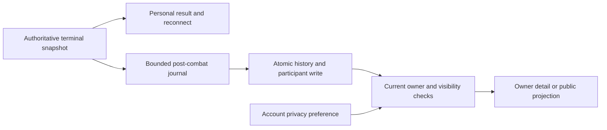

# P73 extension — Match results, statistics and history privacy

**Status:** planning only, owner extension 2026-11-01.
**Parent:** [P73](../phases/P73-active-players-and-direct-challenges.md).
**Owner decision:** the player chooses whether their history is public or
visible only to themselves. Persist that choice on the account; default
to **private**. Account-bound results use additive persistent history
storage; invites/presence remain ephemeral.

This document is an executable sub-spec of the same phase, not a separate
phase or permission to deploy. Read the existing P73 manifest's H01–H18
cases and [conceptual schema](P73-HISTORY-SCHEMA.sql). The SQL is a design
contract, not an installed migration or production command.

## 1. MVP scope

- A **Match history** tab next to Active players/Live, plus a My history
  entry from the player's account/profile and result screen.
- A paged chronological list with outcome, date, opponent where permitted,
  mode, arena and duration. A detail panel shows that player's own recorded
  statistics. Filters: outcome and mode; optional bounded date range.
- Ranked, public Casual, direct/link Challenge, rematches and human private
  rooms played online while bound to an account are included. Freeze the
  account-to-seat association at authoritative admission, not from a name
  typed later. Guests retain the current result view; they do not acquire
  a persistent public guest profile. Practice/demo/training and spectators
  are excluded from persistent online history in this MVP.
- Account setting: **Public / Only me**, changeable after sign-in across
  web/Linux/Windows. Owner history is always available to its authorized
  account, independent of public visibility.
  This preference is independent from presence and the invitation opt-out:
  making history private neither hides the online account nor blocks invites.
- History is read-only gameplay information: no replay, playback, download,
  sharing workflow, chat, editing/deleting results, or Challenge/Rematch
  action on an old match. Existing P73 rematch eligibility still comes
  from a live server ticket, never from a history row.

## 2. Audited facts and missing guarantees

1. `/api/players/{name}` already returns **the last 10 Ranked** outcomes,
   opponents, rating delta, reason and duration. This is not a complete
   cross-mode history, and is publicly cacheable at the audited base.
   The new privacy setting MUST also guard this legacy `recent` field.
2. P5 `matches` rows are best-effort log inserts. Seat JSON is not a
   trustworthy account-history relationship; do not reconstruct ownership
   from display names, IPs, resume tokens or client logs.
3. Ranked settlement already has frozen account IDs, a match key, durable
   pending journals, indexed side rows and optional P61 summaries. Reuse
   that source for Ranked outcomes/rating; do not build a second Elo ledger.
4. `CompletedResult`/`result_id` support terminal reconnect delivery, not
   permanent history. `MatchEnd` currently lacks authoritative per-player
   statistics, and the visible result counters are client-local.
5. Server `SeatStats` already counts validated purchases, Evolutions,
   Fortifications and reconnects. P61 has bounded champion purchase/form
   aggregation, but its event fold currently runs only for Ranked.
6. The client's `damage_dealt` currently counts Hit amounts addressed to
   the enemy Stronghold. This is **not total damage**. `Event::Hit` lacks
   source attribution and its amount may include shield absorption or
   overkill; it is not actual HP removed. Do not persist that counter as
   total damage, sum it as effective damage, or infer a killer from the
   nearest AttackStart. Training-only hooks do not make those metrics
   available in the normal server build.
7. Current schema/auth/release versions are shared with P66/P68/P71 and
   parallel fronts. Allocate the next free migration and wire version at
   integration, not an assumed schema 11/protocol 31.

## 3. Statistics contract

Freeze one authoritative terminal summary per seat and schema version.
The UI and history consume that summary rather than replaying local events.
Collect outside `MatchState` so simulation hashes, RNG, damage and outcomes
stay unchanged. Reuse validated commands and final state, with bounded
arrays/tables; no full event stream or per-tick SQL writes.

Required MVP statistics:

- Purchased champion count and per-kind purchase counts from successful
  server commands, excluding spawned summons and rejected commands.
- Successful Evolution transitions and, when available from the bounded
  collector, per-kind reached tier/branch counts including dead units.
- Successful Fortification count; applied Augment choices from resolved
  final state, never a pending/private option list.
- Stronghold kind, terminal HP and terminal max HP as actually frozen at
  match end. A final upgraded max is not recomputed from today's catalog.
- Outcome/reason from the authoritative terminal result, relative to the
  viewer's seat; recorded mode/origin, arena, catalog/ruleset identity.
- Combat ticks excluding countdown, using the existing frozen combat clock,
  and elapsed wall duration as separate fields. Augment pauses belong in
  wall duration, not fabricated combat time. Persist ticks and tick rate/
  timing version needed to interpret old records.

Total damage dealt/received, healing, kills/assists, attributed friendly
damage and per-champion damage are **not promised by this MVP**. Return
null/unsupported where attribution is absent, never fake zeros. Adding
those later requires a separate exact semantic observer covering DoT,
shields, overkill, regeneration, summons, friendly fire, transfers and
lifesteal with no rule changes. Do not enable the entire local training
runtime in competitive matches to manufacture the numbers.

Legacy rows may supply result/duration/rating only. Store explicit
`result_only`, `partial` or `complete` quality and per-field availability.
Unknown summary versions render a limited fallback, not a crash. A real
measured zero is different from a missing field. Preserve stable champion
IDs and source/catalog version; a future rename/removal must not silently
reinterpret an old numeric enum index as a different champion.

Here complete means complete for this published MVP dictionary, not that
unsupported damage/healing/kill metrics suddenly exist. Reuse a single
collector fold if Ranked statistics and history are both enabled; do not
double-count an event through two observers or recipient fan-out.
On counter overflow, unknown catalog mapping or an oversized optional
summary, retain the canonical result with partial/result-only quality and
an explicit coverage gap. Never panic, invent values or lose the outcome
because optional statistics could not be encoded.

## 4. Storage and identity

Reuse SQLite and the existing store worker. New coherent concern:
`store/player_history/`; do not repurpose `store/history.rs`, which is
P60's private integrity-window query.

The conceptual schema adds two account preference columns and two tables:

- `accounts.history_visibility` and a monotonic privacy revision.
- `player_match_history`: one immutable terminal match envelope, identified
  by a canonical source key; unique ResultId/ranked-key/ranked-row links
  when present; end time, mode/origin, result and versioned bounded payload.
- `player_match_history_sides`: zero to two registered participant links,
  each with a separate random 128-bit history-entry ID, frozen account ID,
  seat/name and indexed end time. A history entry ID is a locator, never
  an access credential. Do not expose shared internal result/ranked keys
  as public private-match correlation IDs.

Canonical key policy: new Ranked envelopes use the existing frozen Ranked
match key; other online modes use the existing ResultId. Legacy Ranked
rows lacking a modern key use a namespaced ranked-row reference. No seed,
display name, wall timestamp or sequential public account ID is a key.

Generate participant entry IDs once when freezing the terminal envelope,
and retain them across journal/DB retries. Unique source keys and unique
`(match, seat)`/`(match, account)` enforce idempotence. Compare immutable
content on duplicate inserts; a conflicting duplicate is quarantined and
alerted, not silently overwritten. Store privacy separately from the frozen
match: changing a setting affects all rows without rewriting statistics.

Do not store keys, IPs, access/refresh/resume tokens, room codes, pending
Shop offers, RNG seeds, private live IDs or full combat logs in history.
No automatic history deletion is authorized. Use paged indexed reads,
backups and size monitoring; an age/count retention policy and any purge
require a separate owner decision before implementation.

## 5. Recording, failure and reconnect behavior



1. Freeze admitted identities, mode/origin and ruleset at pairing. Freeze
   terminal metadata/stats once when an authoritative outcome exists.
   A disconnect or unaccepted invitation is not a completed match. A
   pre-combat cancellation never becomes an invented defeat; unsupported
   interrupted/void records are not forced into W/L/D.
2. Deliver the normal result/celebration without changing combat. Send a
   bounded per-seat `PersonalMatchSummary` through the same `MatchEnd` and
   `CompletedResult` replay path, coordinated with P73's wire bump. It must
   survive reload, normal result resend and authenticated reconnect without
   incrementing counters or persisting a second row.
3. Submit one frozen envelope to a bounded history finalizer after the
   combat loop. Reuse the existing atomic-file journal pattern in an
   independently named per-slot history-pending directory, not a second
   rating finalizer. Never block a live tick, the lobby actor or WS fan-out
   on fsync/SQL. Register pending jobs before retiring a finished slot.
4. Journal -> verify/insert envelope plus participant links in one SQLite
   transaction -> acknowledge persistence -> remove journal. A crash after
   commit but before removal replays idempotently. A crash before a durable
   journal cannot be claimed recoverable; record the actual guarantee.
   Ranked result-only recovery may use the existing authoritative ledger.
5. Use finite queues, retry/backoff, a bounded journal and low-cardinality
   failure metrics. Reuse the existing journal's 32 KiB entry/32 MiB total
   limits as Proposed starting bounds for this separate directory. Overflow,
   read-only disk, full disk, corruption or DB failure must not falsify the
   result or show Saved. Report delayed/unavailable persistence and retain
   recoverable entries; a finite system cannot promise losslessness during
   unlimited storage failure. No silent dropping as the normal path.
6. Reuse store/release pending-job accounting: retire only after commit or
   explicit durable journal handoff to a compatible recovery owner. Preserve
   P66/P71 active-match and terminal-delivery continuity. Recovered private
   data is accessible only after normal current account authorization.
7. Keep history outcome independent from ranking completion. Resolve Ranked
   rating delta/status from the canonical settlement/correction source;
   pending, non-ranked and genuine zero are distinct. Later P60 corrections
   must not leave a stale copied Elo value or expose integrity risk signals.

Suggested private wire addition: `MatchHistoryStatus { result_id, entry_id,
state }`, where state is Pending/Stored/Delayed. Only the authorized account
participant receives it. No-account matches need no persistent-history
acknowledgment. The UI may show the authoritative current result while
history is pending; Stored requires a successful durable DB acknowledgment.
Recovery without a socket is discoverable from the later authenticated API.

## 6. Public/private policy

- Default private for both existing and new accounts. Persist a deliberate
  public opt-in. The same server setting governs all devices and all past
  and future entries; toggling public does not rebuild or backfill data.
- Owner reads require current normal account authentication and entry
  ownership in the query. Do not accept an account/name field as identity
  and do not use P71's expired-token match lease for private HTTP reads.
- Public reads evaluate the owner's current setting on the server every
  time. Public/private UI styling is not an access-control boundary.
- Public projections contain only the opted-in player's own summary.
  Opponent private statistics are never included just because one player
  opted in. Public-queue opponent display names already public in the game
  may be shown; private room/Challenge/rematch/guest opponents are redacted
  in public history, along with internal identity and room/link data.
  Owner views retain the opponent they actually played.
- A separate per-participant entry ID avoids publishing a shared private
  match identifier. Public rendering is a strict projection, never raw
  terminal JSON or a generic two-seat dump.
- Update legacy `/api/players/{name}.recent` and ranking/profile consumers:
  when private, no recent rows may leak through that older route. Aggregate
  rank/W/L record remains public as before. Existing public aggregate P61
  statistics are not converted into per-player detailed history.
- All history responses and legacy profile responses containing visibility/
  recent data use `Cache-Control: private, no-store` (or equivalent no-store
  for anonymous projections), including errors; do not serve old history
  through a shared cache, ETag/304 or static prerendered profile.
- On privacy save, commit first, then acknowledge the new revision. New
  public requests after that commit must observe the new setting. Clear
  application caches/stale in-flight views on the setting change and
  revalidate session/permissions after asynchronous store work. Already
  delivered public data cannot be retracted from another user's device;
  the feature must not promise otherwise.
- Protect concurrent device changes with the privacy revision: GET returns
  it and PATCH requires an If-Match revision. Update visibility and increment
  the revision atomically; a stale save returns 409 and the UI reloads the
  current choice rather than retrying an old public opt-in automatically.
- Privacy-aware handlers/proxy routing must reach every publicly serving
  slot **before** enabling the setting. An old slot that still exposes
  `recent` cannot remain an unguarded public-API fallback. Named ongoing
  match sockets can continue draining safely. See rollout below.

## 7. Authenticated and public API contract

Use versioned typed DTOs and existing auth services; no new login/session
system. Proposed routes:

```text
GET   /api/me/matches?limit=20&cursor=...&mode=...&outcome=...
GET   /api/me/matches/{entry_id}
GET   /api/me/preferences/history
PATCH /api/me/preferences/history      {"visibility":"private"}
GET   /api/players/{name}/matches?limit=20&cursor=...
GET   /api/players/{name}/matches/{entry_id}
```

Use the existing unexpired Access bearer lookup for owner requests, with
Origin/CSRF policy consistent with current browser/native channels. Reject
duplicate/malformed auth headers, unexpected body fields and unsupported
visibility values; public is the other accepted value. GETs do not refresh credentials; on 401 the client uses
its existing coordinated refresh and at most one safe retry. Never place a
key/token in a query string or new browser storage.
PATCH also carries the If-Match privacy revision returned by the preference
GET; a timed-out save is reconciled by reading the current revision, not
by an unconditional overwrite. Mutation acknowledgments follow DB commit.

Add slot-aware routing for `/api/me/*` analogous to current `/api/auth/*`:
the existing X-TBG-Slot/controller route must reach the Access index that
issued the token. Do not authenticate it on whichever slot Caddy happens
to select. The existing auth/client coordinator attaches credentials and
slot internally; UI modules do not handle raw keys. Public history routes
must be served only by a privacy-aware version, never an older fallback.

Pagination: keyset `(ended_unix DESC, entry_id DESC)` using the participant
history index; default 20/max 50 rows. Fetch limit+1, return an opaque
versioned bounded cursor and `has_more`. Validate cursor length/content,
bind it to the same subject/filter set, use parameterized SQL and enforce
ownership independently. No OFFSET scan of an entire lifetime, N+1 query
per entry, full-table COUNT per refresh or cursor-as-authorization shortcut.

List items: entry ID, UTC end time, relative outcome/reason, mode/public
origin projection, arena, allowed opponent display, duration, summary
quality and safe ranking status/delta. Details add that player's available
stats. Neither route returns the other seat's private payload. Unknown
catalog/summary versions have a typed unsupported fallback.

Status semantics: owner 401 unauthenticated/expired; same 404 for a missing
or non-owned detail; public private-history list returns a documented
`history_private` response without rows; nonexistent account/detail 404;
400 invalid filters/cursor; 429 bounded rate refusal; 503 temporary store
failure. Store failure must not become a successful empty history.
Privacy mutation additionally returns 409 for a stale expected revision.

Use the existing store worker for short indexed reads with a separate
bounded history-read admission semaphore: Proposed 4 concurrent requests,
2 s timeout and 32 KiB detail response bound. Do not create an unrelated
SQL pool/service or starve auth/ranked writes with unbounded history work.
Disable public-route SQL debug logging of identities and private payloads.

Retain history-read admission permits until the actual store work finishes
or is cancelled, rather than releasing them when an HTTP waiter times out
while its SQL job is still queued. Bound outstanding jobs and inspect the
indexed query plan so history reads cannot starve auth/ranked writes.

## 8. Legacy data and migration

Allocate one additive versioned migration. Preserve existing tables and
rating contracts. Default both existing and future accounts to private.
Run schema changes and bounded backfill behind an explicit rollout flag;
back up before applying to a real environment. No production data or
migration command is executed by this planning task.

Backfill only verified Ranked rows with canonical account IDs. Use existing
match key when present, otherwise a namespaced legacy Ranked row key; keep
one participant entry per account/seat. Work in resumable bounded batches
with a high-water checkpoint and idempotent uniqueness checks. Link new
Ranked envelopes to their canonical key/row so backfill and online writes
cannot produce duplicates. Preserve already-issued participant entry IDs.

Populate only fields actually stored. Optional P61 data is reused only if
its version and definitions match. Missing per-kind metrics/HP/damage stay
null with result_only quality. Do not reconstruct non-ranked account
history from P5 seat JSON, display names or guessed session associations.
New non-ranked history starts at activation; explain that boundary in UI.

## 9. Frontend integration

Use the P72 shared Bevy shell. Keep fetching/state, list, detail and privacy
editing cohesive; split `ui/history/` only as needed. API identity comes
from the authenticated coordinator, not a name field in the screen.

Show owner history and an explicit Public/Only me control, current saving/
saved/failure state, and a preview of the public projection. Do not show
the switch as saved before server commit. Public profiles can open visible
history; otherwise show the localized private-history state. Preserve list
scroll/filter when opening details and returning. Historical rows do not
offer replay or retroactive rematch in this MVP.

Required states: sign-in required, loading, no recorded games, filtered
empty, legacy result-only, unknown/unsupported stats, persistence pending,
API failure/offline/retry, private public-profile view, invalid/deleted
entry, 401 refresh and 429 backoff. Dates use stored UTC and the user's
locale/time zone, without client-clock ordering. Refresh once after an
actual new result/Stored notice; do not poll every player's history.

Result screen and reconnect use the same authoritative PersonalMatchSummary
as the stored details. Stop describing the old tower-hit client counter as
total damage; unavailable metrics are hidden or localized as unavailable.
Keep P63 celebration and existing P73 rematch controls intact. All new
labels/reasons/availability states are localized in pt-BR/en and the
repository's other supported catalogs, with keyboard/focus accessibility
and matched native/web captures. Windows uses the same frontend.

Key client caches by account and clear them on sign-out, takeover or account
switch. Discard stale in-flight responses that belong to another account
or privacy revision. A HistoryStatus update must match the current result
identity; it cannot restart a celebration or create a rematch request.

## 10. Rollout, recovery and acceptance

Suggested order: H0 freeze schema/DTO/metric/privacy definitions -> H1
observer + terminal summary -> H2 additive store/journal/idempotence -> H3
verified Ranked backfill -> H4 authenticated/public guarded API + routing
and account preference -> H5 shared UI -> H6 one targeted consolidation.

Feature flags keep collection/API/UI activation separate for controlled
rollout, without creating a flag framework. First deploy privacy guards and
compatible schema across public-serving slots, expire/purge legacy shared
profile cache, then collect in shadow, verify bounded writes/duplicates,
enable owner history and finally enable explicit public opt-in. Do not
flip feature flags or deploy from this planning work.

Rollback disables history publication/UI/collection as needed but preserves
privacy guards, preferences, additive data and recovery journals. Never
roll back to a public legacy `recent` handler that ignores the setting;
never drop tables/columns, erase history or reset privacy on rollback.
Monitor terminal->stored delay, pending journal bytes, retries, gaps,
duplicate/conflict counts, read errors/latency and private-read denials.
No per-player/high-cardinality metrics or payload logs.

Before production acceptance, record actual average/max envelope size,
expected matches per day, indexed read latency and write/journal delay.
Estimate disk as matches/day times stored bytes plus indexes, WAL and
backups, and compare it with the existing VPS budget. Define alerts and
request an explicit retention decision before implementing any purge;
this plan does not approve paid capacity or deleting existing results.

H01–H18 in the parent manifest cover ownership/privacy leakage, settings,
all modes, metrics, replay/idempotence, crash boundaries, backfill, source
identity, cursor behavior, routing, release drains and UI parity. Write
focused new tests in Proposed `tests/player_match_history.rs` and
`tests/history_privacy.rs`, plus real changed protocol/store targets.
Queue them for P73's one deduplicated consolidation under the common lock;
no per-step full suite or release build. In-memory SQLite DDL/query-plan
checks are appropriate to this documentation contract and touch no real DB.

Do not call this extension complete with missing persistence/recovery or
privacy evidence. Report exact commands, captures, known coverage gaps and
deferred work. The parent phase remains planning-only until implemented.

## Planning validation record

The conceptual DDL was executed only in disposable in-memory SQLite with
minimal synthetic accounts/ranked prerequisites. Passed: existing/new
accounts default private; 65-match keyset traversal with equal timestamps
has no duplicates; an owner-constrained query cannot read another side;
public query predicates respect visibility; a stale expected privacy
revision updates zero rows; FK/duplicate/payload/visibility constraints
hold; a failed second participant rolls back the match; EXPLAIN uses
`player_match_history_by_account`. No real database was opened.

Manifest validation checked 68 source revisions/hashes, seven new relative
links, Proposed BR-AP01–16 and D01–D16/H01–H18 pending status. JSON and
whitespace checks passed. All application API/auth/collector/journal/
backfill/slot/frontend tests remain unrun; these planning checks do not
mark any H scenario implemented or verified.
