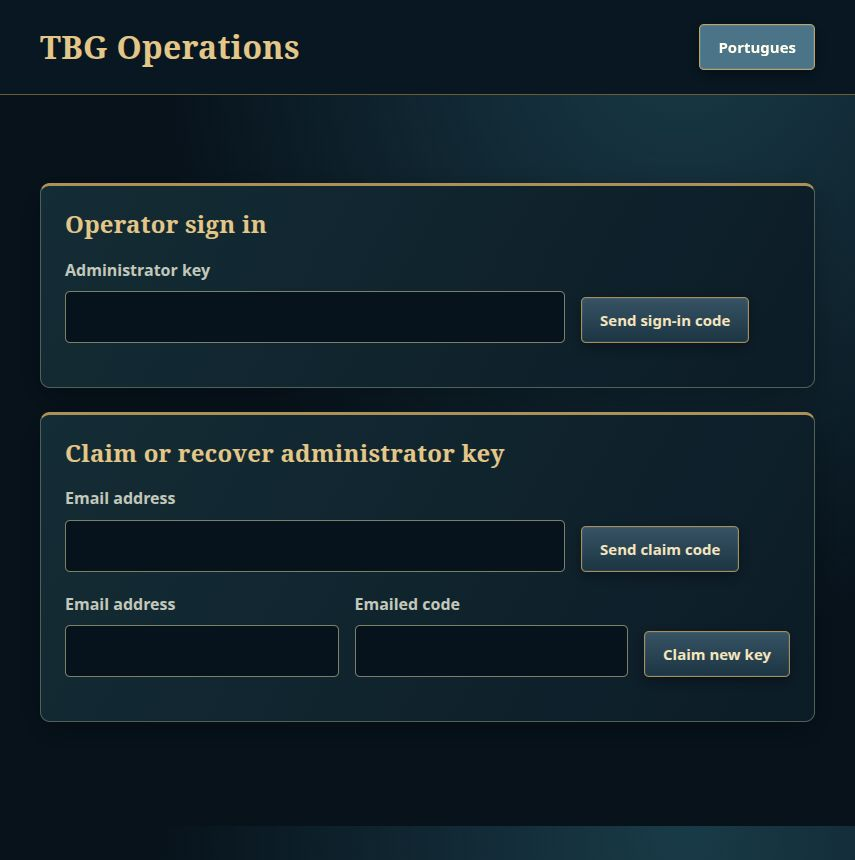
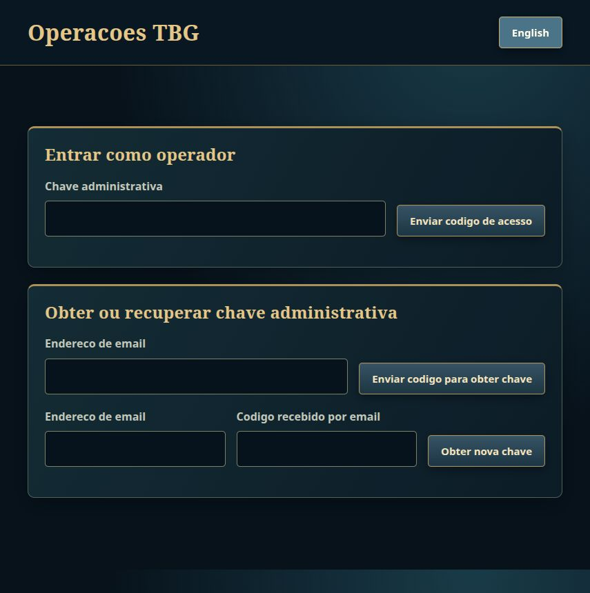

# P75 execution report

Status: implementation candidate for a Draft PR; activation and visual acceptance remain pending. Validation level: **targeted consolidation**, never a full suite. Code, docs and commits are English. Owner communication is Portuguese.

## Delivered behavior

- Required private email enrollment, typed verification codes, authenticated email changes and the seven-day lost-mailbox hold. Registration retries preserve the original committed grant, including the fifth account sharing an address.
- Recovery rotates the existing account's key, revokes old credentials and both slots' sockets, retains ratings, account-bound rows, populated P73 history and the leaderboard, and returns the replacement key through the existing save-key flow. Native recovery retains backups and replaces an existing protected-vault backup using the PR #57 namespace; a write failure surfaces temporary-storage status.
- A secret-free, bounded outbox and one database-leased dispatcher. Synthetic Capture transport was used; no SMTP connection, real mailbox, real password or host credential was used.
- Separate operators, idempotent single-Owner bootstrap, emailed claim/login, hash-only keys/sessions, exact-Origin JSON/CSRF gates, current-role authorization, fresh-key checks and audited CLI recovery. The public router never mounts the 39-route console API.
- Versioned bans, restrictions, revocation, exact email blocks, private reports with frozen evidence, normalized/premoderated custom sheets, blocked terms and six live kill switches. Ban is the sole moderation forfeit; ordinary revocation retains its existing detach behavior.
- Wire 39 appends client tags 27–28 and server tags 37–41. Chat and emoji delivery is seat-only, bounded and excluded from simulation, views and replay. Standard IDs are frozen; custom sheets retain owner-only use and approval/revocation checks.
- Shared desktop client flows for registration/email/recovery, suspension, reports, chat/mute/mode, slots, private previews and uploads. Modal controls capture gameplay input; Enter without explicit Tab cannot surrender. Desktop web and Linux compile; presentation equivalence is unverified.
- A real same-origin operator console with EN/pt-BR catalogs, text-only rendering, every-frame review and audited controls. The automatic static package still contains the inactive public placeholder. Deployment, backup and credential files are examples only.

## Base and commits

Fetched GitHub `origin/main` at `b964875e2219bafe129b19960f7f1369307870d5`. The planning prerequisite was fast-forwarded from `origin/docs/p75-admin-moderation-plan` at `b61764d`. Execution uses `/data/tbg-p75-admin-moderation-social`, branch `phase/p75-admin-moderation-social`. The owner's checkout and other fronts were not modified. All O-P75-01–13 defaults apply.

| Step | Commit |
|---|---|
| S0 | `9a919133` |
| S1 | `75ce8977` |
| S2 | `ad8a970c` |
| S3 | `4f3e17f0` |
| S4 | `693cb15b` |
| S5 | `d6c12b91` |
| S6 | `f17feeb9` |
| S7 | `72e5b966` |
| S8 | `02c70cd1` |
| S9 | `4073a00d` |
| S10 | `34a82125` |
| S11 | `a249583f` |
| S12 | `852d893f` |
| S13 | `b166ce18` |
| S14 | The delivery commit containing this report; names the D-108/D-111 contract amendments |

No history was rewritten. Publication is explicitly authorized by the owner's execution request: normal branch push and Draft PR to `main`; never merge, auto-merge, force-push or deploy.

## Checks actually completed

**112 distinct tests passed, zero unresolved test failures.** This count deduplicates failed/corrected runs and repeated names; it does not count client test compilation as execution. The 112 comprise 67 server integration scenarios, 7 P75 server unit cases, 13 preserved P67 fixture cases, and 25 core protocol/determinism cases. The unchanged `contract_determinism` contributed 2 tests; protocol contributed 23.

Every compiling command used this nonblocking host lock and exactly two build jobs:

```bash
flock -n -E 75 "/tmp/tbg-validation-$(id -u).lock"   env CARGO_BUILD_JOBS=2 CARGO_TARGET_DIR=/data/tbg-p75-target   cargo test -p tbg-server --no-fail-fast   --test contract_p75_identity --test contract_p75_recovery   --test contract_p75_admin --test contract_p75_moderation   --test contract_p75_reports --test contract_p75_chat   --test contract_p75_emoji --test contract_registration   --test schema_upgrade --test revocation_feed --test history_privacy   -- --test-threads=1
```

The union ran once in S14. Its first run found implementation and fixture errors; after relevant corrections only the affected targets/scenarios were rerun. The seven P75 integration targets' final deduplicated coverage is 54 scenarios: identity 7, recovery 10, admin 18, moderation 7, reports 2, chat 4, emoji 6. The existing registration/schema/revocation/history targets contributed 13 more.

Additional exact scopes, each under the same prefix:

```text
cargo test -p tbg-server --lib p75 -- --test-threads=1
cargo test -p tbg-server --lib store::recovery::tests -- --test-threads=1
cargo test -p tbg-core --test contract_protocol --test contract_determinism -- --test-threads=1
```

New late cases were executed by name: `ic12_attached`, `ic01_populated`, `s05_admin_key_attempts`, `ic08_recovery_audit`, `s13_recovery_audit_failure`, `s04_disabled_moderator` and `s07_controls`. The JSON negative case was rechecked after its helper was corrected to send a single actual `text/plain`/form Content-Type.

Representative real output, from the final code or reused evidence for unchanged behavior:

```text
contract_protocol: 23 passed; 0 failed
contract_determinism: 2 passed; 0 failed
server --lib p75: 7 passed; 0 failed; 73 filtered out
preserved recovery fixture: 13 passed; 0 failed; 67 filtered out
schema_upgrade: 7 passed; 0 failed
contract_registration: 2 passed; 0 failed
revocation_feed: 1 passed; 0 failed
history_privacy: 3 passed; 0 failed
ic12_attached_spectators_and_other_matches_never_receive_social_or_email ... ok
ic01_populated_p73_history_and_leaderboard_survive_rotation_byte_for_byte ... ok
s04_disabled_moderator_sessions_stay_revoked_after_reenable ... ok
s07_controls_rtl_and_zero_width_comments_notes_and_terms_are_refused ... ok
```

Client checks passed on the delivery tree, including compilation of native test modules:

```bash
flock -n -E 75 "/tmp/tbg-validation-$(id -u).lock"   env CARGO_BUILD_JOBS=2 CARGO_TARGET_DIR=/data/tbg-p75-target   PKG_CONFIG_PATH=/tmp/p75-native-deps/usr/lib/x86_64-linux-gnu/pkgconfig   cargo check -p tbg-client --bin tbg-client --tests
flock -n -E 75 "/tmp/tbg-validation-$(id -u).lock"   env CARGO_BUILD_JOBS=2 CARGO_TARGET_DIR=/data/tbg-p75-target   cargo check -p tbg-client --bin tbg-client --target wasm32-unknown-unknown
```

Real client output: `Finished dev profile` (native 1.89 s; WASM 1.63 s on the warm cache). The native test target reports the existing unused `visuals/layout.rs::clear` warning; that file is unchanged. Initially ALSA development metadata was unavailable. The official system-repository package `libasound2-dev=1.2.11-1ubuntu0.3` was downloaded and extracted into `/tmp/p75-native-deps`, with its real library metadata pointing to the installed runtime. Nothing was installed on the host.

`cargo fmt -p tbg-core -p tbg-server -p tbg-client`, `git diff --check`, i18n/PNG/visual-contract inspection and these static commands passed:

```text
python3 web/scripts/check.py
landing: 162 files, 4104 KiB checked
admin-public: 16 files, 240 KiB checked
admin-app: 23 files, 122 KiB checked
admin-preview: 23 files, 122 KiB checked
web checks: passed

python3 scripts/check-patch-notes.py
Patch notes OK: 9 entries; current ruleset 15 / cc459351581b7763
```

No simulation source or `contract_determinism` diff exists against the planning prerequisite. No workspace suite, Clippy sweep, release/package build, balance gate, benchmark or ignored test ran. The existing remote CI configuration was left unchanged.

## Contract and negative-case evidence

| Contract | Behavioral coverage |
|---|---|
| IC-01, IC-20 | `contract_p75_recovery`: discovered account FKs, future inventory, every account column except permitted fields, populated P73 envelope/sides, leaderboard, unchanged key format |
| IC-02 | Real sockets on both slots close within 2 s; old key, refresh and Access refused; new key works |
| IC-03 | Recovery, claim and sign-in responses compared byte-for-byte across success, unknown, mismatched, throttled and outbox-error cases |
| IC-04, IC-16 | Public HTTP, real wire frames, fixed-size active log capture, metrics, DB/WAL and mail/Debug secret canaries |
| IC-05 | Legacy and new encoding goldens; frozen tags and protocol 39 |
| IC-06 | Unchanged determinism target, per-step event/state comparison under a seeded social flood, and real-match replay hash |
| IC-07 | Generic FK/account snapshot after ban/unban, identical public profile and restored leaderboard visibility |
| IC-08 | Forced audit failures roll back moderation/recovery; all three audit/history tables reject UPDATE/DELETE |
| IC-09, IC-10 | Shared-DB bootstrap, current Owner retained, distinct credential domains and public-route inventory |
| IC-11, IC-17 | Frozen 16 IDs; normalized hash; private preview, ownership, public approval, revocation and non-reuse |
| IC-12 | Two seats, an attached spectator and another live match; no relay into logs, views or replay; URL sink receives no request |
| IC-13, IC-14 | Populated migration fixtures, history after v12, partial-shape refusal; registration name/refund/IP/email-cap contracts |
| IC-15 | Principal/purpose/epoch binding, five guesses, expiry, immediate code replacement, shared-slot budgets and one-effect races |
| IC-18 | All six switches disabled/restored on two slots, including MatchSocial rights and HTTP feature admission |
| IC-19 | Real cross-slot ban forfeit within 2 s; restrictions leave outcome untouched; exact existing forfeit state and no voluntary-surrender signal |

| Security case | Coverage |
|---|---|
| S01 | All 39 routes × none/expired/disabled/moderator/owner; default-deny methods; positive area inventory and moderator ceilings |
| S02 | Forged account/operator/role/version fields; participant-derived report targets and ownership checks |
| S03 | CSRF/Origin/JSON failures cause no action or audit; mutation via GET refused |
| S04 | Logout, claim rotation, idle/absolute expiry, restart, disabled operator and re-enable never restore a revoked session; cookie attributes checked |
| S05–S06 | Shared code budgets, AdminKey attempts from different IPs, fresh claim after throttling, uniform responses, sixth-email limit |
| S07 | Chat/label charset plus control/RTL/zero-width comments, notes, terms and names; markup retained as literal text only |
| S08–S09 | Huge dimensions, 10,000-frame GIF, zero delays, truncation, polyglots, wrong media/size; no original serving; local URL sink remains untouched |
| S10 | Active log capture and private Debug/DB/WAL/metrics/error canaries |
| S11 | Chat/emoji windows and duplicate rules; report/upload/outbox limits, leased dispatch and bounded normalization/cache/feed/session structures |
| S12 | Concurrent report, claim, recovery, ban/unban, approval and revocation each have one versioned effect |
| S13 | Atomic audit rollback, old recovery credentials/code remain usable on failure, queued/retried mail; relay is independent of SQL |
| S14 | Non-loopback forwarded-IP/Host forgery cannot acquire trusted-proxy identity; CIDR rules enforced |
| S15 | Ban blocks refresh, authenticated resume/lease and guest claim; blocked-address re-registration creates no account |
| S16 | Header/control injection in names, addresses, labels and locale refused; typed mail construction |
| S17 | Target cannot see reporter/private evidence; moderator receives masked email; notes remain operator-only |

## Acceptance and visual evidence

A01–A03: server/API enrollment, changes, recovery, unchanged data and device/socket revocation observed; native/web human journeys pending.
A04: bootstrap/claim/sign-in/roles observed through the real console listener and Capture; authenticated browser walkthrough pending.
A05: real two-server ban forfeit observed; suspension screen and device presentation pending.
A06: real seat-only delivery, masking, refusals, attached spectator isolation and replay observed; native-to-web keyboard/reconnect journey pending.
A07: bounded PNG/GIF/WebP pipeline, private/approved/equipped/revoked states observed by tests; actual animated client and every-frame console walkthrough pending.
A08: frozen evidence and operator resolution/actions observed by API; complete Result-to-console user journey pending.
A09: all six switches observed on both slots by HTTP/cache/wire tests; browser toggle walkthrough pending.
A10: default unconfigured-mail registration remains usable; synthetic dispatcher lease/retry/bounds observed. Live SMTP activation is outside scope.
A11: synthetic populated migration/reopen/history-after-v12 rehearsal passed. No real database was used.
A12: all new in-game surfaces have shared contract/motion entries; Linux, Windows and desktop-web game captures and exact visual/motion parity remain pending.

The actual static console sign-in/claim screen was inspected in both languages at the local preview. It was not connected to an admin backend, so these images prove presentation only:




These are not in-game Linux reference captures and do not establish cross-platform parity.

## Explicitly deferred checks and owner gates

- `flock -n -E 75 "/tmp/tbg-validation-$(id -u).lock" env CARGO_BUILD_JOBS=2 CARGO_TARGET_DIR=/data/tbg-p75-target cargo test -p tbg-client --bin tbg-client p75 -- --test-threads=1`: native unit execution requires cold Bevy code generation/linking. Its test modules compile; minimum policy defers that additional cold build.
- The single legacy `auth_http` smoke (`a01_a02_rotation_is_absolute_idempotent_bounded_and_hash_only`) was attempted under the lock and returned **75**, so it did not run. Broader `auth_http`, `presence_global` and `player_challenges` scenario sweeps are deferred; their registration helpers now send the required email/locale. Existing P75/registration/revocation/privacy evidence was reused.
- Real Linux game journeys, Windows/device captures, desktop-browser play, visual/motion correspondence, animation and subjective look/fun sign-off remain pending. Compilation is not evidence of parity.
- PR #57 protected-backup integration must be reviewed after that independently owned front is consolidated. No files in that front were changed.
- Caddy is unavailable locally; examples were inspected and static checks passed. No host configuration was loaded.
- Owner gates before activation: working nightly backup plus restore rehearsal, host-only SMTP configuration/credentials and DNS, privacy/conduct publication, coordinated schema/protocol/client switch, Owner claim and selected feature switches. Follow P75-OPERATIONS in order. The automatic delivery guard intentionally refuses a schema change.

Several intermediate validation attempts returned lock exit 75. No wait, lock poll, bypass, extra build jobs, cargo clean or alternate target directory was used. Later checks followed independent code changes and superseded those temporary deferrals; the legacy smoke above remains deferred.

## Corrections and interpretation

The first S14 compile exposed the accidentally test-gated production recovery module, SQL borrow/type issues and client integration errors. Focused runs then exposed the raw-image/JSON admission mismatch, a deferred SQLite write-upgrade race and duplicate normalized-image handling. These were fixed without changing simulation or competitive numbers. Fixtures were corrected for reserved names, shared Capture across two slots, invalidated mail predecessors, binary PNG responses, snapshot refresh and unrelated-match initial metadata. Assertions were not removed to obtain a pass.

> blocked: S11 stopped after two missing-script errors following an auto-review rejection of an unapplied draft that removed a key backup without persisting its replacement. The owner explicitly authorized resuming S11. No rejected draft was executed. The replacement preserves backups and surfaces protected-write failure.

Pre-session CSRF bootstrap, nonce-bound sign-in attempts, private owner-history report locators, duplicate-upload refusal and feed-lag units are documented in P75-API. Standalone moderation acquires SQLite's writer lock before reading the expected version; nested console writes retain savepoints. `account_owner` is treated as auth ownership in the recovery exception, alongside auth sessions; ordinary account data is discovered rather than enumerated. The S14 D-111 amendment fixes the test's omitted Skull standard-ID expectation and freezes the full list; D-108 records the required-email fixture transition and additive registration/recovery contracts.

## Publication and stop point

The Draft PR associated with `phase/p75-admin-moderation-social` contains this report's S14 delivery commit. Its exact URL and final SHA are returned in the executor handoff and recorded in GitHub metadata. The branch is pushed normally. Nothing is merged, deployed, auto-merged or activated. Stop for reviewer/owner acceptance; pending gates are not passes.

## Subsequent owner-authorized consolidation

After the original Draft delivery, the owner requested integration of the
War Auxiliary handoff, final CI fixes, normal publication and merge conditional
on passing validation. The original S0–S14 evidence above is historical; its
no-merge instruction and R15/wire-39 identity describe that original delivery.
The new combined candidate is documented in
[the consolidation report](../phases/P75-AUXILIARIES-CONSOLIDATION.md), including
main/PR #57 integration, R16/wire 40, actual current checks, busy-lock deferrals
and unchanged production activation gates. Nothing in P75 changes simulation;
the owner-requested auxiliary tier rules are the separately identified R16 change.
