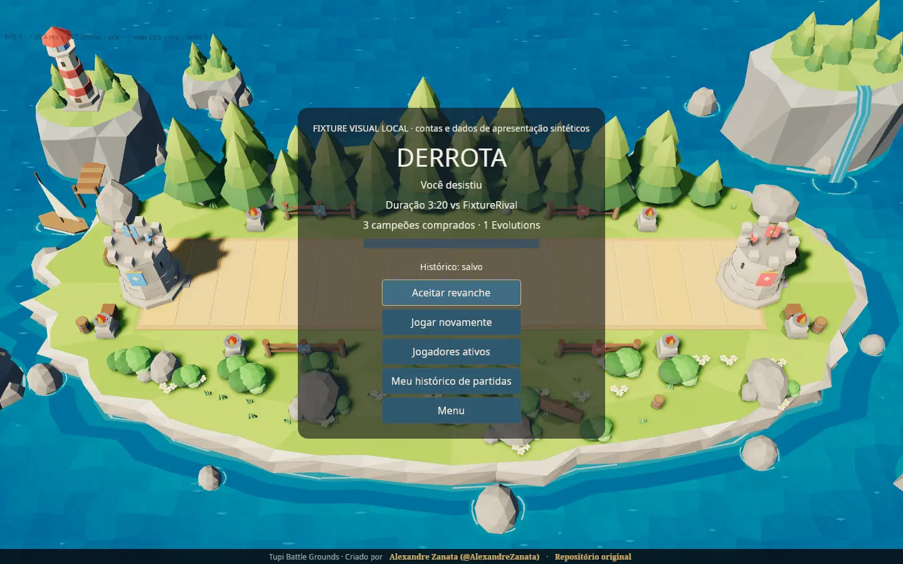

# P73 native capture evidence

These are actual native screenshots from the existing Bevy `ui-acceptance`
capture path under Xvfb, 1440x900, pt-BR, on 2026-11-01. They use the last
successful local binary **before the final source edits**; see the
[execution report](../../P73-EXECUTION-REPORT.md) for deferred checks and limits.
No browser, production, final-source or owner-approval claim is made.
Small WebP conversions preserve the screenshot content; raw PNGs/logs stay local.

## Connected fixture accounts

137 real local fixture accounts connected to a disposable server, not production
users. The public directory and header are actual API projections.

## Synthetic invitation presentation

The existing capture hook injects private presentation state. This is not evidence
of sending/accepting invitations; real socket tests cover behavior separately.

## Synthetic rematch presentation

FixtureRival and its ticket state are injected local fixtures. No actual completed
match or consent is represented by this screenshot.

## Synthetic owner preference and history presentation

Both visibility states and the account/history rows are local presentation
fixtures. The guest header intentionally has no credentials; the body explicitly
labels synthetic data. Saved labels here do not prove database persistence.

## Synthetic Result presentation

The summary and saved/rematch states are injected fixtures, using the same summary
shape as the tested server result. No online match happened for this capture.
The final source corrects the earlier pt-BR Evolution wording visible here.

