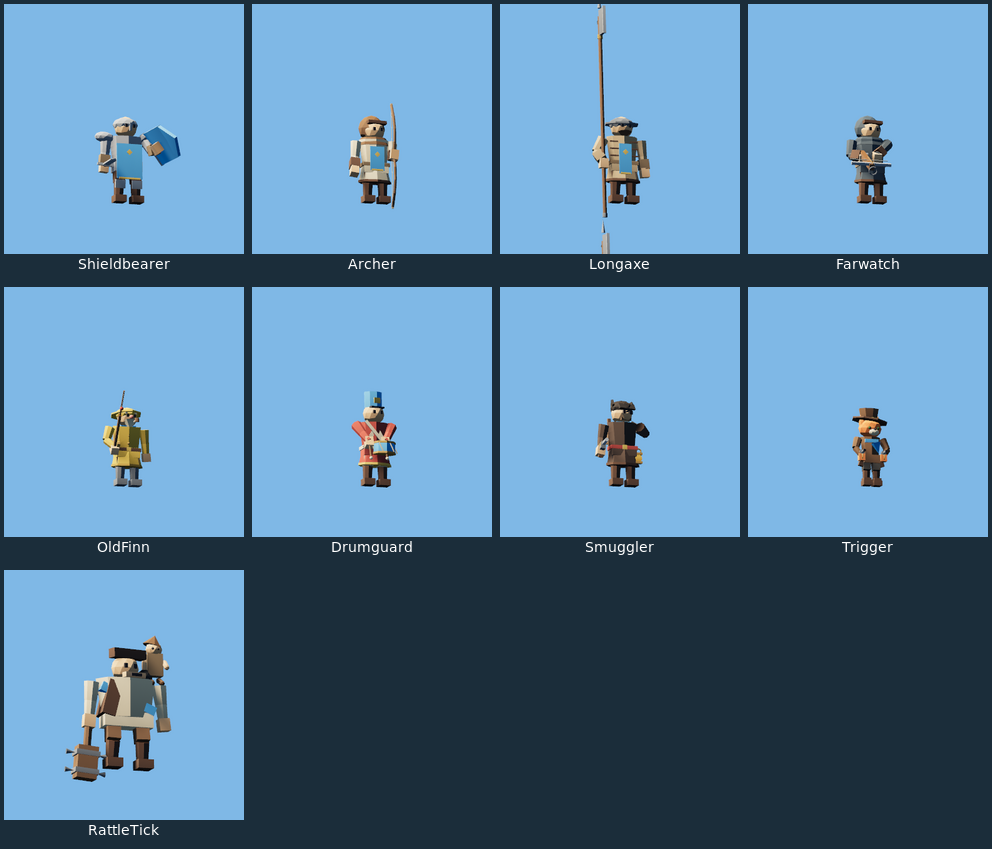
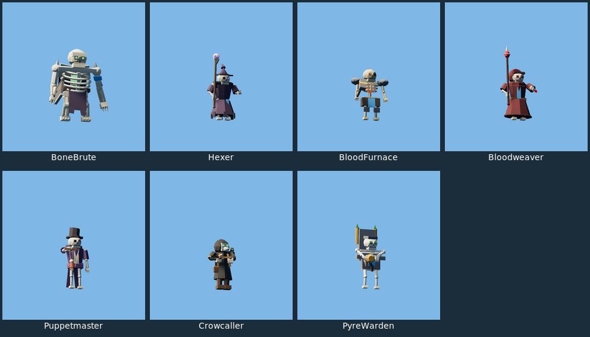
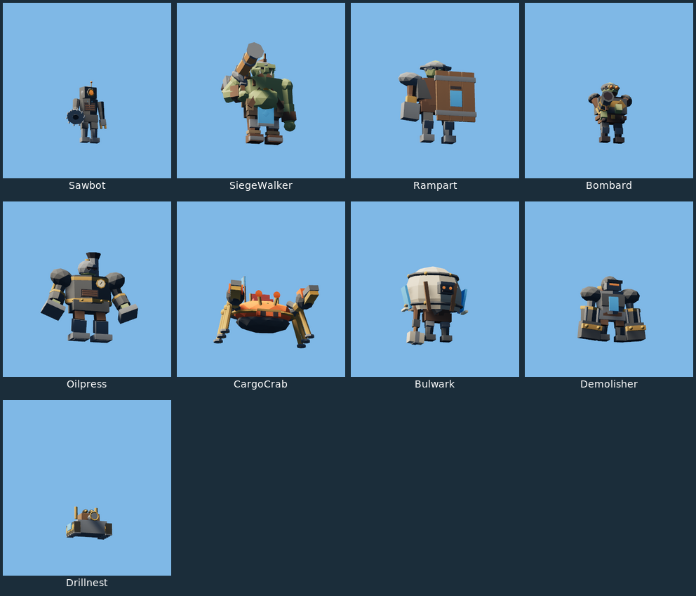
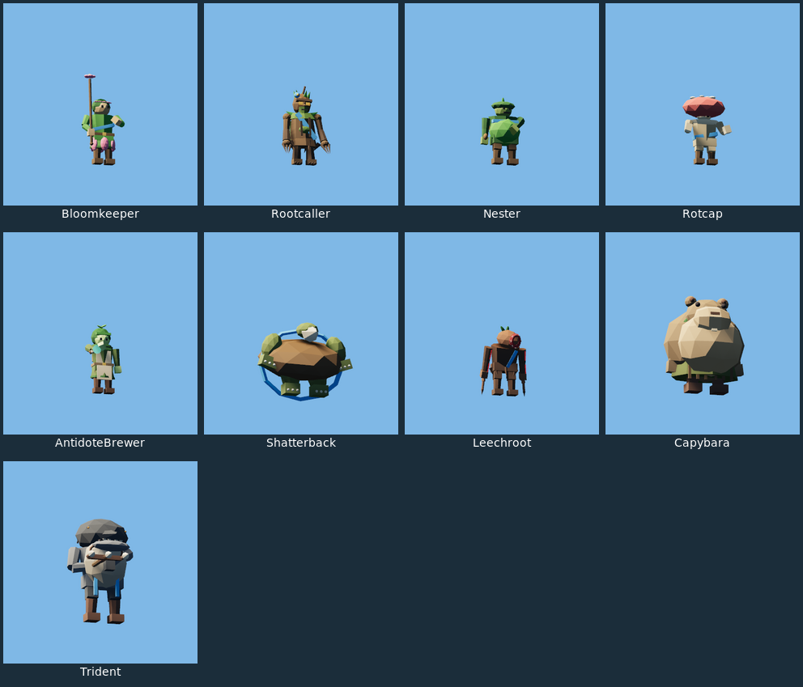
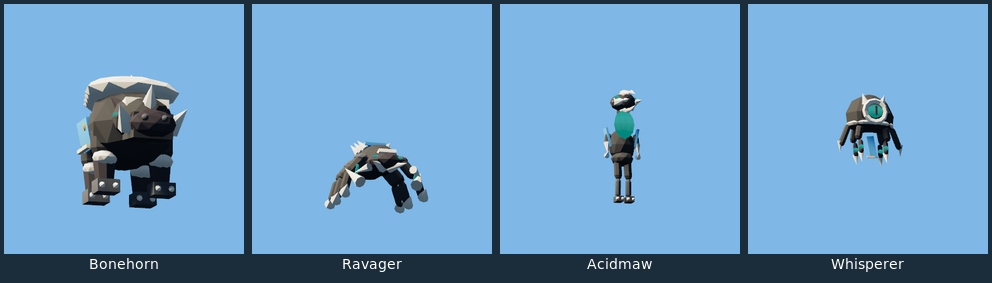
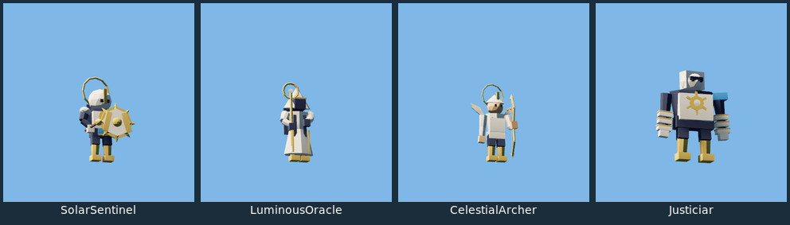
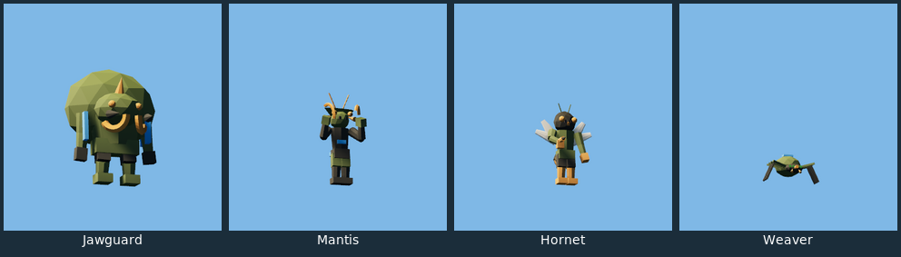

# P70 compact review references

These **before-only derivatives** show the frozen 46-champion cohort. They
are cropped, resized and captioned from real renderer PNGs, then encoded as
lossless WebP. They are not altered character art, final candidates, nameless
lineups or match-distance acceptance. [Provenance](before-derivatives.json)
links every original and its recorded SHA-256. Bulk originals stay ignored
under `.local/p70-evidence/`; transfer them explicitly when reviewing elsewhere.

Paired after sheets remain pending the scoped executable build and real
renderer campaign. See [the execution report](../P70-VISUAL-REVIEW.md).
