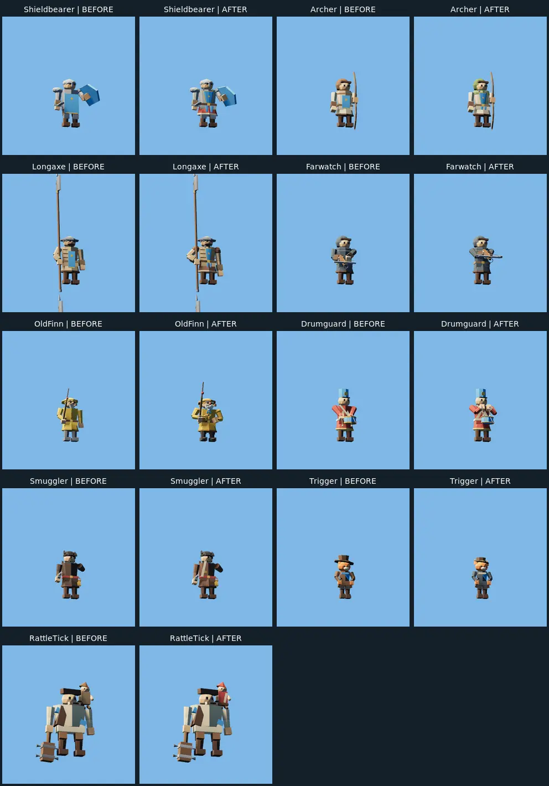
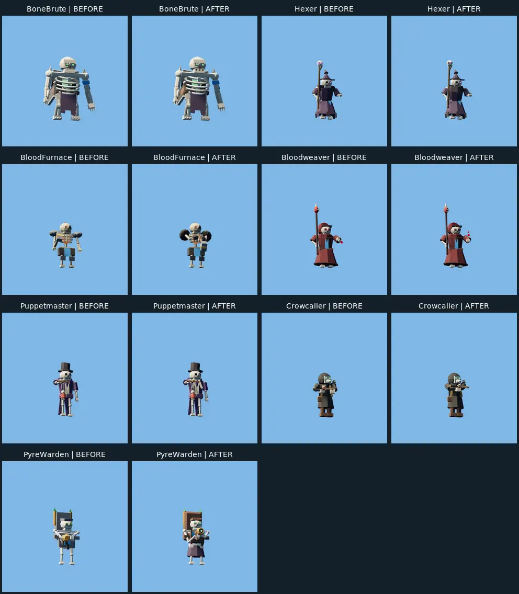
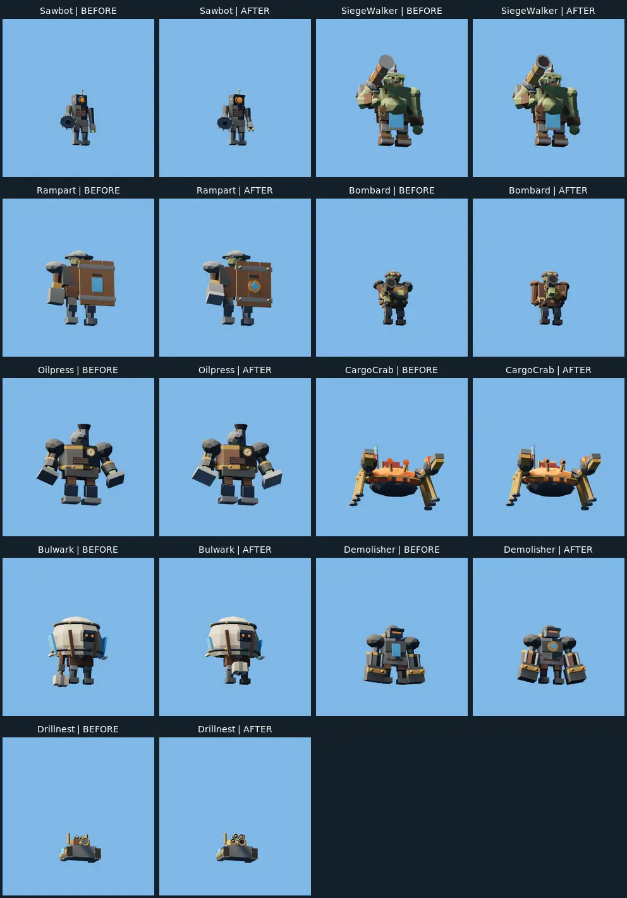
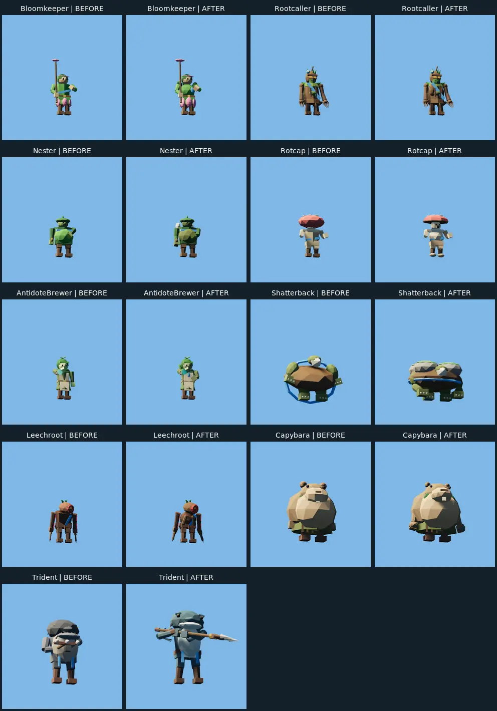
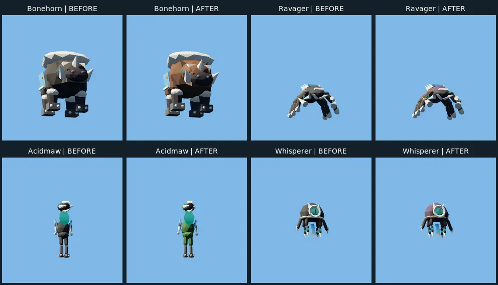
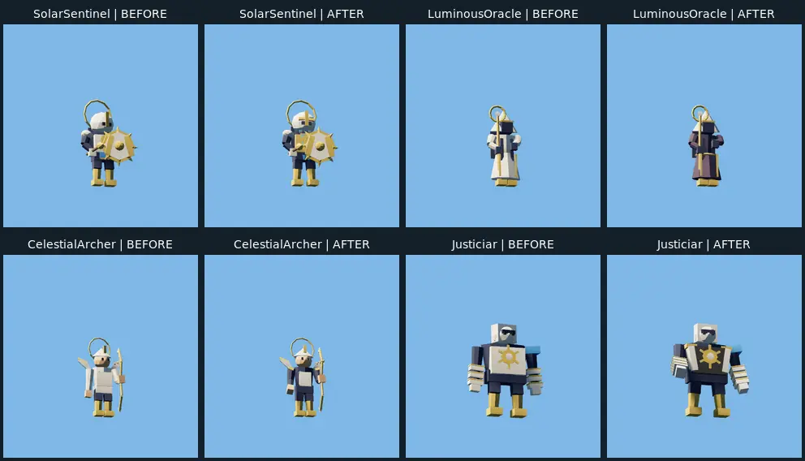
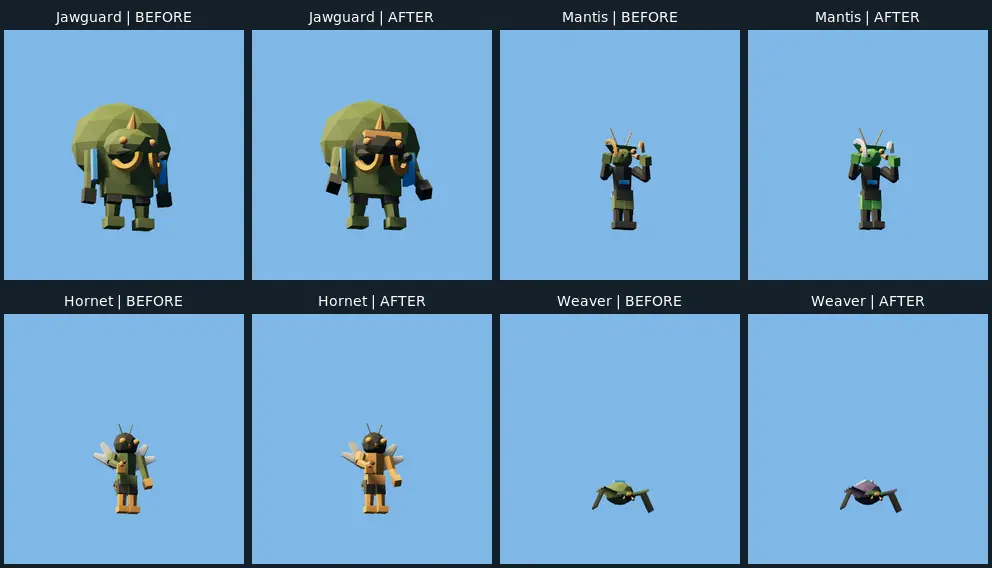

# P70 renderer review pack

All 46 champions have linked five-form before/after pose sheets and after motion recordings. These are review candidates, not owner-approved final art. No generated or painted image is used as evidence.

## Compact comparisons

Each pair is Base Idle: BEFORE on the left, AFTER on the right. These crops show color and identity; they can truncate tall gear and do not prove motion, contact or effects. Shatterback before omits the detachable plates because the frozen gallery did not spawn them. See [derivative provenance](paired-derivatives.json).

### Humans

### Undead

### Machines

### Plants

### Monsters

### Celestials

### Insects

## Actual catalog and live review

The final catalog lighting/framing was inspected for all 46 Base champions and
seven B2 forms. These are actual Troops UI captures, not a substitute gallery.

[Troops group 1](/home/iiii/PESSOAL-PROJETOS-ALEXANDRE/TBG-Tupi-Battle-Grounds/.local/p70-champion-visual-polish/.local/p70-evidence/troops-derivatives/group-1.webp) · [Troops group 2](/home/iiii/PESSOAL-PROJETOS-ALEXANDRE/TBG-Tupi-Battle-Grounds/.local/p70-champion-visual-polish/.local/p70-evidence/troops-derivatives/group-2.webp) · [Troops group 3](/home/iiii/PESSOAL-PROJETOS-ALEXANDRE/TBG-Tupi-Battle-Grounds/.local/p70-champion-visual-polish/.local/p70-evidence/troops-derivatives/group-3.webp) · [Troops group 4](/home/iiii/PESSOAL-PROJETOS-ALEXANDRE/TBG-Tupi-Battle-Grounds/.local/p70-champion-visual-polish/.local/p70-evidence/troops-derivatives/group-4.webp)

[Crop provenance](/home/iiii/PESSOAL-PROJETOS-ALEXANDRE/TBG-Tupi-Battle-Grounds/.local/p70-champion-visual-polish/.local/p70-evidence/troops-derivatives/derivatives.json). The long pole fits;
Base and evolved models remain lit. Every individual original is linked below.

- [Trident Base, seat A, standard: original video](/home/iiii/PESSOAL-PROJETOS-ALEXANDRE/TBG-Tupi-Battle-Grounds/.local/p70-champion-visual-polish/.local/p70-evidence/live-c481369-Trident-Base-A-standard-solo/original.mkv)
- [Trident B2, seat B, standard: original video](/home/iiii/PESSOAL-PROJETOS-ALEXANDRE/TBG-Tupi-Battle-Grounds/.local/p70-champion-visual-polish/.local/p70-evidence/live-c481369-Trident-B2-B-standard-solo/original.mkv)
- [PyreWarden Base, seat A, standard: original video](/home/iiii/PESSOAL-PROJETOS-ALEXANDRE/TBG-Tupi-Battle-Grounds/.local/p70-champion-visual-polish/.local/p70-evidence/live-c481369-PyreWarden-Base-A-standard-solo/original.mkv)
- [PyreWarden B2, seat B, low: original video](/home/iiii/PESSOAL-PROJETOS-ALEXANDRE/TBG-Tupi-Battle-Grounds/.local/p70-champion-visual-polish/.local/p70-evidence/live-c481369-PyreWarden-B2-B-low-solo/original.mkv)

These normal-speed live samples preserve event journals. Close-range Trident contact
and Pyre flame readability remain separate acceptance items; event counts do not
prove them. See the [current execution review](../P70-VISUAL-REVIEW.md).

## Individual evidence

All bulk originals/videos are ignored local files in this execution worktree. Links below work on this machine; the hashed [evidence index](../P70-VISUAL-EVIDENCE.json) preserves revisions and capture metadata. The selected static and temporal derivatives are inspection aids; originals contain the complete frames. Temporal captions use approximate clip labels: recorded video PTS is authoritative.

### Shieldbearer

Fitted blue chest heraldry and segmented red hem stay distinct; A2 tower shield and B2 helmet/sword progression readable in selected poses.

[Before originals](/home/iiii/PESSOAL-PROJETOS-ALEXANDRE/TBG-Tupi-Battle-Grounds/.local/p70-champion-visual-polish/.local/p70-evidence/before-cohort/Shieldbearer/ally-threequarter/captures.json) · [After originals](/home/iiii/PESSOAL-PROJETOS-ALEXANDRE/TBG-Tupi-Battle-Grounds/.local/p70-champion-visual-polish/.local/p70-evidence/after-cohort-d4566f5/Shieldbearer/ally-threequarter/captures.json) · [Selected five-form poses](/home/iiii/PESSOAL-PROJETOS-ALEXANDRE/TBG-Tupi-Battle-Grounds/.local/p70-champion-visual-polish/.local/p70-evidence/derived-after/Shieldbearer.webp) · [Original motion video](/home/iiii/PESSOAL-PROJETOS-ALEXANDRE/TBG-Tupi-Battle-Grounds/.local/p70-champion-visual-polish/.local/p70-evidence/motion-1d6e456-02/original.mkv) · [B2 motion samples](/home/iiii/PESSOAL-PROJETOS-ALEXANDRE/TBG-Tupi-Battle-Grounds/.local/p70-champion-visual-polish/.local/p70-evidence/motion-derivatives/Shieldbearer.webp)

[Actual Troops Base original](/home/iiii/PESSOAL-PROJETOS-ALEXANDRE/TBG-Tupi-Battle-Grounds/.local/p70-champion-visual-polish/.local/p70-evidence/troops-c481369-Shieldbearer-Base/original.png)

### Archer

Green/ochre versus brown/steel branch blocks and bow progression readable; upper bow needs uncropped supplemental inspection.

[Before originals](/home/iiii/PESSOAL-PROJETOS-ALEXANDRE/TBG-Tupi-Battle-Grounds/.local/p70-champion-visual-polish/.local/p70-evidence/before-cohort/Archer/ally-threequarter/captures.json) · [After originals](/home/iiii/PESSOAL-PROJETOS-ALEXANDRE/TBG-Tupi-Battle-Grounds/.local/p70-champion-visual-polish/.local/p70-evidence/after-cohort-d4566f5/Archer/ally-threequarter/captures.json) · [Selected five-form poses](/home/iiii/PESSOAL-PROJETOS-ALEXANDRE/TBG-Tupi-Battle-Grounds/.local/p70-champion-visual-polish/.local/p70-evidence/derived-after/Archer.webp) · [Original motion video](/home/iiii/PESSOAL-PROJETOS-ALEXANDRE/TBG-Tupi-Battle-Grounds/.local/p70-champion-visual-polish/.local/p70-evidence/motion-1d6e456-02/original.mkv) · [B2 motion samples](/home/iiii/PESSOAL-PROJETOS-ALEXANDRE/TBG-Tupi-Battle-Grounds/.local/p70-champion-visual-polish/.local/p70-evidence/motion-derivatives/Archer.webp)

[Actual Troops Base original](/home/iiii/PESSOAL-PROJETOS-ALEXANDRE/TBG-Tupi-Battle-Grounds/.local/p70-champion-visual-polish/.local/p70-evidence/troops-c481369-Archer-Base/original.png)

### BoneBrute

Open ribs/soul, armored A2 and hooded B2 clearly distinct. Repaired B2 two-hand primary grip visible; tall scythe and death crops need wide originals.

[Before originals](/home/iiii/PESSOAL-PROJETOS-ALEXANDRE/TBG-Tupi-Battle-Grounds/.local/p70-champion-visual-polish/.local/p70-evidence/before-cohort/BoneBrute/ally-threequarter/captures.json) · [After originals](/home/iiii/PESSOAL-PROJETOS-ALEXANDRE/TBG-Tupi-Battle-Grounds/.local/p70-champion-visual-polish/.local/p70-evidence/after-cohort-d4566f5/BoneBrute/ally-threequarter/captures.json) · [Selected five-form poses](/home/iiii/PESSOAL-PROJETOS-ALEXANDRE/TBG-Tupi-Battle-Grounds/.local/p70-champion-visual-polish/.local/p70-evidence/derived-after/BoneBrute.webp) · [Original motion video](/home/iiii/PESSOAL-PROJETOS-ALEXANDRE/TBG-Tupi-Battle-Grounds/.local/p70-champion-visual-polish/.local/p70-evidence/motion-1d6e456-02/original.mkv) · [B2 motion samples](/home/iiii/PESSOAL-PROJETOS-ALEXANDRE/TBG-Tupi-Battle-Grounds/.local/p70-champion-visual-polish/.local/p70-evidence/motion-derivatives/BoneBrute.webp)

[Actual Troops Base original](/home/iiii/PESSOAL-PROJETOS-ALEXANDRE/TBG-Tupi-Battle-Grounds/.local/p70-champion-visual-polish/.local/p70-evidence/troops-c481369-BoneBrute-Base/original.png)

### Hexer

Purple hat/staff skull identity retained; A halos and B censer distinguish branches. Full death/spawn originals needed because derivative crops truncate poses.

[Before originals](/home/iiii/PESSOAL-PROJETOS-ALEXANDRE/TBG-Tupi-Battle-Grounds/.local/p70-champion-visual-polish/.local/p70-evidence/before-cohort/Hexer/ally-threequarter/captures.json) · [After originals](/home/iiii/PESSOAL-PROJETOS-ALEXANDRE/TBG-Tupi-Battle-Grounds/.local/p70-champion-visual-polish/.local/p70-evidence/after-cohort-d4566f5/Hexer/ally-threequarter/captures.json) · [Selected five-form poses](/home/iiii/PESSOAL-PROJETOS-ALEXANDRE/TBG-Tupi-Battle-Grounds/.local/p70-champion-visual-polish/.local/p70-evidence/derived-after/Hexer.webp) · [Original motion video](/home/iiii/PESSOAL-PROJETOS-ALEXANDRE/TBG-Tupi-Battle-Grounds/.local/p70-champion-visual-polish/.local/p70-evidence/motion-1d6e456-02/original.mkv) · [B2 motion samples](/home/iiii/PESSOAL-PROJETOS-ALEXANDRE/TBG-Tupi-Battle-Grounds/.local/p70-champion-visual-polish/.local/p70-evidence/motion-derivatives/Hexer.webp)

[Actual Troops Base original](/home/iiii/PESSOAL-PROJETOS-ALEXANDRE/TBG-Tupi-Battle-Grounds/.local/p70-champion-visual-polish/.local/p70-evidence/troops-c481369-Hexer-Base/original.png)

### Sawbot

Orange vent/eye, saw-arm silhouette and dual-saw versus heavy armor progression readable.

[Before originals](/home/iiii/PESSOAL-PROJETOS-ALEXANDRE/TBG-Tupi-Battle-Grounds/.local/p70-champion-visual-polish/.local/p70-evidence/before-cohort/Sawbot/ally-threequarter/captures.json) · [After originals](/home/iiii/PESSOAL-PROJETOS-ALEXANDRE/TBG-Tupi-Battle-Grounds/.local/p70-champion-visual-polish/.local/p70-evidence/after-cohort-d4566f5/Sawbot/ally-threequarter/captures.json) · [Selected five-form poses](/home/iiii/PESSOAL-PROJETOS-ALEXANDRE/TBG-Tupi-Battle-Grounds/.local/p70-champion-visual-polish/.local/p70-evidence/derived-after/Sawbot.webp) · [Original motion video](/home/iiii/PESSOAL-PROJETOS-ALEXANDRE/TBG-Tupi-Battle-Grounds/.local/p70-champion-visual-polish/.local/p70-evidence/motion-1d6e456-04/original.mkv) · [B2 motion samples](/home/iiii/PESSOAL-PROJETOS-ALEXANDRE/TBG-Tupi-Battle-Grounds/.local/p70-champion-visual-polish/.local/p70-evidence/motion-derivatives/Sawbot.webp)

[Actual Troops Base original](/home/iiii/PESSOAL-PROJETOS-ALEXANDRE/TBG-Tupi-Battle-Grounds/.local/p70-champion-visual-polish/.local/p70-evidence/troops-c481369-Sawbot-Base/original.png)

### SiegeWalker

Olive ogre and shoulder cannon distinguish silhouette; twin A2 barrels and large B2 bore readable. Large equipment requires wide views.

[Before originals](/home/iiii/PESSOAL-PROJETOS-ALEXANDRE/TBG-Tupi-Battle-Grounds/.local/p70-champion-visual-polish/.local/p70-evidence/before-cohort/SiegeWalker/ally-threequarter/captures.json) · [After originals](/home/iiii/PESSOAL-PROJETOS-ALEXANDRE/TBG-Tupi-Battle-Grounds/.local/p70-champion-visual-polish/.local/p70-evidence/after-cohort-d4566f5/SiegeWalker/ally-threequarter/captures.json) · [Selected five-form poses](/home/iiii/PESSOAL-PROJETOS-ALEXANDRE/TBG-Tupi-Battle-Grounds/.local/p70-champion-visual-polish/.local/p70-evidence/derived-after/SiegeWalker.webp) · [Original motion video](/home/iiii/PESSOAL-PROJETOS-ALEXANDRE/TBG-Tupi-Battle-Grounds/.local/p70-champion-visual-polish/.local/p70-evidence/motion-1d6e456-04/original.mkv) · [B2 motion samples](/home/iiii/PESSOAL-PROJETOS-ALEXANDRE/TBG-Tupi-Battle-Grounds/.local/p70-champion-visual-polish/.local/p70-evidence/motion-derivatives/SiegeWalker.webp)

[Actual Troops Base original](/home/iiii/PESSOAL-PROJETOS-ALEXANDRE/TBG-Tupi-Battle-Grounds/.local/p70-champion-visual-polish/.local/p70-evidence/troops-c481369-SiegeWalker-Base/original.png)

### Bloomkeeper

Green leaf torso/pink petals and flower staff remain separated; sash stays visible.

[Before originals](/home/iiii/PESSOAL-PROJETOS-ALEXANDRE/TBG-Tupi-Battle-Grounds/.local/p70-champion-visual-polish/.local/p70-evidence/before-cohort/Bloomkeeper/ally-threequarter/captures.json) · [After originals](/home/iiii/PESSOAL-PROJETOS-ALEXANDRE/TBG-Tupi-Battle-Grounds/.local/p70-champion-visual-polish/.local/p70-evidence/after-cohort-d4566f5/Bloomkeeper/ally-threequarter/captures.json) · [Selected five-form poses](/home/iiii/PESSOAL-PROJETOS-ALEXANDRE/TBG-Tupi-Battle-Grounds/.local/p70-champion-visual-polish/.local/p70-evidence/derived-after/Bloomkeeper.webp) · [Original motion video](/home/iiii/PESSOAL-PROJETOS-ALEXANDRE/TBG-Tupi-Battle-Grounds/.local/p70-champion-visual-polish/.local/p70-evidence/motion-1d6e456-05/original.mkv) · [B2 motion samples](/home/iiii/PESSOAL-PROJETOS-ALEXANDRE/TBG-Tupi-Battle-Grounds/.local/p70-champion-visual-polish/.local/p70-evidence/motion-derivatives/Bloomkeeper.webp)

[Actual Troops Base original](/home/iiii/PESSOAL-PROJETOS-ALEXANDRE/TBG-Tupi-Battle-Grounds/.local/p70-champion-visual-polish/.local/p70-evidence/troops-c481369-Bloomkeeper-Base/original.png)

### Rootcaller

Wooden trunk/claw hands, growing A crown and B mushroom canopy distinguish all forms.

[Before originals](/home/iiii/PESSOAL-PROJETOS-ALEXANDRE/TBG-Tupi-Battle-Grounds/.local/p70-champion-visual-polish/.local/p70-evidence/before-cohort/Rootcaller/ally-threequarter/captures.json) · [After originals](/home/iiii/PESSOAL-PROJETOS-ALEXANDRE/TBG-Tupi-Battle-Grounds/.local/p70-champion-visual-polish/.local/p70-evidence/after-bounded-1-d4566f5/Rootcaller/ally-threequarter/captures.json) · [Selected five-form poses](/home/iiii/PESSOAL-PROJETOS-ALEXANDRE/TBG-Tupi-Battle-Grounds/.local/p70-champion-visual-polish/.local/p70-evidence/derived-after/Rootcaller.webp) · [Original motion video](/home/iiii/PESSOAL-PROJETOS-ALEXANDRE/TBG-Tupi-Battle-Grounds/.local/p70-champion-visual-polish/.local/p70-evidence/motion-1d6e456-05/original.mkv) · [B2 motion samples](/home/iiii/PESSOAL-PROJETOS-ALEXANDRE/TBG-Tupi-Battle-Grounds/.local/p70-champion-visual-polish/.local/p70-evidence/motion-derivatives/Rootcaller.webp)

[Actual Troops Base original](/home/iiii/PESSOAL-PROJETOS-ALEXANDRE/TBG-Tupi-Battle-Grounds/.local/p70-champion-visual-polish/.local/p70-evidence/troops-c481369-Rootcaller-Base/original.png)

### Nester

Rounded green shell, egg shoulder tray and branch egg colors remain legible; beetling summon not proven by pose sheets.

[Before originals](/home/iiii/PESSOAL-PROJETOS-ALEXANDRE/TBG-Tupi-Battle-Grounds/.local/p70-champion-visual-polish/.local/p70-evidence/before-cohort/Nester/ally-threequarter/captures.json) · [After originals](/home/iiii/PESSOAL-PROJETOS-ALEXANDRE/TBG-Tupi-Battle-Grounds/.local/p70-champion-visual-polish/.local/p70-evidence/after-bounded-1-d4566f5/Nester/ally-threequarter/captures.json) · [Selected five-form poses](/home/iiii/PESSOAL-PROJETOS-ALEXANDRE/TBG-Tupi-Battle-Grounds/.local/p70-champion-visual-polish/.local/p70-evidence/derived-after/Nester.webp) · [Original motion video](/home/iiii/PESSOAL-PROJETOS-ALEXANDRE/TBG-Tupi-Battle-Grounds/.local/p70-champion-visual-polish/.local/p70-evidence/motion-1d6e456-11/original.mkv) · [B2 motion samples](/home/iiii/PESSOAL-PROJETOS-ALEXANDRE/TBG-Tupi-Battle-Grounds/.local/p70-champion-visual-polish/.local/p70-evidence/motion-derivatives/Nester.webp)

[Actual Troops Base original](/home/iiii/PESSOAL-PROJETOS-ALEXANDRE/TBG-Tupi-Battle-Grounds/.local/p70-champion-visual-polish/.local/p70-evidence/troops-c481369-Nester-Base/original.png)

### Rampart

Wooden wall-shield dominates silhouette; crenellated A2 and spiked B2 distinct, glove salute visible.

[Before originals](/home/iiii/PESSOAL-PROJETOS-ALEXANDRE/TBG-Tupi-Battle-Grounds/.local/p70-champion-visual-polish/.local/p70-evidence/before-cohort/Rampart/ally-threequarter/captures.json) · [After originals](/home/iiii/PESSOAL-PROJETOS-ALEXANDRE/TBG-Tupi-Battle-Grounds/.local/p70-champion-visual-polish/.local/p70-evidence/after-bounded-2-d4566f5/Rampart/ally-threequarter/captures.json) · [Selected five-form poses](/home/iiii/PESSOAL-PROJETOS-ALEXANDRE/TBG-Tupi-Battle-Grounds/.local/p70-champion-visual-polish/.local/p70-evidence/derived-after/Rampart.webp) · [Original motion video](/home/iiii/PESSOAL-PROJETOS-ALEXANDRE/TBG-Tupi-Battle-Grounds/.local/p70-champion-visual-polish/.local/p70-evidence/motion-1d6e456-03-fixed/original.mkv) · [B2 motion samples](/home/iiii/PESSOAL-PROJETOS-ALEXANDRE/TBG-Tupi-Battle-Grounds/.local/p70-champion-visual-polish/.local/p70-evidence/motion-derivatives/Rampart.webp)

[Actual Troops Base original](/home/iiii/PESSOAL-PROJETOS-ALEXANDRE/TBG-Tupi-Battle-Grounds/.local/p70-champion-visual-polish/.local/p70-evidence/troops-c481369-Rampart-Base/original.png)

### Longaxe

Long pole and distinct branch heads remain readable. Grip/arm reach repaired; lowered strike tilt keeps generated vertices above ground. Reordered motion group 03-fixed retains the complete tall weapon. Troops framing was subsequently corrected.

[Before originals](/home/iiii/PESSOAL-PROJETOS-ALEXANDRE/TBG-Tupi-Battle-Grounds/.local/p70-champion-visual-polish/.local/p70-evidence/before-cohort/Longaxe/ally-threequarter/captures.json) · [After originals](/home/iiii/PESSOAL-PROJETOS-ALEXANDRE/TBG-Tupi-Battle-Grounds/.local/p70-champion-visual-polish/.local/p70-evidence/after-repairs-1d6e456/Longaxe/ally-threequarter/captures.json) · [Selected five-form poses](/home/iiii/PESSOAL-PROJETOS-ALEXANDRE/TBG-Tupi-Battle-Grounds/.local/p70-champion-visual-polish/.local/p70-evidence/derived-after/Longaxe.webp) · [Original motion video](/home/iiii/PESSOAL-PROJETOS-ALEXANDRE/TBG-Tupi-Battle-Grounds/.local/p70-champion-visual-polish/.local/p70-evidence/motion-1d6e456-03-fixed/original.mkv) · [B2 motion samples](/home/iiii/PESSOAL-PROJETOS-ALEXANDRE/TBG-Tupi-Battle-Grounds/.local/p70-champion-visual-polish/.local/p70-evidence/motion-derivatives/Longaxe.webp)

[Actual Troops Base original](/home/iiii/PESSOAL-PROJETOS-ALEXANDRE/TBG-Tupi-Battle-Grounds/.local/p70-champion-visual-polish/.local/p70-evidence/troops-c481369-Longaxe-Base/original.png)

### Farwatch

Grey hood/crossbow silhouette differs from Archer; golden A and red B bow accents readable at release.

[Before originals](/home/iiii/PESSOAL-PROJETOS-ALEXANDRE/TBG-Tupi-Battle-Grounds/.local/p70-champion-visual-polish/.local/p70-evidence/before-cohort/Farwatch/ally-threequarter/captures.json) · [After originals](/home/iiii/PESSOAL-PROJETOS-ALEXANDRE/TBG-Tupi-Battle-Grounds/.local/p70-champion-visual-polish/.local/p70-evidence/after-bounded-3-d4566f5/Farwatch/ally-threequarter/captures.json) · [Selected five-form poses](/home/iiii/PESSOAL-PROJETOS-ALEXANDRE/TBG-Tupi-Battle-Grounds/.local/p70-champion-visual-polish/.local/p70-evidence/derived-after/Farwatch.webp) · [Original motion video](/home/iiii/PESSOAL-PROJETOS-ALEXANDRE/TBG-Tupi-Battle-Grounds/.local/p70-champion-visual-polish/.local/p70-evidence/motion-1d6e456-03-fixed/original.mkv) · [B2 motion samples](/home/iiii/PESSOAL-PROJETOS-ALEXANDRE/TBG-Tupi-Battle-Grounds/.local/p70-champion-visual-polish/.local/p70-evidence/motion-derivatives/Farwatch.webp)

[Actual Troops Base original](/home/iiii/PESSOAL-PROJETOS-ALEXANDRE/TBG-Tupi-Battle-Grounds/.local/p70-champion-visual-polish/.local/p70-evidence/troops-c481369-Farwatch-Base/original.png)

### Bombard

Bronze backpack, goggles and cannon bore remain readable; A2 large bore and B2 paired barrel progression distinct.

[Before originals](/home/iiii/PESSOAL-PROJETOS-ALEXANDRE/TBG-Tupi-Battle-Grounds/.local/p70-champion-visual-polish/.local/p70-evidence/before-cohort/Bombard/ally-threequarter/captures.json) · [After originals](/home/iiii/PESSOAL-PROJETOS-ALEXANDRE/TBG-Tupi-Battle-Grounds/.local/p70-champion-visual-polish/.local/p70-evidence/after-bounded-3-d4566f5/Bombard/ally-threequarter/captures.json) · [Selected five-form poses](/home/iiii/PESSOAL-PROJETOS-ALEXANDRE/TBG-Tupi-Battle-Grounds/.local/p70-champion-visual-polish/.local/p70-evidence/derived-after/Bombard.webp) · [Original motion video](/home/iiii/PESSOAL-PROJETOS-ALEXANDRE/TBG-Tupi-Battle-Grounds/.local/p70-champion-visual-polish/.local/p70-evidence/motion-1d6e456-03-fixed/original.mkv) · [B2 motion samples](/home/iiii/PESSOAL-PROJETOS-ALEXANDRE/TBG-Tupi-Battle-Grounds/.local/p70-champion-visual-polish/.local/p70-evidence/motion-derivatives/Bombard.webp)

[Actual Troops Base original](/home/iiii/PESSOAL-PROJETOS-ALEXANDRE/TBG-Tupi-Battle-Grounds/.local/p70-champion-visual-polish/.local/p70-evidence/troops-c481369-Bombard-Base/original.png)

### Rotcap

Pale stem and broad cap remain clear; spore dots, purple A2 and stacked B2 caps distinguish forms.

[Before originals](/home/iiii/PESSOAL-PROJETOS-ALEXANDRE/TBG-Tupi-Battle-Grounds/.local/p70-champion-visual-polish/.local/p70-evidence/before-cohort/Rotcap/ally-threequarter/captures.json) · [After originals](/home/iiii/PESSOAL-PROJETOS-ALEXANDRE/TBG-Tupi-Battle-Grounds/.local/p70-champion-visual-polish/.local/p70-evidence/after-bounded-4-d4566f5/Rotcap/ally-threequarter/captures.json) · [Selected five-form poses](/home/iiii/PESSOAL-PROJETOS-ALEXANDRE/TBG-Tupi-Battle-Grounds/.local/p70-champion-visual-polish/.local/p70-evidence/derived-after/Rotcap.webp) · [Original motion video](/home/iiii/PESSOAL-PROJETOS-ALEXANDRE/TBG-Tupi-Battle-Grounds/.local/p70-champion-visual-polish/.local/p70-evidence/motion-1d6e456-05/original.mkv) · [B2 motion samples](/home/iiii/PESSOAL-PROJETOS-ALEXANDRE/TBG-Tupi-Battle-Grounds/.local/p70-champion-visual-polish/.local/p70-evidence/motion-derivatives/Rotcap.webp)

[Actual Troops Base original](/home/iiii/PESSOAL-PROJETOS-ALEXANDRE/TBG-Tupi-Battle-Grounds/.local/p70-champion-visual-polish/.local/p70-evidence/troops-c481369-Rotcap-Base/original.png)

### OldFinn

Ochre oilskin, beard/pipe and rod silhouette visible; A2 catch and B equipment retained. Fish flight remains live-only evidence.

[Before originals](/home/iiii/PESSOAL-PROJETOS-ALEXANDRE/TBG-Tupi-Battle-Grounds/.local/p70-champion-visual-polish/.local/p70-evidence/before-cohort/OldFinn/ally-threequarter/captures.json) · [After originals](/home/iiii/PESSOAL-PROJETOS-ALEXANDRE/TBG-Tupi-Battle-Grounds/.local/p70-champion-visual-polish/.local/p70-evidence/after-8319c12/OldFinn/ally-threequarter/captures.json) · [Selected five-form poses](/home/iiii/PESSOAL-PROJETOS-ALEXANDRE/TBG-Tupi-Battle-Grounds/.local/p70-champion-visual-polish/.local/p70-evidence/derived-after/OldFinn.webp) · [Original motion video](/home/iiii/PESSOAL-PROJETOS-ALEXANDRE/TBG-Tupi-Battle-Grounds/.local/p70-champion-visual-polish/.local/p70-evidence/motion-1d6e456-01/original.mkv) · [B2 motion samples](/home/iiii/PESSOAL-PROJETOS-ALEXANDRE/TBG-Tupi-Battle-Grounds/.local/p70-champion-visual-polish/.local/p70-evidence/motion-derivatives/OldFinn.webp)

[Actual Troops Base original](/home/iiii/PESSOAL-PROJETOS-ALEXANDRE/TBG-Tupi-Battle-Grounds/.local/p70-champion-visual-polish/.local/p70-evidence/troops-c481369-OldFinn-Base/original.png)

### AntidoteBrewer

Pale apron, leaf hood and turquoise vessel distinguish the healer from Bloomkeeper; all five forms visible.

[Before originals](/home/iiii/PESSOAL-PROJETOS-ALEXANDRE/TBG-Tupi-Battle-Grounds/.local/p70-champion-visual-polish/.local/p70-evidence/before-cohort/AntidoteBrewer/ally-threequarter/captures.json) · [After originals](/home/iiii/PESSOAL-PROJETOS-ALEXANDRE/TBG-Tupi-Battle-Grounds/.local/p70-champion-visual-polish/.local/p70-evidence/after-bounded-4-d4566f5/AntidoteBrewer/ally-threequarter/captures.json) · [Selected five-form poses](/home/iiii/PESSOAL-PROJETOS-ALEXANDRE/TBG-Tupi-Battle-Grounds/.local/p70-champion-visual-polish/.local/p70-evidence/derived-after/AntidoteBrewer.webp) · [Original motion video](/home/iiii/PESSOAL-PROJETOS-ALEXANDRE/TBG-Tupi-Battle-Grounds/.local/p70-champion-visual-polish/.local/p70-evidence/motion-1d6e456-05/original.mkv) · [B2 motion samples](/home/iiii/PESSOAL-PROJETOS-ALEXANDRE/TBG-Tupi-Battle-Grounds/.local/p70-champion-visual-polish/.local/p70-evidence/motion-derivatives/AntidoteBrewer.webp)

[Actual Troops Base original](/home/iiii/PESSOAL-PROJETOS-ALEXANDRE/TBG-Tupi-Battle-Grounds/.local/p70-champion-visual-polish/.local/p70-evidence/troops-c481369-AntidoteBrewer-Base/original.png)

### Shatterback

Connected custom head pivot, grounded Hit/Death/Spawn/Evolve and intact four-plate shell now visible. Old before gallery omitted detachable plates; that baseline is partial and cannot prove a plate comparison.

[Before originals](/home/iiii/PESSOAL-PROJETOS-ALEXANDRE/TBG-Tupi-Battle-Grounds/.local/p70-champion-visual-polish/.local/p70-evidence/before-cohort/Shatterback/ally-threequarter/captures.json) · [After originals](/home/iiii/PESSOAL-PROJETOS-ALEXANDRE/TBG-Tupi-Battle-Grounds/.local/p70-champion-visual-polish/.local/p70-evidence/after-repairs-1d6e456/Shatterback/ally-threequarter/captures.json) · [Selected five-form poses](/home/iiii/PESSOAL-PROJETOS-ALEXANDRE/TBG-Tupi-Battle-Grounds/.local/p70-champion-visual-polish/.local/p70-evidence/derived-after/Shatterback.webp) · [Original motion video](/home/iiii/PESSOAL-PROJETOS-ALEXANDRE/TBG-Tupi-Battle-Grounds/.local/p70-champion-visual-polish/.local/p70-evidence/motion-1d6e456-01/original.mkv) · [B2 motion samples](/home/iiii/PESSOAL-PROJETOS-ALEXANDRE/TBG-Tupi-Battle-Grounds/.local/p70-champion-visual-polish/.local/p70-evidence/motion-derivatives/Shatterback.webp)

[Actual Troops Base original](/home/iiii/PESSOAL-PROJETOS-ALEXANDRE/TBG-Tupi-Battle-Grounds/.local/p70-champion-visual-polish/.local/p70-evidence/troops-c481369-Shatterback-Base/original.png)

### BloodFurnace

Exposed ribs, dark shoulder furnaces and orange core create a strong skeletal smith silhouette; hammer progression remains visible.

[Before originals](/home/iiii/PESSOAL-PROJETOS-ALEXANDRE/TBG-Tupi-Battle-Grounds/.local/p70-champion-visual-polish/.local/p70-evidence/before-cohort/BloodFurnace/ally-threequarter/captures.json) · [After originals](/home/iiii/PESSOAL-PROJETOS-ALEXANDRE/TBG-Tupi-Battle-Grounds/.local/p70-champion-visual-polish/.local/p70-evidence/after-bounded-5-d4566f5/BloodFurnace/ally-threequarter/captures.json) · [Selected five-form poses](/home/iiii/PESSOAL-PROJETOS-ALEXANDRE/TBG-Tupi-Battle-Grounds/.local/p70-champion-visual-polish/.local/p70-evidence/derived-after/BloodFurnace.webp) · [Original motion video](/home/iiii/PESSOAL-PROJETOS-ALEXANDRE/TBG-Tupi-Battle-Grounds/.local/p70-champion-visual-polish/.local/p70-evidence/motion-1d6e456-06/original.mkv) · [B2 motion samples](/home/iiii/PESSOAL-PROJETOS-ALEXANDRE/TBG-Tupi-Battle-Grounds/.local/p70-champion-visual-polish/.local/p70-evidence/motion-derivatives/BloodFurnace.webp)

[Actual Troops Base original](/home/iiii/PESSOAL-PROJETOS-ALEXANDRE/TBG-Tupi-Battle-Grounds/.local/p70-champion-visual-polish/.local/p70-evidence/troops-c481369-BloodFurnace-Base/original.png)

### Bloodweaver

Wine-red robes, needle staff, gold A chalice and B rings distinguish it from purple Hexer.

[Before originals](/home/iiii/PESSOAL-PROJETOS-ALEXANDRE/TBG-Tupi-Battle-Grounds/.local/p70-champion-visual-polish/.local/p70-evidence/before-cohort/Bloodweaver/ally-threequarter/captures.json) · [After originals](/home/iiii/PESSOAL-PROJETOS-ALEXANDRE/TBG-Tupi-Battle-Grounds/.local/p70-champion-visual-polish/.local/p70-evidence/after-bounded-6-d4566f5/Bloodweaver/ally-threequarter/captures.json) · [Selected five-form poses](/home/iiii/PESSOAL-PROJETOS-ALEXANDRE/TBG-Tupi-Battle-Grounds/.local/p70-champion-visual-polish/.local/p70-evidence/derived-after/Bloodweaver.webp) · [Original motion video](/home/iiii/PESSOAL-PROJETOS-ALEXANDRE/TBG-Tupi-Battle-Grounds/.local/p70-champion-visual-polish/.local/p70-evidence/motion-1d6e456-06/original.mkv) · [B2 motion samples](/home/iiii/PESSOAL-PROJETOS-ALEXANDRE/TBG-Tupi-Battle-Grounds/.local/p70-champion-visual-polish/.local/p70-evidence/motion-derivatives/Bloodweaver.webp)

[Actual Troops Base original](/home/iiii/PESSOAL-PROJETOS-ALEXANDRE/TBG-Tupi-Battle-Grounds/.local/p70-champion-visual-polish/.local/p70-evidence/troops-c481369-Bloodweaver-Base/original.png)

### Oilpress

Box boiler, pressure gauge, chimney and heavy fists visible; brass/iron separation and A2 shoulder spikes readable.

[Before originals](/home/iiii/PESSOAL-PROJETOS-ALEXANDRE/TBG-Tupi-Battle-Grounds/.local/p70-champion-visual-polish/.local/p70-evidence/before-cohort/Oilpress/ally-threequarter/captures.json) · [After originals](/home/iiii/PESSOAL-PROJETOS-ALEXANDRE/TBG-Tupi-Battle-Grounds/.local/p70-champion-visual-polish/.local/p70-evidence/after-bounded-6-d4566f5/Oilpress/ally-threequarter/captures.json) · [Selected five-form poses](/home/iiii/PESSOAL-PROJETOS-ALEXANDRE/TBG-Tupi-Battle-Grounds/.local/p70-champion-visual-polish/.local/p70-evidence/derived-after/Oilpress.webp) · [Original motion video](/home/iiii/PESSOAL-PROJETOS-ALEXANDRE/TBG-Tupi-Battle-Grounds/.local/p70-champion-visual-polish/.local/p70-evidence/motion-1d6e456-04/original.mkv) · [B2 motion samples](/home/iiii/PESSOAL-PROJETOS-ALEXANDRE/TBG-Tupi-Battle-Grounds/.local/p70-champion-visual-polish/.local/p70-evidence/motion-derivatives/Oilpress.webp)

[Actual Troops Base original](/home/iiii/PESSOAL-PROJETOS-ALEXANDRE/TBG-Tupi-Battle-Grounds/.local/p70-champion-visual-polish/.local/p70-evidence/troops-c481369-Oilpress-Base/original.png)

### Drumguard

Red coat, blue plume and waist drum distinguish it from fighters; A2 gold drum and B armored caps readable.

[Before originals](/home/iiii/PESSOAL-PROJETOS-ALEXANDRE/TBG-Tupi-Battle-Grounds/.local/p70-champion-visual-polish/.local/p70-evidence/before-cohort/Drumguard/ally-threequarter/captures.json) · [After originals](/home/iiii/PESSOAL-PROJETOS-ALEXANDRE/TBG-Tupi-Battle-Grounds/.local/p70-champion-visual-polish/.local/p70-evidence/after-bounded-7-d4566f5/Drumguard/ally-threequarter/captures.json) · [Selected five-form poses](/home/iiii/PESSOAL-PROJETOS-ALEXANDRE/TBG-Tupi-Battle-Grounds/.local/p70-champion-visual-polish/.local/p70-evidence/derived-after/Drumguard.webp) · [Original motion video](/home/iiii/PESSOAL-PROJETOS-ALEXANDRE/TBG-Tupi-Battle-Grounds/.local/p70-champion-visual-polish/.local/p70-evidence/motion-1d6e456-07/original.mkv) · [B2 motion samples](/home/iiii/PESSOAL-PROJETOS-ALEXANDRE/TBG-Tupi-Battle-Grounds/.local/p70-champion-visual-polish/.local/p70-evidence/motion-derivatives/Drumguard.webp)

[Actual Troops Base original](/home/iiii/PESSOAL-PROJETOS-ALEXANDRE/TBG-Tupi-Battle-Grounds/.local/p70-champion-visual-polish/.local/p70-evidence/troops-c481369-Drumguard-Base/original.png)

### Leechroot

Hollow coral-colored mouth and long root arms distinguish it from Rootcaller; red fluid nodes progress across branches.

[Before originals](/home/iiii/PESSOAL-PROJETOS-ALEXANDRE/TBG-Tupi-Battle-Grounds/.local/p70-champion-visual-polish/.local/p70-evidence/before-cohort/Leechroot/ally-threequarter/captures.json) · [After originals](/home/iiii/PESSOAL-PROJETOS-ALEXANDRE/TBG-Tupi-Battle-Grounds/.local/p70-champion-visual-polish/.local/p70-evidence/after-bounded-7-d4566f5/Leechroot/ally-threequarter/captures.json) · [Selected five-form poses](/home/iiii/PESSOAL-PROJETOS-ALEXANDRE/TBG-Tupi-Battle-Grounds/.local/p70-champion-visual-polish/.local/p70-evidence/derived-after/Leechroot.webp) · [Original motion video](/home/iiii/PESSOAL-PROJETOS-ALEXANDRE/TBG-Tupi-Battle-Grounds/.local/p70-champion-visual-polish/.local/p70-evidence/motion-1d6e456-11/original.mkv) · [B2 motion samples](/home/iiii/PESSOAL-PROJETOS-ALEXANDRE/TBG-Tupi-Battle-Grounds/.local/p70-champion-visual-polish/.local/p70-evidence/motion-derivatives/Leechroot.webp)

[Actual Troops Base original](/home/iiii/PESSOAL-PROJETOS-ALEXANDRE/TBG-Tupi-Battle-Grounds/.local/p70-champion-visual-polish/.local/p70-evidence/troops-c481369-Leechroot-Base/original.png)

### CargoCrab

Orange mechanical carapace, articulated gold legs and opposing claws readable; selected attack and salute differ. Passenger behavior remains unobserved.

[Before originals](/home/iiii/PESSOAL-PROJETOS-ALEXANDRE/TBG-Tupi-Battle-Grounds/.local/p70-champion-visual-polish/.local/p70-evidence/before-cohort/CargoCrab/ally-threequarter/captures.json) · [After originals](/home/iiii/PESSOAL-PROJETOS-ALEXANDRE/TBG-Tupi-Battle-Grounds/.local/p70-champion-visual-polish/.local/p70-evidence/after-bounded-8-d4566f5/CargoCrab/ally-threequarter/captures.json) · [Selected five-form poses](/home/iiii/PESSOAL-PROJETOS-ALEXANDRE/TBG-Tupi-Battle-Grounds/.local/p70-champion-visual-polish/.local/p70-evidence/derived-after/CargoCrab.webp) · [Original motion video](/home/iiii/PESSOAL-PROJETOS-ALEXANDRE/TBG-Tupi-Battle-Grounds/.local/p70-champion-visual-polish/.local/p70-evidence/motion-1d6e456-04/original.mkv) · [B2 motion samples](/home/iiii/PESSOAL-PROJETOS-ALEXANDRE/TBG-Tupi-Battle-Grounds/.local/p70-champion-visual-polish/.local/p70-evidence/motion-derivatives/CargoCrab.webp)

[Actual Troops Base original](/home/iiii/PESSOAL-PROJETOS-ALEXANDRE/TBG-Tupi-Battle-Grounds/.local/p70-champion-visual-polish/.local/p70-evidence/troops-c481369-CargoCrab-Base/original.png)

### Puppetmaster

Top hat, ivory bow and dangling puppets clearly separate it from the other skeletal casters; B branch marionettes readable.

[Before originals](/home/iiii/PESSOAL-PROJETOS-ALEXANDRE/TBG-Tupi-Battle-Grounds/.local/p70-champion-visual-polish/.local/p70-evidence/before-cohort/Puppetmaster/ally-threequarter/captures.json) · [After originals](/home/iiii/PESSOAL-PROJETOS-ALEXANDRE/TBG-Tupi-Battle-Grounds/.local/p70-champion-visual-polish/.local/p70-evidence/after-bounded-8-d4566f5/Puppetmaster/ally-threequarter/captures.json) · [Selected five-form poses](/home/iiii/PESSOAL-PROJETOS-ALEXANDRE/TBG-Tupi-Battle-Grounds/.local/p70-champion-visual-polish/.local/p70-evidence/derived-after/Puppetmaster.webp) · [Original motion video](/home/iiii/PESSOAL-PROJETOS-ALEXANDRE/TBG-Tupi-Battle-Grounds/.local/p70-champion-visual-polish/.local/p70-evidence/motion-1d6e456-06/original.mkv) · [B2 motion samples](/home/iiii/PESSOAL-PROJETOS-ALEXANDRE/TBG-Tupi-Battle-Grounds/.local/p70-champion-visual-polish/.local/p70-evidence/motion-derivatives/Puppetmaster.webp)

[Actual Troops Base original](/home/iiii/PESSOAL-PROJETOS-ALEXANDRE/TBG-Tupi-Battle-Grounds/.local/p70-champion-visual-polish/.local/p70-evidence/troops-c481369-Puppetmaster-Base/original.png)

### Smuggler

Brown coat, bandanna, coin belt and rear cargo remain legible; B2 lantern silhouette distinct.

[Before originals](/home/iiii/PESSOAL-PROJETOS-ALEXANDRE/TBG-Tupi-Battle-Grounds/.local/p70-champion-visual-polish/.local/p70-evidence/before-cohort/Smuggler/ally-threequarter/captures.json) · [After originals](/home/iiii/PESSOAL-PROJETOS-ALEXANDRE/TBG-Tupi-Battle-Grounds/.local/p70-champion-visual-polish/.local/p70-evidence/after-bounded-9-d4566f5/Smuggler/ally-threequarter/captures.json) · [Selected five-form poses](/home/iiii/PESSOAL-PROJETOS-ALEXANDRE/TBG-Tupi-Battle-Grounds/.local/p70-champion-visual-polish/.local/p70-evidence/derived-after/Smuggler.webp) · [Original motion video](/home/iiii/PESSOAL-PROJETOS-ALEXANDRE/TBG-Tupi-Battle-Grounds/.local/p70-champion-visual-polish/.local/p70-evidence/motion-1d6e456-06/original.mkv) · [B2 motion samples](/home/iiii/PESSOAL-PROJETOS-ALEXANDRE/TBG-Tupi-Battle-Grounds/.local/p70-champion-visual-polish/.local/p70-evidence/motion-derivatives/Smuggler.webp)

[Actual Troops Base original](/home/iiii/PESSOAL-PROJETOS-ALEXANDRE/TBG-Tupi-Battle-Grounds/.local/p70-champion-visual-polish/.local/p70-evidence/troops-c481369-Smuggler-Base/original.png)

### Bonehorn

Brown/ivory quadruped with horn and bone back plates distinguish all forms; B2 jaw armor visible, broad body needs full-frame fall review.

[Before originals](/home/iiii/PESSOAL-PROJETOS-ALEXANDRE/TBG-Tupi-Battle-Grounds/.local/p70-champion-visual-polish/.local/p70-evidence/before-cohort/Bonehorn/ally-threequarter/captures.json) · [After originals](/home/iiii/PESSOAL-PROJETOS-ALEXANDRE/TBG-Tupi-Battle-Grounds/.local/p70-champion-visual-polish/.local/p70-evidence/after-bounded-9-d4566f5/Bonehorn/ally-threequarter/captures.json) · [Selected five-form poses](/home/iiii/PESSOAL-PROJETOS-ALEXANDRE/TBG-Tupi-Battle-Grounds/.local/p70-champion-visual-polish/.local/p70-evidence/derived-after/Bonehorn.webp) · [Original motion video](/home/iiii/PESSOAL-PROJETOS-ALEXANDRE/TBG-Tupi-Battle-Grounds/.local/p70-champion-visual-polish/.local/p70-evidence/motion-1d6e456-07/original.mkv) · [B2 motion samples](/home/iiii/PESSOAL-PROJETOS-ALEXANDRE/TBG-Tupi-Battle-Grounds/.local/p70-champion-visual-polish/.local/p70-evidence/motion-derivatives/Bonehorn.webp)

[Actual Troops Base original](/home/iiii/PESSOAL-PROJETOS-ALEXANDRE/TBG-Tupi-Battle-Grounds/.local/p70-champion-visual-polish/.local/p70-evidence/troops-c481369-Bonehorn-Base/original.png)

### Ravager

Low purple/brown multi-legged body, white claws and dorsal spikes readable; A2 back plating and B2 jaw growth distinct.

[Before originals](/home/iiii/PESSOAL-PROJETOS-ALEXANDRE/TBG-Tupi-Battle-Grounds/.local/p70-champion-visual-polish/.local/p70-evidence/before-cohort/Ravager/ally-threequarter/captures.json) · [After originals](/home/iiii/PESSOAL-PROJETOS-ALEXANDRE/TBG-Tupi-Battle-Grounds/.local/p70-champion-visual-polish/.local/p70-evidence/after-bounded-10-d4566f5/Ravager/ally-threequarter/captures.json) · [Selected five-form poses](/home/iiii/PESSOAL-PROJETOS-ALEXANDRE/TBG-Tupi-Battle-Grounds/.local/p70-champion-visual-polish/.local/p70-evidence/derived-after/Ravager.webp) · [Original motion video](/home/iiii/PESSOAL-PROJETOS-ALEXANDRE/TBG-Tupi-Battle-Grounds/.local/p70-champion-visual-polish/.local/p70-evidence/motion-1d6e456-07/original.mkv) · [B2 motion samples](/home/iiii/PESSOAL-PROJETOS-ALEXANDRE/TBG-Tupi-Battle-Grounds/.local/p70-champion-visual-polish/.local/p70-evidence/motion-derivatives/Ravager.webp)

[Actual Troops Base original](/home/iiii/PESSOAL-PROJETOS-ALEXANDRE/TBG-Tupi-Battle-Grounds/.local/p70-champion-visual-polish/.local/p70-evidence/troops-c481369-Ravager-Base/original.png)

### Acidmaw

Tall narrow green body with turquoise throat sac is strongly differentiated from broad monsters; bone jaw/spine growth readable.

[Before originals](/home/iiii/PESSOAL-PROJETOS-ALEXANDRE/TBG-Tupi-Battle-Grounds/.local/p70-champion-visual-polish/.local/p70-evidence/before-cohort/Acidmaw/ally-threequarter/captures.json) · [After originals](/home/iiii/PESSOAL-PROJETOS-ALEXANDRE/TBG-Tupi-Battle-Grounds/.local/p70-champion-visual-polish/.local/p70-evidence/after-bounded-10-d4566f5/Acidmaw/ally-threequarter/captures.json) · [Selected five-form poses](/home/iiii/PESSOAL-PROJETOS-ALEXANDRE/TBG-Tupi-Battle-Grounds/.local/p70-champion-visual-polish/.local/p70-evidence/derived-after/Acidmaw.webp) · [Original motion video](/home/iiii/PESSOAL-PROJETOS-ALEXANDRE/TBG-Tupi-Battle-Grounds/.local/p70-champion-visual-polish/.local/p70-evidence/motion-1d6e456-07/original.mkv) · [B2 motion samples](/home/iiii/PESSOAL-PROJETOS-ALEXANDRE/TBG-Tupi-Battle-Grounds/.local/p70-champion-visual-polish/.local/p70-evidence/motion-derivatives/Acidmaw.webp)

[Actual Troops Base original](/home/iiii/PESSOAL-PROJETOS-ALEXANDRE/TBG-Tupi-Battle-Grounds/.local/p70-champion-visual-polish/.local/p70-evidence/troops-c481369-Acidmaw-Base/original.png)

### Whisperer

Single turquoise eye, floating tentacles and purple/ivory armor distinguish it clearly; death closes/darkens eye and folds limbs.

[Before originals](/home/iiii/PESSOAL-PROJETOS-ALEXANDRE/TBG-Tupi-Battle-Grounds/.local/p70-champion-visual-polish/.local/p70-evidence/before-cohort/Whisperer/ally-threequarter/captures.json) · [After originals](/home/iiii/PESSOAL-PROJETOS-ALEXANDRE/TBG-Tupi-Battle-Grounds/.local/p70-champion-visual-polish/.local/p70-evidence/after-bounded-11-d4566f5/Whisperer/ally-threequarter/captures.json) · [Selected five-form poses](/home/iiii/PESSOAL-PROJETOS-ALEXANDRE/TBG-Tupi-Battle-Grounds/.local/p70-champion-visual-polish/.local/p70-evidence/derived-after/Whisperer.webp) · [Original motion video](/home/iiii/PESSOAL-PROJETOS-ALEXANDRE/TBG-Tupi-Battle-Grounds/.local/p70-champion-visual-polish/.local/p70-evidence/motion-1d6e456-08/original.mkv) · [B2 motion samples](/home/iiii/PESSOAL-PROJETOS-ALEXANDRE/TBG-Tupi-Battle-Grounds/.local/p70-champion-visual-polish/.local/p70-evidence/motion-derivatives/Whisperer.webp)

[Actual Troops Base original](/home/iiii/PESSOAL-PROJETOS-ALEXANDRE/TBG-Tupi-Battle-Grounds/.local/p70-champion-visual-polish/.local/p70-evidence/troops-c481369-Whisperer-Base/original.png)

### Bulwark

Ivory dome, dark vertical braces and recessed orange eyes separate it from box-shaped machines; A2 battlements and B2 heavy feet readable.

[Before originals](/home/iiii/PESSOAL-PROJETOS-ALEXANDRE/TBG-Tupi-Battle-Grounds/.local/p70-champion-visual-polish/.local/p70-evidence/before-cohort/Bulwark/ally-threequarter/captures.json) · [After originals](/home/iiii/PESSOAL-PROJETOS-ALEXANDRE/TBG-Tupi-Battle-Grounds/.local/p70-champion-visual-polish/.local/p70-evidence/after-bounded-11-d4566f5/Bulwark/ally-threequarter/captures.json) · [Selected five-form poses](/home/iiii/PESSOAL-PROJETOS-ALEXANDRE/TBG-Tupi-Battle-Grounds/.local/p70-champion-visual-polish/.local/p70-evidence/derived-after/Bulwark.webp) · [Original motion video](/home/iiii/PESSOAL-PROJETOS-ALEXANDRE/TBG-Tupi-Battle-Grounds/.local/p70-champion-visual-polish/.local/p70-evidence/motion-1d6e456-08/original.mkv) · [B2 motion samples](/home/iiii/PESSOAL-PROJETOS-ALEXANDRE/TBG-Tupi-Battle-Grounds/.local/p70-champion-visual-polish/.local/p70-evidence/motion-derivatives/Bulwark.webp)

[Actual Troops Base original](/home/iiii/PESSOAL-PROJETOS-ALEXANDRE/TBG-Tupi-Battle-Grounds/.local/p70-champion-visual-polish/.local/p70-evidence/troops-c481369-Bulwark-Base/original.png)

### Demolisher

Large piston fists and low steel chassis convey a different silhouette from Oilpress; brass joints and branch mechanisms visible.

[Before originals](/home/iiii/PESSOAL-PROJETOS-ALEXANDRE/TBG-Tupi-Battle-Grounds/.local/p70-champion-visual-polish/.local/p70-evidence/before-cohort/Demolisher/ally-threequarter/captures.json) · [After originals](/home/iiii/PESSOAL-PROJETOS-ALEXANDRE/TBG-Tupi-Battle-Grounds/.local/p70-champion-visual-polish/.local/p70-evidence/after-bounded-12-d4566f5/Demolisher/ally-threequarter/captures.json) · [Selected five-form poses](/home/iiii/PESSOAL-PROJETOS-ALEXANDRE/TBG-Tupi-Battle-Grounds/.local/p70-champion-visual-polish/.local/p70-evidence/derived-after/Demolisher.webp) · [Original motion video](/home/iiii/PESSOAL-PROJETOS-ALEXANDRE/TBG-Tupi-Battle-Grounds/.local/p70-champion-visual-polish/.local/p70-evidence/motion-1d6e456-08/original.mkv) · [B2 motion samples](/home/iiii/PESSOAL-PROJETOS-ALEXANDRE/TBG-Tupi-Battle-Grounds/.local/p70-champion-visual-polish/.local/p70-evidence/motion-derivatives/Demolisher.webp)

[Actual Troops Base original](/home/iiii/PESSOAL-PROJETOS-ALEXANDRE/TBG-Tupi-Battle-Grounds/.local/p70-champion-visual-polish/.local/p70-evidence/troops-c481369-Demolisher-Base/original.png)

### Crowcaller

Dark hood, pale mask and crossbar perch preserve bird-handler identity; live crow flight remains unverified.

[Before originals](/home/iiii/PESSOAL-PROJETOS-ALEXANDRE/TBG-Tupi-Battle-Grounds/.local/p70-champion-visual-polish/.local/p70-evidence/before-cohort/Crowcaller/ally-threequarter/captures.json) · [After originals](/home/iiii/PESSOAL-PROJETOS-ALEXANDRE/TBG-Tupi-Battle-Grounds/.local/p70-champion-visual-polish/.local/p70-evidence/after-bounded-12-d4566f5/Crowcaller/ally-threequarter/captures.json) · [Selected five-form poses](/home/iiii/PESSOAL-PROJETOS-ALEXANDRE/TBG-Tupi-Battle-Grounds/.local/p70-champion-visual-polish/.local/p70-evidence/derived-after/Crowcaller.webp) · [Original motion video](/home/iiii/PESSOAL-PROJETOS-ALEXANDRE/TBG-Tupi-Battle-Grounds/.local/p70-champion-visual-polish/.local/p70-evidence/motion-1d6e456-08/original.mkv) · [B2 motion samples](/home/iiii/PESSOAL-PROJETOS-ALEXANDRE/TBG-Tupi-Battle-Grounds/.local/p70-champion-visual-polish/.local/p70-evidence/motion-derivatives/Crowcaller.webp)

[Actual Troops Base original](/home/iiii/PESSOAL-PROJETOS-ALEXANDRE/TBG-Tupi-Battle-Grounds/.local/p70-champion-visual-polish/.local/p70-evidence/troops-c481369-Crowcaller-Base/original.png)

### Trigger

Brown brimmed hat, blue coat and brass pistols separate the gunslinger from bow users; dual B pistols visible.

[Before originals](/home/iiii/PESSOAL-PROJETOS-ALEXANDRE/TBG-Tupi-Battle-Grounds/.local/p70-champion-visual-polish/.local/p70-evidence/before-cohort/Trigger/ally-threequarter/captures.json) · [After originals](/home/iiii/PESSOAL-PROJETOS-ALEXANDRE/TBG-Tupi-Battle-Grounds/.local/p70-champion-visual-polish/.local/p70-evidence/after-bounded-13-d4566f5/Trigger/ally-threequarter/captures.json) · [Selected five-form poses](/home/iiii/PESSOAL-PROJETOS-ALEXANDRE/TBG-Tupi-Battle-Grounds/.local/p70-champion-visual-polish/.local/p70-evidence/derived-after/Trigger.webp) · [Original motion video](/home/iiii/PESSOAL-PROJETOS-ALEXANDRE/TBG-Tupi-Battle-Grounds/.local/p70-champion-visual-polish/.local/p70-evidence/motion-1d6e456-09/original.mkv) · [B2 motion samples](/home/iiii/PESSOAL-PROJETOS-ALEXANDRE/TBG-Tupi-Battle-Grounds/.local/p70-champion-visual-polish/.local/p70-evidence/motion-derivatives/Trigger.webp)

[Actual Troops Base original](/home/iiii/PESSOAL-PROJETOS-ALEXANDRE/TBG-Tupi-Battle-Grounds/.local/p70-champion-visual-polish/.local/p70-evidence/troops-c481369-Trigger-Base/original.png)

### RattleTick

Pale patched coat, small red shoulder rider and heavy mallet form a unique silhouette; branch changes subtle from this angle.

[Before originals](/home/iiii/PESSOAL-PROJETOS-ALEXANDRE/TBG-Tupi-Battle-Grounds/.local/p70-champion-visual-polish/.local/p70-evidence/before-cohort/RattleTick/ally-threequarter/captures.json) · [After originals](/home/iiii/PESSOAL-PROJETOS-ALEXANDRE/TBG-Tupi-Battle-Grounds/.local/p70-champion-visual-polish/.local/p70-evidence/after-bounded-13-d4566f5/RattleTick/ally-threequarter/captures.json) · [Selected five-form poses](/home/iiii/PESSOAL-PROJETOS-ALEXANDRE/TBG-Tupi-Battle-Grounds/.local/p70-champion-visual-polish/.local/p70-evidence/derived-after/RattleTick.webp) · [Original motion video](/home/iiii/PESSOAL-PROJETOS-ALEXANDRE/TBG-Tupi-Battle-Grounds/.local/p70-champion-visual-polish/.local/p70-evidence/motion-1d6e456-09/original.mkv) · [B2 motion samples](/home/iiii/PESSOAL-PROJETOS-ALEXANDRE/TBG-Tupi-Battle-Grounds/.local/p70-champion-visual-polish/.local/p70-evidence/motion-derivatives/RattleTick.webp)

[Actual Troops Base original](/home/iiii/PESSOAL-PROJETOS-ALEXANDRE/TBG-Tupi-Battle-Grounds/.local/p70-champion-visual-polish/.local/p70-evidence/troops-c481369-RattleTick-Base/original.png)

### Capybara

Broad ivory belly, rounded muzzle and leaf collar remain recognizable; bark/fiber branch details visible, life-clip crops need full originals.

[Before originals](/home/iiii/PESSOAL-PROJETOS-ALEXANDRE/TBG-Tupi-Battle-Grounds/.local/p70-champion-visual-polish/.local/p70-evidence/before-cohort/Capybara/ally-threequarter/captures.json) · [After originals](/home/iiii/PESSOAL-PROJETOS-ALEXANDRE/TBG-Tupi-Battle-Grounds/.local/p70-champion-visual-polish/.local/p70-evidence/after-bounded-14-d4566f5/Capybara/ally-threequarter/captures.json) · [Selected five-form poses](/home/iiii/PESSOAL-PROJETOS-ALEXANDRE/TBG-Tupi-Battle-Grounds/.local/p70-champion-visual-polish/.local/p70-evidence/derived-after/Capybara.webp) · [Original motion video](/home/iiii/PESSOAL-PROJETOS-ALEXANDRE/TBG-Tupi-Battle-Grounds/.local/p70-champion-visual-polish/.local/p70-evidence/motion-1d6e456-09/original.mkv) · [B2 motion samples](/home/iiii/PESSOAL-PROJETOS-ALEXANDRE/TBG-Tupi-Battle-Grounds/.local/p70-champion-visual-polish/.local/p70-evidence/motion-derivatives/Capybara.webp)

[Actual Troops Base original](/home/iiii/PESSOAL-PROJETOS-ALEXANDRE/TBG-Tupi-Battle-Grounds/.local/p70-champion-visual-polish/.local/p70-evidence/troops-c481369-Capybara-Base/original.png)

### Trident

Shark jaw/countershade, dorsal fins and two-hand horizontal thrust readable in all five forms; B2 tip reaches fixed-sheet edge.

[Before originals](/home/iiii/PESSOAL-PROJETOS-ALEXANDRE/TBG-Tupi-Battle-Grounds/.local/p70-champion-visual-polish/.local/p70-evidence/before-smoke-display/Trident/ally-threequarter/captures.json) · [After originals](/home/iiii/PESSOAL-PROJETOS-ALEXANDRE/TBG-Tupi-Battle-Grounds/.local/p70-champion-visual-polish/.local/p70-evidence/after-8319c12/Trident/ally-threequarter/captures.json) · [Selected five-form poses](/home/iiii/PESSOAL-PROJETOS-ALEXANDRE/TBG-Tupi-Battle-Grounds/.local/p70-champion-visual-polish/.local/p70-evidence/derived-after/Trident.webp) · [Original motion video](/home/iiii/PESSOAL-PROJETOS-ALEXANDRE/TBG-Tupi-Battle-Grounds/.local/p70-champion-visual-polish/.local/p70-evidence/motion-1d6e456-01/original.mkv) · [B2 motion samples](/home/iiii/PESSOAL-PROJETOS-ALEXANDRE/TBG-Tupi-Battle-Grounds/.local/p70-champion-visual-polish/.local/p70-evidence/motion-derivatives/Trident.webp)

[Actual Troops Base original](/home/iiii/PESSOAL-PROJETOS-ALEXANDRE/TBG-Tupi-Battle-Grounds/.local/p70-champion-visual-polish/.local/p70-evidence/troops-c481369-Trident-Base/original.png)

### SolarSentinel

Sun shield, gold halo, ivory helmet and dark blue cloth remain distinct from Shieldbearer; progression visible in all forms.

[Before originals](/home/iiii/PESSOAL-PROJETOS-ALEXANDRE/TBG-Tupi-Battle-Grounds/.local/p70-champion-visual-polish/.local/p70-evidence/before-cohort/SolarSentinel/ally-threequarter/captures.json) · [After originals](/home/iiii/PESSOAL-PROJETOS-ALEXANDRE/TBG-Tupi-Battle-Grounds/.local/p70-champion-visual-polish/.local/p70-evidence/after-bounded-14-d4566f5/SolarSentinel/ally-threequarter/captures.json) · [Selected five-form poses](/home/iiii/PESSOAL-PROJETOS-ALEXANDRE/TBG-Tupi-Battle-Grounds/.local/p70-champion-visual-polish/.local/p70-evidence/derived-after/SolarSentinel.webp) · [Original motion video](/home/iiii/PESSOAL-PROJETOS-ALEXANDRE/TBG-Tupi-Battle-Grounds/.local/p70-champion-visual-polish/.local/p70-evidence/motion-1d6e456-09/original.mkv) · [B2 motion samples](/home/iiii/PESSOAL-PROJETOS-ALEXANDRE/TBG-Tupi-Battle-Grounds/.local/p70-champion-visual-polish/.local/p70-evidence/motion-derivatives/SolarSentinel.webp)

[Actual Troops Base original](/home/iiii/PESSOAL-PROJETOS-ALEXANDRE/TBG-Tupi-Battle-Grounds/.local/p70-champion-visual-polish/.local/p70-evidence/troops-c481369-SolarSentinel-Base/original.png)

### LuminousOracle

Purple/gold robe, tall ring staff and faceless ivory head distinguish the oracle; understated Cast requires temporal inspection.

[Before originals](/home/iiii/PESSOAL-PROJETOS-ALEXANDRE/TBG-Tupi-Battle-Grounds/.local/p70-champion-visual-polish/.local/p70-evidence/before-cohort/LuminousOracle/ally-threequarter/captures.json) · [After originals](/home/iiii/PESSOAL-PROJETOS-ALEXANDRE/TBG-Tupi-Battle-Grounds/.local/p70-champion-visual-polish/.local/p70-evidence/after-bounded-15-d4566f5/LuminousOracle/ally-threequarter/captures.json) · [Selected five-form poses](/home/iiii/PESSOAL-PROJETOS-ALEXANDRE/TBG-Tupi-Battle-Grounds/.local/p70-champion-visual-polish/.local/p70-evidence/derived-after/LuminousOracle.webp) · [Original motion video](/home/iiii/PESSOAL-PROJETOS-ALEXANDRE/TBG-Tupi-Battle-Grounds/.local/p70-champion-visual-polish/.local/p70-evidence/motion-1d6e456-10/original.mkv) · [B2 motion samples](/home/iiii/PESSOAL-PROJETOS-ALEXANDRE/TBG-Tupi-Battle-Grounds/.local/p70-champion-visual-polish/.local/p70-evidence/motion-derivatives/LuminousOracle.webp)

[Actual Troops Base original](/home/iiii/PESSOAL-PROJETOS-ALEXANDRE/TBG-Tupi-Battle-Grounds/.local/p70-champion-visual-polish/.local/p70-evidence/troops-c481369-LuminousOracle-Base/original.png)

### CelestialArcher

Gold bow, halo and ivory/navy body separate it from the human Archer; upper bow requires uncropped views.

[Before originals](/home/iiii/PESSOAL-PROJETOS-ALEXANDRE/TBG-Tupi-Battle-Grounds/.local/p70-champion-visual-polish/.local/p70-evidence/before-cohort/CelestialArcher/ally-threequarter/captures.json) · [After originals](/home/iiii/PESSOAL-PROJETOS-ALEXANDRE/TBG-Tupi-Battle-Grounds/.local/p70-champion-visual-polish/.local/p70-evidence/after-bounded-15-d4566f5/CelestialArcher/ally-threequarter/captures.json) · [Selected five-form poses](/home/iiii/PESSOAL-PROJETOS-ALEXANDRE/TBG-Tupi-Battle-Grounds/.local/p70-champion-visual-polish/.local/p70-evidence/derived-after/CelestialArcher.webp) · [Original motion video](/home/iiii/PESSOAL-PROJETOS-ALEXANDRE/TBG-Tupi-Battle-Grounds/.local/p70-champion-visual-polish/.local/p70-evidence/motion-1d6e456-10/original.mkv) · [B2 motion samples](/home/iiii/PESSOAL-PROJETOS-ALEXANDRE/TBG-Tupi-Battle-Grounds/.local/p70-champion-visual-polish/.local/p70-evidence/motion-derivatives/CelestialArcher.webp)

[Actual Troops Base original](/home/iiii/PESSOAL-PROJETOS-ALEXANDRE/TBG-Tupi-Battle-Grounds/.local/p70-champion-visual-polish/.local/p70-evidence/troops-c481369-CelestialArcher-Base/original.png)

### Justiciar

Dark chest, gold sun insignia, ivory mask and large golden gauntlets distinguish the judge; extended-arm Cast readable.

[Before originals](/home/iiii/PESSOAL-PROJETOS-ALEXANDRE/TBG-Tupi-Battle-Grounds/.local/p70-champion-visual-polish/.local/p70-evidence/before-cohort/Justiciar/ally-threequarter/captures.json) · [After originals](/home/iiii/PESSOAL-PROJETOS-ALEXANDRE/TBG-Tupi-Battle-Grounds/.local/p70-champion-visual-polish/.local/p70-evidence/after-bounded-16-d4566f5/Justiciar/ally-threequarter/captures.json) · [Selected five-form poses](/home/iiii/PESSOAL-PROJETOS-ALEXANDRE/TBG-Tupi-Battle-Grounds/.local/p70-champion-visual-polish/.local/p70-evidence/derived-after/Justiciar.webp) · [Original motion video](/home/iiii/PESSOAL-PROJETOS-ALEXANDRE/TBG-Tupi-Battle-Grounds/.local/p70-champion-visual-polish/.local/p70-evidence/motion-1d6e456-10/original.mkv) · [B2 motion samples](/home/iiii/PESSOAL-PROJETOS-ALEXANDRE/TBG-Tupi-Battle-Grounds/.local/p70-champion-visual-polish/.local/p70-evidence/motion-derivatives/Justiciar.webp)

[Actual Troops Base original](/home/iiii/PESSOAL-PROJETOS-ALEXANDRE/TBG-Tupi-Battle-Grounds/.local/p70-champion-visual-polish/.local/p70-evidence/troops-c481369-Justiciar-Base/original.png)

### Jawguard

Olive/ivory round armor, gold jaw ring and dark mandibles readable; ivory A plates and B spikes differentiate forms.

[Before originals](/home/iiii/PESSOAL-PROJETOS-ALEXANDRE/TBG-Tupi-Battle-Grounds/.local/p70-champion-visual-polish/.local/p70-evidence/before-cohort/Jawguard/ally-threequarter/captures.json) · [After originals](/home/iiii/PESSOAL-PROJETOS-ALEXANDRE/TBG-Tupi-Battle-Grounds/.local/p70-champion-visual-polish/.local/p70-evidence/after-bounded-16-d4566f5/Jawguard/ally-threequarter/captures.json) · [Selected five-form poses](/home/iiii/PESSOAL-PROJETOS-ALEXANDRE/TBG-Tupi-Battle-Grounds/.local/p70-champion-visual-polish/.local/p70-evidence/derived-after/Jawguard.webp) · [Original motion video](/home/iiii/PESSOAL-PROJETOS-ALEXANDRE/TBG-Tupi-Battle-Grounds/.local/p70-champion-visual-polish/.local/p70-evidence/motion-1d6e456-10/original.mkv) · [B2 motion samples](/home/iiii/PESSOAL-PROJETOS-ALEXANDRE/TBG-Tupi-Battle-Grounds/.local/p70-champion-visual-polish/.local/p70-evidence/motion-derivatives/Jawguard.webp)

[Actual Troops Base original](/home/iiii/PESSOAL-PROJETOS-ALEXANDRE/TBG-Tupi-Battle-Grounds/.local/p70-champion-visual-polish/.local/p70-evidence/troops-c481369-Jawguard-Base/original.png)

### Mantis

Triangular green head, long antennae and sickle forearms identify the mantis; ivory A limbs and dark B blades distinguish branches.

[Before originals](/home/iiii/PESSOAL-PROJETOS-ALEXANDRE/TBG-Tupi-Battle-Grounds/.local/p70-champion-visual-polish/.local/p70-evidence/before-cohort/Mantis/ally-threequarter/captures.json) · [After originals](/home/iiii/PESSOAL-PROJETOS-ALEXANDRE/TBG-Tupi-Battle-Grounds/.local/p70-champion-visual-polish/.local/p70-evidence/after-bounded-17-d4566f5/Mantis/ally-threequarter/captures.json) · [Selected five-form poses](/home/iiii/PESSOAL-PROJETOS-ALEXANDRE/TBG-Tupi-Battle-Grounds/.local/p70-champion-visual-polish/.local/p70-evidence/derived-after/Mantis.webp) · [Original motion video](/home/iiii/PESSOAL-PROJETOS-ALEXANDRE/TBG-Tupi-Battle-Grounds/.local/p70-champion-visual-polish/.local/p70-evidence/motion-1d6e456-11/original.mkv) · [B2 motion samples](/home/iiii/PESSOAL-PROJETOS-ALEXANDRE/TBG-Tupi-Battle-Grounds/.local/p70-champion-visual-polish/.local/p70-evidence/motion-derivatives/Mantis.webp)

[Actual Troops Base original](/home/iiii/PESSOAL-PROJETOS-ALEXANDRE/TBG-Tupi-Battle-Grounds/.local/p70-champion-visual-polish/.local/p70-evidence/troops-c481369-Mantis-Base/original.png)

### Hornet

Black round head, amber eyes, striped abdomen and pale wings distinct from Mantis; A ivory and B dark wing armor readable.

[Before originals](/home/iiii/PESSOAL-PROJETOS-ALEXANDRE/TBG-Tupi-Battle-Grounds/.local/p70-champion-visual-polish/.local/p70-evidence/before-cohort/Hornet/ally-threequarter/captures.json) · [After originals](/home/iiii/PESSOAL-PROJETOS-ALEXANDRE/TBG-Tupi-Battle-Grounds/.local/p70-champion-visual-polish/.local/p70-evidence/after-bounded-17-d4566f5/Hornet/ally-threequarter/captures.json) · [Selected five-form poses](/home/iiii/PESSOAL-PROJETOS-ALEXANDRE/TBG-Tupi-Battle-Grounds/.local/p70-champion-visual-polish/.local/p70-evidence/derived-after/Hornet.webp) · [Original motion video](/home/iiii/PESSOAL-PROJETOS-ALEXANDRE/TBG-Tupi-Battle-Grounds/.local/p70-champion-visual-polish/.local/p70-evidence/motion-1d6e456-11/original.mkv) · [B2 motion samples](/home/iiii/PESSOAL-PROJETOS-ALEXANDRE/TBG-Tupi-Battle-Grounds/.local/p70-champion-visual-polish/.local/p70-evidence/motion-derivatives/Hornet.webp)

[Actual Troops Base original](/home/iiii/PESSOAL-PROJETOS-ALEXANDRE/TBG-Tupi-Battle-Grounds/.local/p70-champion-visual-polish/.local/p70-evidence/troops-c481369-Hornet-Base/original.png)

### Weaver

Low purple faceted abdomen, eight thin legs and gold eyes clearly separate it from upright insects; A silk versus B dark legs visible.

[Before originals](/home/iiii/PESSOAL-PROJETOS-ALEXANDRE/TBG-Tupi-Battle-Grounds/.local/p70-champion-visual-polish/.local/p70-evidence/before-cohort/Weaver/ally-threequarter/captures.json) · [After originals](/home/iiii/PESSOAL-PROJETOS-ALEXANDRE/TBG-Tupi-Battle-Grounds/.local/p70-champion-visual-polish/.local/p70-evidence/after-bounded-18-d4566f5/Weaver/ally-threequarter/captures.json) · [Selected five-form poses](/home/iiii/PESSOAL-PROJETOS-ALEXANDRE/TBG-Tupi-Battle-Grounds/.local/p70-champion-visual-polish/.local/p70-evidence/derived-after/Weaver.webp) · [Original motion video](/home/iiii/PESSOAL-PROJETOS-ALEXANDRE/TBG-Tupi-Battle-Grounds/.local/p70-champion-visual-polish/.local/p70-evidence/motion-1d6e456-12/original.mkv) · [B2 motion samples](/home/iiii/PESSOAL-PROJETOS-ALEXANDRE/TBG-Tupi-Battle-Grounds/.local/p70-champion-visual-polish/.local/p70-evidence/motion-derivatives/Weaver.webp)

[Actual Troops Base original](/home/iiii/PESSOAL-PROJETOS-ALEXANDRE/TBG-Tupi-Battle-Grounds/.local/p70-champion-visual-polish/.local/p70-evidence/troops-c481369-Weaver-Base/original.png)

### PyreWarden

Coffin pack and open nozzle distinguish the caster. Live friendly-fire/segment observed in both seats; crowded jet occlusion prompted thicker volume and upright gold/green tongues. Flame readability remains a separate live/owner decision.

[Before originals](/home/iiii/PESSOAL-PROJETOS-ALEXANDRE/TBG-Tupi-Battle-Grounds/.local/p70-champion-visual-polish/.local/p70-evidence/before-cohort/PyreWarden/ally-threequarter/captures.json) · [After originals](/home/iiii/PESSOAL-PROJETOS-ALEXANDRE/TBG-Tupi-Battle-Grounds/.local/p70-champion-visual-polish/.local/p70-evidence/after-8319c12/PyreWarden/ally-threequarter/captures.json) · [Selected five-form poses](/home/iiii/PESSOAL-PROJETOS-ALEXANDRE/TBG-Tupi-Battle-Grounds/.local/p70-champion-visual-polish/.local/p70-evidence/derived-after/PyreWarden.webp) · [Original motion video](/home/iiii/PESSOAL-PROJETOS-ALEXANDRE/TBG-Tupi-Battle-Grounds/.local/p70-champion-visual-polish/.local/p70-evidence/motion-1d6e456-01/original.mkv) · [B2 motion samples](/home/iiii/PESSOAL-PROJETOS-ALEXANDRE/TBG-Tupi-Battle-Grounds/.local/p70-champion-visual-polish/.local/p70-evidence/motion-derivatives/PyreWarden.webp)

[Actual Troops Base original](/home/iiii/PESSOAL-PROJETOS-ALEXANDRE/TBG-Tupi-Battle-Grounds/.local/p70-champion-visual-polish/.local/p70-evidence/troops-c481369-PyreWarden-Base/original.png)

### Drillnest

Low tracked drill carrier with clustered launch tubes and pale A armor/dark B housing; summon release requires live evidence.

[Before originals](/home/iiii/PESSOAL-PROJETOS-ALEXANDRE/TBG-Tupi-Battle-Grounds/.local/p70-champion-visual-polish/.local/p70-evidence/before-cohort/Drillnest/ally-threequarter/captures.json) · [After originals](/home/iiii/PESSOAL-PROJETOS-ALEXANDRE/TBG-Tupi-Battle-Grounds/.local/p70-champion-visual-polish/.local/p70-evidence/after-bounded-18-d4566f5/Drillnest/ally-threequarter/captures.json) · [Selected five-form poses](/home/iiii/PESSOAL-PROJETOS-ALEXANDRE/TBG-Tupi-Battle-Grounds/.local/p70-champion-visual-polish/.local/p70-evidence/derived-after/Drillnest.webp) · [Original motion video](/home/iiii/PESSOAL-PROJETOS-ALEXANDRE/TBG-Tupi-Battle-Grounds/.local/p70-champion-visual-polish/.local/p70-evidence/motion-1d6e456-12/original.mkv) · [B2 motion samples](/home/iiii/PESSOAL-PROJETOS-ALEXANDRE/TBG-Tupi-Battle-Grounds/.local/p70-champion-visual-polish/.local/p70-evidence/motion-derivatives/Drillnest.webp)

[Actual Troops Base original](/home/iiii/PESSOAL-PROJETOS-ALEXANDRE/TBG-Tupi-Battle-Grounds/.local/p70-champion-visual-polish/.local/p70-evidence/troops-c481369-Drillnest-Base/original.png)

## Scope and pending acceptance

See the [execution report](../P70-VISUAL-REVIEW.md) for commands, tested fixes, limitations and deferred checks. All 46 still await owner visual/fun approval. The proposed Trident range is 2000 and awaits D-33/owner balance acceptance. Browser runtime, Windows and missing live/temporal counterparts are not claimed as verified.

## Frozen baseline derivatives

The existing `before-*.webp` files and [before provenance](before-derivatives.json) remain unchanged.
