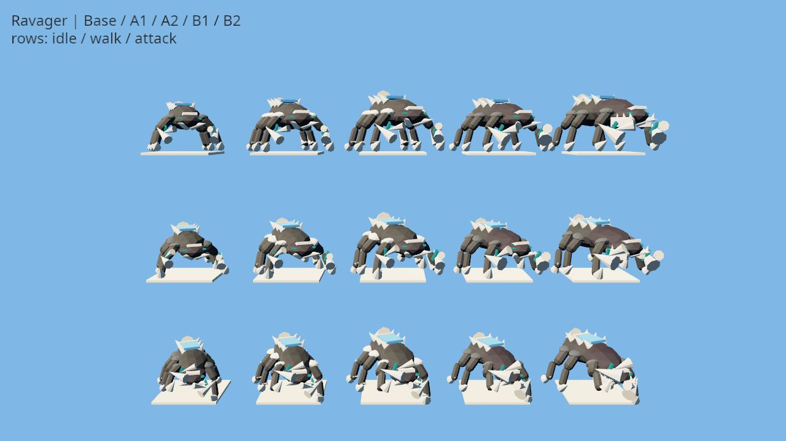

# R09 — Ravager delivery

Implementation: dedicated six-support kit, five forms, tripod gait, hook/cut,
collapse, Evolution and snapshot-driven frenzy closure. Authoritative same-prey
ramp, target/death/inactivity resets, absolute branch values and public progress
use existing bounded state (D-69). Public pools remain unchanged.

Validation level: work front. `cargo fmt -p tbg-core -p tbg-client` and
`git diff --check` passed. Preview packaging with the shared lock, two Cargo jobs,
BINARYEN_CORES=2 and existing `/tmp/tbg-pr20-web-target` returned **75: deferred:
shared validation slot busy**. No retry/poll/bypass; the owner-requested screenshots
will use a combined preview at consolidation. Screenshot/character commit pending.

Deferred focused regression command (shared lock, CARGO_BUILD_JOBS=2):
`cargo test -p tbg-core --lib ravager::tests -- --test-threads=1`.
The tests cover plain first hit, capped ramp, new summon prey, Strongholds,
canceled/new-target windups, inactivity, prey death, B2 and seat/public progress.
Frozen forms join the deduplicated `contract_roster` target at consolidation.
No full suite, balance run, multiplayer scenario or FPS measurement was run.

Pilot consolidation on the combined R08–R11 tree: the three R09 scenarios passed
inside `cargo test -p tbg-core --lib r0 -- --test-threads=1` (8 passed including
R08). The shared progress projection/form contracts passed with contract_protocol
(10) and contract_roster (5). These were under the shared host lock with two Cargo
jobs, using `/tmp/tbg-pr20-target`. The earlier exit-75 preview remains historical;
a new combined pilot preview was started after R10/R11 integration, not polled.

Desktop preview: the combined R08–R11 WASM build passed under the shared lock,
CARGO_BUILD_JOBS=2, BINARYEN_CORES=2 and the existing web cache. The 1280×720 actual
browser lineup was observed and saved: Base/A1/A2/B1/B2, idle/walk/attack anticipation.
Triangles: 1,974 / 2,058 / 2,058 / 1,974 / 2,082. A visibly adds leg guards and a long
trailing crest; B broadens the scythes and adds the serrated jaw shield.

Work-front delivery complete. Evidence was captured from the combined pilot tree;
the isolated historical character commit was not rebuilt separately. Full-clip
playback, live reconnect, performance and balance acceptance remain deferred.
