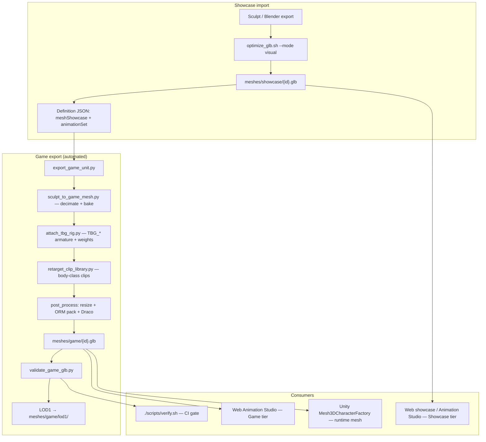

# Mesh pipeline — import high-poly characters for TBG

Use when you export characters from Blender/sculpt tools as static `.glb` files (embedded PBR, no rig).

## Full workflow (Phase 03)

Dual-tier assets: **showcase** (high-poly web preview) and **game** (skinned, clipped, mobile budget).



**One-time setup per body class:** clip library under `content/characters/animations/clips/{bodyClass}/` and animation set manifest in `content/characters/animation_sets/`.

**Batch all pilot units** (one Blender session, parallel post-process):

```bash
./tools/blender/setup.sh                    # rig templates (HumanoidLight / HumanoidHeavy)
./tools/mesh-pipeline/batch_seed_to_game.sh # all pilot_roster.json ids (~4–6 min for 20 units)
# Optional: TBG_BATCH_WORKERS=4  parallel gltf-transform (default 4)
# Subset:    ./tools/mesh-pipeline/batch_seed_to_game.sh demo_scout_01 demo_guard_01
./scripts/verify.sh                         # validates every meshes/game/*.glb
```

## Quick import (web studio preview)

```bash
# Default: visual mode — Draco only, preserves geometry + texture resolution
./tools/mesh-pipeline/optimize_glb.sh /path/to/sculpt.glb content/characters/meshes/showcase/my_unit.glb

# Smaller / faster preview (decimated mesh + 1024 textures)
./tools/mesh-pipeline/optimize_glb.sh --mode preview /path/to/sculpt.glb content/characters/meshes/my_unit_lod.glb

# Mobile game mesh (≤ 8k tris, 1024² textures, Draco) — static mesh only; use export_game_unit for skinned
./tools/mesh-pipeline/optimize_glb.sh --mode game --tri 8000 --tex 1024 \
  /path/to/showcase.glb content/characters/meshes/game/my_unit.glb
```

Requires Node.js (`npx @gltf-transform/cli`).

| Mode | What it does | Typical size | Visual |
|------|----------------|--------------|--------|
| **visual** (default) | Draco compress only | ~37–44 MB from ~80 MB source | Same as source |
| **preview** | Simplify + resize textures + Draco | ~4 MB | Lower fidelity |
| **game** | Simplify to tri budget + resize + Draco | ≤ 2 MB target | Mobile runtime (static) |

## Game unit export (skinned + clips)

Single unit:

```bash
python3 tools/blender/export_game_unit.py demo_sentinel_01
```

Pipeline steps:

1. **Coarsen** showcase via gltf-transform toward ~50k tris (fast pre-pass for 1M+ sculpts)
2. **Decimate** coarse mesh to `gameLod.triTarget` (~8k) in Blender with mesh cleanup
3. **Attach** `TBG_*` rig from `tools/blender/templates/` (`HumanoidLight` | `HumanoidHeavy`)
4. **Retarget** clips from animation set manifest onto unit skeleton
5. **Post-process** — texture resize, ORM pack, Draco, mesh-integrity gate
6. **Validate** — `validate_game_glb.py` (tris, bones, clips, file size)
7. **LOD1** — static mesh at ~50% tri budget in `meshes/game/lod1/`

**Authoring tip:** pre-normalize raw sculpts to ~50k tris before import (`optimize_glb.sh --mode game --tri 50000`) for faster batch exports. Game tier still lands at ~8k.

Python fallback (no Blender): proxy skinned mesh + clip stubs for CI/dev only.

Validate game meshes: `python3 tools/mesh-pipeline/validate_game_glb.py <path.glb>`  
Phase 04b baseline audit: `python3 tools/mesh_pipeline/baseline_audit.py --write` → `.local/phases/04b-biped-game-ready-pipeline/AUDIT.md`  
Weight quality gate: `python3 tools/mesh-pipeline/validate_game_glb.py --check-weights <path.glb>` (or `TBG_WEIGHT_GATE=1`)  
AI mesh input contract: `tools/blender/scripts/PREP-AI-MESH-SPEC.md`  
Budget reference: [BUDGETS.md](./BUDGETS.md)

### AI mesh prep (Phase 04b)

Normalize raw AI/sculpt GLBs to human scale (1.8 m, feet at Y=0, centered XZ) before showcase import:

```bash
./tools/blender/blender_cmd.sh --background --python tools/blender/scripts/prep_ai_mesh.py -- \
  /path/raw.glb /path/prepped.glb --report-json

python3 tools/mesh-pipeline/import_showcase_sculpts.py \
  --source-dir /path/to/downloads --prep --force --only demo_titan_01
```

Optional: `--voxel-remesh` (auto when >500k tris), `--z-up` for Z-up sources. See [PREP-AI-MESH-SPEC.md](../blender/scripts/PREP-AI-MESH-SPEC.md).

### Unified import (Phase 04b)

Single CLI from raw AI GLB → showcase → game export → weight gate:

```bash
python3 tools/blender/import_game_ready_unit.py \
  --source /path/raw.glb --id demo_scout_01 \
  --body-class HumanoidLight --animation-set humanoid_light_combat_v1 \
  --mixamo-fallback
```

Blocked when `rigException: true` in definition JSON — see `.local/phases/04b-biped-game-ready-pipeline/EXCEPTION-WORKFLOW.md`.

Batch export prints a weight-gate summary table (`TBG_WEIGHT_GATE=1` default in `batch_seed_to_game.sh`; CI sets it in `verify.sh`).

Web studio accepts showcase meshes up to **150 MB** per asset.

## Batch import showcase sculpts

Manifest: `content/characters/fixed_test_imports.json` (15 fixed test characters).

```bash
python3 tools/mesh-pipeline/bootstrap_fixed_test_characters.py  # new ids + roster order
python3 tools/mesh-pipeline/import_showcase_sculpts.py --source-dir /path/to/downloads --force
python3 -m character_studio export-all-cards   # refresh cards (PYTHONPATH=tools)
```

Import reads `fixed_test_imports.json` by default. Use `--only demo_scout_01` for a subset.

## Batch export game meshes

```bash
./tools/blender/setup.sh                    # HumanoidHeavy + HumanoidLight rig templates
./tools/mesh-pipeline/batch_seed_to_game.sh # all pilot_roster.json ids
./scripts/verify.sh                         # validates every meshes/game/*.glb
```

Showcase carousel continues to use `meshShowcase` tier; game meshes land in `meshes/game/` with LOD1 in `meshes/game/lod1/`.

Manual Blender weight/silhouette fixes: re-export individual ids after editing showcase sculpt.

## Definition JSON (dual-tier)

```json
{
  "meshShowcase": "content/characters/meshes/showcase/demo_sentinel_01.glb",
  "mesh": "content/characters/meshes/game/demo_sentinel_01.glb",
  "animationSet": "humanoid_heavy_combat_v1",
  "rigProfile": "tbg_biped_auto",
  "rigException": false,
  "gameLod": { "triTarget": 8000, "textureSize": 1024 }
}
```

Web preview loads `meshShowcase` when present; Unity runtime loads `mesh` (game tier).

## Studio demo units

| id | Source sculpt |
|----|----------------|
| `demo_scout_01` | Scout ranged pilot |
| `demo_striker_01` | DPS striker |
| `demo_guard_01` | Tank guard |
| `demo_sentinel_01` | Heavy sentinel (Phase 03 pilot) |

Open `./scripts/start-studio.sh` → **Animation Studio** tab → toggle Showcase / Game tier.

## Add a unit

1. Run `optimize_glb.sh` (visual mode) → `meshes/showcase/`.
2. Create `content/characters/definitions/{id}.json` with `assetMode: "mesh3d"`, `meshShowcase`, `animationSet`.
3. Run `export_game_unit.py {id}` → `meshes/game/`.
4. Omit external `textures` when the GLB already has embedded PBR.
5. Tint with `primaryColor` / `secondaryColor` in the studio.

## Animations

| Tier | Clips |
|------|-------|
| **Showcase** (static sculpt) | Procedural Idle / Attack / Death in browser when no skeletal clips |
| **Game** (skinned GLB) | Embedded clips from body-class library — Idle, Walk, Attack, Attack2, Ultimate, Death, Spawn |

Rig spec: `tools/blender/RIG-SPEC.md`. Animation sets: `content/characters/animation_sets/`.

## Limits

- Web showcase preview: **150 MB** per asset.
- Game target: see [BUDGETS.md](./BUDGETS.md) — ≤ 8k tris, ≤ 64 bones, ≤ 2 MB target GLB, 6–12 clips.
- CI: `./scripts/verify.sh` fails on budget violations and total game mesh repo size > 80 MB.

## Related

- Phase 03 plan: `.local/phases/03-game-animation-studio/`
- ADR: [docs/adr/ADR-004-dual-tier-mesh-animation.md](../../docs/adr/ADR-004-dual-tier-mesh-animation.md)
- Blender scripts: [tools/blender/README.md](../blender/README.md)
